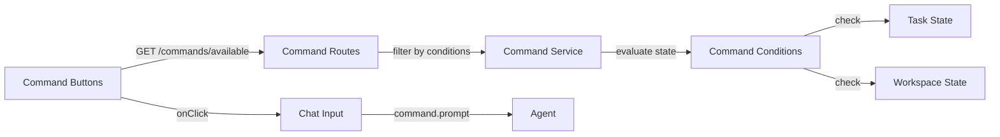

# Commands Architecture

## Quick Reference

### Key Files
- **Command Service**: `apps/backend/services/command.service.ts`
- **Command Conditions**: `apps/backend/utils/command-conditions.ts`
- **Command Types**: `packages/types/src/types/command.types.ts`
- **API Routes**: `apps/backend/routes/command.routes.ts`
- **Frontend Component**: `apps/frontend/src/features/tasks/components/chat-view/command-buttons.tsx`
- **Frontend Hook**: `apps/frontend/src/features/tasks/hooks/use-available-commands.ts`

### Core Methods
```typescript
// Command Service
getCommands(): Promise<Command[]>
getAvailableCommands(taskId: string): Promise<Command[]>
createCommand(command: CreateCommandDto): Promise<Command>
updateCommand(id: string, updates: UpdateCommandDto): Promise<Command>
deleteCommand(id: string): Promise<void>

// Command Conditions Utility
filterAvailableCommands(commands: Command[], task: Task, workspace?: Workspace): Command[]
evaluateCondition(condition: CommandCondition, task: Task, workspace?: Workspace): boolean
```

## Architecture Overview

Commands are contextual actions that appear as buttons in the UI based on task/workspace state. When clicked, they send predefined prompts to the agent.



## Implementation Guide

### 1. Command Structure
```typescript
// packages/types/src/types/command.types.ts
interface Command {
  id: string;
  title: string;
  prompt: string;
  description?: string;
  icon?: string;
  conditions?: CommandCondition[];
  createdAt: Date;
  updatedAt: Date;
}

interface CommandCondition {
  type: 'requiresUncommittedChanges' | 
        'requiresCommittedChanges' | 
        'requiresLastIterationError' | 
        'allowedGitSyncStatuses';
  value?: any; // For conditions that need parameters
}
```

### 2. Default Commands
```typescript
// apps/backend/services/command.service.ts
const DEFAULT_COMMANDS: Command[] = [
  {
    id: 'commit-changes',
    title: 'Commit Changes',
    prompt: 'Commit the current changes with an appropriate commit message',
    icon: 'git-commit',
    conditions: [{ type: 'requiresUncommittedChanges' }]
  },
  {
    id: 'push-changes',
    title: 'Push to Remote',
    prompt: 'Push the committed changes to the remote repository',
    icon: 'git-push',
    conditions: [{ type: 'requiresCommittedChanges' }]
  },
  {
    id: 'fix-errors',
    title: 'Fix Errors',
    prompt: 'Fix the errors from the previous iteration',
    icon: 'bug',
    conditions: [{ type: 'requiresLastIterationError' }]
  }
];
```

### 3. Condition Evaluation
```typescript
// apps/backend/utils/command-conditions.ts
function evaluateCondition(
  condition: CommandCondition,
  task: Task,
  workspace?: Workspace
): boolean {
  switch (condition.type) {
    case 'requiresUncommittedChanges':
      return workspace?.gitStatus?.hasUncommittedChanges ?? false;
      
    case 'requiresCommittedChanges':
      return workspace?.gitStatus?.ahead > 0;
      
    case 'requiresLastIterationError':
      const lastIteration = task.iterations[task.iterations.length - 1];
      return lastIteration?.status === 'error';
      
    case 'allowedGitSyncStatuses':
      return condition.value?.includes(workspace?.gitStatus?.syncStatus);
      
    default:
      return true;
  }
}
```

### 4. Frontend Integration
```typescript
// apps/frontend/src/features/tasks/hooks/use-available-commands.ts
export function useAvailableCommands(taskId: string) {
  return useQuery({
    queryKey: queryKeys.taskCommands(taskId),
    queryFn: () => api.commands.getAvailable(taskId),
  });
}

// apps/frontend/src/features/tasks/components/chat-view/command-buttons.tsx
export function CommandButtons({ taskId, onCommandClick }: Props) {
  const { data: commands, isLoading } = useAvailableCommands(taskId);
  
  if (!commands?.length) return null;
  
  return (
    <div className="flex gap-2">
      {commands.map(command => (
        <Button
          key={command.id}
          onClick={() => onCommandClick(command.prompt)}
          variant="outline"
          size="sm"
        >
          {command.icon && <Icon name={command.icon} />}
          {command.title}
        </Button>
      ))}
    </div>
  );
}
```

## Decision Trees

### When to Create Custom Commands
```
Need a quick action?
├─ Is it state-dependent? → Add conditions
├─ Is it always available? → No conditions needed
├─ Complex logic needed? → Consider agent prompting instead
└─ Multiple steps? → Break into separate commands
```

### Condition Selection
```
What triggers command visibility?
├─ Git state? → Use git-related conditions
├─ Error recovery? → Use requiresLastIterationError
├─ Custom state? → Extend condition types
└─ Always visible? → Omit conditions
```

## Common Patterns

### Adding New Command Types
```typescript
// 1. Define in types package
interface CommandCondition {
  type: 'requiresUncommittedChanges' | 
        'requiresCommittedChanges' | 
        'requiresLastIterationError' | 
        'allowedGitSyncStatuses' |
        'requiresTestFailure'; // New condition
}

// 2. Implement evaluation logic
case 'requiresTestFailure':
  return workspace?.lastTestRun?.failed ?? false;

// 3. Create command using new condition
{
  id: 'fix-tests',
  title: 'Fix Failing Tests',
  prompt: 'Fix the failing tests and ensure all tests pass',
  conditions: [{ type: 'requiresTestFailure' }]
}
```

### Dynamic Command Creation
```typescript
// Via API
POST /api/v1/commands
{
  "title": "Deploy to Staging",
  "prompt": "Deploy the current branch to the staging environment",
  "icon": "rocket",
  "conditions": [
    { "type": "allowedGitSyncStatuses", "value": ["synced"] }
  ]
}
```

## Troubleshooting

| Issue | Check | Solution |
|-------|-------|----------|
| Commands not showing | Task/workspace state | Verify conditions match current state |
| Wrong commands visible | Condition evaluation | Debug `filterAvailableCommands` |
| Command not executing | Prompt formatting | Check prompt is valid agent input |
