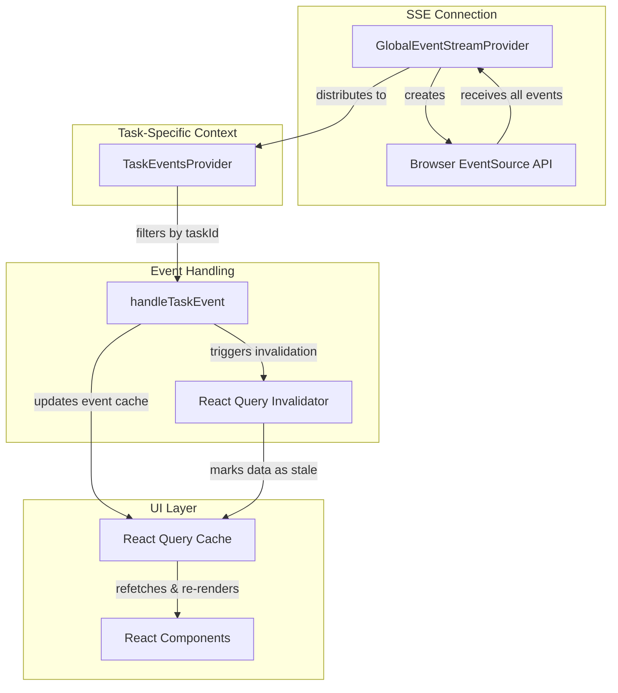

# Event Architecture

## 1. Overview

The Event system is the real-time communication backbone of the Moatless Vibe. It uses a global Server-Sent Events (SSE) stream to push live updates from the backend to the frontend, ensuring users see agent progress and state changes instantly without needing to refresh or poll the server.

This architecture is designed to be scalable, efficient, and resilient, providing a reactive and responsive user experience.

## 2. Architecture

The system is split between a backend that emits events and a frontend that consumes and reacts to them.

### Backend Architecture

The backend uses a simple but powerful event bus pattern.

```mermaid
graph TB
    subgraph "Backend Services"
        TS[Task Service]
        AS[Agent Service]
        WS[Workspace Service]
    end

    subgraph "Event Core"
        ES[EventService (EventEmitter)]
        ER[Events Route (/api/v1/events/stream)]
        SM[SSE Manager]
    end

    subgraph "Clients"
        Client1[Client 1]
        Client2[Client 2]
    end

    TS -->|emitEvent(event)| ES
    AS -->|emitEvent(event)| ES
    WS -->|emitEvent(event)| ES

    ER -->|subscribes to all events| ES
    ER -->|manages connections| SM

    SM -->|broadcasts events| Client1
    SM -->|broadcasts events| Client2
```

- **`EventService` (`apps/backend/services/event.service.ts`)**: This is the central event bus, built on Node.js's native `EventEmitter`. Any backend service can inject `EventService` and call `emitEvent(event)` to broadcast a state change.

- **Global SSE Route (`apps/backend/routes/events.ts`)**: A single endpoint, `/api/v1/events/stream`, is exposed for clients to connect to. This route subscribes to **all** events from the `EventService` and streams them to every connected client.

- **`sseManager` (`apps/backend/utils/sse-manager.js`)**: A simple utility to manage the list of active SSE connections and broadcast messages to them.

This design is straightforward: any event emitted on the backend is sent to every listening client. The responsibility of filtering and interpreting events lies with the frontend.

### Frontend Architecture

The frontend architecture is designed to consume the global event stream efficiently and translate events into specific, targeted UI updates using `react-query` for cache management.



- **`GlobalEventStreamProvider`**: A top-level provider that establishes and maintains a single, persistent SSE connection for the entire application. It receives all events from the backend, handles all cache invalidation for events with a `taskId`, and makes events available to subscribers.

- **`TaskDataProvider` (`apps/frontend/src/features/tasks/contexts/task-data-provider.tsx`)**: Now handles event subscription in addition to other task data. It subscribes to task-specific events from the global stream and maintains both historical events (from API) and streaming events (recent SSE events for UI components).

- **Event-Driven Cache Invalidation**: This is the core of the frontend's real-time functionality. The `GlobalEventStreamProvider` centralizes all invalidation logic, ensuring consistent behavior across the application and avoiding duplication.

## 3. Data Flow: From Backend Action to UI Update

Here is the end-to-end flow of an event:

1.  **Action**: A backend service performs an action (e.g., `taskService.closeTask(taskId)`).
2.  **Emission**: The service emits an event (e.g., a `RESULT` event with `status: 'closed'`).
3.  **Broadcast**: The `EventService` broadcasts this event to the global SSE route.
4.  **Streaming**: The SSE route sends the event as a JSON string to all connected frontend clients.
5.  **Reception**: The `GlobalEventStreamProvider` on the frontend receives the event.
6.  **Invalidation**: If the event has a `taskId`, the global provider:
    a.  **Consults Mapping**: Uses `EVENT_INVALIDATION_MAP` to determine affected queries.
    b.  **Invalidates Queries**: Calls `queryClient.invalidateQueries` for affected query keys.
    c.  **Invalidates Task Lists**: For status-affecting events, also invalidates task lists.
7.  **Task Subscription**: The `TaskDataProvider` receives the event through its subscription and updates both the historical event cache (`queryClient.setQueryData`) and the streaming events list.
8.  **Refetch & Re-render**: `react-query` automatically refetches the stale data, and any components subscribed to that data will re-render with the fresh information.

## 4. Event Types and Their Effects

The `EVENT_INVALIDATION_MAP` defines how the UI reacts to different events. This mapping is the source of truth for the event-driven architecture.

### Actively Used Event Types

| EventType | Invalidated Query Keys | Description |
| :--- | :--- | :--- |
| `MESSAGE` | (none) | AI message chunks from Claude. Handled by direct cache update, no invalidation needed. Contains tool calls, assistant messages, and user messages. |
| `RESULT` | `task`, `taskGitDiff`, `tasks.all` | The agent run finished. Updates the task, git diff, and all task lists. |
| `ERROR` | `task` | The agent run failed. Updates the task status to show the error. |
| `WORKSPACE` | `taskWorkspaceStatus`, `taskGitDiff` | Workspace events like file changes, command execution, or git operations. |
| `INPUT` | `task`, `tasks.all` | Task status changes or user inputs. Updates the task and task lists. |

### Deprecated/Unused Event Types

The following event types are defined in the codebase but are not actively used in production:
- `START` - Previously used for agent run start, now handled via INPUT events
- `STOP` - Previously used for agent stop, now handled via status changes
- `SERVER` - Defined but never emitted by any service
- `TOOL` - Tool calls are sent as MESSAGE events instead
- `COMPLETION` - Defined but never implemented

This system ensures that updates are both efficient and targeted. A `MESSAGE` event, which happens frequently during streaming, doesn't trigger any expensive data refetches, while a `RESULT` event, which signifies a major state change, correctly invalidates all relevant data views.

## 5. Event Payload Examples

The `payload` of each event carries the specific data for that event type. Here are some key examples:

### MESSAGE Event

A `MESSAGE` event contains the content chunks from the AI agent. The payload follows the structure of the Claude API.

```typescript
// From: @packages/types/types/claude.ts
interface ClaudeCodeSDKMessage {
  type: 'assistant' | 'user';
  message: {
    id: string;
    role: 'assistant' | 'user';
    content: Array<{
      type: 'text' | 'tool_use';
      text?: string;
      id?: string;
      name?: string;
      input?: Record<string, unknown>;
    }>;
    // ... other metadata
  };
}
```

### RESULT Event

A `RESULT` event is emitted when an agent run completes.

```typescript
// From: @packages/types/types/claude.ts
interface SDKResultMessage {
  is_error: boolean;
  result?: string;
  error?: {
    message: string;
    stack?: string;
  };
  duration_ms?: number;
  total_cost_usd?: number;
  // ... other metrics
}
```

### ERROR Event

An `ERROR` event signals a failure during processing.

```typescript
// From: @packages/types/types/event.ts
interface ErrorEventPayload {
  error: string;
  stackTrace?: string;
  code?: string;
}
```

### WORKSPACE Event

A `WORKSPACE` event indicates a change in the task's file environment. The payload is flexible but often includes details about what changed.

```typescript
// Example payload for a worktree creation
interface WorkspaceEventPayload {
  subType: 'worktree_created';
  path: string; // e.g., '/data/workspaces/task-123'
  branch: string; // e.g., 'moatless-pr-branch'
}
```

## 6. Implementation Notes

### Backend Caching (`EventService`)

The `EventService` on the backend implements an in-memory cache (`eventCache`) for events on a per-task basis.

- **Cache Population**: When events for a task are requested for the first time, they are loaded from storage and stored in the cache.
- **Cache Updates**: When a new event is emitted, it's appended to the cached array for that task.
- **`claude-code` Agents**: For tasks using the `claude-code` agent, the service has special logic to read events directly from the file system logs generated by that agent type, bypassing the standard event store for historical data.

### Stream Monitoring

The backend provides an endpoint to monitor the health and status of the global event stream.

- **Endpoint**: `GET /api/v1/events/stream/status`
- **Response**: This endpoint returns a JSON object with statistics, including:
  - `globalConnections`: Number of clients connected to the global stream.
  - `taskConnections`: A record of connections per task ID (currently unused as all connections are global).
  - `totalEventCount`: The total number of events broadcast since the server started.

This endpoint is useful for debugging and monitoring the real-time system's health.
