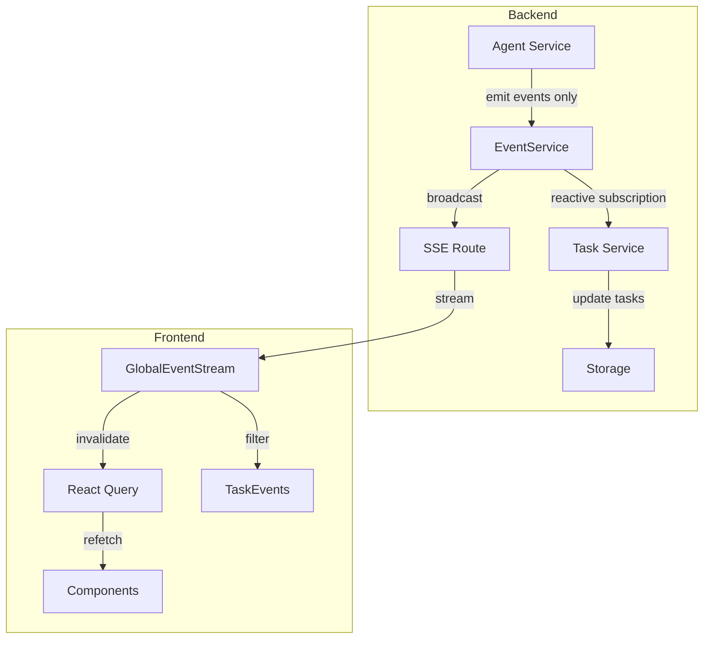

# Event Architecture

## Quick Reference

### Key Files
- **Event Service**: `apps/backend/services/event.service.ts`
- **SSE Manager**: `apps/backend/utils/sse-manager.js`
- **Event Routes**: `apps/backend/routes/events.ts`
- **Global Provider**: `apps/frontend/src/lib/providers/global-event-stream-provider.tsx`
- **Task Provider**: `apps/frontend/src/features/tasks/contexts/task-data-provider.tsx`
- **Event Types**: `packages/types/src/types/event.ts`

### Core Methods
```typescript
// Event Service
emitEvent(event: TaskEvent): Promise<void>
getTaskEvents(taskId: string): Promise<TaskEvent[]>

// Frontend Subscription
subscribeToTaskEvents(taskId: string, callback: (event: TaskEvent) => void): () => void
```

## Architecture Overview

Real-time communication via Server-Sent Events (SSE) with **reactive task updates** and centralized cache invalidation.



### Reactive Backend Architecture
- **Agent Service**: Emits events about execution progress
- **Event Service**: Broadcasts events to SSE clients AND internal subscribers
- **Task Service**: Subscribes to events and reactively updates task state
- **Storage**: Persists updated tasks after event-driven changes

## Implementation Guide

### 1. Emitting Events (Backend)
```typescript
// apps/backend/services/agent.service.ts
await this.eventService.emitEvent({
  taskId,
  iterationId,
  type: EventType.MESSAGE,
  payload: {
    type: 'assistant',
    message: { content: [{ type: 'text', text: 'Processing...' }] }
  }
});
```

### 2. Event Types & Invalidation Map
```typescript
// packages/types/src/types/event.ts
export enum EventType {
  MESSAGE = 'message',
  START = 'start',
  STOP = 'stop',
  RESULT = 'result',
  ERROR = 'error',
  WORKSPACE = 'workspace',
  SERVER = 'server',
  TOOL = 'tool',
  COMPLETION = 'completion',
  TASK_STATUS = 'task_status',
}

// apps/frontend/src/lib/providers/global-event-stream-provider.tsx
const EVENT_INVALIDATION_MAP: Record<EventType, string[]> = {
  [EventType.MESSAGE]: [], // No invalidation - direct cache update
  [EventType.RESULT]: ['task', 'taskGitDiff', 'tasks.all'],
  [EventType.ERROR]: ['task'],
  [EventType.WORKSPACE]: ['taskWorkspaceStatus', 'taskGitDiff'],
  [EventType.TASK_STATUS]: ['task', 'tasks.all'],
};
```

### 3. Subscribing to Events (Frontend)
```typescript
// In a React component
const { subscribeToTaskEvents } = useGlobalEventStream();

useEffect(() => {
  const unsubscribe = subscribeToTaskEvents(taskId, (event) => {
    // Handle event
    if (event.type === EventType.MESSAGE) {
      updateMessageCache(event.payload);
    }
  });
  
  return unsubscribe;
}, [taskId]);
```

### 4. Task-Specific Event Handling
```typescript
// apps/frontend/src/features/tasks/contexts/task-data-provider.tsx
const handleTaskEvent = (event: TaskEvent) => {
  // Update event cache
  queryClient.setQueryData(
    queryKeys.taskEvents(taskId),
    (old) => [...(old || []), event]
  );
  
  // Update streaming events for UI
  setStreamingEvents(prev => [...prev.slice(-99), event]);
};
```

## Event Flow

### Complete Event Journey (Reactive Pattern)
```
1. Agent Action → agentService.executeAgent()
2. Emit Event → eventService.emitEvent(event) with agentSessionId
3. Backend Reaction → taskService.handleAgentEvent() updates task
4. Broadcast → SSE route sends to all clients
5. Receive → GlobalEventStream receives
6. Invalidate → Consult EVENT_INVALIDATION_MAP
7. Update Cache → React Query invalidates queries
8. UI Update → Components re-render with new data
```

### Reactive Task Updates
The Task Service now subscribes to all events and reactively updates task state:

```typescript
// Task Service Event Subscription
this.eventService.subscribeAll((event: Event) => {
  if (this.shouldHandleEvent(event)) {
    this.handleAgentEvent(event)
  }
})

// Reactive handlers for different event types
private async handleAgentEvent(event: Event) {
  // Update agentSessionId if present
  if (event.agentSessionId && !iteration.agentSessionId) {
    iteration.agentSessionId = event.agentSessionId
  }
  
  // Handle specific event types
  switch (event.type) {
    case EventType.RESULT:
      // Update iteration status, cost, result, git data
      await this.handleResultEvent(task, iteration, event)
      break
    case EventType.ERROR:
      // Update iteration error, emit TASK_STATUS event
      await this.handleErrorEvent(task, iteration, event)
      break
    case EventType.MESSAGE:
      // Update context tokens
      await this.handleMessageEvent(task, iteration, event)
      break
  }
}

## Event Types

### Event Type Definitions
```typescript
// Base event structure
interface BaseEvent {
  eventId: string
  agentType: string
  type: EventType
  subType?: string
  taskId: string
  iterationId?: number
  timestamp?: Date
  isError: boolean
  contextTokens?: number
  numTurns?: number
  totalCost?: number
  agentSessionId?: string  // NEW: Available on all events for task updates
}
```

### Active Events
| Type | Purpose | Invalidates | Payload |
|------|---------|-------------|---------|
| `MESSAGE` | AI messages | None (direct update) | ClaudeCodeSDKMessage |
| `RESULT` | Run complete | task, gitDiff, lists | SDKResultMessage |
| `ERROR` | Run failed | task | `{ error: string, stackTrace?: string, code?: string }` |
| `WORKSPACE` | File changes | workspace, gitDiff | EventPayload (varies by subType) |
| `TASK_STATUS` | Status change | task, lists | `{ status: string, previousStatus: string, iterationNumber?: number }` |

### Unused Events
- `START`, `STOP` - Use TASK_STATUS events instead
- `SERVER` - Server events handled separately via preview environment
- `TOOL` - Tool usage included in MESSAGE events
- `COMPLETION` - Never implemented

## Common Patterns

### Event Payload Examples
```typescript
// MESSAGE event
{
  type: EventType.MESSAGE,
  payload: {
    type: 'assistant',
    message: {
      id: 'msg_123',
      role: 'assistant',
      content: [{ type: 'text', text: 'Processing your request...' }]
    }
  }
}

// TASK_STATUS event
{
  type: EventType.TASK_STATUS,
  subType: 'running', // The new status
  payload: {
    status: 'running',
    previousStatus: 'open',
    iterationNumber: 3
  }
}

// ERROR event
{
  type: EventType.ERROR,
  isError: true,
  payload: {
    error: 'Failed to execute command',
    stackTrace: 'Error: Failed to execute...',
    code: 'COMMAND_FAILED'
  }
}
```

### Emitting Custom Events
```typescript
// Backend service
class CustomService {
  async performAction(taskId: string) {
    // Do work...
    
    await this.eventService.emitEvent({
      taskId,
      type: EventType.WORKSPACE,
      payload: {
        subType: 'custom_action',
        data: { /* custom data */ }
      }
    });
  }
}
```

### Handling Events in Components
```typescript
// Frontend component
function TaskComponent({ taskId }: Props) {
  const { events, streamingEvents } = useTaskData();
  
  // Historical events from API
  const allEvents = events?.data || [];
  
  // Recent streaming events for real-time UI
  const recentMessages = streamingEvents
    .filter(e => e.type === EventType.MESSAGE)
    .slice(-10);
}
```

## Decision Trees

### When to Emit Events
```
State changed?
├─ Affects UI? → Emit event
├─ Background only? → Skip event
├─ Error occurred? → Emit ERROR event
└─ Run complete? → Emit RESULT event
```

### Choosing Event Types
```
What happened?
├─ AI message? → MESSAGE
├─ Run finished? → RESULT
├─ Error? → ERROR
├─ File change? → WORKSPACE
└─ Task status change? → TASK_STATUS
```

## Troubleshooting

| Issue | Check | Solution |
|-------|-------|----------|
| Events not received | SSE connection | Check `/api/v1/events/stream/status` |
| UI not updating | Invalidation map | Verify event type in map |
| Duplicate events | Event cache | Check deduplication logic |
| Connection drops | Network/timeout | Implement reconnection logic |