# Preview Environment Architecture

## Table of Contents
1. [Overview](#overview)
2. [Core Concepts](#core-concepts)
3. [Architecture](#architecture)
4. [Backend Implementation](#backend-implementation)
5. [Frontend Implementation](#frontend-implementation)
6. [Data Flow](#data-flow)
7. [Integration Points](#integration-points)
8. [Configuration](#configuration)
9. [Best Practices](#best-practices)
10. [Troubleshooting](#troubleshooting)

## Overview

### Purpose
The Preview Environment system provides live preview capabilities for web applications, enabling AI agents and developers to see real-time results of code changes. It orchestrates development servers, injects debugging capabilities, and provides a bridge between code modifications and visual feedback through sophisticated process management and real-time communication.

### Key Responsibilities
- Orchestrate development server lifecycle with intelligent process management
- Provide live preview with hot reload and automatic recovery
- Capture and stream console output with structured formatting
- Enable DOM inspection through injected debugging capabilities
- Detect and adapt to different web frameworks automatically
- Manage dynamic port allocation with conflict resolution
- Stream server logs in real-time via Server-Sent Events
- Recover orphaned processes after system crashes

### Position in Architecture
Preview environments serve as the visual feedback layer in the AI-driven development workflow. They transform code changes into running applications, providing both AI agents and developers with immediate validation of modifications. This system bridges the workspace execution environment with the user interface, making abstract code changes tangible and verifiable.

## Core Concepts

### Domain Terminology

| Term | Definition |
|------|------------|
| Preview Server | Development server instance running user's application |
| Inspector Script | Client-side JavaScript providing debugging and monitoring capabilities |
| Port Allocation | Dynamic assignment strategy for available network ports |
| Script Injection | Technique for adding inspector capabilities to preview applications |
| Server Handler | Process lifecycle manager for development servers |
| Console Capture | Real-time interception and streaming of console output |
| DOM Inspector | Interactive element selection and property inspection system |
| Framework Detector | Automatic identification of web framework and configuration |
| Process Recovery | Mechanism to restore servers after system crashes |
| Message Bridge | PostMessage-based communication between iframe and parent |
| Log Streamer | Real-time log forwarding via Server-Sent Events |

### Key Abstractions

The Preview Environment system operates through several layers of abstraction that ensure reliability and flexibility:

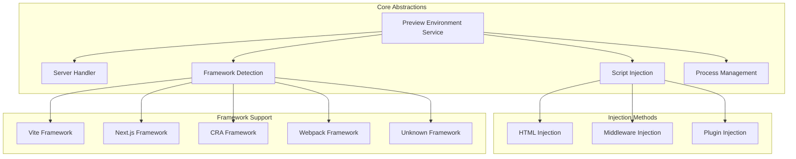

### Design Decisions

#### Process Management Strategy
- **Isolated process per preview** ensures clean separation and prevents conflicts
- **Graceful shutdown with timeout** allows servers to clean up resources properly
- **Automatic port recycling** prevents port exhaustion in long-running sessions
- **Process group management** ensures child processes are cleaned up

#### Communication Architecture
- **PostMessage API** provides secure cross-origin communication
- **Structured message protocol** ensures reliable parsing and routing
- **Event namespacing** prevents conflicts with application code
- **Bidirectional communication** enables inspector control from parent

#### Resilience Patterns
- **Metadata persistence** enables recovery after crashes
- **Health check polling** detects server failures quickly
- **Automatic restart** recovers from transient failures
- **Orphan process detection** cleans up abandoned servers

## Architecture

### High-Level Overview

The Preview Environment system orchestrates live application previews through a sophisticated multi-layered architecture that manages server processes, injects debugging capabilities, and provides real-time communication channels.

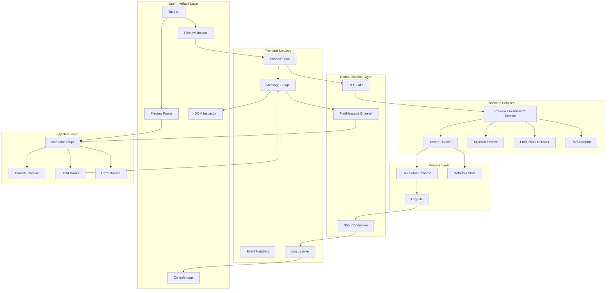

### Architectural Layers

#### 1. User Interface Layer
The visual components that users interact with directly:
- **Preview Frame**: Isolated iframe containing the running application
- **Preview Toolbar**: Controls for refresh, inspect, and server management
- **Console Logs**: Real-time display of application console output
- **DOM Inspector**: Interactive element selection and property viewer

#### 2. Frontend Services Layer
State management and coordination logic:
- **Preview Store**: Centralized state for preview status and configuration
- **Message Bridge**: Handles PostMessage communication with iframe
- **Event Handlers**: Process incoming messages from inspector script
- **Log Listener**: Consumes server log SSE stream

#### 3. Communication Layer
Bridges frontend and backend through multiple channels:
- **PostMessage Channel**: Secure iframe communication
- **SSE Connection**: Real-time server log streaming
- **REST API**: Server lifecycle management

#### 4. Backend Services Layer
Core business logic and process management:
- **Preview Environment Service**: Orchestrates all preview operations
- **Server Handler**: Manages individual server processes
- **Injection Service**: Modifies application to add inspector
- **Framework Detector**: Identifies web framework and configuration
- **Port Allocator**: Manages dynamic port assignment

#### 5. Process Layer
Low-level system resources:
- **Dev Server Process**: Actual running development server
- **Log File**: Persistent server output storage
- **Metadata Store**: Process recovery information

#### 6. Injected Layer
Client-side debugging capabilities:
- **Inspector Script**: Core debugging runtime
- **Console Capture**: Intercepts and forwards console calls
- **DOM Hooks**: Enables element selection and inspection
- **Error Monitor**: Catches and reports runtime errors

### Component Interaction Patterns

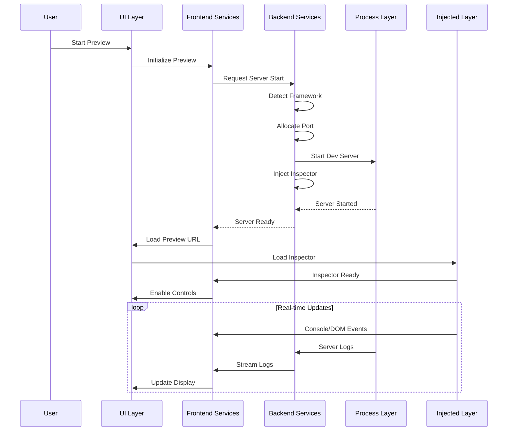

## Backend Implementation

### Service Layer Architecture

The backend implementation follows a layered architecture that separates concerns and ensures maintainability:

```mermaid
graph LR
    subgraph "API Layer"
        R1[/start Route]
        R2[/stop Route]
        R3[/status Route]
        R4[/logs Route]
    end
    
    subgraph "Service Layer"
        PES[Preview Environment Service]
        subgraph "Handlers"
            VH[Vite Handler]
            NH[Next Handler]
            CH[CRA Handler]
        end
    end
    
    subgraph "Infrastructure"
        PM[Process Manager]
        PA[Port Allocator]
        LM[Log Manager]
        MS[Metadata Store]
    end
    
    subgraph "External"
        FS[File System]
        NET[Network]
        PROC[OS Process]
    end
    
    R1 --> PES
    R2 --> PES
    R3 --> PES
    R4 --> PES
    
    PES --> VH
    PES --> NH
    PES --> CH
    
    VH --> PM
    NH --> PM
    CH --> PM
    
    PM --> PA
    PM --> LM
    PM --> MS
    
    PA --> NET
    LM --> FS
    MS --> FS
    PM --> PROC
```

### Server Lifecycle Management

The server lifecycle is carefully orchestrated to ensure reliable operation through the `PreviewEnvironmentService` class located at `apps/backend/services/preview-environment.service.ts`.

#### Lifecycle States and Transitions

The preview server progresses through several states during its lifecycle:

1. **Idle State**: The initial state where no server process exists
   - No resources allocated
   - Ready to accept start requests
   - Implementation: `PreviewEnvironmentService.servers` Map is empty for the task

2. **Starting State**: Server initialization begins
   - Triggered by: `PreviewEnvironmentService.startServer(taskId, workspaceDir)`
   - Framework detection initiated via `detectFramework()` 
   - Port allocation requested through `allocatePort()`
   - Inspector script injection performed
   - Child process spawned using Node.js `spawn()`
   - Implementation details in `ServerHandler.start()` method

3. **Detecting State**: Waiting for server to become ready
   - Monitor process stdout/stderr for port binding messages
   - Pattern matching against framework-specific ready indicators
   - Timeout handler set (default 30 seconds)
   - Health check polling begins
   - Implementation: `ServerHandler.waitForPort()` method

4. **Running State**: Server is operational
   - Port successfully detected and verified
   - Health checks running every 5 seconds
   - Log streaming active via file tailing
   - Process metrics collected
   - Implementation: `ServerHandler` maintains process reference and metadata

5. **Failed State**: Server failed to start or crashed
   - Timeout exceeded without detecting port
   - Process exited with non-zero code
   - Dependencies missing or build errors
   - Resources cleaned up via `ServerHandler.cleanup()`
   - Error details stored for diagnostics

6. **Stopping State**: Graceful shutdown initiated
   - Triggered by: `PreviewEnvironmentService.stopServer(taskId)`
   - SIGTERM sent to process group
   - 5-second grace period for cleanup
   - SIGKILL sent if process doesn't exit
   - Port released back to pool

7. **Restarting State**: Server restart requested
   - Current process stopped gracefully
   - Configuration preserved
   - New process started with same settings
   - Useful for applying configuration changes

8. **Crashed State**: Unexpected process termination
   - Detected via process 'exit' event
   - Exit code and signal captured
   - Automatic recovery attempted (up to 3 times)
   - Implementation: `ServerHandler` exit event handler

9. **Recovering State**: Attempting automatic recovery
   - Analyze crash reason from logs
   - Clean up orphaned resources
   - Restart with exponential backoff
   - Track retry count to prevent infinite loops

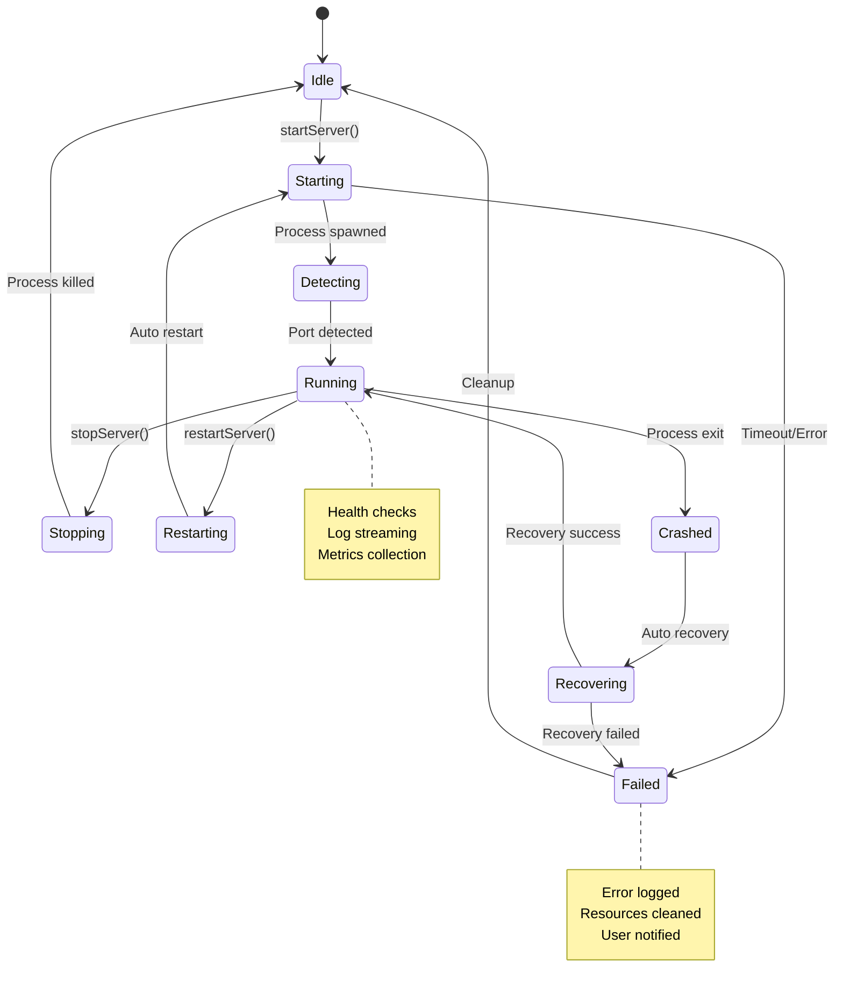

#### Key Implementation Files

- **Main Service**: `apps/backend/services/preview-environment.service.ts`
  - `PreviewEnvironmentService` class orchestrates all preview operations
  - `ServerHandler` inner class manages individual server processes
  - `startServer()`, `stopServer()`, `restartServer()` methods
  - Process lifecycle event handlers

- **State Management**: `apps/backend/services/preview-environment.service.ts`
  - `servers: Map<string, ServerHandler>` tracks active servers
  - `metadata` directory stores process recovery information
  - Health check intervals and retry logic

- **Process Management**: `apps/backend/services/preview-environment.service.ts`
  - Child process spawning with proper environment setup
  - Process group management for clean shutdown
  - Signal handling (SIGTERM, SIGKILL)
  - Stdout/stderr stream processing

### Port Allocation Strategy

Dynamic port allocation prevents conflicts and ensures scalability. The port allocation logic is implemented in `apps/backend/services/preview-environment.service.ts` within the `allocatePort()` method.

#### Port Allocation Process

1. **Allocation Request Initiated**
   - Triggered when starting a new preview server
   - Called from `PreviewEnvironmentService.startServer()`
   - Checks if command contains placeholder like `{PORT}`

2. **Command Analysis**
   - **Port in Command**: If the start command contains `{PORT}` placeholder
     - System will dynamically allocate a port
     - Replace placeholder with allocated port number
     - Example: `vite --port {PORT}` becomes `vite --port 3001`
   - **No Port Specified**: If command doesn't specify port
     - Let the framework choose its default port
     - Detect the port from server output later

3. **Dynamic Port Request**
   - Implementation: `allocatePort()` method
   - Creates a temporary server to find available port
   - Uses Node.js net module: `server.listen(0)`
   - OS assigns random available port
   - Port number extracted and server closed

4. **Port Registry Management**
   - Active ports tracked in `activePorts` Set
   - Prevents allocation of already-used ports
   - Released when server stops
   - Persisted in metadata for recovery

5. **Port Substitution**
   - Replace `{PORT}` in command string
   - Pass port via environment variables
   - Update framework configuration if needed

6. **Port Reservation**
   - Add to active ports registry
   - Store in server metadata
   - Used for health checks and connections

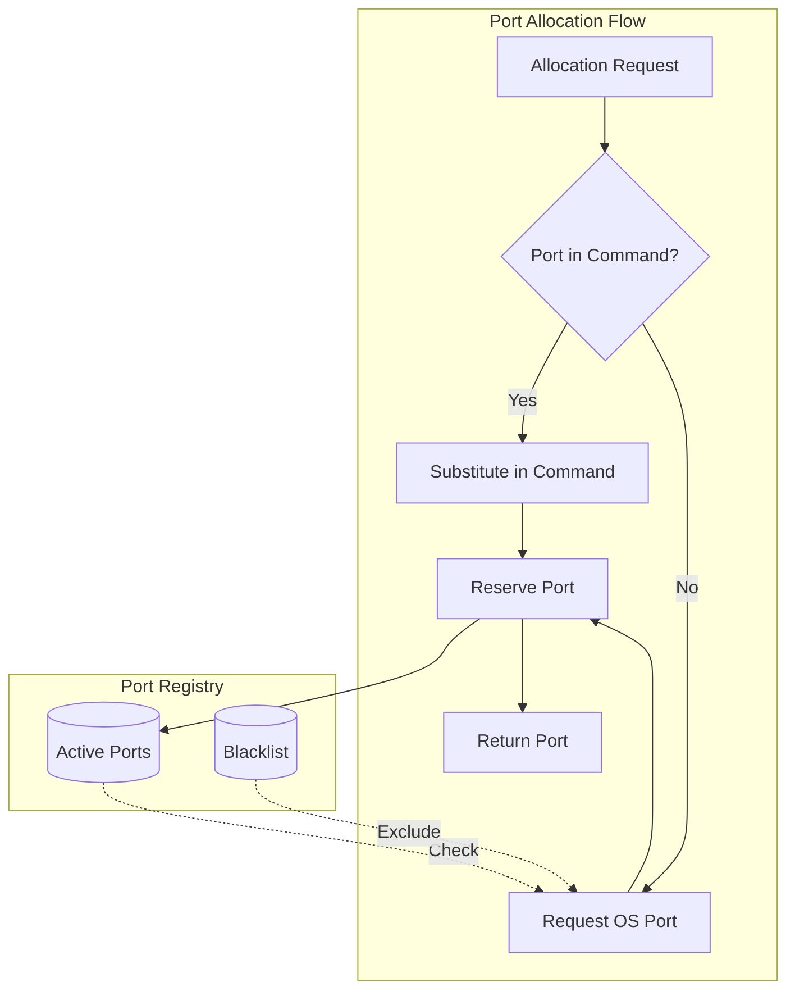

#### Implementation Details

```typescript
// From apps/backend/services/preview-environment.service.ts
private async allocatePort(): Promise<number> {
  return new Promise((resolve, reject) => {
    const server = createServer();
    server.listen(0, () => {
      const address = server.address();
      if (address && typeof address !== 'string') {
        const port = address.port;
        server.close(() => resolve(port));
      }
    });
  });
}
```

#### Port Conflict Resolution

1. **Detection**: EADDRINUSE error when binding
2. **Resolution**: Automatically retry with new port
3. **Blacklist**: Mark failed ports as unavailable
4. **Fallback**: Use port range scanning if needed

#### Key Files

- **Port Allocation**: `apps/backend/services/preview-environment.service.ts`
  - `allocatePort()` method for dynamic allocation
  - `activePorts` Set for tracking
  - Port substitution in command strings

- **Port Detection**: `apps/backend/services/preview-environment.service.ts`
  - `waitForPort()` monitors server output
  - Regex patterns for different frameworks
  - Timeout handling for detection failures

### Process Recovery Mechanism

The system can recover from crashes and restore preview environments. This is crucial for maintaining preview servers across system restarts, crashes, or unexpected shutdowns. The recovery logic is implemented in `apps/backend/services/preview-environment.service.ts`.

#### Recovery Process Overview

When the preview service starts, it automatically attempts to recover any previously running preview servers. This ensures that long-running preview sessions aren't lost due to backend restarts.

##### 1. Service Initialization
- **Trigger**: PreviewEnvironmentService constructor or init method
- **Location**: `apps/backend/services/preview-environment.service.ts`
- **Actions**:
  1. Create metadata directory if not exists (`data/preview-servers/`)
  2. Scan directory for `.json` metadata files
  3. Each file represents a previously running server

##### 2. Metadata File Structure
Each running server saves metadata to `data/preview-servers/[taskId].json`:
```json
{
  "taskId": "task-123",
  "pid": 12345,
  "port": 3001,
  "framework": "vite",
  "workspaceDir": "/path/to/workspace",
  "startCommand": "npm run dev",
  "startedAt": "2024-01-15T10:30:00Z",
  "env": {
    "NODE_ENV": "development"
  }
}
```

##### 3. Process Validation
For each metadata file found:
1. **Check Process Existence**
   - Use `process.kill(pid, 0)` to test if process exists
   - No signal sent, just checks if process is alive
   - Handles permission errors gracefully

2. **Process Still Alive**
   - Create new `ServerHandler` instance
   - Attach to existing process using saved PID
   - Restore output streams and monitoring
   - Add to active servers map
   - Resume health checks and log streaming

3. **Process Dead**
   - Delete stale metadata file
   - Clean up any allocated resources
   - Log recovery failure for debugging
   - Port automatically freed by OS

##### 4. Handler Restoration
When reattaching to a live process:
```typescript
// From ServerHandler class
private async restoreFromMetadata(metadata: ServerMetadata) {
  this.process = { pid: metadata.pid } as ChildProcess;
  this.port = metadata.port;
  this.framework = metadata.framework;
  
  // Resume health monitoring
  this.startHealthCheck();
  
  // Resume log file monitoring
  this.watchLogFile(metadata.taskId);
}
```

##### 5. Recovery Completion
- Mark service as ready for new requests
- Log recovery statistics
- Emit recovery events for monitoring

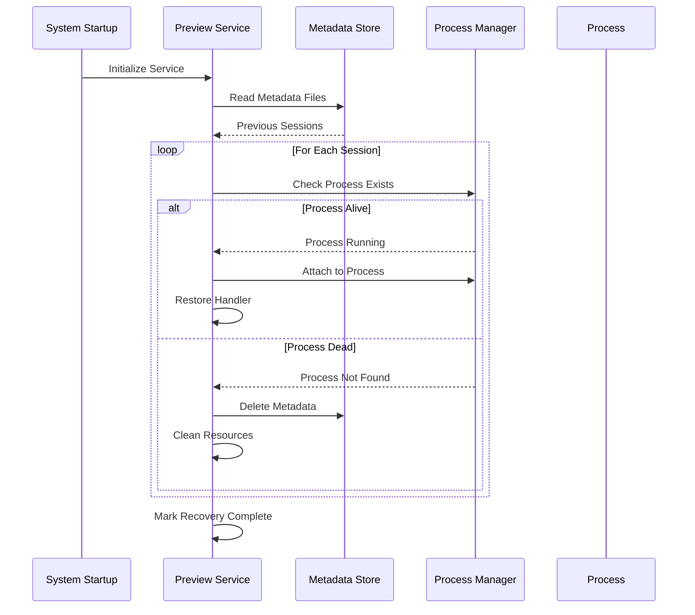

#### Orphaned Process Handling

The system also handles orphaned processes that may be running without metadata:

1. **Port Scanning**: Check common development ports (3000-3010)
2. **Process Identification**: Match process command lines
3. **Adoption**: Create metadata for orphaned processes
4. **Cleanup**: Kill unrecognized development servers

#### Recovery Edge Cases

1. **PID Reuse**: Validate process command matches expected pattern
2. **Port Conflicts**: Handle cases where port is now used by another process
3. **Workspace Changes**: Verify workspace directory still exists
4. **Permission Issues**: Handle cases where process is owned by different user

#### Implementation Files

- **Recovery Logic**: `apps/backend/services/preview-environment.service.ts`
  - `recoverServers()` method scans and restores
  - `ServerHandler.restoreFromMetadata()` reattaches to process
  - Metadata file management

- **Metadata Storage**: `data/preview-servers/`
  - JSON files with server state
  - Cleaned up on successful shutdown
  - Used for crash recovery

- **Process Utilities**: `apps/backend/utils/process.utils.ts`
  - Process existence checking
  - Safe signal sending
  - Command line parsing

### Script Injection System

The system primarily uses a **Proxy Injection** strategy, which is the default and recommended method. It also supports other methods like HTML Injection and Middleware Injection as fallbacks or for specific use cases.

#### Injection Strategy Overview

The system selects an appropriate injection strategy based on the detected framework. Each strategy ensures the inspector script loads without breaking the application.

##### 1. HTML Injection (Vite, CRA, Static Sites)
**Implementation**: Direct modification of `index.html`
- **File Location**: `[workspace]/index.html` or `[workspace]/public/index.html`
- **Process**:
  1. Read existing HTML file
  2. Find closing `</body>` tag
  3. Insert script tag before it
  4. Write modified HTML back
- **Script Tag**: `<script src="/.moatless/inspector.js"></script>`
- **Advantages**: Simple, works with hot reload
- **Limitations**: Only works for HTML-based apps

##### 2. Middleware Injection (Next.js, Express)
**Implementation**: Custom middleware file
- **File Location**: `[workspace]/middleware.ts` or custom middleware
- **Process**:
  1. Create middleware that injects script
  2. Configure framework to use middleware
  3. Serve inspector script on special route
- **Example**:
  ```typescript
  // middleware.ts
  export function middleware(request: Request) {
    if (request.url.includes('/.moatless/inspector.js')) {
      return new Response(inspectorScript, {
        headers: { 'Content-Type': 'application/javascript' }
      });
    }
  }
  ```

##### 3. Plugin Injection (Vite, Webpack)
**Implementation**: Build tool plugin
- **Process**:
  1. Create plugin configuration
  2. Hook into HTML transformation
  3. Inject script during build
- **Vite Example**:
  ```javascript
  // vite-plugin-inspector.js
  export default {
    name: 'moatless-inspector',
    transformIndexHtml(html) {
      return html.replace('</body>', '<script src="/.moatless/inspector.js"></script></body>');
    }
  }
  ```

##### 4. Proxy Injection (Default for New Environments)
**Implementation**: Reverse proxy with on-the-fly response modification
- **File Location**: No files modified - injection happens in memory
- **Process**:
  1. Start proxy server on different port (dev server port + 1000)
  2. Proxy all requests to actual dev server
  3. Intercept HTML responses and inject script before `</body>` tag
  4. Pass through all other responses unchanged
- **Advantages**: 
  - No files modified on disk - prevents accidental commits
  - Works universally across all frameworks
  - Transparent to the development server
  - Easy to enable/disable without cleanup
- **Implementation**: `apps/backend/services/preview-proxy.service.ts`
- **Use Cases**: Default method for all environments to avoid file modification

#### Proxy Injection Implementation Details

The proxy injection system provides a universal, non-invasive method for script injection that works across all frameworks without modifying any files on disk.

##### Architecture

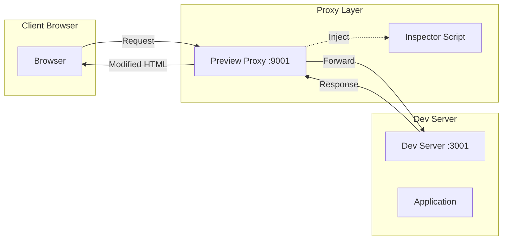

##### Key Components

1. **PreviewProxyService** (`preview-proxy.service.ts`)
   - HTTP proxy server implementation
   - Response interception and modification
   - Port management and lifecycle

2. **Request Handling**
   ```typescript
   // All requests proxied to dev server
   GET /api/data → localhost:3001/api/data
   GET /style.css → localhost:3001/style.css
   GET /index.html → localhost:3001/index.html (modified)
   ```

3. **HTML Response Modification**
   - Detects `Content-Type: text/html`
   - Buffers complete response
   - Injects script before `</body>` tag
   - Updates content-length header

4. **Non-HTML Pass-through**
   - CSS, JS, images, etc. passed unchanged
   - Maintains streaming for large files
   - Preserves all headers

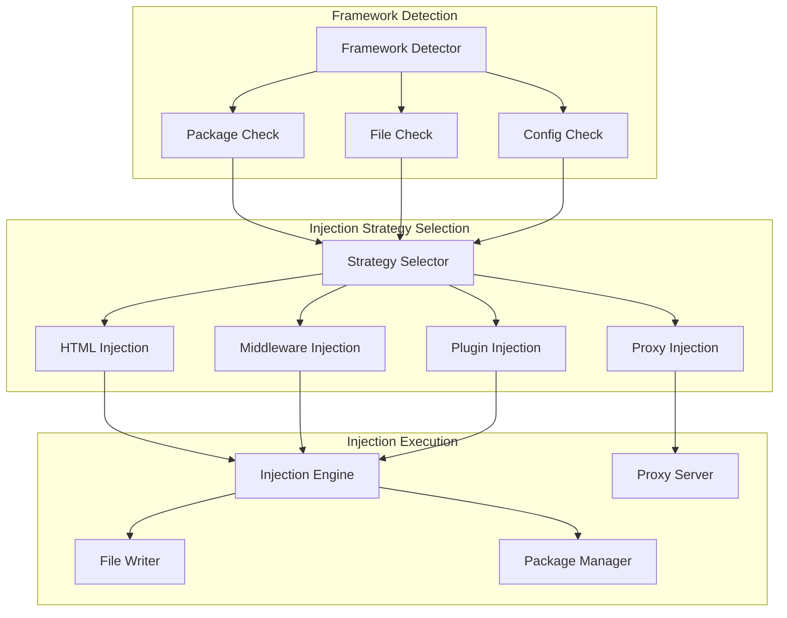

#### Inspector Script Details

The inspector script (`/.moatless/inspector.js`) provides debugging capabilities:

##### Core Features
1. **Console Interception**
   ```javascript
   // Capture all console methods
   ['log', 'warn', 'error', 'info', 'debug'].forEach(method => {
     const original = console[method];
     console[method] = (...args) => {
       original.apply(console, args);
       window.parent.postMessage({
         type: 'CONSOLE_LOG',
         level: method,
         args: serializeArgs(args),
         timestamp: Date.now(),
         stack: new Error().stack
       }, '*');
     };
   });
   ```

2. **DOM Inspection**
   ```javascript
   // Element selection handler
   document.addEventListener('click', (e) => {
     if (!inspectorMode) return;
     e.preventDefault();
     e.stopPropagation();
     
     const element = e.target;
     const data = {
       tagName: element.tagName,
       id: element.id,
       className: element.className,
       attributes: getAttributes(element),
       computedStyle: getComputedStyle(element),
       rect: element.getBoundingClientRect()
     };
     
     window.parent.postMessage({
       type: 'DOM_ELEMENT',
       data
     }, '*');
   });
   ```

3. **Error Capture**
   ```javascript
   window.addEventListener('error', (event) => {
     window.parent.postMessage({
       type: 'ERROR',
       message: event.message,
       filename: event.filename,
       line: event.lineno,
       column: event.colno,
       stack: event.error?.stack
     }, '*');
   });
   ```

#### Injection File Management

The system manages injected files carefully:

1. **File Creation**: `apps/backend/services/preview-environment.service.ts`
   - Creates `.moatless` directory in workspace
   - Writes inspector.js with minified content
   - Sets appropriate file permissions

2. **File Serving**: Development servers serve the file
   - Most dev servers serve static files from root
   - Special handling for restrictive frameworks

3. **Cleanup**: Files removed when preview stops
   - Prevents cluttering user workspace
   - Restores original files if modified

#### Implementation Files

- **Main Implementation**: `apps/backend/services/preview-environment.service.ts`
  - `injectInspector()` method orchestrates injection
  - `generateInspectorScript()` creates the script content
  - Strategy selection based on framework

- **Framework Configs**: `packages/shared/constants/preview-config.ts`
  - Injection strategies per framework
  - File paths and patterns
  - Script templates

- **Type Definitions**: 
  - `packages/shared/types/preview-environment.ts`: Backend metadata types
  - `packages/shared/types/repository.ts`: Framework and injection types  
  - `apps/frontend/src/features/preview/types.ts`: Frontend component types

#### Injection Strategy by Framework

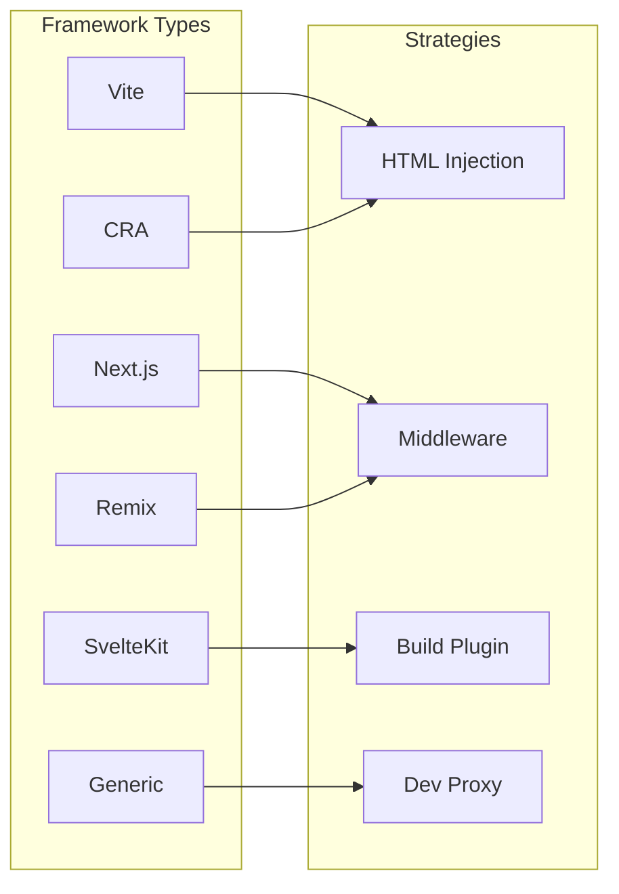

### Inspector Script Architecture

The inspector script provides debugging capabilities through a modular architecture:

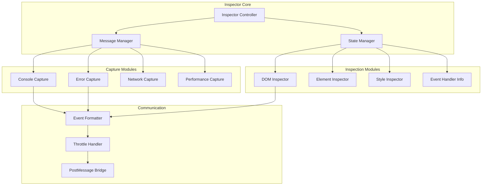

### API Layer

The API layer provides RESTful endpoints for preview environment management:

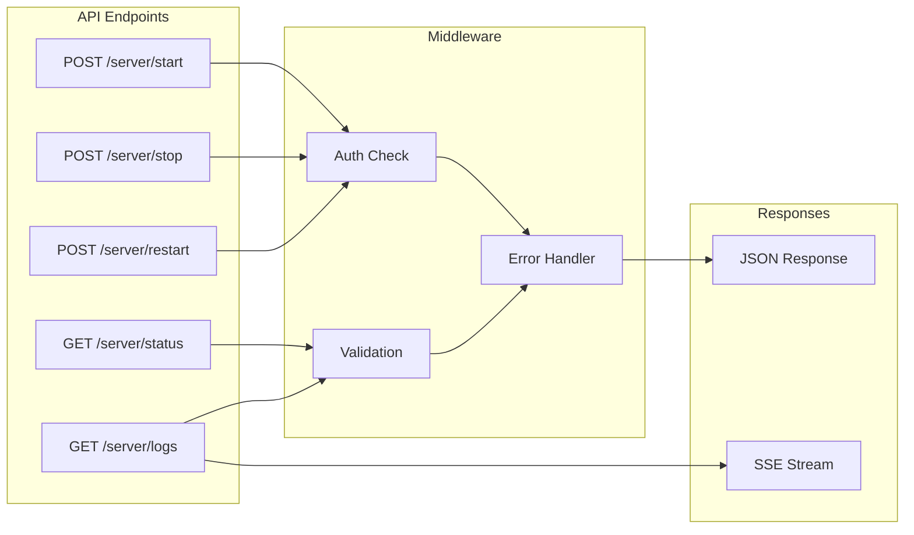

### Business Logic Flows

#### Server Start Flow

The server start process involves multiple coordinated steps across several components. Here's what happens when a preview server is started:

##### 1. API Request Reception
- **Entry Point**: `apps/backend/routes/preview.ts` - POST `/api/preview/start`
- **Validation**: Request body validated for required `taskId` and `workspaceDir`
- **Service Call**: Routes to `PreviewEnvironmentService.startServer()`

##### 2. Framework Detection Phase
- **Service Method**: `apps/backend/services/repository.service.ts` - `detectFramework()`
- **Process**:
  1. Read workspace `package.json` file
  2. Analyze dependencies for framework indicators
  3. Check for framework-specific config files
  4. Return configuration including:
     - Framework type (vite, nextjs, etc.)
     - Start command template
     - Port binding pattern regex
     - Injection strategy

##### 3. Port Allocation Phase  
- **Service Method**: `apps/backend/services/preview-environment.service.ts` - `allocatePort()`
- **Process**:
  1. Check if start command contains `{PORT}` placeholder
  2. Create temporary server on port 0 (OS assigns free port)
  3. Extract assigned port number
  4. Close temporary server
  5. Add port to active ports registry
  6. Replace `{PORT}` in command with allocated port

##### 4. Inspector Script Injection
- **Service Method**: `apps/backend/services/preview-environment.service.ts` - `injectInspector()`
- **Process**:
  1. Select injection strategy based on framework
  2. For HTML injection (Vite, CRA):
     - Modify `index.html` to include inspector script
  3. For middleware injection (Next.js):
     - Add custom middleware file
  4. For plugin injection:
     - Modify framework config to load inspector
  5. Create inspector script file in workspace

##### 5. Server Process Creation
- **Class**: `ServerHandler` in `apps/backend/services/preview-environment.service.ts`
- **Process**:
  1. Create new ServerHandler instance with configuration
  2. Set up process environment variables
  3. Spawn child process using Node.js `spawn()`
  4. Configure stdio streams for output capture
  5. Set up event handlers for process lifecycle

##### 6. Server Ready Detection
- **Method**: `ServerHandler.waitForPort()` 
- **Process**:
  1. Monitor process stdout/stderr streams
  2. Apply framework-specific regex patterns
  3. Extract port number when pattern matches
  4. Set up 30-second timeout for detection
  5. Start health check polling once port detected

##### 7. Metadata Persistence
- **Location**: `data/preview-servers/[taskId].json`
- **Contents**:
  - Process ID for recovery
  - Allocated port number
  - Framework configuration
  - Start timestamp
  - Workspace directory

##### 8. Response to Client
- **Response Format**:
  ```json
  {
    "port": 3001,
    "url": "http://localhost:3001",
    "pid": 12345,
    "framework": "vite"
  }
  ```

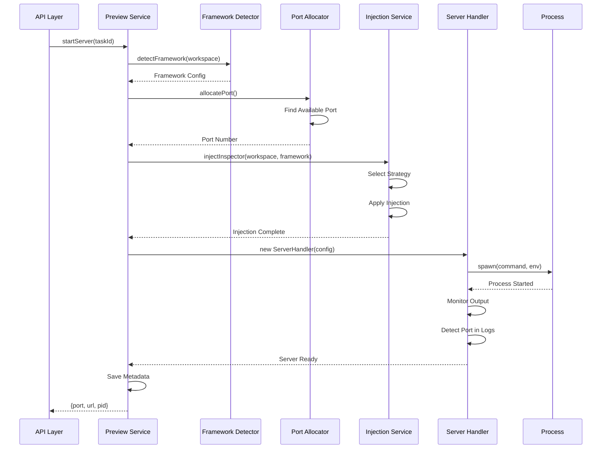

##### Key Implementation Files

- **API Routes**: Server management endpoints (check backend routes)
  - POST `/server/start` endpoint  
  - POST `/server/stop` endpoint
  - POST `/server/restart` endpoint
  - GET `/server/status` endpoint
  - GET `/server/logs` endpoint (SSE)

- **Main Service**: `apps/backend/services/preview-environment.service.ts`
  - `startServer()` orchestrates entire flow
  - `ServerHandler` class manages process lifecycle
  - `allocatePort()` handles dynamic port assignment
  - `injectInspector()` adds debugging capabilities

- **Framework Detection**: `apps/backend/services/repository.service.ts`
  - `detectFramework()` analyzes project structure
  - Returns framework-specific configuration

- **Type Definitions**: `packages/shared/types/preview-environment.ts`
  - `PreviewEnvironmentMetadata` interface
  - `PreviewEnvironmentOptions` interface
  - `ProcessValidation` interface

#### Framework Detection Logic

The framework detection system automatically identifies the web framework being used and configures the preview environment accordingly. This logic is implemented in:

- **Backend Service**: `apps/backend/services/preview-environment.service.ts` - `detectFramework()` method (lines 646-716)
- **Repository Service**: `apps/backend/services/repository.service.ts` - May contain additional framework detection logic
- **Type Definitions**: Framework types are defined in `packages/shared/types/repository.ts`

##### Detection Process Steps

1. **Start Detection**
   - Initiated when creating a repository or starting preview
   - Scans workspace directory for framework indicators
   - Returns framework type and suggested configuration

2. **Package.json Analysis**
   - **File Check**: First verify if `package.json` exists
   - **Parse Contents**: Read and parse JSON safely
   - **Extract Dependencies**: Check both `dependencies` and `devDependencies`
   - Implementation: `RepositoryService.detectFramework()`

3. **Dependency Checking**
   - **Vite Detection**: Look for `vite` in dependencies
     - Also check for `@vitejs/plugin-react`
     - Identifies Vite-based React projects
   - **Next.js Detection**: Look for `next` package
     - Check for `next.config.js` as confirmation
     - Detect App Router vs Pages Router
   - **Create React App**: Look for `react-scripts`
     - Check for `public/index.html` structure
   - **Remix Detection**: Look for `@remix-run/node`
     - Check for `remix.config.js`
   - **SvelteKit Detection**: Look for `@sveltejs/kit`
     - Check for `svelte.config.js`

4. **Configuration File Checks**
   - Scan for framework-specific config files
   - `vite.config.ts/js` for Vite
   - `next.config.js` for Next.js
   - `remix.config.js` for Remix
   - Fall back to file structure analysis

5. **Structure Analysis** 
   - If no package.json, analyze directory structure
   - Look for `index.html` in root (static sites)
   - Check for `src` directory patterns
   - Identify build output directories

6. **Framework Configuration**
   - Return appropriate start command
   - Set build command if applicable
   - Configure port strategy
   - Set injection method

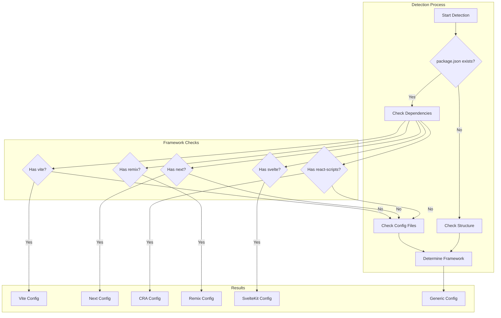

##### Implementation Example

```typescript
// From apps/backend/services/repository.service.ts
async detectFramework(workspaceDir: string): Promise<FrameworkConfig> {
  const packageJsonPath = path.join(workspaceDir, 'package.json');
  
  if (await fileExists(packageJsonPath)) {
    const packageJson = JSON.parse(await fs.readFile(packageJsonPath, 'utf-8'));
    const deps = { ...packageJson.dependencies, ...packageJson.devDependencies };
    
    if (deps.vite) {
      return {
        type: 'vite',
        startCommand: 'npm run dev',
        buildCommand: 'npm run build',
        readyPattern: /Local:.*http/,
        injectionStrategy: 'html'
      };
    }
    
    if (deps.next) {
      return {
        type: 'nextjs', 
        startCommand: 'npm run dev',
        buildCommand: 'npm run build',
        readyPattern: /ready on.*http/i,
        injectionStrategy: 'middleware'
      };
    }
    // ... more framework checks
  }
}
```

##### Key Implementation Files

- **Main Detection**: `apps/backend/services/preview-environment.service.ts`
  - `detectFramework()` method (lines 646-716) with detection logic
  - Returns `FrameworkDetection` interface with type, version, and config files
  - Used internally by preview service for injection strategy

- **Script Injection Strategy**: `apps/backend/services/preview-environment.service.ts`
  - `getScriptInjectionStrategy()` method (lines 1096-1133)
  - Maps framework types to injection methods
  - Returns `ScriptInjectionStrategy` for each framework

- **Type Definitions**: `packages/shared/types/repository.ts`
  - Framework-related types and configurations
  - `ScriptInjectionStrategy` interface
  - Shared between frontend and backend services

## Frontend Implementation

### Component Architecture

The frontend implementation follows a modular architecture that separates UI components, state management, and communication logic. The preview system is organized as a feature module with clear separation of concerns.

#### Feature Organization Structure

The preview feature is located at `apps/frontend/src/features/preview/` with the following structure:

1. **API Layer** (`api/`)
   - `server.ts`: HTTP client methods for server control
   - Handles start, stop, restart, status, and logs requests
   - Integrates with React Query for caching

2. **Components** (`components/`)
   - `preview.tsx`: Main preview container component
   - `inspector-panel.tsx`: Element inspection and property viewer
   - Additional UI components for preview functionality

3. **Hooks** (`hooks/`)
   - `use-server.ts`: Server lifecycle management (start, stop, restart, status, logs)
   - `use-preview.ts`: Preview context and state management
   - `use-preview-connection.ts`: Message bridge and PostMessage communication
   - `use-inspector.ts`: DOM inspection state

4. **Types** (`types.ts`)
   - `ElementInfo`: Information about selected DOM elements
   - `PreviewConfig`: Preview configuration settings
   - `PreviewProps`: Component prop types

5. **Exports** (`index.ts`)
   - Centralized exports for all preview features
   - Exposes API, components, hooks, and types

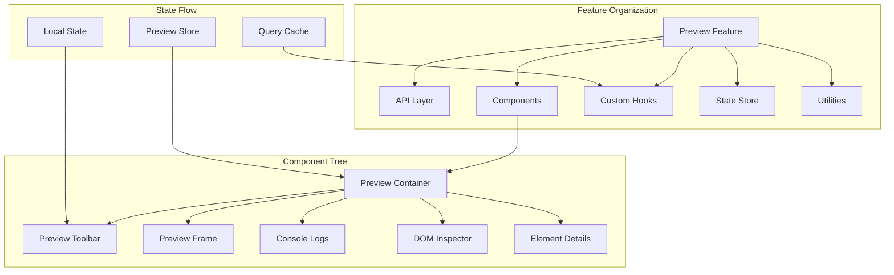

#### Key Component Responsibilities

**Preview Container** (`apps/frontend/src/features/preview/components/preview.tsx`)
- Main preview component that integrates all functionality
- Manages iframe for preview display
- Coordinates with PreviewProvider context
- Handles loading and error states

**Inspector Panel** (`apps/frontend/src/features/preview/components/inspector-panel.tsx`)
- Displays selected DOM element information
- Shows element properties and attributes
- Provides interactive element inspection
- Manages inspector UI state

**Preview Provider** (`apps/frontend/src/features/preview/hooks/use-preview.tsx`)
- Context provider for preview state management
- Manages server connection and status
- Coordinates message passing between components
- Handles preview configuration

**Server Hooks** (`apps/frontend/src/features/preview/hooks/use-server.ts`)
- `useStartServer`: Starts preview server
- `useStopServer`: Stops preview server
- `useRestartServer`: Restarts preview server
- `useServerStatus`: Monitors server status
- `useServerLogs`: Streams server logs

**Preview Connection** (`apps/frontend/src/features/preview/hooks/use-preview-connection.ts`)
- Manages PostMessage communication with iframe
- Handles inspector script messages
- Coordinates DOM selection events
- Manages console log capture

#### Implementation Files

- **Main Components**: `apps/frontend/src/features/preview/components/`
  - `preview.tsx`: Main container component
  - `inspector-panel.tsx`: DOM inspection interface

- **Hooks**: `apps/frontend/src/features/preview/hooks/`
  - `use-server.ts`: Server management hooks
  - `use-preview.ts`: Preview context provider
  - `use-preview-connection.ts`: Message bridge implementation
  - `use-inspector.ts`: DOM inspection logic

- **API Integration**: `apps/frontend/src/features/preview/api/`
  - `server.ts`: HTTP API client with React Query integration
  - Type-safe methods for all server operations

- **Type Definitions**: `apps/frontend/src/features/preview/types.ts`
  - Component prop types and data interfaces
  - Shared types for preview functionality

### State Management Architecture

The preview system uses a hybrid state management approach:

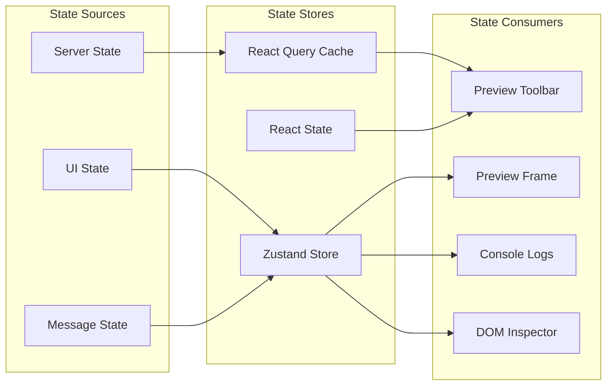

### Message Communication Flow

The message system enables bidirectional communication between the parent window and preview iframe. This is implemented through a secure PostMessage bridge with structured message protocols, including script health monitoring via periodic heartbeat messages.

#### Message Bridge Architecture

The message bridge consists of several components working together:

1. **Parent Window Side** (`apps/frontend/src/features/preview/utils/message-bridge.ts`)
   - Message event listener with origin validation
   - Handler registry for different message types
   - Outbound message queue for reliability
   - Type-safe message interfaces

2. **Inspector Script** (`apps/backend/services/preview-environment.service.ts` - injected script)
   - Loaded into preview iframe on startup
   - Intercepts console methods
   - Handles DOM event listeners
   - Sends structured messages to parent

3. **Message Types** (from inspector script)
   - `INSPECTOR_SCRIPT_LOADED`: Script loaded and initialized
   - `console`: Console method calls with level and message
   - `ELEMENT_CLICKED`: Selected element information
   - `NETWORK_REQUEST`: Network activity tracking
   - `SCROLL_POSITION`: Scroll position updates
   - `ROUTE_CHANGE`: Navigation events
   - `TOGGLE_SELECTOR`: Enable/disable inspection mode
   - `SELECTOR_STATE_RESPONSE`: Current selector state
   - `HEARTBEAT`: Periodic health check messages (every 5 seconds)

#### Communication Flow Steps

##### Initialization Phase
1. **Handler Registration**: Parent window sets up message listeners
   - Implementation: `MessageBridge.initialize()`
   - Validates message origin matches preview URL
   - Routes messages to appropriate handlers

2. **Inspector Loading**: Preview iframe loads inspector script
   - Script injected via HTML modification or middleware
   - Establishes global hooks for console and DOM

3. **Ready Signal**: Inspector confirms initialization
   - Sends `INSPECTOR_SCRIPT_LOADED` message to parent
   - Includes version payload
   - Parent enables preview controls

##### Console Capture Flow
1. **Method Interception**: Inspector overrides console methods
   ```javascript
   const originalLog = console.log;
   console.log = (...args) => {
     originalLog.apply(console, args);
     sendToParent({ 
       type: 'console', 
       level: 'log', 
       message: args.map(a => String(a)).join(' '),
       args,
       source: 'preview-iframe'
     });
   };
   ```

2. **Message Transmission**: Structured data sent to parent
   - Arguments serialized safely
   - Timestamp and stack trace included
   - Handles circular references

3. **Parent Processing**: Message bridge receives and processes
   - Deserializes arguments for display
   - Updates console viewer component
   - Stores in preview store

##### DOM Inspection Flow
1. **Mode Toggle**: User activates inspection mode
   - Parent sends `TOGGLE_SELECTOR` message with payload
   - Inspector toggles overlay.toggle() based on state
   - Updates cursor and event listeners

2. **Element Selection**: User clicks element in preview
   - Click event captured and prevented
   - Element marked with data attributes
   - Element information extracted

3. **Data Transmission**: Element data sent to parent
   - Message type: `ELEMENT_CLICKED`
   - Includes tagName, attrs, text, and rect
   - Supports multi-select with meta/ctrl key

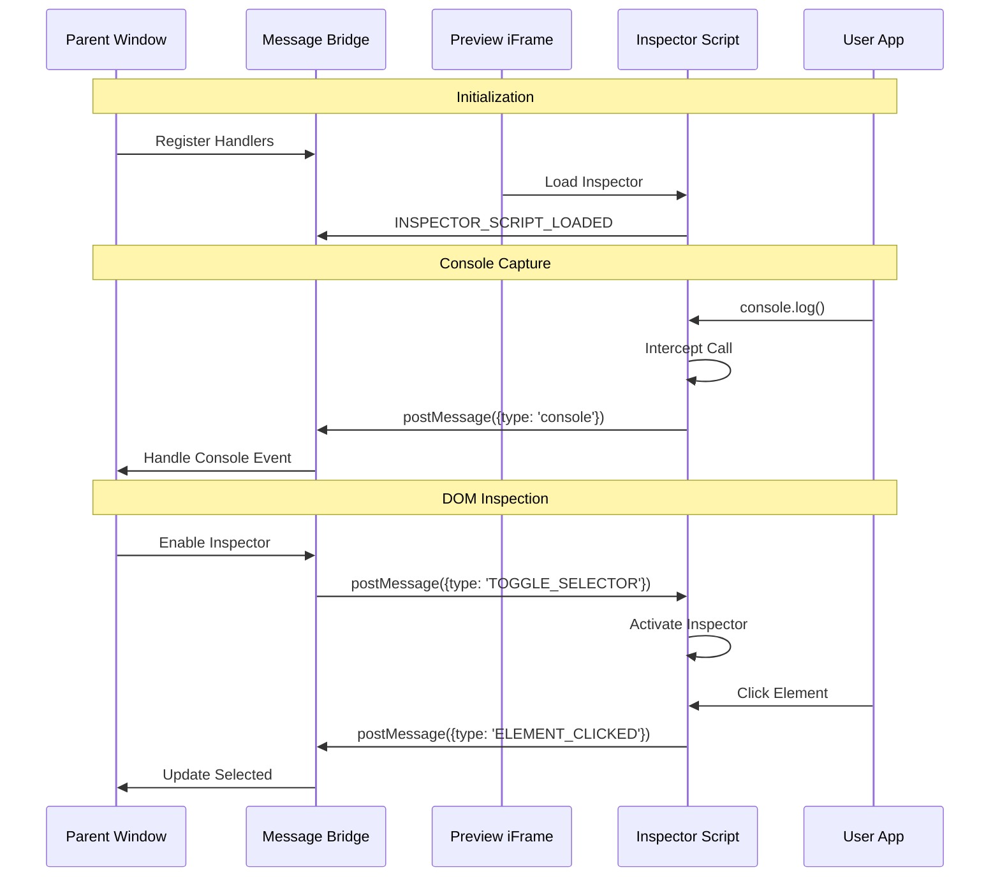

##### Script Health Monitoring
The preview system includes real-time monitoring of the inspector script health status:

1. **Health States**:
   - `not-injected`: Script has not been injected into the preview
   - `injected-not-reachable`: Script was injected but is not responding
   - `injected-reachable`: Script is active and communicating

2. **Heartbeat Mechanism**:
   - Inspector script sends `HEARTBEAT` messages every 5 seconds
   - Frontend tracks last heartbeat timestamp
   - Status marked as "not reachable" if no heartbeat for 10 seconds

3. **Visual Indicator**:
   - Located in the server control popup
   - Shows current script health with appropriate icon and color
   - Provides tooltip with detailed status description

#### Security Considerations

1. **Origin Validation**: All messages validated against expected origin
2. **Message Structure**: Strict typing prevents injection attacks
3. **Sanitization**: User data sanitized before display
4. **Sandboxing**: Iframe runs with restricted permissions

#### Implementation Files

- **Message Bridge**: `apps/frontend/src/features/preview/hooks/use-preview-connection.ts`
  - Hook-based message handling implementation
  - Origin validation and error handling
  - Coordinates with preview context

- **Inspector Script**: Generated by `apps/backend/services/preview-environment.service.ts`
  - Console method interception
  - DOM event handling
  - PostMessage communication
  - Embedded directly in `getPreviewInspectorScript()` method

- **Type Definitions**: `apps/frontend/src/features/preview/types.ts`
  - Frontend message and element types
  - Component prop interfaces
  - Preview configuration types

### Real-time Updates Architecture

The system provides multiple real-time update channels:

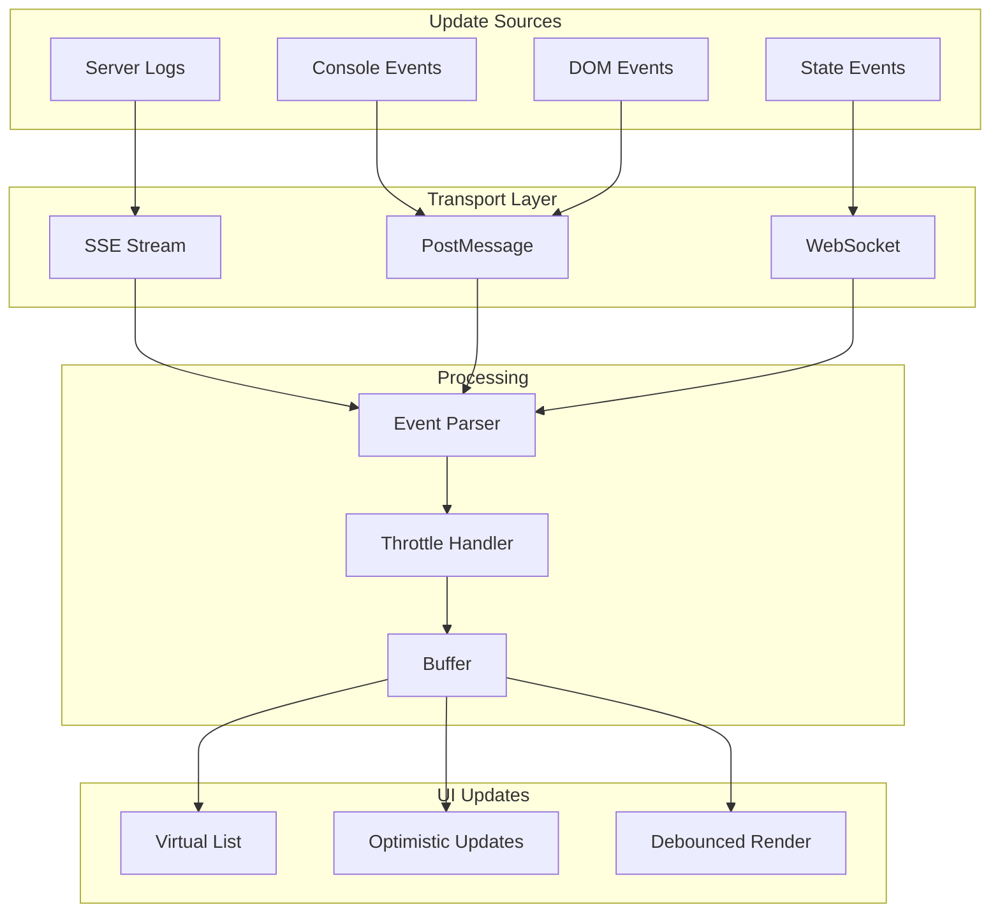

## Data Flow

### End-to-End Preview Lifecycle

The complete preview lifecycle involves coordination across multiple system layers:

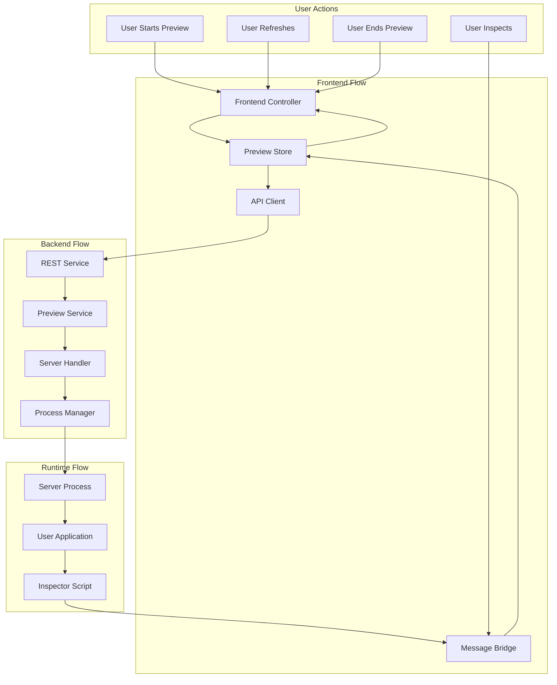

### Concurrent Operations Management

The system handles multiple concurrent operations gracefully:

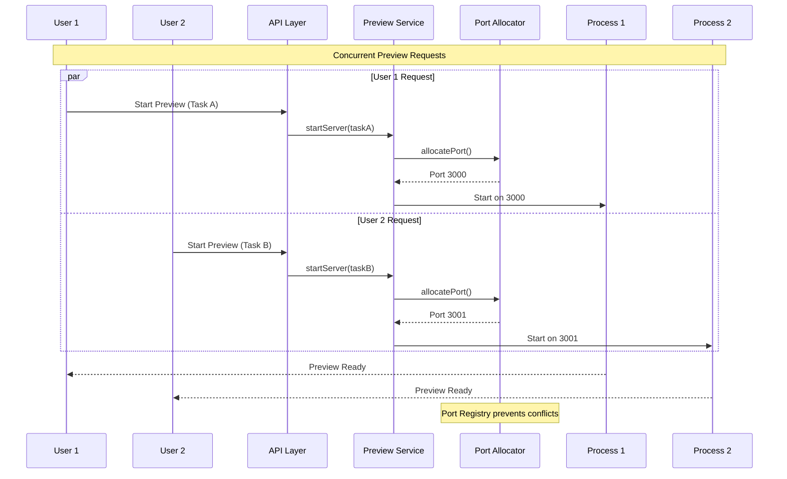

### Error Recovery Flow

The system includes comprehensive error recovery mechanisms:

```mermaid
stateDiagram-v2
    [*] --> Normal: Server Running
    
    Normal --> Error: Exception/Crash
    Error --> Detection: Health Check
    
    Detection --> Analysis: Determine Cause
    
    Analysis --> Recoverable: Transient Error
    Analysis --> Fatal: Permanent Error
    
    Recoverable --> Restart: Auto Restart
    Restart --> Normal: Success
    Restart --> Retry: Failed
    
    Retry --> Retry: Retry Count < Max
    Retry --> Fatal: Max Retries
    
    Fatal --> Cleanup: Stop Server
    Cleanup --> Notify: Alert User
    Notify --> [*]
    
    note right of Recoverable
        Port conflicts
        Memory issues
        Build errors
    end note
    
    note right of Fatal
        Missing dependencies
        Syntax errors
        Config issues
    end note
```

## Integration Points

### System Integration Architecture

The Preview Environment system integrates with multiple components across the architecture:

```mermaid
graph TB
    subgraph "Preview System"
        PES[Preview Environment Service]
        SH[Server Handler]
        IS[Injection Service]
    end
    
    subgraph "Core Services"
        TS[Task Service]
        WS[Workspace Service]
        RS[Repository Service]
        ES[Event Service]
    end
    
    subgraph "Infrastructure"
        FS[File System]
        NET[Network Layer]
        PROC[Process Manager]
        LOG[Logging System]
    end
    
    subgraph "External Systems"
        NPM[NPM Registry]
        GIT[Git Repository]
        DOCKER[Docker Engine]
    end
    
    PES --> TS
    PES --> WS
    PES --> RS
    PES --> ES
    
    SH --> FS
    SH --> NET
    SH --> PROC
    SH --> LOG
    
    IS --> NPM
    WS --> GIT
    RS --> DOCKER
```

### Event Integration Pattern

The system participates in the event-driven architecture through well-defined event contracts:

```mermaid
sequenceDiagram
    participant PS as Preview Service
    participant ES as Event Service
    participant TS as Task Service
    participant UI as UI Components
    
    Note over PS,UI: Server Lifecycle Events
    
    PS->>ES: emit('preview.server.starting')
    ES->>UI: Broadcast Event
    
    PS->>ES: emit('preview.server.started')
    ES->>UI: Broadcast Event
    ES->>TS: Update Task Status
    
    PS->>ES: emit('preview.server.error')
    ES->>UI: Broadcast Event
    ES->>TS: Mark Task Error
    
    Note over PS,UI: Consuming Events
    
    TS->>ES: emit('task.deleted')
    ES->>PS: Handle Event
    PS->>PS: Stop Preview Server
    
    TS->>ES: emit('workspace.reset')
    ES->>PS: Handle Event
    PS->>PS: Restart Preview Server
```

### Data Contract Architecture

The system defines clear data contracts for integration:

```mermaid
graph LR
    subgraph "Input Contracts"
        TC[Task Config]
        WC[Workspace Config]
        RC[Repository Config]
    end
    
    subgraph "Preview System"
        PES[Preview Service]
        VAL[Validator]
        TRANS[Transformer]
    end
    
    subgraph "Output Contracts"
        SS[Server Status]
        CE[Console Events]
        EI[Element Info]
        ERR[Error Details]
    end
    
    TC --> VAL
    WC --> VAL
    RC --> VAL
    
    VAL --> PES
    PES --> TRANS
    
    TRANS --> SS
    TRANS --> CE
    TRANS --> EI
    TRANS --> ERR
```

## Configuration

### Configuration Architecture

The Preview Environment system uses a layered configuration approach:

```mermaid
graph TD
    subgraph "Configuration Sources"
        ENV[Environment Variables]
        CONF[Config Files]
        REPO[Repository Settings]
        RUNTIME[Runtime Detection]
    end
    
    subgraph "Configuration Layers"
        DEFAULT[Default Config]
        FRAMEWORK[Framework Config]
        PROJECT[Project Config]
        USER[User Overrides]
    end
    
    subgraph "Configuration Resolution"
        MERGER[Config Merger]
        VALIDATOR[Config Validator]
        RESOLVER[Config Resolver]
    end
    
    ENV --> DEFAULT
    CONF --> FRAMEWORK
    REPO --> PROJECT
    RUNTIME --> USER
    
    DEFAULT --> MERGER
    FRAMEWORK --> MERGER
    PROJECT --> MERGER
    USER --> MERGER
    
    MERGER --> VALIDATOR
    VALIDATOR --> RESOLVER
```

### Framework Auto-Configuration

The system automatically configures itself based on detected frameworks:

```mermaid
graph LR
    subgraph "Detection"
        DET[Framework Detector]
        PKG[package.json]
        FILES[Config Files]
        STRUCT[File Structure]
    end
    
    subgraph "Framework Profiles"
        VITE[Vite Profile]
        NEXT[Next.js Profile]
        CRA[CRA Profile]
        REMIX[Remix Profile]
        CUSTOM[Custom Profile]
    end
    
    subgraph "Configuration Output"
        PORT[Port Strategy]
        INJ[Injection Method]
        CMD[Start Command]
        DETECT[Detection Pattern]
    end
    
    DET --> PKG
    DET --> FILES
    DET --> STRUCT
    
    PKG --> VITE
    PKG --> NEXT
    PKG --> CRA
    PKG --> REMIX
    FILES --> CUSTOM
    
    VITE --> PORT
    VITE --> INJ
    VITE --> CMD
    VITE --> DETECT
```
