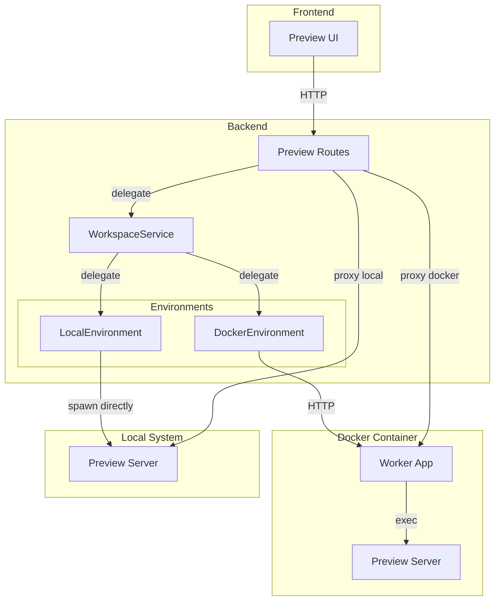

# Preview Environment Architecture

> **LLM Implementation Guide**: This document provides comprehensive guidance for implementing and working with preview server functionality in both Local and Docker environments. It covers the delegation pattern, HTTP proxy architecture, and environment-specific server management flows.

## Quick Reference

### Key Files and Methods
- **Workspace Service**: `apps/backend/services/workspace.service.ts`
  - `startServer()` - Always delegates to environment
  - `stopServer()` - Always delegates to environment
  - `getServerStatus()` - Always delegates to environment
  - `getServerLogs()` - Always delegates to environment
- **Local Environment**: `apps/backend/environments/local-environment.ts`
  - `startServer()` - Direct server process management with metadata persistence
  - `stopServer()` - Direct server cleanup with orphaned process detection
  - `getServerStatus()` - Process validation and recovery
  - `getServerLogs()` - Log retrieval from files or running processes
  - `getPreviewPort()` - Returns direct port for local access
- **Docker Environment**: `apps/backend/environments/docker-environment.ts`
  - `startServer()` - HTTP request to worker
  - `stopServer()` - HTTP request to worker
  - `proxyPreviewRequest()` - Proxy through worker
- **Worker App**: `apps/backend/worker-app.ts`
  - `/server/start` - Start server in container
  - `/server/stop` - Stop server in container
  - `/server/proxy/*` - Proxy preview requests
- **Preview Routes**: `apps/backend/routes/preview-environment.ts`
  - Proxy endpoint with HTML injection

### Architecture Overview



## Environment-Specific Flows

### Delegation Pattern
The WorkspaceService now checks if the environment implements server methods and delegates to them:

```typescript
// WorkspaceService.startServer()
async startServer(taskId: string): Promise<unknown> {
  const workspace = await this.getOrCreateWorkspace(taskId)
  const environment = workspace.getEnvironment()
  
  // Check if environment has server methods and delegate
  if (environment.startServer) {
    return environment.startServer()
  }
  
  // Fallback to preview environment service for backwards compatibility
  return this.previewEnvironmentService.startServer(taskId)
}
```

### Local Environment Flow

#### 1. Server Start (Local)
```typescript
// Frontend calls API
POST /api/v1/tasks/:taskId/server/start

// Route delegates to WorkspaceService
await services.workspace.startServer(taskId)

// WorkspaceService checks environment
if (environment.startServer) {
  // LocalEnvironment delegates to PreviewEnvironmentService
  return this.previewEnvironmentService.startServer(this.taskId)
}

// PreviewEnvironmentService spawns local process
const serverHandler = new ServerHandler({
  taskId,
  workspaceDir: this.workspacePath,
  command: framework.command,
  framework: framework.type
})
await serverHandler.start()
```

#### 2. Preview Access (Local)
```typescript
// Frontend requests preview
GET /api/v1/tasks/:taskId/proxy/*

// Route checks for direct port access
const serverPort = workspace.getPreviewPort() // Returns port for local

if (serverPort) {
  // Direct proxy to local server
  const response = await proxy(`http://localhost:${serverPort}${path}`)
  // Inject inspector script for HTML responses
  return injectScript(response)
}
```

### Docker Environment Flow

#### 1. Server Start (Docker)
```typescript
// Frontend calls API
POST /api/v1/tasks/:taskId/server/start

// Route delegates to WorkspaceService
await services.workspace.startServer(taskId)

// WorkspaceService checks environment
if (environment.startServer) {
  // DockerEnvironment sends HTTP request to worker
  const response = await fetch(
    `http://localhost:${this.workerPortMapping.hostPort}/server/start`,
    {
      method: 'POST',
      body: JSON.stringify({
        serverCommand: repositoryConfig.previewConfig.serverStartCommand,
        envVars: repositoryConfig.codeExecution.envVars
      })
    }
  )
}

// Worker receives request and starts server in container
app.post('/server/start', async (c) => {
  const { serverCommand, envVars } = await c.req.json()
  
  previewServer = new PreviewServer(
    taskId,
    '/repo', // workspace in container
    serverCommand,
    envVars
  )
  
  return previewServer.start()
})
```

#### 2. Preview Access (Docker)
```typescript
// Frontend requests preview
GET /api/v1/tasks/:taskId/proxy/*

// Route checks for direct port access
const serverPort = workspace.getPreviewPort() // Returns undefined for Docker

if (!serverPort) {
  // Use workspace proxy method for Docker
  const proxyResponse = await workspace.proxyPreviewRequest({
    method: req.method,
    path: fullPath,
    headers: req.headers,
    body: req.body
  })
  
  // DockerEnvironment forwards to worker
  const response = await fetch(
    `http://localhost:${workerPort}/server/proxy${path}`,
    { method, headers, body }
  )
  
  // Worker proxies to preview server in container
  return previewServer.proxyRequest({
    method,
    path,
    headers,
    body
  })
}
```

## Server Configuration

### Repository Configuration Schema
```typescript
interface RepositoryConfig {
  previewConfig?: {
    serverStartCommand: string  // e.g., "npm run dev"
    serverPort?: number        // Optional fixed port
    framework?: string         // Optional framework hint
  }
  codeExecution: {
    type: 'local' | 'docker'
    envVars?: Record<string, string>
    serverCommand?: string     // Backward compatibility
  }
}
```

### Framework Detection
Framework detection happens in the PreviewEnvironmentService:

```typescript
async detectFramework(workspaceDir: string): Promise<FrameworkConfig> {
  const packageJson = await readPackageJson(workspaceDir)
  
  // Check for frameworks in order of precedence
  if (hasVite(packageJson)) return viteConfig
  if (hasNext(packageJson)) return nextConfig
  if (hasRemix(packageJson)) return remixConfig
  if (hasCRA(packageJson)) return craConfig
  
  // Default generic config
  return genericConfig
}
```

## HTTP Proxy Architecture

### Worker Endpoints (Docker Only)
The worker app exposes these endpoints for server management:

```typescript
// Start server
POST /server/start
Body: { serverCommand: string, envVars: Record<string, string> }
Response: { running: boolean, port: number, pid: number, url: string }

// Stop server
POST /server/stop
Response: { success: boolean }

// Get status
GET /server/status
Response: { running: boolean, configured: boolean, uptimeSeconds: number }

// Get logs
GET /server/logs?lines=100
Response: { logs: string }

// Proxy requests
ALL /server/proxy/*
Response: Proxied response from preview server
```

### Proxy Flow with Script Injection
Both local and Docker environments support inspector script injection:

```typescript
// Preview route proxy handler
async (c) => {
  const workspace = await services.workspace.getOrCreateWorkspace(taskId)
  const serverPort = workspace.getPreviewPort()
  
  if (serverPort) {
    // Local: Direct proxy
    const response = await proxy(`http://localhost:${serverPort}${path}`)
    return injectScriptIfHTML(response)
  } else {
    // Docker: Proxy through workspace
    const response = await workspace.proxyPreviewRequest({ ... })
    return injectScriptIfHTML(response)
  }
}

// Script injection for HTML responses
function injectScriptIfHTML(response: Response) {
  if (response.headers.get('content-type')?.includes('text/html')) {
    const html = await response.text()
    const script = generateInspectorScript(taskId)
    return injectScript(html, script)
  }
  return response
}
```

## State Management

### Server States
```typescript
interface ServerStatus {
  running: boolean
  configured: boolean  // Has server command
  port?: number       // Only when running
  pid?: number        // Process ID
  url?: string        // Direct server URL (local only)
  proxyUrl?: string   // Dedicated proxy URL for SPA support
  uptimeSeconds: number
  responsive?: boolean // Server ping check result
  error?: string      // Error message if startup failed
  logs?: string       // Error logs if startup failed
}
```

### Environment Capabilities
Not all environments support server operations:

```typescript
// BaseEnvironment interface (optional methods)
interface BaseEnvironment {
  // Required methods
  setup(): Promise<void>
  runCommand(cmd: string): Promise<CommandResult>
  
  // Optional server methods
  startServer?(): Promise<ServerStatus>
  stopServer?(): Promise<boolean>
  getServerStatus?(): Promise<ServerStatus>
  getServerLogs?(lines?: number): Promise<string>
  getPreviewPort?(): number | undefined
  proxyPreviewRequest?(req: ProxyRequest): Promise<ProxyResponse>
}
```

## Implementation Patterns

### Starting a Preview Server
```typescript
// Universal pattern works for both environments
const workspace = await workspaceService.getOrCreateWorkspace(taskId)

// Ensure workspace is ready
if (workspace.getStatus() !== 'ready') {
  await workspace.setup()
}

// Start server (delegates to appropriate environment)
const serverStatus = await workspaceService.startServer(taskId)

// Check if server started successfully
if (serverStatus.running) {
  console.log(`Server running on port ${serverStatus.port}`)
}
```

### Accessing Preview URL
```typescript
// Get preview URL based on environment
function getPreviewUrl(taskId: string, workspace: Workspace): string {
  const serverPort = workspace.getPreviewPort()
  
  if (serverPort) {
    // Local: Direct port access
    return `http://localhost:${serverPort}`
  } else {
    // Docker: Through proxy
    return `/api/v1/tasks/${taskId}/proxy/`
  }
}
```

### Error Handling
```typescript
try {
  await workspaceService.startServer(taskId)
} catch (error) {
  if (error.message.includes('not ready')) {
    // Workspace needs setup
    await workspace.setup()
    await workspaceService.startServer(taskId)
  } else if (error.message.includes('No server command')) {
    // Missing configuration
    throw new Error('Repository missing preview configuration')
  } else {
    // Other errors
    throw error
  }
}
```

## Server Lifecycle Management

### Graceful Shutdown
Both environments handle server cleanup:

```typescript
// LocalEnvironment cleanup
async teardown(force = false) {
  // Stop agent
  await this.stopAgent()
  
  // Stop server directly
  await this.stopServer()
  
  this.logger.info('LocalEnvironment teardown completed')
}

// DockerEnvironment cleanup
async teardown(force = false) {
  try {
    await this.stopAgent()
    await this.stopServer()
  } catch (error) {
    // Log but don't fail teardown
    logger.warn('Error stopping server during teardown', { error })
  }
  await super.teardown(force)
}
```

### Process Recovery
LocalEnvironment can recover orphaned server processes:

```typescript
// LocalEnvironment recovery (happens automatically on startup)
private async loadAndValidateExistingPreviewEnvironments() {
  const files = await fs.readdir(this.previewEnvironmentsPath)
  const jsonFiles = files.filter((f) => f.endsWith('.json'))
  
  for (const file of jsonFiles) {
    const taskId = file.replace('.json', '')
    if (taskId !== this.taskId) continue // Only recover for this environment
    
    const metadata = await this.loadPreviewEnvironmentMetadata(taskId)
    if (metadata) {
      const validation = await this.validateProcess(metadata.pid, metadata.command)
      
      if (validation.exists && validation.isCorrectProcess) {
        // Reattach to existing process
        this.previewServer = new PreviewServer(taskId, metadata.workspacePath, metadata.command, metadata.envVars || {})
        this.restoreServerHandler(this.previewServer, metadata)
      } else {
        // Clean up orphaned metadata
        await this.deletePreviewEnvironmentMetadata(taskId)
      }
    }
  }
}
```

## Troubleshooting

### Common Issues

| Issue | Environment | Cause | Solution |
|-------|-------------|-------|----------|
| Server won't start | Both | Missing dependencies | Run setup commands |
| Port conflicts | Local | Port already in use | Use dynamic allocation |
| Cannot access preview | Docker | Worker not ready | Check container health |
| Script injection fails | Both | Wrong content type | Check framework config |
| Server crashes | Both | Runtime error | Check server logs |

### Debug Commands

```bash
# Check local server process
ps aux | grep "npm run dev"
lsof -i :3000

# Check Docker server
docker exec <container> ps aux | grep node
docker exec <container> curl http://localhost:3000

# Check worker health
curl http://localhost:<worker-port>/health
curl http://localhost:<worker-port>/server/status

# View server logs
# Local
cat data/preview-servers/logs/<taskId>.log

# Docker
curl http://localhost:<worker-port>/server/logs
```

### Environment-Specific Debugging

#### Local Environment
1. Check PreviewEnvironmentService has server handler
2. Verify process is running with correct PID
3. Check port is actually listening
4. Review server logs in data directory

#### Docker Environment
1. Verify worker container is healthy
2. Check worker port mapping is correct
3. Ensure server command includes in request body
4. Check preview server process inside container
5. Verify proxy endpoints are accessible

## Migration Notes

### From PreviewEnvironmentService to Environment Ownership
The system has been simplified where:
1. WorkspaceService always delegates to environment implementations
2. LocalEnvironment directly manages preview servers with metadata persistence
3. DockerEnvironment continues to proxy through worker HTTP endpoints
4. PreviewEnvironmentService has been removed entirely

This architecture provides:
- Simplified delegation with no fallback logic
- Clear ownership boundaries - environments own their servers
- Better process recovery through metadata persistence
- Consistent error handling and logging