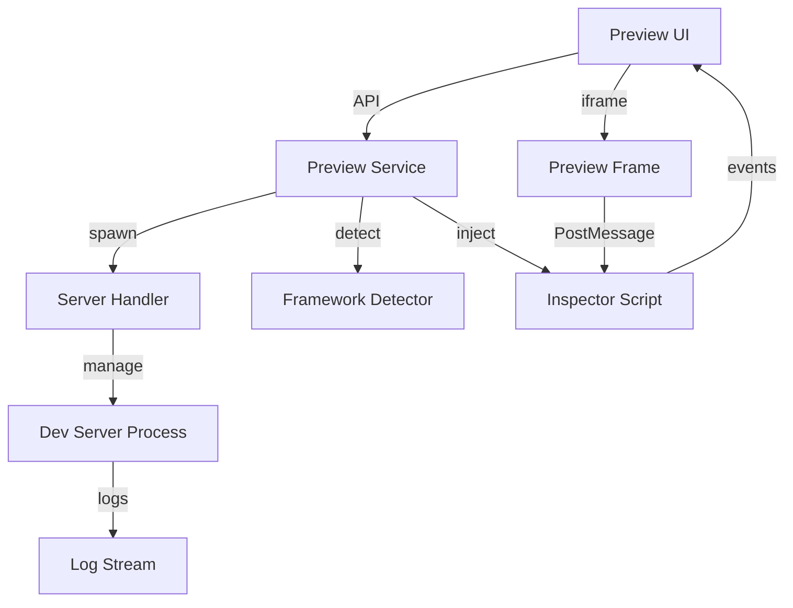

# Preview Environment Architecture

## Quick Reference

### Key Files
- **Preview Service**: `apps/backend/services/preview-environment.service.ts`
- **Server Handler**: Inner class in preview service managing processes
- **Repository Service**: `apps/backend/services/repository.service.ts` (framework detection)
- **Preview Routes**: `apps/backend/routes/preview.ts`
- **Frontend Component**: `apps/frontend/src/features/preview/components/preview.tsx`
- **Preview Hooks**: `apps/frontend/src/features/preview/hooks/use-server.ts`
- **Message Bridge**: `apps/frontend/src/features/preview/hooks/use-preview-connection.ts`

### Core Methods
```typescript
// Preview Environment Service
startServer(taskId: string, workspaceDir: string): Promise<PreviewServerInfo>
stopServer(taskId: string): Promise<void>
restartServer(taskId: string): Promise<PreviewServerInfo>
getServerStatus(taskId: string): PreviewServerStatus | null
streamServerLogs(taskId: string): AsyncIterable<string>

// Framework Detection
detectFramework(workspaceDir: string): Promise<FrameworkConfig>
```

## Architecture Overview

Preview environments provide live application previews with debugging capabilities through development server orchestration and inspector script injection.



## Implementation Guide

### 1. Starting a Preview Server
```typescript
// Frontend: apps/frontend/src/features/preview/hooks/use-server.ts
const { mutate: startServer } = useStartServer();
startServer({ taskId, workspaceDir });

// Backend: apps/backend/services/preview-environment.service.ts
async startServer(taskId: string, workspaceDir: string) {
  // Step 1: Detect framework
  const framework = await this.repositoryService.detectFramework(workspaceDir);
  
  // Step 2: Allocate port if needed
  const port = framework.command.includes('{PORT}') 
    ? await this.allocatePort() 
    : null;
    
  // Step 3: Inject inspector script
  await this.injectInspector(workspaceDir, framework);
  
  // Step 4: Create and start server handler
  const handler = new ServerHandler({
    taskId,
    workspaceDir,
    command: framework.command.replace('{PORT}', port),
    framework: framework.type
  });
  
  await handler.start();
  this.servers.set(taskId, handler);
  
  return { port: handler.port, url: handler.url, pid: handler.pid };
}
```

### 2. Framework Detection
```typescript
// apps/backend/services/repository.service.ts
detectFramework(workspaceDir: string): FrameworkConfig {
  const packageJson = readPackageJson(workspaceDir);
  
  // Check dependencies
  if (packageJson.dependencies?.vite || packageJson.devDependencies?.vite) {
    return {
      type: 'vite',
      command: 'npm run dev -- --port {PORT}',
      portPattern: /Local:\s+http:\/\/localhost:(\d+)/,
      injectionStrategy: 'html'
    };
  }
  
  if (packageJson.dependencies?.next) {
    return {
      type: 'nextjs',
      command: 'npm run dev -- -p {PORT}',
      portPattern: /ready on.*:(\d+)/,
      injectionStrategy: 'middleware'
    };
  }
  
  // ... other frameworks
}
```

### 3. Inspector Script Injection
```typescript
// apps/backend/services/preview-environment.service.ts
async injectInspector(workspaceDir: string, framework: FrameworkConfig) {
  const inspectorScript = this.generateInspectorScript();
  
  switch (framework.injectionStrategy) {
    case 'html':
      // Modify index.html
      const indexPath = path.join(workspaceDir, 'index.html');
      const html = await fs.readFile(indexPath, 'utf-8');
      const modified = html.replace('</head>', 
        `<script src="/.moatless/inspector.js"></script></head>`);
      await fs.writeFile(indexPath, modified);
      break;
      
    case 'middleware':
      // Add middleware file for Next.js
      const middlewarePath = path.join(workspaceDir, 'middleware.js');
      await fs.writeFile(middlewarePath, getNextMiddleware());
      break;
  }
  
  // Write inspector script
  const scriptPath = path.join(workspaceDir, '.moatless/inspector.js');
  await fs.ensureDir(path.dirname(scriptPath));
  await fs.writeFile(scriptPath, inspectorScript);
}
```

### 4. Message Communication
```typescript
// Frontend: apps/frontend/src/features/preview/hooks/use-preview-connection.ts
function usePreviewConnection(iframeRef: RefObject<HTMLIFrameElement>) {
  useEffect(() => {
    const handleMessage = (event: MessageEvent) => {
      if (event.origin !== previewOrigin) return;
      
      switch (event.data.type) {
        case 'console':
          addConsoleLog(event.data);
          break;
        case 'ELEMENT_CLICKED':
          setSelectedElement(event.data.element);
          break;
        case 'HEARTBEAT':
          updateScriptHealth('injected-reachable');
          break;
      }
    };
    
    window.addEventListener('message', handleMessage);
    return () => window.removeEventListener('message', handleMessage);
  }, []);
}
```

## Decision Trees

### Framework Detection Logic
```
Has package.json?
├─ Check dependencies
│   ├─ vite? → Vite config
│   ├─ next? → Next.js config
│   ├─ react-scripts? → CRA config
│   └─ @remix-run? → Remix config
└─ Check file structure
    ├─ vite.config.js? → Vite
    ├─ next.config.js? → Next.js
    └─ index.html? → Generic static
```

### Port Allocation Strategy
```
Command has {PORT}?
├─ Yes → Allocate dynamic port
│   ├─ Create temp server on port 0
│   ├─ Get assigned port
│   └─ Replace {PORT} in command
└─ No → Let framework choose
    └─ Detect port from output
```

### Inspector Injection Method
```
Framework type?
├─ Vite/CRA → HTML injection
├─ Next.js → Middleware injection
├─ Remix → Plugin injection
└─ Unknown → Proxy injection
```

## Common Patterns

### Server Lifecycle States
```typescript
// Server states in ServerHandler
enum ServerState {
  IDLE = 'idle',
  STARTING = 'starting',
  DETECTING = 'detecting',
  RUNNING = 'running',
  STOPPING = 'stopping',
  FAILED = 'failed',
  CRASHED = 'crashed'
}

// Handle state transitions
class ServerHandler {
  async start() {
    this.state = ServerState.STARTING;
    this.process = spawn(this.command, { cwd: this.workspaceDir });
    this.state = ServerState.DETECTING;
    this.port = await this.waitForPort();
    this.state = ServerState.RUNNING;
  }
}
```

### Message Types from Inspector
```typescript
// Inspector script messages
interface InspectorMessage {
  type: 'INSPECTOR_SCRIPT_LOADED' | 'console' | 'ELEMENT_CLICKED' | 
        'HEARTBEAT' | 'TOGGLE_SELECTOR' | 'error';
  payload: any;
}

// Console message format
interface ConsoleMessage {
  type: 'console';
  level: 'log' | 'warn' | 'error' | 'info';
  message: string;
  args: any[];
  timestamp: number;
}
```

### Process Recovery
```typescript
// Recover orphaned processes after crash
async recoverServers() {
  const metadataFiles = await fs.readdir('data/preview-servers');
  
  for (const file of metadataFiles) {
    const metadata = await fs.readJson(file);
    if (isProcessRunning(metadata.pid)) {
      // Reattach to existing process
      const handler = ServerHandler.fromMetadata(metadata);
      this.servers.set(metadata.taskId, handler);
    }
  }
}
```

## Framework-Specific Configurations

| Framework | Start Command | Port Pattern | Injection |
|-----------|--------------|--------------|-----------|
| Vite | `npm run dev -- --port {PORT}` | `/Local:\s+http:\/\/localhost:(\d+)/` | HTML |
| Next.js | `npm run dev -- -p {PORT}` | `/ready on.*:(\d+)/` | Middleware |
| CRA | `PORT={PORT} npm start` | `/On Your Network.*:(\d+)/` | HTML |
| Remix | `npm run dev` | `/http:\/\/localhost:(\d+)/` | Plugin |
| Generic | `npm start` | Auto-detect | Proxy |

## Troubleshooting

| Issue | Check | Solution |
|-------|-------|----------|
| Server won't start | Check logs in `data/preview-servers/logs/` | Verify dependencies installed |
| Port conflicts | Check `activePorts` Set | Use dynamic port allocation |
| Inspector not working | Check script health status | Verify injection strategy |
| Framework not detected | Check package.json | Add manual framework config |
| Process orphaned | Check metadata files | Run recovery on startup |

## API Endpoints

```typescript
// Backend routes
POST /api/preview/start      // Start preview server
POST /api/preview/stop       // Stop preview server  
POST /api/preview/restart    // Restart server
GET  /api/preview/status     // Get server status
GET  /api/preview/logs       // Stream logs (SSE)
```