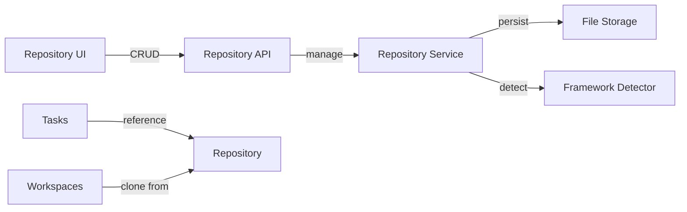

# Repository Architecture

## Quick Reference

### Key Files
- **Repository Service**: `apps/backend/services/repository.service.ts`
- **Repository Routes**: `apps/backend/routes/repositories.ts`
- **Repository Types**: `packages/types/src/types/repository.types.ts`
- **Repository Schemas**: `packages/types/schemas/repository.schemas.ts`
- **Framework Constants**: `packages/types/constants/preview-config.ts`
- **Frontend Hooks**: `apps/frontend/src/features/repositories/hooks/`

### Core Methods
```typescript
// Repository Service
getRepositories(): Promise<Repository[]>
getRepository(id: string): Promise<Repository | null>
createRepository(data: CreateRepositoryDto): Promise<Repository>
updateRepository(id: string, data: UpdateRepositoryDto): Promise<Repository>
deleteRepository(id: string): Promise<void>
detectFramework(workspaceDir: string): Promise<FrameworkConfig>
```

## Architecture Overview

Repositories store configuration for AI-assisted development projects, including git URLs, framework settings, and preview configurations.



## Implementation Guide

### 1. Repository Structure
```typescript
// packages/types/src/types/repository.types.ts
interface Repository {
  id: string;
  name: string;
  gitUrl: string;
  branch?: string;
  framework?: FrameworkType;
  previewConfig?: PreviewConfig;
  createdAt: Date;
  updatedAt: Date;
}

interface PreviewConfig {
  startCommand?: string;
  buildCommand?: string;
  port?: number;
  env?: Record<string, string>;
}
```

### 2. Creating a Repository
```typescript
// Frontend: Create repository with framework detection
const { mutate: createRepo } = useCreateRepository();
createRepo({
  name: 'My Project',
  gitUrl: 'https://github.com/user/repo.git',
  branch: 'main'
});

// Backend: apps/backend/services/repository.service.ts
async createRepository(data: CreateRepositoryDto) {
  const repo: Repository = {
    id: generateId(),
    ...data,
    createdAt: new Date(),
    updatedAt: new Date()
  };
  
  // Clone to temp directory for framework detection
  const tempDir = await this.cloneForDetection(repo.gitUrl);
  repo.framework = await this.detectFramework(tempDir);
  repo.previewConfig = this.getDefaultConfig(repo.framework);
  
  await this.storage.save(`repositories/${repo.id}.json`, repo);
  return repo;
}
```

### 3. Framework Detection
```typescript
// apps/backend/services/repository.service.ts
async detectFramework(dir: string): Promise<FrameworkConfig> {
  const packageJson = await readPackageJson(dir);
  
  // Check framework indicators
  for (const [framework, config] of Object.entries(FRAMEWORK_CONFIGS)) {
    if (config.detect(packageJson, dir)) {
      return {
        type: framework,
        startCommand: config.defaultStartCommand,
        buildCommand: config.defaultBuildCommand,
        portPattern: config.portPattern
      };
    }
  }
  
  return { type: 'unknown', startCommand: 'npm start' };
}
```

## Common Patterns

### Repository Selection in Tasks
```typescript
// Frontend component
function TaskCreation() {
  const { data: repositories } = useRepositories();
  const [selectedRepo, setSelectedRepo] = useState<string>();
  
  return (
    <RepositorySelector
      repositories={repositories}
      value={selectedRepo}
      onChange={setSelectedRepo}
    />
  );
}
```

### Framework Configuration Override
```typescript
// Allow manual preview config override
updateRepository(repoId, {
  previewConfig: {
    startCommand: 'npm run custom-dev',
    port: 3001,
    env: { NODE_ENV: 'development' }
  }
});
```

## API Endpoints

```typescript
GET    /api/v1/repositories       // List all repositories
GET    /api/v1/repositories/:id   // Get repository details
POST   /api/v1/repositories       // Create repository
PUT    /api/v1/repositories/:id   // Update repository
DELETE /api/v1/repositories/:id   // Delete repository
```