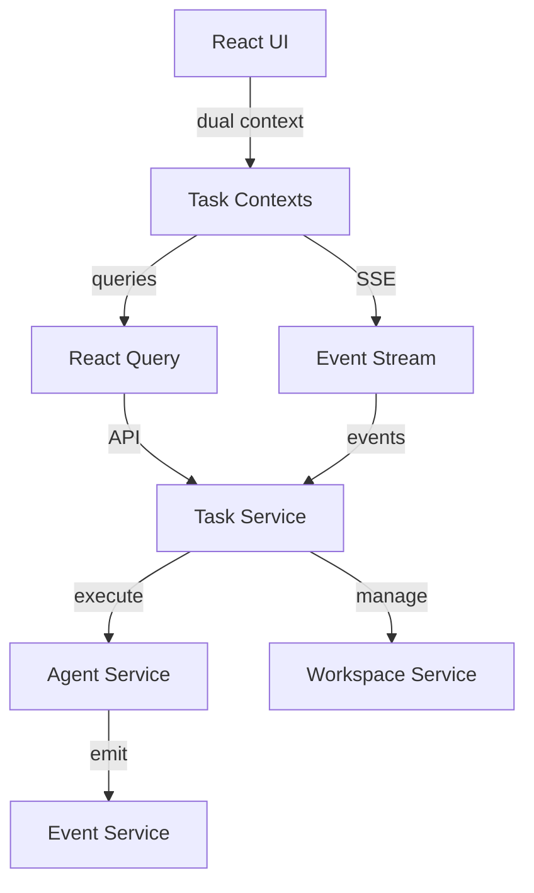
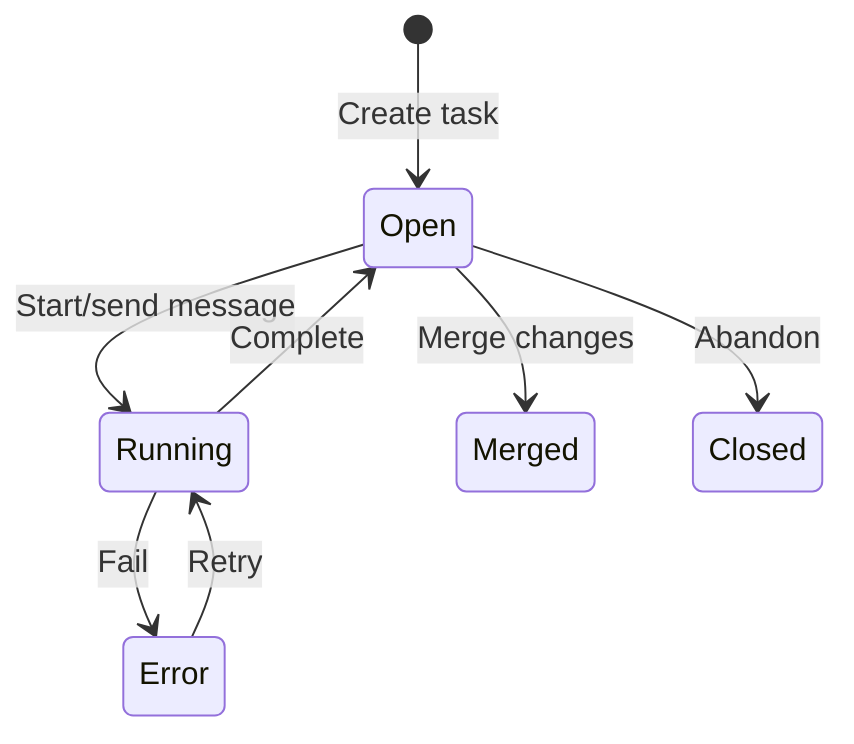

# Task Architecture

## Quick Reference

### Key Files
- **Task Service**: `apps/backend/services/task.service.ts`
- **Task Routes**: `apps/backend/routes/tasks.ts`
- **Task Types**: `packages/types/src/types/task.types.ts`
- **UI Context**: `apps/frontend/src/features/tasks/contexts/task-ui-provider.tsx`
- **Data Context**: `apps/frontend/src/features/tasks/contexts/task-data-provider.tsx`
- **Task Providers**: `apps/frontend/src/features/tasks/contexts/task-providers.tsx`

### Core Methods
```typescript
// Task Service
createTask(data: CreateTaskDto): Promise<Task>
startTask(taskId: string): Promise<Task>
sendMessage(taskId: string, message: string): Promise<void>
closeTask(taskId: string): Promise<void>
getAvailableCommands(taskId: string): Promise<Command[]>

// Frontend Hooks
useTaskData(): { task, events, workspace, gitDiff, streamingEvents }
useTaskUI(): { panels, chat, selection, methods }
```

## Architecture Overview

Tasks orchestrate AI agent interactions through an event-driven system with sophisticated frontend state management using the Dual-Context Pattern.



## The Dual-Context Pattern

Separates UI state from server state to prevent unnecessary re-renders:

### 1. TaskUIProvider (Local UI State)
```typescript
// apps/frontend/src/features/tasks/contexts/task-ui-provider.tsx
interface TaskUIState {
  panels: {
    selectedPanel: PanelType;
    eventViewerExpanded: boolean;
  };
  chat: {
    scrollPosition: number;
    selectedIteration: string | null;
  };
  gitDiff: {
    selectedFile: string | null;
    expandedFiles: Set<string>;
  };
}

// Usage
const { panels, chat } = useTaskUI();
```

### 2. TaskDataProvider (Server State)
```typescript
// apps/frontend/src/features/tasks/contexts/task-data-provider.tsx
interface TaskDataContext {
  task: UseQueryResult<Task>;
  events: UseQueryResult<TaskEvent[]>;
  workspace: UseQueryResult<WorkspaceStatus>;
  gitDiff: UseQueryResult<GitDiff>;
  streamingEvents: TaskEvent[]; // Recent SSE events
}

// Usage
const { task, events, streamingEvents } = useTaskData();
```

## Implementation Guide

### 1. Task Creation Flow
```typescript
// Frontend
const { mutate: createTask } = useCreateTask();
createTask({
  repositoryId: repoId,
  message: 'Fix the login bug',
  mode: 'code',
  shouldStart: true // Auto-start with agent
});

// Backend: apps/backend/services/task.service.ts
async createTask(data: CreateTaskDto) {
  // Create task with first iteration
  const task = {
    id: generateId(),
    status: 'open',
    iterations: [{
      id: generateId(),
      message: data.message,
      status: 'created'
    }],
    ...data
  };
  
  // Save before workspace operations
  await this.storage.save(`tasks/${task.id}.json`, task);
  
  // Create workspace
  await this.workspaceService.createWorkspace(task.id, data.repositoryId);
  
  // Optionally start immediately
  if (data.shouldStart) {
    await this.startTask(task.id);
  }
  
  return task;
}
```

### 2. Task Lifecycle States


### 3. Iteration Status Flow
```typescript
// Iteration statuses
type IterationStatus = 'created' | 'active' | 'completed' | 'error' | 'failed';

// Status transitions
async sendMessage(taskId: string, message: string) {
  // Create iteration with 'created' status
  const iteration = {
    id: generateId(),
    message,
    status: 'created'
  };
  
  task.iterations.push(iteration);
  await this.save(task);
  
  // Immediately activate and execute
  iteration.status = 'active';
  task.status = 'running';
  
  await this.agentService.executeAgent(taskId, iteration.id, message);
}
```

### 4. Event-Driven Updates
```typescript
// Backend emits events
await this.eventService.emitEvent({
  taskId,
  type: EventType.MESSAGE,
  payload: { content: 'Processing...' }
});

// Frontend receives via SSE
const handleTaskEvent = (event: TaskEvent) => {
  // Update event cache
  queryClient.setQueryData(
    queryKeys.taskEvents(taskId),
    (old) => [...(old || []), event]
  );
  
  // Update streaming events
  setStreamingEvents(prev => [...prev.slice(-99), event]);
};
```

## Common Patterns

### Using Task Contexts
```typescript
// Wrap components with providers
<TaskProviders taskId={taskId}>
  <TaskDetail />
</TaskProviders>

// Inside components
function TaskDetail() {
  const { task, events } = useTaskData();
  const { panels, setPanelView } = useTaskUI();
  
  if (task.isLoading) return <Skeleton />;
  
  return (
    <div>
      <h1>{task.data.title}</h1>
      <EventViewer events={events.data} />
    </div>
  );
}
```

### Command System Integration
```typescript
// Backend filters available commands
getAvailableCommands(taskId: string) {
  const task = await this.getTask(taskId);
  const workspace = await this.workspaceService.getStatus(taskId);
  
  return commands.filter(cmd => 
    evaluateConditions(cmd.conditions, task, workspace)
  );
}

// Frontend displays filtered commands
<CommandButtons 
  commands={availableCommands}
  onExecute={(prompt) => sendMessage(taskId, prompt)}
/>
```

### Optimistic Updates
```typescript
const sendMessage = useMutation({
  mutationFn: api.sendMessage,
  onMutate: async ({ message }) => {
    // Optimistically add iteration
    await queryClient.cancelQueries(queryKeys.task(taskId));
    const previous = queryClient.getQueryData(queryKeys.task(taskId));
    
    queryClient.setQueryData(queryKeys.task(taskId), old => ({
      ...old,
      iterations: [...old.iterations, { message, status: 'active' }]
    }));
    
    return { previous };
  },
  onError: (err, vars, context) => {
    // Rollback on error
    queryClient.setQueryData(queryKeys.task(taskId), context.previous);
  }
});
```

## Troubleshooting

| Issue | Check | Solution |
|-------|-------|----------|
| UI not updating | SSE connection | Check global event stream status |
| Wrong UI state | Context isolation | Verify TaskProviders wrapping |
| Stale data | Cache invalidation | Check EVENT_INVALIDATION_MAP |
| Lost UI state | Task switching | UI state persists in Map per task |