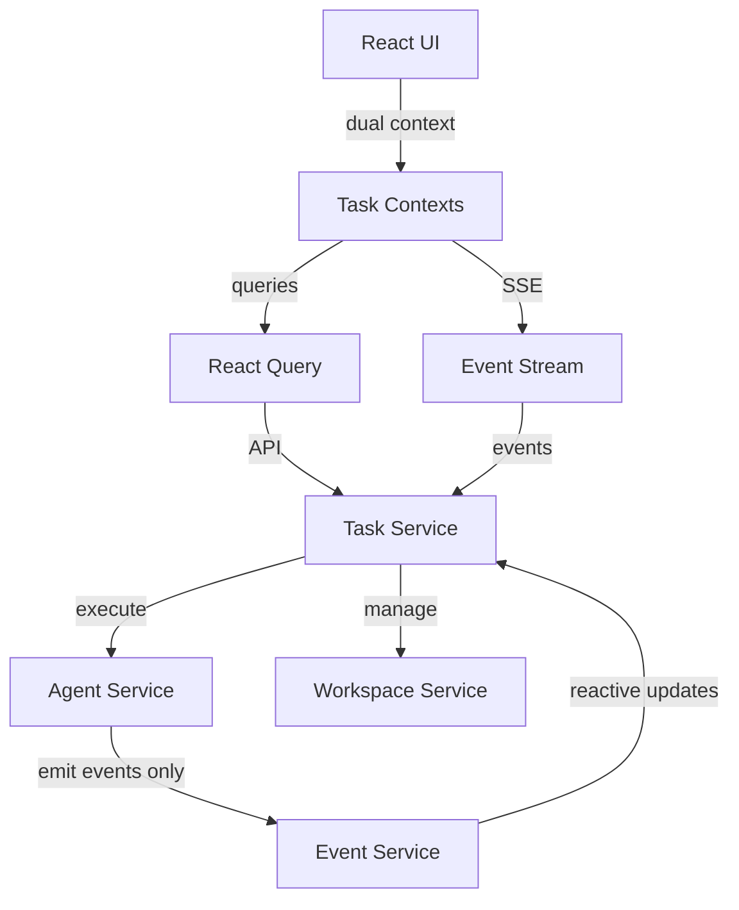
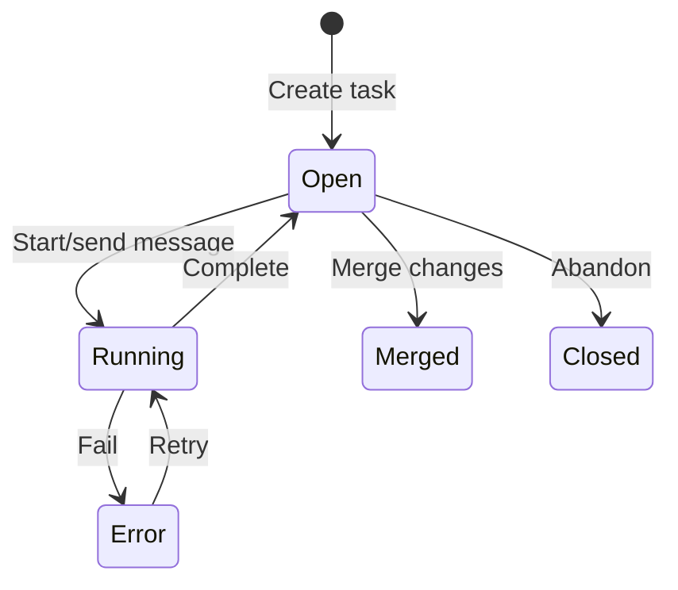

# Task Architecture

## Quick Reference

### Key Files
- **Task Service**: `apps/backend/services/task.service.ts`
- **Task Routes**: `apps/backend/routes/tasks.ts`
- **Task Types**: `packages/types/src/types/task.types.ts`
- **UI Context**: `apps/frontend/src/features/tasks/contexts/task-ui-provider.tsx`
- **Data Context**: `apps/frontend/src/features/tasks/contexts/task-data-provider.tsx`
- **Task Providers**: `apps/frontend/src/features/tasks/contexts/task-providers.tsx`

### Core Methods
```typescript
// Task Service
createTask(data: CreateTaskDto): Promise<Task>
startTask(taskId: string): Promise<Task>
sendMessage(taskId: string, message: string): Promise<void>
closeTask(taskId: string): Promise<void>
getAvailableCommands(taskId: string): Promise<Command[]>

// Frontend Hooks
useTaskData(): { task, events, workspace, gitDiff, streamingEvents }
useTaskUI(): { panels, chat, selection, methods }
```

## Architecture Overview

Tasks orchestrate AI agent interactions through a **reactive event-driven system** with sophisticated frontend state management using the Dual-Context Pattern.



### Reactive Pattern Benefits
- **Separation of Concerns**: Agent Service focuses on execution, Task Service on state management
- **Loose Coupling**: Services communicate only via events
- **Consistent Updates**: All task updates flow through a single reactive path
- **Event-Driven**: Task state changes happen automatically in response to agent events

## UI Layout Architecture

The task page uses a full-screen layout with proper height constraints and overflow handling:

### Layout Structure
```
TaskPage (h-full w-full flex flex-col)
├── TaskHeader (fixed height)
│   ├── Repository info, task title, status
│   ├── Git status indicator
│   └── View toggle buttons (Files/Preview)
└── ResizablePanelGroup (flex-1 horizontal)
    ├── Left Panel: ChatView (300-600px constrained)
    │   ├── MessageHistory (flex-1 overflow-hidden)
    │   ├── CommandButtons (flex-shrink-0, when shown)
    │   └── ChatInput (flex-shrink-0, always visible)
    └── Right Panel: FileExplorer/Preview (remaining width)
```

### Key Layout Components

**TaskPage** (`apps/frontend/src/features/tasks/components/task-page.tsx`)
- Root container with full height (`h-full`) constrained by main layout
- Manages panel resizing with pixel constraints (300-600px for chat)
- Handles localStorage persistence for panel sizes

**TaskHeader** (`apps/frontend/src/features/tasks/components/task-header/task-header.tsx`)
- Single-row layout with all controls
- Repository name, task title, status indicators
- View toggle buttons for Files/Preview panels

**ChatView** (`apps/frontend/src/features/tasks/components/chat-view/chat-container.tsx`)
- Combines MessageHistory and ChatInput in proper flex layout
- Ensures MessageHistory scrolls while ChatInput stays visible
- Handles command buttons display when available

### Height Chain Management
The layout establishes a proper height chain from root to components:

```typescript
// Root Layout (h-screen)
<div className="flex h-screen w-full">
  <AppSidebar />
  <main className="flex-1 overflow-hidden h-full">
    {/* TaskPage (h-full) */}
    <div className="flex flex-col h-full w-full">
      <TaskHeader />
      <ResizablePanelGroup className="flex-1">
        {/* ChatView (h-full) */}
        <div className="h-full flex flex-col">
          <div className="flex-1 overflow-hidden min-h-0">
            <MessageHistory className="h-full" />
          </div>
          <div className="flex-shrink-0">
            <ChatInput />
          </div>
        </div>
      </ResizablePanelGroup>
    </div>
  </main>
</div>
```

## The Tri-Context Pattern

Separates concerns across three specialized contexts for optimal performance:

### 1. TaskUIProvider (Local UI State)
```typescript
// apps/frontend/src/features/tasks/contexts/task-ui-provider.tsx
interface TaskUIState {
  panels: {
    rightPanelView: 'files' | 'preview';
    panelSizes: { left: number; right: number };
  };
  chat: {
    message: string;
    selectedModel: ClaudeModel;
    resumeConversation: boolean;
    scrollPosition?: number;
    isAtBottom: boolean;
  };
}

// Usage
const { rightPanelView, setRightPanelView } = usePanelView();
const { message, setMessage } = useChatMessage();
const { selectedModel, setSelectedModel } = useChatModel();
```

### 2. TaskDataProvider (Server State)
```typescript
// apps/frontend/src/features/tasks/contexts/task-data-provider.tsx
interface TaskDataContext {
  taskId: string;
  isLoading: boolean;
  error: Error | null;
  status: TaskStatus;
  iterations: TaskIteration[];
  repositoryId: string;
  // Specialized data access methods
}

// Usage
const { taskId, status, iterations, repositoryId } = useTaskData();
const { data: workspaceStatus } = useWorkspaceStatus();
```

### 3. TaskProviders (Unified Provider)
```typescript
// apps/frontend/src/features/tasks/contexts/task-providers.tsx
export function TaskProviders({ taskId, children }) {
  return (
    <TaskDataProvider taskId={taskId}>
      <TaskUIProvider>
        {children}
      </TaskUIProvider>
    </TaskDataProvider>
  );
}

// Convenience hooks for common patterns
export const usePanelView = () => { /* Panel state management */ };
export const usePanelSizes = () => { /* Panel sizing logic */ };
export const useTaskData = () => { /* Task data access */ };
```

### Context Isolation Benefits

1. **Performance**: Components only re-render when their specific data changes
2. **Separation of Concerns**: UI state separate from server state
3. **Reusability**: Contexts can be used independently
4. **Testing**: Each context can be tested in isolation

## Panel System & Responsive Design

### Resizable Panel Management
The TaskPage implements a sophisticated panel system with pixel-based constraints:

```typescript
// Panel constraints with pixel-to-percentage conversion
const calculatePanelSizeConstraints = (windowWidth: number) => {
  const minWidthPx = 300;  // Chat panel minimum
  const maxWidthPx = 600;  // Chat panel maximum
  const defaultWidthPx = 600; // Default chat width
  
  // Convert to percentages for ResizablePanel
  const minSizePercent = (minWidthPx / windowWidth) * 100;
  const maxSizePercent = (maxWidthPx / windowWidth) * 100;
  
  return { minSizePercent, maxSizePercent, defaultSizePercent };
};

// Panel size persistence
localStorage.setItem('leftPanelSize', constrainedSizePercent.toString());
```

### Panel State Management
```typescript
// Panel view switching
const { rightPanelView, setRightPanelView } = usePanelView();

// Toggle between Files and Preview
<Button 
  variant={rightPanelView === 'files' ? 'default' : 'outline'}
  onClick={() => setRightPanelView('files')}
>
  Files
</Button>

// Panel sizes with constraints
const { panelSizes, setPanelSizes } = usePanelSizes();
const handleLeftPanelResize = (size: number) => {
  const constrainedSize = Math.max(300, Math.min(600, actualPixelWidth));
  setPanelSizes({ left: constrainedSize, right: 100 - constrainedSize });
};
```

### Overflow Handling Strategy
Each component in the height chain manages overflow appropriately:

1. **MessageHistory**: Uses `overflow-hidden` with `ScrollArea` for custom scrolling
2. **ChatInput**: Fixed height with `flex-shrink-0` to prevent compression
3. **CommandButtons**: Conditional rendering with `flex-shrink-0` when shown
4. **FileExplorer/Preview**: Uses `overflow-hidden` on container with internal scrolling

### Responsive Breakpoints
The layout adapts to different screen sizes:

```typescript
// Window resize handling
useEffect(() => {
  const handleResize = () => {
    const windowWidth = window.innerWidth;
    setPanelConstraints(calculatePanelSizeConstraints(windowWidth));
  };
  
  window.addEventListener('resize', handleResize);
  return () => window.removeEventListener('resize', handleResize);
}, []);
```

## Reactive Task Update Architecture

### Agent Service → Event Service → Task Service Flow

The new reactive pattern ensures clean separation of concerns:

```typescript
// Agent Service - Only emits events
for await (const event of agent.run(message, options)) {
  // Include agentSessionId in all events
  await this.eventService.emitEvent({
    ...event,
    agentSessionId: iteration.agentSessionId,
  })
}
```

```typescript
// Task Service - Subscribes to events and updates tasks reactively
constructor() {
  this.eventService.subscribeAll((event: Event) => {
    if (this.shouldHandleEvent(event)) {
      this.handleAgentEvent(event)
    }
  })
}

private async handleAgentEvent(event: Event) {
  // Handle agentSessionId updates
  if (event.agentSessionId && !iteration.agentSessionId) {
    iteration.agentSessionId = event.agentSessionId
  }
  
  // Handle different event types
  switch (event.type) {
    case EventType.RESULT:
      await this.handleResultEvent(task, iteration, event)
      break
    case EventType.ERROR:
      await this.handleErrorEvent(task, iteration, event)
      break
    case EventType.MESSAGE:
      await this.handleMessageEvent(task, iteration, event)
      break
  }
}
```

### Event-Driven Task Updates

| Event Type | Triggers | Task Service Action |
|------------|----------|---------------------|
| `RESULT` | Agent execution complete | Update iteration status, cost, result, git data |
| `ERROR` | Agent execution failed | Update iteration error, emit TASK_STATUS event |
| `MESSAGE` | Context tokens updated | Update iteration contextTokens |
| Any with `agentSessionId` | Session ID available | Update iteration agentSessionId |

## Implementation Guide

### 1. Task Creation Flow
```typescript
// Frontend
const { mutate: createTask } = useCreateTask();
createTask({
  repositoryId: repoId,
  message: 'Fix the login bug',
  mode: 'code',
  shouldStart: true // Auto-start with agent
});

// Backend: apps/backend/services/task.service.ts
async createTask(data: CreateTaskDto) {
  // Create task with first iteration
  const task = {
    id: generateId(),
    status: 'open',
    iterations: [{
      id: generateId(),
      message: data.message,
      status: 'created'
    }],
    ...data
  };
  
  // Save before workspace operations
  await this.storage.save(`tasks/${task.id}.json`, task);
  
  // Create workspace
  await this.workspaceService.createWorkspace(task.id, data.repositoryId);
  
  // Optionally start immediately
  if (data.shouldStart) {
    await this.startTask(task.id);
  }
  
  return task;
}
```

### 2. Task Lifecycle States


### 3. Iteration Status Flow
```typescript
// Iteration statuses
type IterationStatus = 'created' | 'active' | 'completed' | 'error' | 'failed';

// Status transitions
async sendMessage(taskId: string, message: string) {
  // Create iteration with 'created' status
  const iteration = {
    id: generateId(),
    message,
    status: 'created'
  };
  
  task.iterations.push(iteration);
  await this.save(task);
  
  // Immediately activate and execute
  iteration.status = 'active';
  task.status = 'running';
  
  await this.agentService.executeAgent(taskId, iteration.id, message);
}
```

### 4. Event-Driven Updates
```typescript
// Backend emits events
await this.eventService.emitEvent({
  taskId,
  type: EventType.MESSAGE,
  payload: { content: 'Processing...' }
});

// Frontend receives via SSE
const handleTaskEvent = (event: TaskEvent) => {
  // Update event cache
  queryClient.setQueryData(
    queryKeys.taskEvents(taskId),
    (old) => [...(old || []), event]
  );
  
  // Update streaming events
  setStreamingEvents(prev => [...prev.slice(-99), event]);
};
```

## Common Patterns

### Using Task Contexts
```typescript
// Wrap components with providers
<TaskProviders taskId={taskId}>
  <TaskDetail />
</TaskProviders>

// Inside components
function TaskDetail() {
  const { task, events } = useTaskData();
  const { panels, setPanelView } = useTaskUI();
  
  if (task.isLoading) return <Skeleton />;
  
  return (
    <div>
      <h1>{task.data.title}</h1>
      <EventViewer events={events.data} />
    </div>
  );
}
```

### Command System Integration
```typescript
// Backend filters available commands
getAvailableCommands(taskId: string) {
  const task = await this.getTask(taskId);
  const workspace = await this.workspaceService.getStatus(taskId);
  
  return commands.filter(cmd => 
    evaluateConditions(cmd.conditions, task, workspace)
  );
}

// Frontend displays filtered commands
<CommandButtons 
  commands={availableCommands}
  onExecute={(prompt) => sendMessage(taskId, prompt)}
/>
```

### Optimistic Updates
```typescript
const sendMessage = useMutation({
  mutationFn: api.sendMessage,
  onMutate: async ({ message }) => {
    // Optimistically add iteration
    await queryClient.cancelQueries(queryKeys.task(taskId));
    const previous = queryClient.getQueryData(queryKeys.task(taskId));
    
    queryClient.setQueryData(queryKeys.task(taskId), old => ({
      ...old,
      iterations: [...old.iterations, { message, status: 'active' }]
    }));
    
    return { previous };
  },
  onError: (err, vars, context) => {
    // Rollback on error
    queryClient.setQueryData(queryKeys.task(taskId), context.previous);
  }
});
```

## Troubleshooting

| Issue | Check | Solution |
|-------|-------|----------|
| UI not updating | SSE connection | Check global event stream status |
| Wrong UI state | Context isolation | Verify TaskProviders wrapping |
| Stale data | Cache invalidation | Check EVENT_INVALIDATION_MAP |
| Lost UI state | Task switching | UI state persists in Map per task |
| Layout height issues | Height chain | Verify h-full/h-screen chain from root |
| Panel sizing broken | Window resize | Check panel constraint calculations |
| Chat input hidden | Flex layout | Ensure flex-shrink-0 on ChatInput container |
| MessageHistory overflow | ScrollArea | Verify overflow-hidden and min-h-0 |
| Panel state lost | localStorage | Check panel size persistence |

### Layout Debugging
```typescript
// Check height chain
console.log('Root layout:', document.querySelector('.h-screen'));
console.log('Main element:', document.querySelector('main.h-full'));
console.log('TaskPage:', document.querySelector('[data-testid="task-page"]'));

// Check panel constraints
console.log('Panel constraints:', panelConstraints);
console.log('Window width:', window.innerWidth);
console.log('Saved panel size:', localStorage.getItem('leftPanelSize'));
```

### Context Debugging
```typescript
// Check context providers
const TaskDebugger = () => {
  const taskData = useTaskData();
  const panelView = usePanelView();
  const chatMessage = useChatMessage();
  
  console.log('Task data:', taskData);
  console.log('Panel view:', panelView);
  console.log('Chat message:', chatMessage);
  
  return null;
};
```