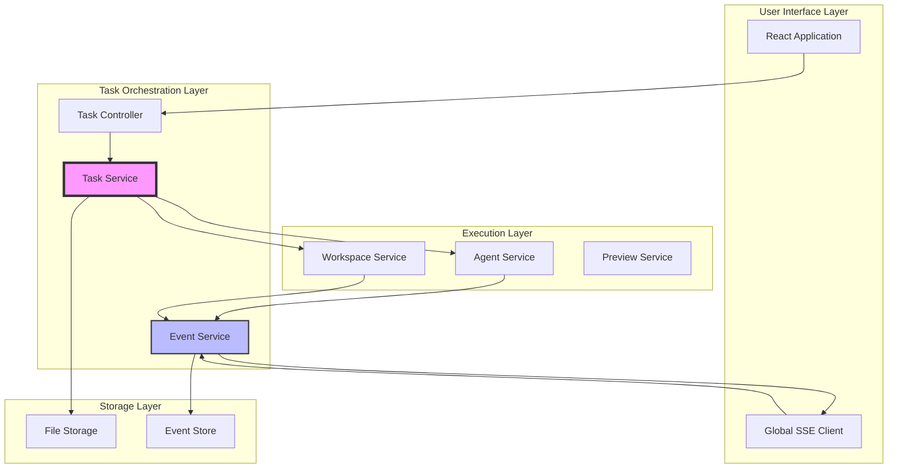
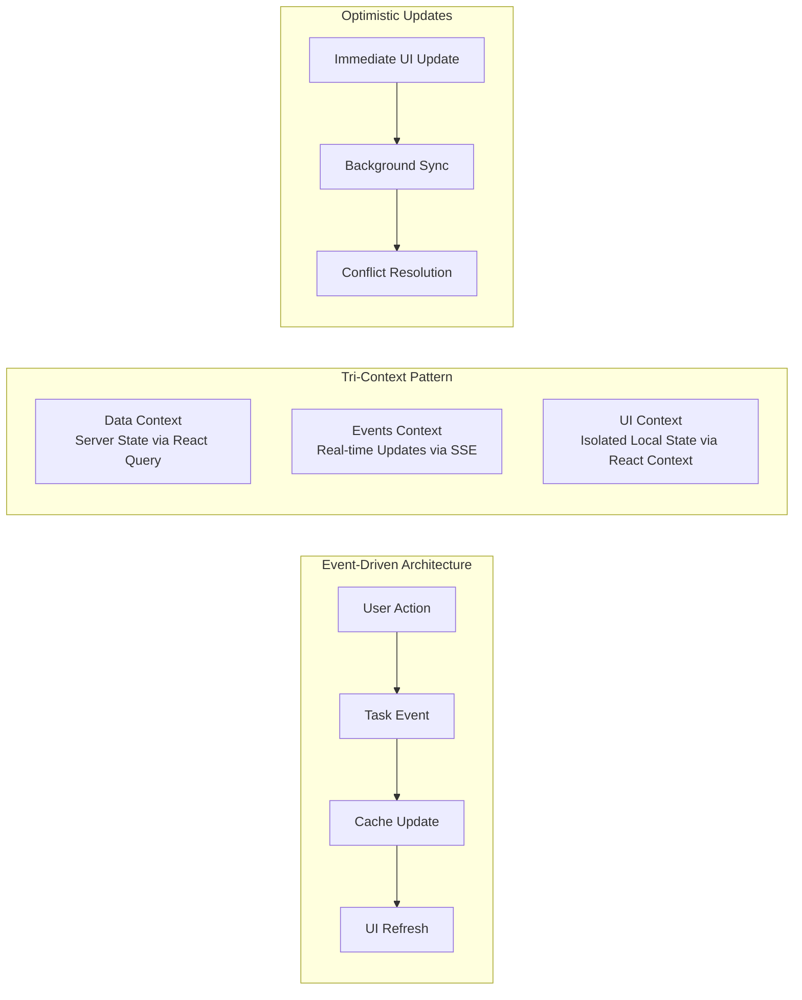
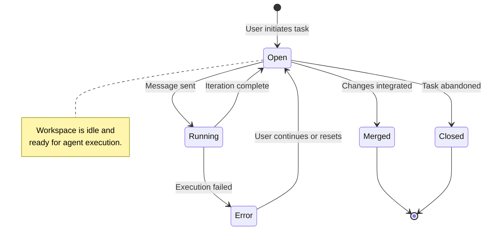

# Task Architecture

## Overview

The Task system is the central orchestration layer in Moatless Swarm UI, managing AI agent interactions through a sophisticated event-driven architecture. It coordinates isolated workspaces, tracks conversation history, and streams real-time updates while maintaining high performance through strategic caching and a refined frontend state management pattern.

## Architectural Overview

### System Position & Responsibilities



#### Layer Breakdown

**User Interface Layer**
- **React Application** (`apps/frontend/src/features/tasks/`): Provides the user interface for task management.
- **Global SSE Client** (`apps/frontend/src/features/events`): A single, global SSE connection that receives events for all tasks.

**Task Orchestration Layer**
- **Task Controller** (`apps/backend/routes/tasks.ts`): HTTP endpoints for task operations.
- **Task Service** (`apps/backend/services/task.service.ts`): Core business logic for task lifecycle management.
- **Event Service** (`apps/backend/services/event.service.ts`): Manages event streaming and persistence.

**Execution Layer**
- **Agent Service** (`apps/backend/services/agent.service.ts`): Integrates with AI providers (e.g., Claude).
- **Workspace Service** (`apps/backend/services/workspace.service.ts`): Manages isolated git worktrees for each task.
- **Preview Service** (`apps/backend/services/preview.service.ts`): Handles development server instances for live previews.

**Storage Layer**
- **File Storage** (`data/` directory): JSON-based persistence for tasks and metadata.
- **Event Store** (`data/events/`): Time-series storage for all task-related events.

### Core Architectural Patterns



## Frontend: The Tri-Context Pattern

To achieve high performance and prevent unnecessary re-renders, the frontend employs a "Tri-Context Pattern". This pattern separates different types of state into three distinct React contexts, ensuring that components only re-render when the specific data they subscribe to changes.

This pattern is implemented via the `<TaskProviders>` component (`apps/frontend/src/features/tasks/contexts/task-providers.tsx`), which composes the three context providers.

### 1. TaskUIProvider: Local UI State

- **File**: `apps/frontend/src/features/tasks/contexts/task-ui-provider.tsx`
- **Responsibility**: Manages pure UI state that is local to the client and specific to each task. This includes things like panel visibility, selected items, and scroll positions.
- **Implementation**: This provider uses a `useState` hook holding a `Map<string, TaskUIState>`, where the key is the `taskId`. This provides **complete state isolation** between tasks. When you switch from one task to another, the UI state for the previous task is preserved in the map, and the state for the new task is loaded (or initialized to default).
- **Hooks**: Provides specialized hooks like `usePanelView()`, `useChatState()`, and `useGitDiffState()` that allow components to subscribe to only the slice of UI state they need, preventing re-renders from unrelated state changes.

### 2. TaskDataProvider: Server State

- **File**: `apps/frontend/src/features/tasks/contexts/task-data-provider.tsx`
- **Responsibility**: Manages fetching, caching, and serving stable data from the backend. This includes task metadata, iterations, git diffs, and workspace status.
- **Implementation**: Built on top of `react-query`, it uses the `useQueries` hook to fetch multiple data sources in parallel. Data is considered relatively stable and is refetched based on `staleTime` or through event-driven invalidation. It exposes specialized hooks like `useTaskStatus()` and `useTaskMetadata()` to provide components with stable, memoized primitive values.

### 3. TaskEventsProvider: Real-time Events

- **File**: `apps/frontend/src/features/tasks/contexts/task-events-provider.tsx`
- **Responsibility**: Manages the real-time flow of events for the current task.
- **Implementation**: It subscribes to the `GlobalEventStream` and filters events for the current `taskId`. Its primary job is to receive live events and trigger cache invalidations in the `TaskDataProvider` via `react-query`. It is the engine of the event-driven architecture on the frontend.

This separation ensures that a high-frequency stream of events from `TaskEventsProvider` doesn't cause components that only care about stable metadata from `TaskDataProvider` or local UI state from `TaskUIProvider` to re-render.

## Backend: Task Lifecycle & Services

### Task Lifecycle Management



#### Lifecycle State Details

- **Open**: The initial state of a task after its workspace has been successfully created. The task is ready to accept messages.
- **Running**: The task is actively processing a message with an AI agent. The UI is locked from sending new messages, but the agent can be stopped.
- **Error**: The last agent iteration failed. The user can inspect the error and choose to continue the conversation or start fresh.
- **Merged**: The changes generated in the task's workspace have been successfully merged into the target branch of the main repository. This is a terminal success state.
- **Closed**: The task has been manually closed by the user. The associated workspace is torn down. This is a terminal failure/abandonment state.

### Core Services

- **TaskService (`task.service.ts`)**: The central orchestrator.
  - `createTask`: Creates the task record and initiates workspace creation.
  - `createVibeTask`: A specialized creator that clones a repository from a predefined template to create a new, self-contained environment for a task.
  - `sendMessage`: Kicks off an agent run. It creates a `TaskIteration`, updates the task status to `running`, and calls `AgentService`.
  - `closeTask`: Handles the teardown of a task, including stopping the agent, stopping the preview server, and cleaning up the workspace.
  - `getAvailableCommands`: Determines which contextual commands are available to the user based on the task's current state.

- **EventService (`event.service.ts`)**: The heart of the real-time system. It persists events and broadcasts them to the frontend via an SSE (Server-Sent Events) stream.

- **WorkspaceService (`workspace.service.ts`)**: Manages the filesystem environments for tasks. It creates git worktrees, reads/writes files, executes commands, and manages the lifecycle of preview servers.

## Event-Driven Cache Invalidation

The frontend relies on events from the backend to keep its data fresh without constant polling.

```mermaid
graph TB
    subgraph "Event Flow"
        UA[User Action]
        TS[Task Service]
        AS[Agent Service]
        ES[Event Service]
        SSE[Global SSE Stream]
        TEP[TaskEventsProvider]
        RQ[React Query Cache]
        UI[UI Components]
    end
    
    UA -->|1. Send Message| TS
    TS -->|2. Create Iteration| AS
    AS -->|3. Emit Events| ES
    ES -->|4. Stream to All Clients| SSE
    SSE -->|5. Filter & Handle Event| TEP
    TEP -->|6. Invalidate Queries| RQ
    RQ -->|7. Re-render| UI
```



#### Cache Invalidation Implementation

- **Global Stream**: A single, persistent SSE connection is established for the application (`apps/frontend/src/features/events/contexts/global-event-stream-provider.tsx`).
- **Task Subscription**: `TaskEventsProvider` subscribes to this global stream and filters events for the currently viewed `taskId`.
- **Event Handler (`handleTaskEvent`)**: The provider's event handler (`apps/frontend/src/features/tasks/contexts/task-events-provider.tsx`) is the system's brain.
  1.  It directly updates the `react-query` cache for events, making it the single source of truth.
  2.  It uses a mapping (`getInvalidationKeys`) to determine which other data queries (like task status, git diff, etc.) have become stale due to the event.
  3.  It triggers `queryClient.invalidateQueries` for only the affected queries, ensuring minimal and precise refetching.

## Command System

The task system includes a context-aware command system that displays relevant actions based on the current workspace and task state.

#### Command Structure

Commands are defined in `packages/shared/types/command.ts` and have conditions that determine their visibility.

```typescript
interface Command {
  name: string;
  description: string;
  prompt: string;
  conditions?: {
    requiresUncommittedChanges?: boolean;
    requiresAheadOfMain?: boolean;
    requiresLastIterationError?: boolean;
    // ... and more
  };
  icon?: string; // Lucide icon name
  variant?: string; // Button variant
}
```

#### Filtering and Execution

1.  **Backend Filtering**: The `taskService.getAvailableCommands(taskId)` method is called by the frontend. It uses the `filterAvailableCommands` utility to return only the commands whose conditions are met by the current task and workspace state.
2.  **UI Display**: The `CommandButtons` component (`apps/frontend/src/features/tasks/components/chat-view/command-buttons.tsx`) renders the filtered commands.
3.  **Execution**: When a command button is clicked, its `prompt` is sent to the agent via the standard `sendMessage` flow, but with an added `commandName` parameter.
