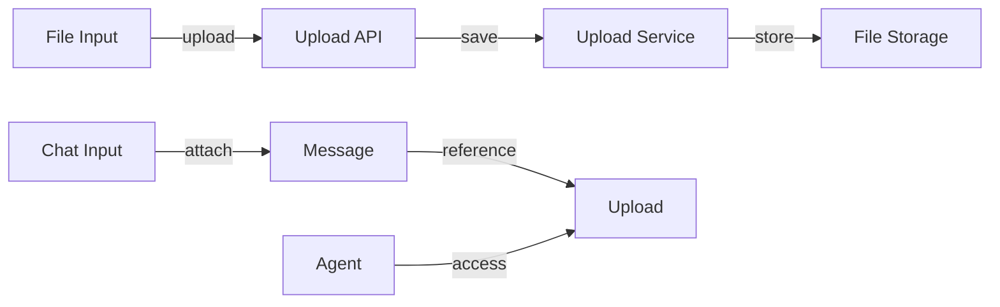

# Uploads Architecture

## Quick Reference

### Key Files
- **Upload Routes**: `apps/backend/routes/uploads.ts`
- **Upload Service**: `apps/backend/services/upload.service.ts`
- **Upload Hook**: `apps/frontend/src/features/uploads/hooks/use-upload.ts`
- **File Input**: `apps/frontend/src/features/tasks/components/chat-input/file-input.tsx`
- **Upload Types**: `packages/types/src/types/upload.types.ts`

### Core Methods
```typescript
// Upload Service
saveUpload(file: File, metadata: UploadMetadata): Promise<Upload>
getUpload(id: string): Promise<Upload | null>
deleteUpload(id: string): Promise<void>

// Frontend Hook
useUploadFile(): UseMutationResult<Upload, Error, File>
```

## Architecture Overview

Uploads enable file attachments in AI agent conversations, stored with unique IDs and metadata.



## Implementation Guide

### 1. Upload Structure
```typescript
// packages/types/src/types/upload.types.ts
interface Upload {
  id: string;
  filename: string;
  path: string;
  mimeType: string;
  size: number;
  uploadedAt: Date;
  metadata?: {
    taskId?: string;
    userId?: string;
  };
}
```

### 2. File Upload Flow
```typescript
// Frontend: apps/frontend/src/features/uploads/hooks/use-upload.ts
const { mutate: uploadFile } = useUploadFile();

const handleFileSelect = (file: File) => {
  uploadFile(file, {
    onSuccess: (upload) => {
      // Attach upload ID to message
      setAttachments([...attachments, upload.id]);
    }
  });
};

// Backend: apps/backend/routes/uploads.ts
app.post('/uploads', async (c) => {
  const body = await c.req.parseBody();
  const file = body.file as File;
  
  const upload = await uploadService.saveUpload(file, {
    taskId: body.taskId,
    userId: c.get('userId')
  });
  
  return c.json(upload);
});
```

### 3. Storage Implementation
```typescript
// apps/backend/services/upload.service.ts
async saveUpload(file: File, metadata: UploadMetadata) {
  const id = generateId();
  const ext = path.extname(file.name);
  const storagePath = `uploads/${id}${ext}`;
  
  // Save file to disk
  const buffer = await file.arrayBuffer();
  await fs.writeFile(`data/${storagePath}`, Buffer.from(buffer));
  
  // Save metadata
  const upload: Upload = {
    id,
    filename: file.name,
    path: storagePath,
    mimeType: file.type,
    size: file.size,
    uploadedAt: new Date(),
    metadata
  };
  
  await this.storage.save(`uploads/${id}.json`, upload);
  return upload;
}
```

## Common Patterns

### File Attachments in Messages
```typescript
// Chat input with file attachments
function ChatInput() {
  const [attachments, setAttachments] = useState<string[]>([]);
  const { mutate: uploadFile } = useUploadFile();
  
  const handleSubmit = () => {
    sendMessage({
      text: message,
      attachments // Array of upload IDs
    });
  };
  
  return (
    <>
      <FileInput onFileSelect={(file) => uploadFile(file)} />
      <AttachmentList attachments={attachments} />
      <button onClick={handleSubmit}>Send</button>
    </>
  );
}
```

### Agent Accessing Uploads
```typescript
// Agent receives upload references
const iteration = {
  message: "Analyze this file",
  attachments: ["upload-123", "upload-456"]
};

// Agent fetches upload details
const uploads = await Promise.all(
  iteration.attachments.map(id => uploadService.getUpload(id))
);

// Access file contents
for (const upload of uploads) {
  const content = await fs.readFile(`data/${upload.path}`);
  // Process file...
}
```

## Security Considerations

```typescript
// Validate file types
const ALLOWED_TYPES = ['text/plain', 'application/json', 'image/*'];
if (!ALLOWED_TYPES.some(t => file.type.match(t))) {
  throw new Error('File type not allowed');
}

// Size limits
const MAX_SIZE = 10 * 1024 * 1024; // 10MB
if (file.size > MAX_SIZE) {
  throw new Error('File too large');
}

// Sanitize filenames
const safeName = sanitizeFilename(file.name);
```

## API Endpoints

```typescript
POST   /api/v1/uploads      // Upload file
GET    /api/v1/uploads/:id  // Get upload metadata
DELETE /api/v1/uploads/:id  // Delete upload
```