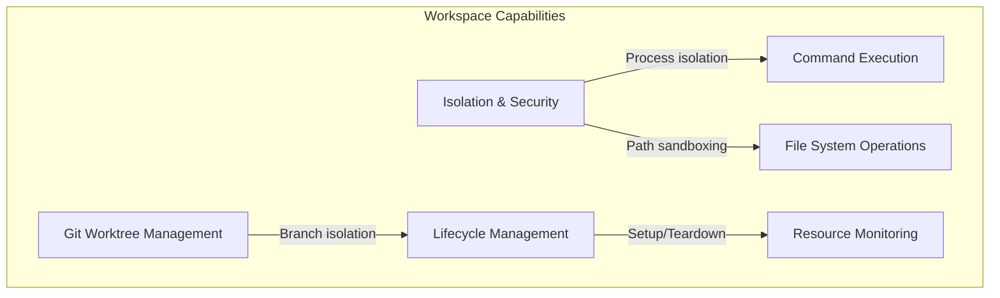
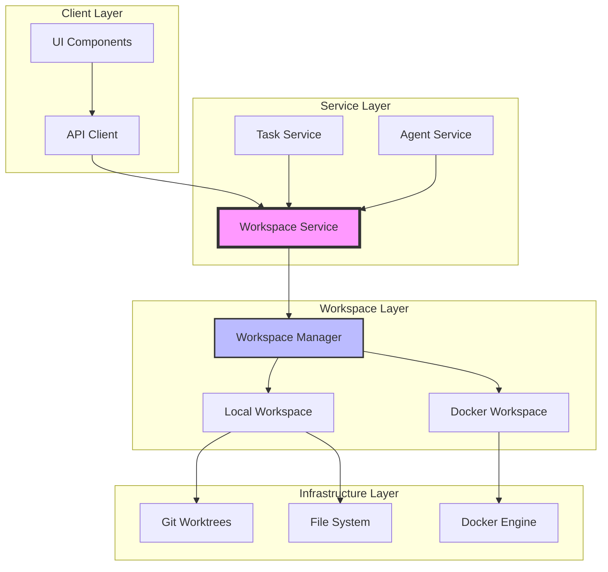
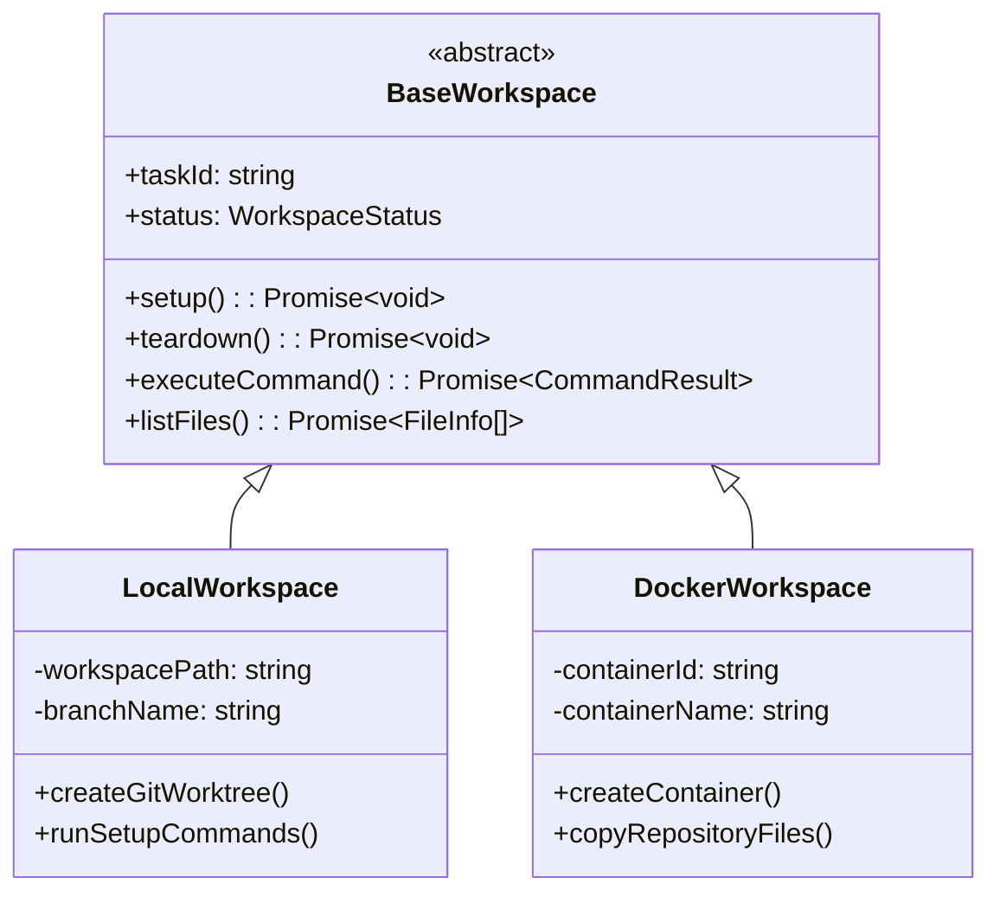
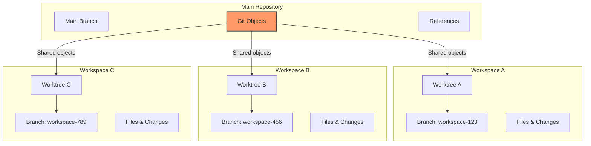
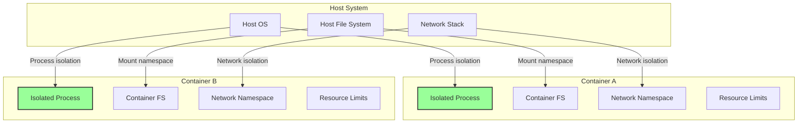
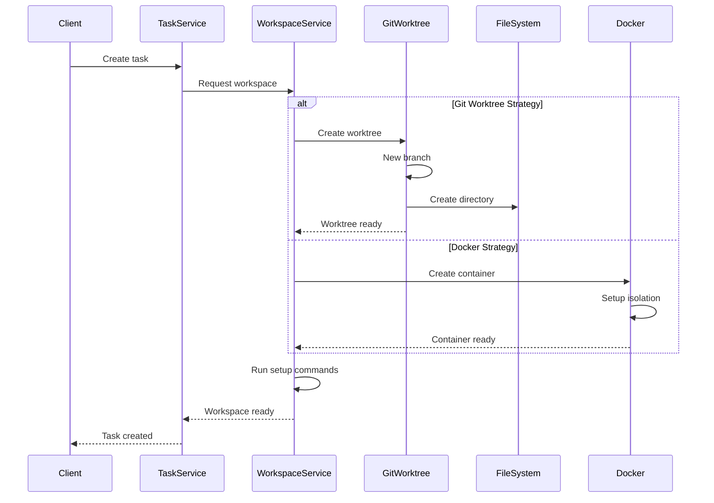
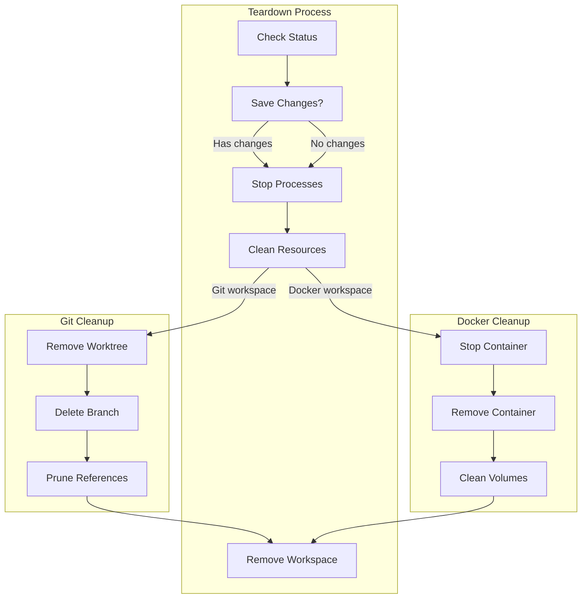

# Workspace Architecture

## Table of Contents
1. [Overview](#overview)
2. [Architectural Principles](#architectural-principles)
3. [Core Architecture](#core-architecture)
4. [Isolation Architecture](#isolation-architecture)
5. [Lifecycle Management](#lifecycle-management)
6. [Security Architecture](#security-architecture)
7. [Integration Architecture](#integration-architecture)
8. [Performance & Scalability](#performance--scalability)
9. [Monitoring & Observability](#monitoring--observability)
10. [Best Practices](#best-practices)

## Overview

### Purpose
The Workspace system creates **isolated execution environments** for AI agents, enabling safe and concurrent task execution while maintaining complete separation between tasks and protecting the main repository.

### Key Capabilities


### Strategic Value
- **Complete Task Isolation**: Every task operates in its own environment
- **Concurrent Execution**: Multiple agents work simultaneously without conflicts
- **Version Control Safety**: Git worktrees prevent code conflicts
- **Resource Management**: Controlled allocation and cleanup
- **Security Boundaries**: Sandboxed execution prevents system access

### Workspace Capabilities

The workspace service provides capability checking to ensure operations are only performed when the workspace is in an appropriate state:

1. **File Operations** (`apps/backend/services/workspace.service.ts`)
   - `canListFiles()`: Available when workspace exists (any state except NOT_SETUP)
   - `canReadWriteFiles()`: Available during setup, idle, or running states
   - `canSearchFiles()`: Available when workspace is initialized

2. **Command Execution**
   - `canExecuteCommands()`: Only when workspace is in IDLE state
   - Prevents command execution during setup or when agent is running
   - Ensures exclusive access to command execution

3. **Git Operations**
   - `canAccessGit()`: Available when workspace exists
   - Includes diff generation, branch info, commit status
   - Works even during active development

4. **Server Management** (Preview Environments)
   - `canManageServer()`: Available in IDLE or RUNNING states
   - Start/stop/restart development servers
   - Port forwarding and log access

5. **State-Based Availability**
   ```
   NOT_SETUP:     No operations available
   SETTING_UP:    File operations only
   IDLE:          All operations available
   RUNNING:       File/git operations, no commands
   ERROR:         Limited to cleanup operations
   ```

## Architectural Principles

### Core Design Principles

1. **Complete Isolation**: Each task operates in a completely separate environment
2. **Security by Design**: All operations are sandboxed and validated
3. **Resource Efficiency**: Shared git objects, lazy initialization
4. **Concurrent Safety**: Multiple agents can work simultaneously
5. **Separation of Concerns**: Worker mode is a deployment decision, not a workspace type

### Worker Mode Architecture

**Important**: Worker mode is not a separate workspace type but rather a deployment architecture for Docker workspaces. When using Docker workspaces, the backend always runs inside the container (worker mode) to ensure proper isolation and security.

Key principles:
- **Single Responsibility**: DockerWorkspace handles container management, not mode detection
- **Deployment Concern**: The decision to run in worker mode is made at the deployment/configuration level
- **Always Worker**: Docker workspaces inherently run the backend inside containers for isolation
- **Communication**: Host-to-container communication via HTTP and SSE is the standard pattern

## Core Architecture

### System Architecture



**Implementation Details:**

The workspace system architecture is organized into distinct layers:

1. **Service Layer** - Core business logic
   - `apps/backend/services/workspace.service.ts` - Main workspace service orchestrating all workspace operations
     - Worker mode selection: Uses `repository.codeExecution.workspaceType` OR `process.env.DEFAULT_WORKSPACE_TYPE`
     - Setup persistence: Saves workspace path to task storage after successful setup
     - Force cleanup: Always uses `force: true` internally for workspace cleanup
     - Git status checking: Conditional based on workspace type (LocalWorkspace only)
   - `apps/backend/services/task.service.ts` - Task service that requests workspace creation
   - `apps/backend/services/agents/` - Agent implementations that execute within workspaces

2. **Workspace Layer** - Workspace implementations
   - `apps/backend/workspaces/base.ts` - Abstract base class defining workspace interface
   - `apps/backend/workspaces/local.ts` - Local filesystem workspace using git worktrees
   - `apps/backend/workspaces/docker.ts` - Docker container-based workspace implementation

3. **Infrastructure Layer** - Low-level utilities
   - `apps/backend/utils/git-utils.ts` - Git operations including worktree management
   - `apps/backend/utils/file-search.ts` - File system search utilities

### Workspace Hierarchy



**Workspace Class Implementation Details:**

1. **BaseWorkspace Abstract Class** (`apps/backend/workspaces/base.ts`)
   - Defines common interface for all workspace types
   - Properties:
     - `taskId`: Unique identifier linking to task
     - `repositoryConfig`: Configuration from repository service
     - `eventService`: For emitting workspace events
   - Abstract methods that subclasses must implement:
     - `setup()`: Initialize workspace environment
     - `teardown()`: Clean up resources
     - `runCommand()`: Execute shell commands
     - `listFiles()`: Directory traversal
     - `readFile()`: File content retrieval
     - `writeFile()`: File modification
     - `searchFiles()`: File search functionality
     - `getGitDiff()`: Version control changes
     - `isWorkspacePathValid()`: Check if workspace path/container is valid
     - `toWorkspaceInfo()`: Convert to storage-compatible object
     - `getWorkspacePath()`: Get workspace path or container ID
   - Optional server management methods:
     - `startServer()`: Start development server
     - `stopServer()`: Stop development server
     - `restartServer()`: Restart development server
     - `getServerStatus()`: Get server running status
     - `getServerLogs()`: Retrieve server logs

2. **LocalWorkspace Implementation** (`apps/backend/workspaces/local.ts`)
   - Uses git worktrees for isolation
   - Key methods:
     - `createGitWorktree()`: Sets up isolated git working directory
     - `runSetupCommands()`: Executes npm install, pip install, etc.
     - `validatePath()`: Ensures operations stay within workspace
     - `executeCommand()`: Runs commands with timeout and resource limits
     - `getGitStatus()`: Returns detailed git sync status with origin
     - `hasUnmergedCommits()`: Checks for commits not in base branch
     - `isBehindBase()`: Checks if workspace is behind base branch
     - `getOriginSyncStatus()`: Gets sync status with origin remote
   - State management:
     - Tracks setup progress with `setupInProgress` and `setupComplete` flags
     - Monitors running processes
     - Manages background tasks
     - Auto-recreates missing worktrees during setup
   - Branch detection:
     - Intelligently detects existing branches from workspace paths
     - Handles recovery when worktree is missing but branch exists
   - Server management:
     - Methods delegate to PreviewEnvironmentService
     - Throws errors directing users to use preview environment endpoints

3. **DockerWorkspace Implementation** (`apps/backend/workspaces/docker.ts`)
   - Container-based isolation that always runs in worker mode
   - Key methods:
     - `createContainer()`: Docker container initialization
     - `executeInContainer()`: Runs commands inside Docker
     - `getContainerLogs()`: Retrieves execution logs
   - Architecture:
     - Runs the entire backend inside the container
     - Uses SSE (Server-Sent Events) for real-time event streaming
     - HTTP communication with worker backend on port 8001
     - Health check polling during setup
     - Agent execution triggered via HTTP endpoints
     - Maintains `eventStreamController` for SSE connections
   - File Operations:
     - Uses `WorkspaceFileOperations` utility class for direct file access
     - All file operations happen within the container
   - Container lifecycle:
     - Creates named containers per task: `moatless-task-<task-id>`
     - Manages volume mounts and environment variables
     - Uses custom Docker image with backend pre-installed

## Isolation Architecture

### Git Worktree Isolation



**Git Worktree Implementation Details:**

Git worktrees provide workspace isolation through separate working directories while sharing the same git repository objects. Here's how it works:

1. **Worktree Creation** (`apps/backend/utils/git-utils.ts:createGitWorktree()`)
   - Each task gets its own worktree with a dedicated branch
   - Branch naming convention: `workspace-<task-id>`
   - Worktree path: `<repo-parent>/<repo-name>-workspace-<task-id>`
   - Creation command: `git worktree add -b "workspace-<task-id>" "<path>"`
   - Handles existing branch conflicts by creating alternative names
   - Detects if branch is already checked out in another worktree

2. **Branch Isolation** (`apps/backend/workspaces/local.ts`)
   - Each workspace operates on its own branch
   - Changes are isolated from main repository and other workspaces
   - Prevents conflicts between concurrent AI agents
   - Branches can be merged back to main when task completes
   - Auto-recovery: Recreates missing worktrees if branch still exists

3. **Git Utilities** (`apps/backend/utils/git-utils.ts`)
   - **Origin-Aware Operations**: Most functions prioritize `origin/branch` over local branches
   - **Comprehensive Status**: `getComprehensiveGitStatus()` provides detailed sync information:
     - Current branch and tracking status
     - Commits ahead/behind origin
     - Modified files and staging area
     - Untracked files
   - **Worktree Management**:
     - `isGitWorktree()`: Detects if path is a worktree
     - `isBranchCheckedOut()`: Checks if branch is in use
     - `getWorktreeBranch()`: Retrieves branch name from worktree
   - **Advanced Diff**: `getGitDiffDetailed()` returns structured diff with:
     - File-by-file changes
     - Full file contents for new/deleted files
     - Line-by-line modifications
   - **Origin Sync Functions**:
     - `fetchLatestFromOrigin()`: Updates from remote
     - `isOriginBranch()`: Checks if branch exists on origin
     - `getOriginBranchName()`: Gets corresponding origin branch

### Git Status vs Git Changes

The workspace system provides two distinct ways to track repository state, each serving different purposes:

#### GitStatus - Repository Synchronization State
**Purpose**: Tracks synchronization status with base branch and origin remote
**Use Case**: Understanding branch relationships and merge requirements

```typescript
interface GitStatus {
  currentBranch: string;          // Current workspace branch
  baseBranch: string;             // Base branch (usually main/master)
  hasUncommittedChanges: boolean; // Working directory dirty state
  hasConflicts: boolean;          // Merge conflicts detected
  status: GitSyncStatus;          // Sync state: 'synced' | 'ahead' | 'behind' | 'diverged' | 'uncommitted_changes' | 'error'
  commitsAhead: number;           // Commits ahead of base branch
  commitsBehind: number;          // Commits behind base branch
  originExists: boolean;          // Origin remote availability
  additions?: number;             // File changes vs base branch
  deletions?: number;             // File deletions vs base branch
  modifications?: number;         // File modifications vs base branch
}
```

**Key Characteristics:**
- Compares current branch to base branch (e.g., main)
- Tracks branch divergence and merge requirements
- Includes origin remote synchronization state
- Shows relationship between workspace and main repository
- Used for understanding branch management needs

#### GitChanges - Working Directory State
**Purpose**: Tracks actual changes in the working directory
**Use Case**: Understanding current work progress and file modifications

```typescript
interface GitChanges {
  currentBranch: string;    // Current workspace branch
  status: string;           // Simple status: 'clean' | 'modified' | 'error'
  additions: number;        // Lines added in working directory
  deletions: number;        // Lines deleted in working directory
  modifications: number;    // Files modified in working directory
}
```

**Key Characteristics:**
- Focuses on working directory state only
- Counts actual line changes and file modifications
- Includes staged, unstaged, and untracked changes
- Independent of base branch comparison
- Reflects immediate development activity

#### When to Use Each

**Use GitStatus when:**
- Planning branch merges or rebases
- Understanding sync requirements with main branch
- Checking for merge conflicts before integration
- Monitoring branch divergence over time
- Coordinating with team repository state

**Use GitChanges when:**
- Tracking task iteration progress
- Measuring development activity
- Understanding scope of current work
- Providing simple status indicators
- Monitoring file change velocity

#### Implementation in Task Iterations

Task iterations now capture `GitChanges` instead of `GitStatus` to better reflect the actual work performed:

```typescript
interface TaskIteration {
  // ... other fields
  gitChanges?: GitChanges;  // Working directory changes (new)
  // gitStatus was removed in favor of gitChanges
}
```

This change provides a clearer picture of the work accomplished in each iteration, focusing on tangible changes rather than repository synchronization state.

### Docker Container Isolation



**Docker Container Implementation Details:**

Docker provides complete process and resource isolation for workspace execution. Docker workspaces always operate in worker mode, where the backend runs inside the container:

1. **Container Creation** (`apps/backend/workspaces/docker.ts:setup()`)
   - Container naming: `moatless-task-<task-id>`
   - Uses custom Docker image with backend pre-installed
   - Mounts workspace at `/workspace` and data at `/data`
   - Starts backend automatically (no `sleep infinity`)

2. **Worker Mode Architecture**
   - **Backend in Container**: Full backend runs inside Docker container
   - **SSE Communication**: Real-time event streaming from container to host
   - **HTTP API**: Worker exposes endpoints on port 8001:
     - `/health`: Health check endpoint
     - `/execute`: Run commands
     - `/execute-agent`: Execute AI agents
     - `/stop-agent`: Stop running agents
     - `/events/stream`: SSE event stream
   - **Health Monitoring**: Polls `/health` during setup (max 30 attempts)
   - **Event Streaming**: Maintains persistent SSE connection for real-time updates
   - **Resource Limits**: Configurable CPU and memory limits
   - **Environment Variables**:
     - `WORKER_MODE=true`: Indicates worker mode
     - `WORKER_API_URL`: API URL for host communication
     - `WORKER_TASK_ID`: Task identifier
     - `WORKSPACE_DIR=/workspace`: Working directory
     - `DATA_DIR=/data`: Data storage directory

## Lifecycle Management

### Workspace Creation Flow



**Detailed Workspace Creation Process:**

1. **Task Creation** (`apps/backend/services/task.service.ts`)
   - Client initiates task creation through API endpoint
   - Task service validates repository configuration
   - Generates unique task ID for workspace isolation

2. **Workspace Request** (`apps/backend/services/workspace.service.ts:createWorkspace()`)
   - WorkspaceService receives task ID and repository ID
   - Retrieves repository configuration to determine workspace type
   - Workspace type selection logic:
     - First checks `repository.codeExecution.workspaceType`
     - Falls back to `process.env.DEFAULT_WORKSPACE_TYPE` if not specified
     - Options: `local` (git worktree) or `docker` (container with worker mode)
   - Validates prerequisites (Docker installed for container workspaces)
   - Stores workspace path in task metadata after successful setup

3. **Git Worktree Creation** (for Local workspaces)
   - **Path Generation** (`workspace.service.ts:createWorkspaceRepository()`)
     - Constructs workspace path: `<WORKTREE_DIR>/<repo-name>-workspace-<task-id>`
     - Default worktree directory: `../` relative to repository path
     - Can be overridden with `WORKTREE_DIR` environment variable
   
   - **Branch Creation** (`utils/git-utils.ts:createGitWorktree()`)
     - Creates new branch named `workspace-<task-id>`
     - If branch exists and is checked out, creates alternative branch
     - Executes: `git worktree add -b "<branch-name>" "<workspace-path>"`
   
   - **Validation**
     - Verifies repository is a git repository
     - Ensures worktree directory exists and is writable
     - Handles existing worktrees gracefully

4. **Docker Container Creation** (for Docker workspaces)
   - **Container Setup** (`apps/backend/workspaces/docker.ts:setup()`)
     - Creates container with name `moatless-task-<task-id>`
     - Uses Docker image with backend pre-installed
     - Mounts volumes:
       - Repository path to `/workspace`
       - Data directory to `/data`
     - Sets environment variables:
       - `WORKER_MODE=true`
       - `WORKER_API_URL` for host communication
       - `WORKER_TASK_ID` for task identification
       - Authentication credentials (Claude API keys)
   
   - **Container Initialization**
     - Starts backend automatically (image ENTRYPOINT)
     - Waits for health check at `http://localhost:8001/health`
     - Executes setup commands defined in repository config
     - No file copying needed - workspace is mounted directly

5. **Setup Commands Execution**
   - **Local Workspace** (`apps/backend/workspaces/local.ts:runSetupCommandsInBackground()`)
     - Runs commands like `npm install`, `pip install`, etc.
     - Executes in background to allow immediate workspace availability
     - Emits events for command progress tracking
   
   - **Docker Workspace**
     - Runs setup commands inside container
     - Each command execution is tracked and logged
     - Failures in setup commands mark workspace as errored

6. **Workspace Registration**
   - Workspace instance stored in `activeWorkspaces` Map
   - Workspace path saved to task metadata for recovery
   - Status transitions from `initializing` to `ready`

### Workspace Teardown Flow



**Detailed Workspace Teardown Process:**

1. **Cleanup Initiation** (`apps/backend/services/workspace.service.ts:cleanupWorkspace()`)
   - Triggered when task completes, fails, or is manually stopped
   - Logs cleanup start time for performance tracking
   - Retrieves workspace from `activeWorkspaces` Map

2. **Status Verification**
   - Checks current workspace status and type
   - Determines if force cleanup is needed (always true in current implementation)
   - Captures workspace path before cleanup for logging

3. **Local Workspace Teardown** (`apps/backend/workspaces/local.ts:teardown()`)
   - **Process Termination**
     - Stops any running agent processes
     - Kills server processes if preview environment is active
     - Ensures all child processes are terminated
   
   - **Git Worktree Removal** (`utils/git-utils.ts:removeGitWorktree()`)
     - Executes: `git worktree remove --force "<workspace-path>"`
     - Force flag ensures removal even with uncommitted changes
     - Handles cases where worktree is already removed
   
   - **Branch Cleanup**
     - Deletes workspace branch: `git branch -D workspace-<task-id>`
     - Prunes worktree references: `git worktree prune`
     - Cleans up any dangling references

4. **Docker Workspace Teardown** (`apps/backend/workspaces/docker.ts:teardown()`)
   - **Container Stopping**
     - Gracefully stops container: `docker stop "<container-id>"`
     - Waits for container to stop with timeout
     - Force kills if graceful stop fails
   
   - **Container Removal**
     - Removes container: `docker rm -f "<container-id>"`
     - Cleans up associated volumes if configured
     - Removes any temporary files created during execution
   
   - **Resource Cleanup**
     - Releases allocated ports
     - Cleans up network configurations
     - Removes any created volumes

5. **Workspace Deregistration**
   - Removes workspace from `activeWorkspaces` Map
   - Updates task metadata to reflect workspace removal
   - Emits workspace deleted event for audit trail

6. **Error Handling During Teardown**
   - Catches and logs all errors without rethrowing
   - Ensures workspace is removed from active list even if teardown fails
   - Provides detailed error logging for debugging
   - Total cleanup time is tracked and logged

## Repository Configuration

### Workspace Configuration Schema

The repository configuration schema (`packages/shared/schemas/repository.schemas.ts`) defines how workspaces are configured:

```typescript
CodeExecutionSchema: {
  type: 'local' | 'docker',
  workspaceType?: 'local' | 'docker',  // Explicit workspace type
  dockerImage?: string,                 // Docker image with backend
  workerResources?: {                   // Resource limits for containers
    cpuLimit?: string,
    memoryLimit?: string
  },
  setupCommands: string[],
  environmentVariables?: Record<string, string>
}
```

### Configuration Fields

1. **Workspace Type Selection**
   - `type`: Legacy field for basic workspace type
   - `workspaceType`: Explicit workspace type selection (takes precedence)
   - Falls back to `DEFAULT_WORKSPACE_TYPE` environment variable
   - Options: `local` or `docker`

2. **Docker Configuration**
   - `dockerImage`: Docker image with backend pre-installed (required for Docker workspaces)
   - `workerResources`: CPU and memory limits for containers
   - Docker workspaces always run in worker mode with backend inside container

3. **Repository Fields** (merged into RepositoryConfig)
   - `path`: Local filesystem path to repository
   - `useGitWorktrees`: Enable git worktree-based workspaces (for local mode)
   - `originalBranch`: Base branch for workspace creation

## Security Architecture

### Path Validation

All workspace operations include strict path validation to prevent directory traversal attacks:

1. **Local Workspace** (`validatePath()`)
   - Ensures all paths resolve within workspace directory
   - Prevents access to parent directories
   - Validates symbolic links stay within bounds

2. **Docker Workspace**
   - Container isolation provides natural boundaries
   - Volume mounts restricted to workspace directory
   - No host filesystem access outside defined mounts

### Process Isolation

1. **Command Execution**
   - Commands run with restricted permissions
   - Environment variables sanitized
   - Resource limits enforced (CPU, memory, timeout)

2. **Agent Execution**
   - Agents run within workspace context
   - No access to host system resources
   - File system operations sandboxed

## Integration Architecture

### Preview Environment Integration

Workspaces integrate with the Preview Environment service for development server management:

1. **Server Operations**
   - Workspace delegates server management to PreviewEnvironmentService
   - Maintains separation of concerns
   - Enables port forwarding and log access

2. **Lifecycle Coordination**
   - Preview environments tied to workspace lifecycle
   - Automatic cleanup on workspace teardown
   - Server processes managed independently

### Event System Integration

Workspaces emit events throughout their lifecycle. All workspace events use `EventType.WORKSPACE` with various subtypes:

#### Event Structure
```typescript
{
  eventId: string,              // Unique event ID (UUID)
  agentType: 'system',          // Always 'system' for workspace events
  type: EventType.WORKSPACE,    // Event type constant
  subType: string,              // Specific workspace action
  taskId: string,               // Associated task ID
  iterationId?: number,         // Optional iteration number
  timestamp: Date,              // Event timestamp
  isError: boolean,             // Error flag
  payload: object               // Event-specific data
}
```

#### Currently Implemented Events

**Note**: Currently, only Docker workspaces emit events. Local workspaces rely on logging instead of event emission.

1. **Setup Lifecycle Events** (Docker only)
   - `setup_completed`: Docker container setup successful
     - Payload: `{ containerId: string }`
     - Emitted when container is created and started
   
   - `setup_failed`: Docker container setup failed
     - Payload: `{ error: string }`
     - Emitted when container creation or startup fails

2. **Command Execution Events** (Docker only)
   - `command_completed`: Setup command executed successfully
     - Payload: `{ command: string, durationMs: number }`
     - Emitted for each successful setup command
   
   - `command_failed`: Setup command execution failed
     - Payload: `{ command: string, error: string, exitCode?: number }`
     - Emitted when a setup command fails or throws an error
