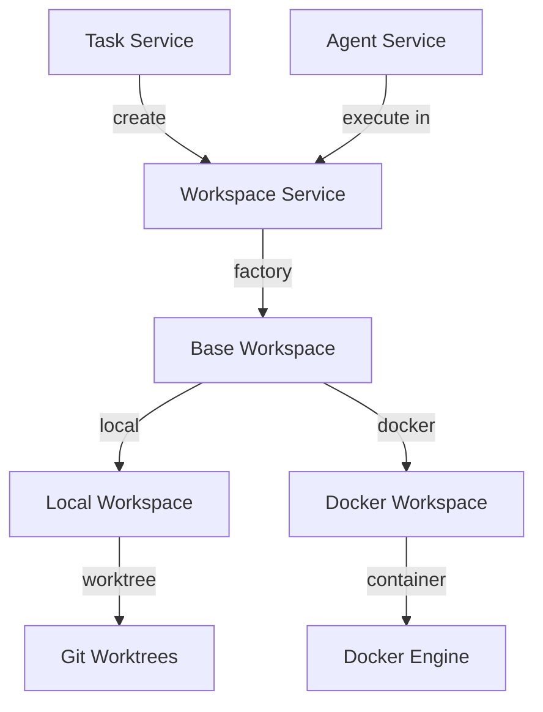

# Workspace Architecture

## Quick Reference

### Key Files
- **Workspace Service**: `apps/backend/services/workspace.service.ts`
- **Base Workspace**: `apps/backend/workspaces/base.ts`
- **Local Workspace**: `apps/backend/workspaces/local.ts`
- **Docker Workspace**: `apps/backend/workspaces/docker.ts`
- **Git Utilities**: `apps/backend/utils/git-utils.ts`
- **Workspace Routes**: `apps/backend/routes/workspace.routes.ts`

### Core Methods
```typescript
// Workspace Service
createWorkspace(taskId: string, repositoryId: string): Promise<void>
cleanupWorkspace(taskId: string): Promise<void>
getWorkspaceStatus(taskId: string): Promise<WorkspaceStatus>
executeCommand(taskId: string, command: string): Promise<CommandResult>
listFiles(taskId: string, path: string): Promise<FileInfo[]>
readFile(taskId: string, path: string): Promise<string>
writeFile(taskId: string, path: string, content: string): Promise<void>
```

## Architecture Overview

Workspaces provide isolated execution environments for AI agents using either Git worktrees (local) or Docker containers.



## Workspace Types

### 1. Local Workspace (Git Worktrees)
```typescript
// apps/backend/workspaces/local.ts
class LocalWorkspace extends BaseWorkspace {
  async setup() {
    // Create git worktree
    const branchName = `workspace-${this.taskId}`;
    await createGitWorktree(this.repoPath, branchName, this.workspacePath);
    
    // Run setup commands
    for (const cmd of this.config.setupCommands) {
      await this.executeCommand(cmd);
    }
  }
  
  async teardown() {
    // Remove worktree and branch
    await removeGitWorktree(this.workspacePath);
    await deleteBranch(this.branchName);
  }
}
```

### 2. Docker Workspace (Container Isolation)
```typescript
// apps/backend/workspaces/docker.ts
class DockerWorkspace extends BaseWorkspace {
  async setup() {
    // Create container
    this.containerId = await docker.createContainer({
      Image: this.config.dockerImage,
      name: `moatless-task-${this.taskId}`,
      Env: ['WORKER_MODE=true', `WORKER_TASK_ID=${this.taskId}`],
      HostConfig: {
        Binds: [`${this.repoPath}:/workspace`]
      }
    });
    
    await docker.startContainer(this.containerId);
    await this.waitForHealthCheck();
  }
}
```

## Implementation Guide

### 1. Workspace Creation Flow
```typescript
// apps/backend/services/workspace.service.ts
async createWorkspace(taskId: string, repositoryId: string) {
  // Get repository config
  const repo = await this.repositoryService.getRepository(repositoryId);
  
  // Determine workspace type
  const type = repo.codeExecution?.workspaceType || 
               process.env.DEFAULT_WORKSPACE_TYPE || 
               'local';
  
  // Create workspace instance
  const workspace = type === 'docker' 
    ? new DockerWorkspace(taskId, repo)
    : new LocalWorkspace(taskId, repo);
  
  // Setup workspace
  await workspace.setup();
  
  // Register workspace
  this.activeWorkspaces.set(taskId, workspace);
  
  // Save path to task
  await this.taskService.updateWorkspacePath(taskId, workspace.getPath());
}
```

### 2. Workspace Capabilities
```typescript
// State-based capability checking
interface WorkspaceCapabilities {
  canListFiles(): boolean;      // NOT_SETUP → false, others → true
  canReadWriteFiles(): boolean;  // SETUP, IDLE, RUNNING → true
  canExecuteCommands(): boolean; // Only IDLE → true
  canAccessGit(): boolean;       // Exists → true
  canManageServer(): boolean;    // IDLE, RUNNING → true
}

// Usage
const workspace = await workspaceService.getWorkspace(taskId);
if (workspace.canExecuteCommands()) {
  const result = await workspace.executeCommand('npm test');
}
```

### 3. Git Status vs Git Changes
```typescript
// GitStatus - Repository sync state
interface GitStatus {
  currentBranch: string;
  baseBranch: string;
  status: 'synced' | 'ahead' | 'behind' | 'diverged';
  commitsAhead: number;
  commitsBehind: number;
  hasUncommittedChanges: boolean;
}

// GitChanges - Working directory state
interface GitChanges {
  status: 'clean' | 'modified' | 'error';
  additions: number;    // Lines added
  deletions: number;    // Lines deleted
  modifications: number; // Files modified
}
```

## Common Patterns

### Path Validation
```typescript
// Ensure operations stay within workspace
validatePath(requestedPath: string): string {
  const resolved = path.resolve(this.workspacePath, requestedPath);
  if (!resolved.startsWith(this.workspacePath)) {
    throw new Error('Path traversal detected');
  }
  return resolved;
}
```

### Command Execution
```typescript
// Execute with timeout and resource limits
async executeCommand(command: string, options?: ExecOptions) {
  const timeout = options?.timeout || 30000;
  const maxBuffer = 10 * 1024 * 1024; // 10MB
  
  const result = await exec(command, {
    cwd: this.workspacePath,
    timeout,
    maxBuffer,
    shell: true
  });
  
  return {
    stdout: result.stdout,
    stderr: result.stderr,
    exitCode: result.code || 0
  };
}
```

### Workspace Recovery
```typescript
// Recover workspace after crash
async recoverWorkspace(taskId: string) {
  const task = await this.taskService.getTask(taskId);
  if (!task.workspacePath) return null;
  
  // Check if workspace still exists
  if (await fs.pathExists(task.workspacePath)) {
    // Recreate workspace instance
    const workspace = new LocalWorkspace(taskId, task.repository);
    workspace.workspacePath = task.workspacePath;
    
    // Verify git worktree
    if (await isGitWorktree(task.workspacePath)) {
      this.activeWorkspaces.set(taskId, workspace);
      return workspace;
    }
  }
  
  // Workspace lost, recreate
  await this.createWorkspace(taskId, task.repositoryId);
}
```

## Configuration

### Repository Configuration
```typescript
// packages/types/schemas/repository.schemas.ts
interface CodeExecutionConfig {
  workspaceType?: 'local' | 'docker';
  dockerImage?: string;              // Required for docker
  setupCommands: string[];           // npm install, etc.
  environmentVariables?: Record<string, string>;
  workerResources?: {
    cpuLimit?: string;
    memoryLimit?: string;
  };
}
```

### Environment Variables
```bash
# Default workspace type if not specified in repo
DEFAULT_WORKSPACE_TYPE=local

# Custom worktree directory (default: ../)
WORKTREE_DIR=/path/to/worktrees

# Docker workspace settings
DOCKER_HOST=unix:///var/run/docker.sock
WORKER_API_URL=http://host.docker.internal:8000
```

## Troubleshooting

| Issue | Check | Solution |
|-------|-------|----------|
| Workspace creation fails | Git repository valid? | Ensure repo is cloned |
| Docker workspace timeout | Container started? | Check Docker daemon |
| Commands not executing | Workspace state | Must be IDLE state |
| Worktree conflicts | Branch already exists | Use different task ID |
| Path traversal error | Requested path | Keep paths relative |