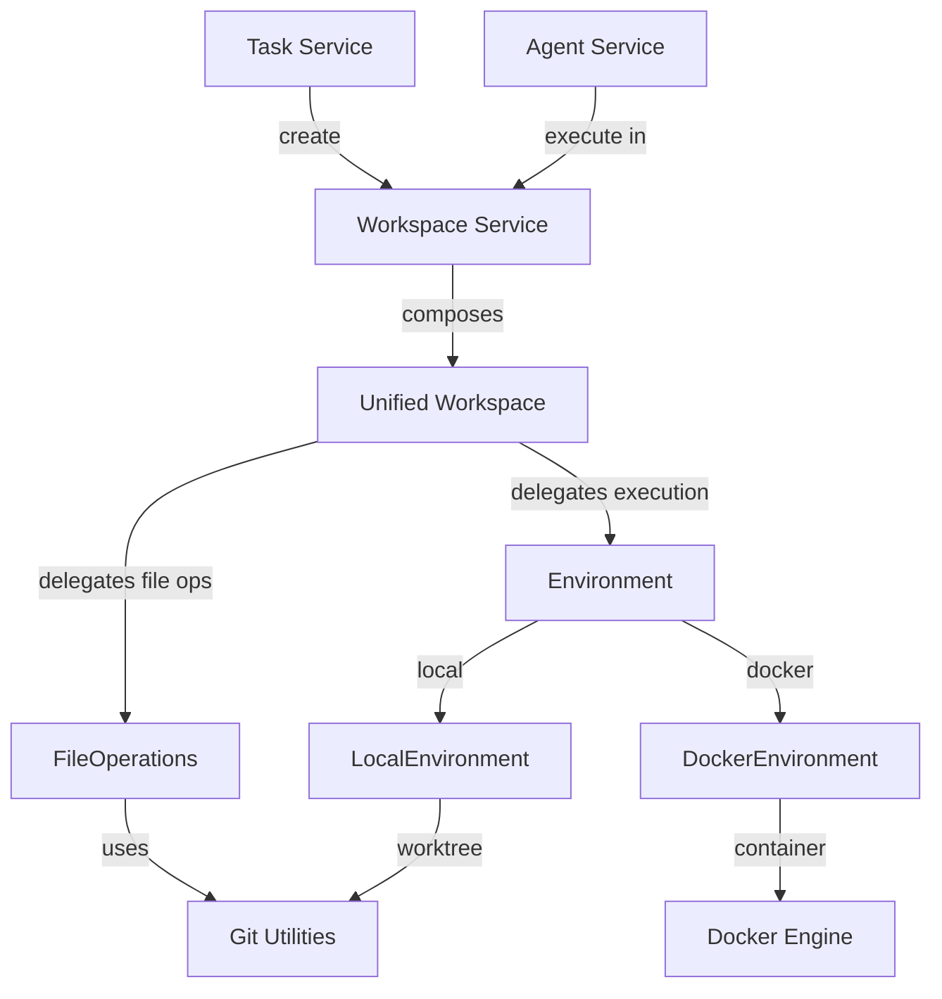
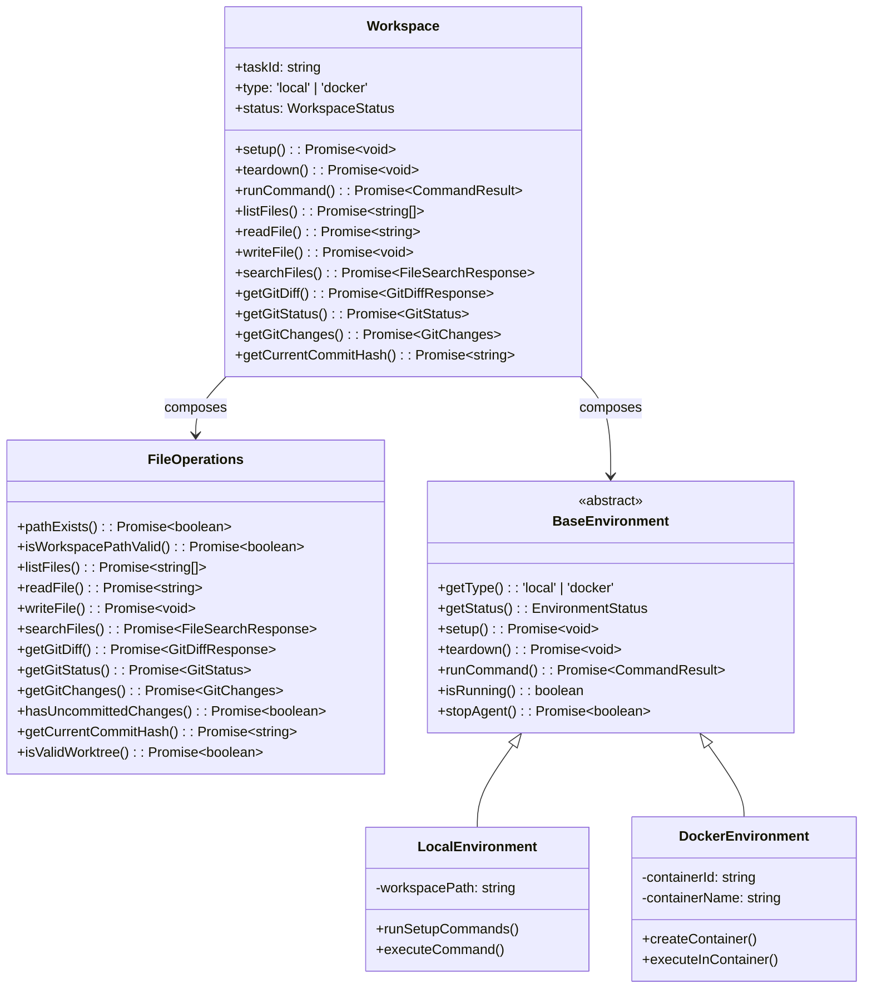

# Workspace Architecture

> **Note**: This document is intended to be read by LLMs (Language Learning Models) to understand the workspace system implementation, patterns, and troubleshooting approaches.

## Quick Reference

### Key Files
- **Workspace Service**: `apps/backend/services/workspace.service.ts`
- **Unified Workspace**: `apps/backend/workspaces/workspace.ts`
- **File Operations**: `apps/backend/services/file-operations.service.ts`
- **Local Environment**: `apps/backend/environments/local-environment.ts`
- **Docker Environment**: `apps/backend/environments/docker-environment.ts`
- **Git Utilities**: `apps/backend/utils/git-utils.ts`
- **Workspace Routes**: `apps/backend/routes/workspace.routes.ts`

### Core Methods
**Workspace Service** (`apps/backend/services/workspace.service.ts`):
- `createWorkspace()` (lines 30-66) - Creates new workspace with environment
- `cleanupWorkspace()` (lines 560-590) - Environment cleanup only, no worktree removal
- `removeWorktree()` (lines 241-258) - Worktree removal for task close/delete only
- `getOrCreateWorkspace()` (lines 308-370) - Gets existing or creates new workspace
- `ensureWorktreeExists()` (lines 143-188) - Recreates missing worktrees
- `getLastIterationBranch()` (lines 209-235) - Gets branch from last completed iteration
- `removeWorktreeIfExists()` (lines 263-306) - Internal worktree removal helper

## Architecture Overview

Workspaces provide isolated execution environments for AI agents using either Git worktrees (local) or Docker containers. The architecture separates file operations from execution environments for better modularity.

## New Architecture Design

### Composition-Based Architecture

### Key Components

1. **Unified Workspace** (`apps/backend/workspaces/workspace.ts`)
   - Single implementation replacing LocalWorkspace and DockerWorkspace
   - Composes FileOperations for file/git operations
   - Composes Environment for command execution
   - Delegates operations to appropriate services

2. **FileOperations Service** (`apps/backend/services/file-operations.service.ts`)
   - Handles all file system operations
   - Manages git operations (diff, status, changes, commit hash)
   - Path validation and security
   - File size limits and safety checks
   - **NEW**: `getCurrentCommitHash()` method
   - **NEW**: `isValidWorktree()` method for validation

3. **Environment Abstractions**
   - **LocalEnvironment**: Git worktree-based execution
   - **DockerEnvironment**: Container-based isolation
   - Both implement BaseEnvironment interface

## Critical Implementation Details

### Workspace Lifecycle Management

#### 1. Workspace Creation and Recreation
**Logic Location**: `apps/backend/services/workspace.service.ts:282-299`

When workspace path is missing, the system automatically recreates it:
- Checks if path exists and is valid worktree using `isGitWorktree()` from git-utils
- Gets branch from last completed iteration via `getLastIterationBranch()`
- Uses priority: explicit branchName → last iteration branch → undefined (creates new)
- Calls `ensureWorktreeExists()` to recreate worktree at same path

#### 2. Task Iteration Git Tracking
**Schema Location**: `packages/types/src/schemas/task.schemas.ts:54` (commitHash field)
**Capture Location**: `apps/backend/services/agent.service.ts:311-335` (success) and `apps/backend/services/agent.service.ts:399-425` (failure)

Each task iteration stores:
- `commitHash` - Commit hash when iteration completes (NEW)
- `gitStatus` - Sync state with base branch
- `gitChanges` - Working directory changes

Agent service captures git info on iteration completion by calling:
- `workspace.getGitStatus()` → `fileOperations.getGitStatus()`
- `workspace.getGitChanges()` → `fileOperations.getGitChanges()`
- `workspace.getCurrentCommitHash()` → `fileOperations.getCurrentCommitHash()`

#### 3. Workspace Cleanup vs Worktree Removal
**CRITICAL DISTINCTION:**

**cleanupWorkspace()** (`apps/backend/services/workspace.service.ts:560-590`):
- ONLY handles environment cleanup via `workspace.teardown(true)`
- Stops agents and servers (delegated to environment implementations)
- Removes Docker containers (if Docker environment)
- Cleans up processes and resources
- DOES NOT remove worktree directories
- Removes workspace from `activeWorkspaces` map

**removeWorktree()** (`apps/backend/services/workspace.service.ts:241-258`):
- ONLY called when tasks are closed/deleted
- Executes `git worktree remove "${workspacePath}" --force` (line 294)
- Includes comprehensive validation and error handling
- Separate operation from environment cleanup

#### 4. When Each Method is Called
**Task deletion** (`apps/backend/services/task.service.ts:755-767`):
- Line 759: `cleanupWorkspace(taskId)` - Stop processes
- Line 762: `removeWorktree(taskId)` - Remove worktree

**Task closure** (`apps/backend/services/task.service.ts:769-815`):
- Line 788: `cleanupWorkspace(taskId)` - Stop processes
- Line 791: `removeWorktree(taskId)` - Remove worktree

**Agent restart/other operations**:
- Only calls `cleanupWorkspace(taskId)` - Stop processes only
- No worktree removal

### 5. Missing Workspace Path Recovery
**Implementation**: `apps/backend/services/workspace.service.ts:280-305`

System handles missing workspace paths automatically:
- If `repository.useGitWorktrees` enabled and path is not valid worktree:
  - Gets branch from last completed iteration
  - Calls `ensureWorktreeExists()` to recreate at same path
- If worktrees disabled but path missing:
  - Throws `WorkspaceError` (lines 300-304)
- Includes comprehensive logging for debugging (lines 291-295)

## Implementation Guide

### 1. Workspace Creation Flow
**Implementation**: `apps/backend/services/workspace.service.ts:30-66`

Process:
1. Get repository config via `repositoryService.getRepositoryById()` (line 35)
2. Create workspace repository path via `createWorkspaceRepository()` (line 42)
3. Determine environment type from `repository.codeExecution.type` (line 46)
4. Create environment instance (`DockerEnvironment` or `LocalEnvironment`) (lines 47-50)
5. Create unified workspace composing environment and file operations (lines 53-61)
6. Register in `activeWorkspaces` map (line 63)
7. Return workspace instance for further setup by caller

### 2. File Operations Delegation
**Implementation**: `apps/backend/workspaces/workspace.ts:150-188`

Workspace delegates all file operations to FileOperations service:
- `readFile()` (line 162) → `fileOperations.readFile()`
- `writeFile()` (line 167) → `fileOperations.writeFile()`
- `getGitDiff()` (line 154) → `fileOperations.getGitDiff()`
- `getGitStatus()` (line 174) → `fileOperations.getGitStatus()`
- `getGitChanges()` (line 178) → `fileOperations.getGitChanges()`
- `getCurrentCommitHash()` (line 182) → `fileOperations.getCurrentCommitHash()`

FileOperations service handles path validation, security checks, and git operations.

### 3. Command Execution Delegation
**Implementation**: `apps/backend/workspaces/workspace.ts:194-210`

Workspace delegates command execution to environment:
- `runCommand()` (line 194) → `environment.runCommand()`
- `isRunning()` (line 198) → `environment.isRunning()`
- `setup()` (line 74) → `environment.setup()`
- `teardown()` (line 139) → `environment.teardown()`

Environment implementations:
- `LocalEnvironment` (`apps/backend/environments/local-environment.ts`)
- `DockerEnvironment` (`apps/backend/environments/docker-environment.ts`)

## Workspace Capabilities

### State-Based Operations
**Implementation**: `apps/backend/services/workspace.service.ts:355-402`

Capability checking methods:
- `canListFiles()` (lines 355-369) - NOT_SETUP → false, others → true
- `canReadWriteFiles()` (lines 371-385) - SETUP, IDLE, RUNNING → true
- `canExecuteCommands()` (lines 387-401) - Only IDLE → true
- `canAccessGit()` (lines 419-433) - Exists → true
- `canManageServer()` (lines 403-417) - IDLE, RUNNING → true

Each method validates task existence and workspace status before allowing operations.

## Git Operations

### Git Status vs Git Changes
**Schema Location**: `packages/types/src/schemas/task.schemas.ts:233-245` (GitStatus)
**Implementation**: `apps/backend/services/file-operations.service.ts:263-318` (getGitStatus) and `apps/backend/services/file-operations.service.ts:344-372` (getGitChanges)

**GitStatus** - Repository sync state with base branch:
- Tracks sync with origin/main branch
- Includes commits ahead/behind counts
- Shows conflicts and uncommitted changes
- Counts file additions/deletions/modifications vs base branch

**GitChanges** - Working directory state only:
- Shows current working directory changes
- Tracks lines added/deleted/modified in working dir
- Status: 'clean' | 'modified' | 'error'

Both are captured and stored in task iterations for continuity.

## Common Patterns

### Path Validation
**Implementation**: `apps/backend/services/file-operations.service.ts:133-175`

FileOperations ensures all operations stay within workspace:
- Joins relative path with workspace path
- Resolves both paths to prevent traversal attacks
- Validates resolved path starts with workspace path
- Throws "Access denied" error for paths outside workspace
- Applied to all file operations (read, write, list)

### Workspace Recreation
**Validation**: `apps/backend/services/file-operations.service.ts:61-72` (isWorkspacePathValid)
**Recreation**: `apps/backend/services/workspace.service.ts:143-188` (ensureWorktreeExists)

System automatically handles workspace recreation:
- `isWorkspacePathValid()` checks if path exists and is git repository
- `getOrCreateWorkspace()` automatically calls `ensureWorktreeExists()` when needed
- `ensureWorktreeExists()` handles the recreation logic:
  - Validates branch existence using `checkBranchExists()` (lines 193-204)
  - Uses `createGitWorktree()` from git-utils to create worktree
  - Handles branch conflicts by creating new branch if needed
  - Comprehensive error handling and logging

## Configuration

### Repository Configuration
**Schema Location**: `packages/types/src/schemas/repository.schemas.ts`

Key configuration fields:
- `workspaceType` - 'local' or 'docker'
- `dockerImage` - Required for docker workspaces
- `setupCommands` - Commands run during environment setup
- `environmentVariables` - Environment variables for workspace
- `useGitWorktrees` - Enable/disable git worktree usage
- `workerResources` - CPU/memory limits for containers

### Environment Variables
**Usage**: `apps/backend/services/workspace.service.ts:130-136` (WORKTREE_DIR)

Key environment variables:
- `DEFAULT_WORKSPACE_TYPE` - Default to 'local' if not specified in repo
- `WORKTREE_DIR` - Custom worktree directory (default: ../)
- `DOCKER_HOST` - Docker daemon connection
- `WORKER_API_URL` - URL for Docker worker communication

## Migration Notes

### From Old to New Architecture

**Before (Inheritance-based):**
- `BaseWorkspace` abstract class
- `LocalWorkspace extends BaseWorkspace`
- `DockerWorkspace extends BaseWorkspace`
- Mixed file and execution concerns

**After (Composition-based):**
- `Workspace` unified class
- `FileOperations` service for file/git operations
- `LocalEnvironment` for local execution
- `DockerEnvironment` for container execution
- Clean separation of concerns

### Key Benefits
1. **No Code Duplication**: Single FileOperations implementation
2. **Better Testing**: Test file operations independently
3. **Flexible**: Easy to add new environment types
4. **Maintainable**: Each component has single responsibility

## Common Issues and Solutions

### Workspace Path Issues
| Issue | Root Cause | Action |
|-------|------------|------------|
| "Workspace path does not exist" | Worktree removed externally | Call `getOrCreateWorkspace()` - it auto-recreates |
| "Branch 'X' does not exist" | Branch was deleted | Check git history, use different branch or create new |
| "Workspace not ready" | Environment not setup | Wait for setup completion or call `setupWorkspace()` |
| "Cannot execute commands" | Workspace not IDLE | Check status, wait for completion |
| "Worktree conflicts" | Branch already checked out | System creates new branch automatically |

### Git Worktree States
| State | Description | Response |
|-------|-------------|-------------|
| Missing directory | Worktree removed by `git worktree remove` | Normal - system recreates automatically |
| Invalid .git file | Worktree corrupted | System detects and recreates |
| Branch mismatch | Different branch than expected | Uses last iteration branch or creates new |
| Repository not found | Repo config invalid | Check repository configuration |

### Task Lifecycle States
| Operation | Workspace Action | Worktree Action |
|-----------|------------------|------------------|
| Task creation | `createWorkspace()` | Creates new worktree |
| Task running | `cleanupWorkspace()` only | No worktree changes |
| Task closing | `cleanupWorkspace()` + `removeWorktree()` | Removes worktree |
| Task deletion | `cleanupWorkspace()` + `removeWorktree()` | Removes worktree |
| Agent restart | `cleanupWorkspace()` only | No worktree changes |

### Branch Selection Logic
**Implementation**: `apps/backend/services/workspace.service.ts:287-295`

Priority order for branch selection:
1. Explicit branchName parameter (if provided)
2. Last completed iteration branch via `getLastIterationBranch()` (lines 209-235)
3. Create new branch (workspace-{taskId})

Branch validation (`checkBranchExists()` lines 193-204):
- Uses `getBranchList()` from git-utils to get all branches
- If branch exists: Use it (may create new branch if already checked out)
- If branch missing: Fail with clear error
- If no branch specified: Create new branch using `getBranchName()` (line 112)

### Important Implementation Notes
1. **Never manually call `removeWorktree()`** - only TaskService does this
2. **Always use `getOrCreateWorkspace()`** - it handles missing paths automatically
3. **Check `repository.useGitWorktrees`** before worktree operations
4. **Teardown ≠ Worktree removal** - they are separate operations
5. **Task iterations store git state** - use for branch continuity
6. **Missing workspace paths are normal** - system handles gracefully