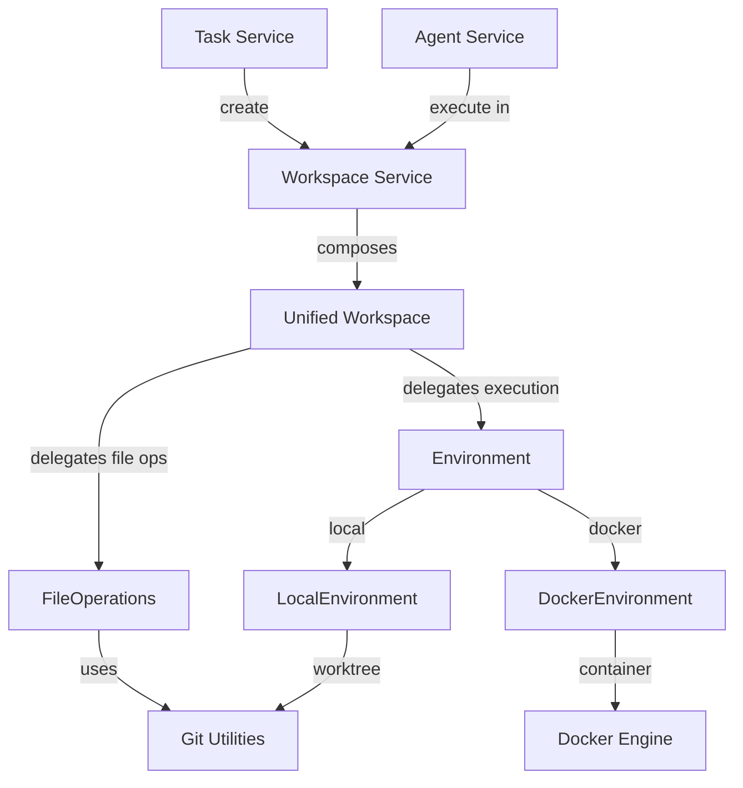
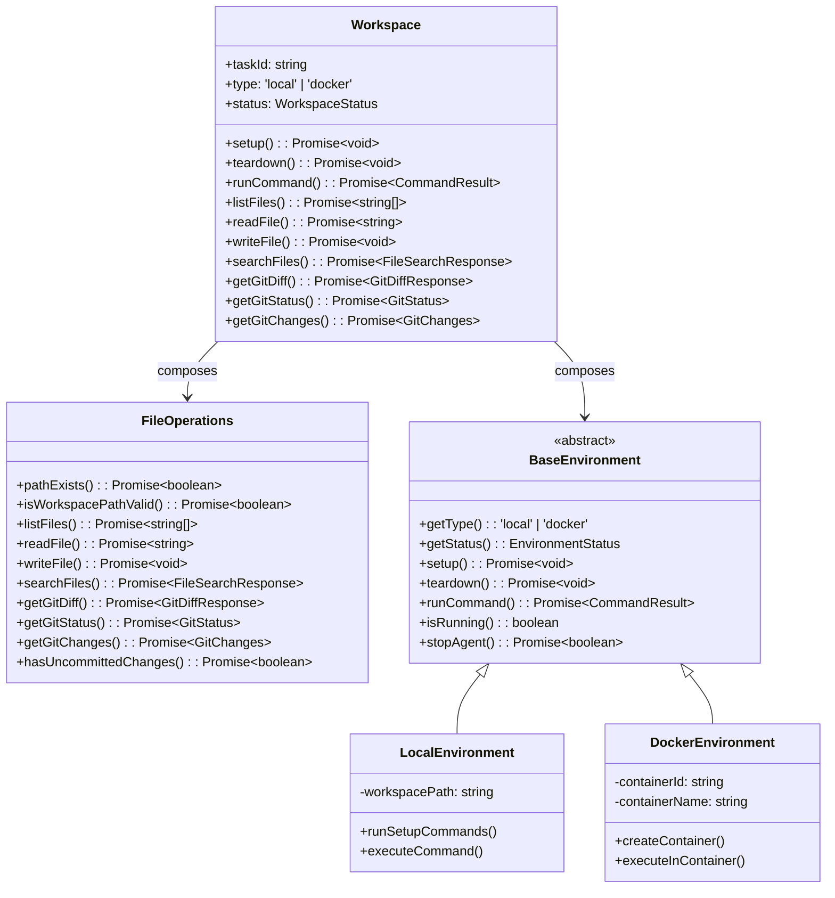

# Workspace Architecture

## Quick Reference

### Key Files
- **Workspace Service**: `apps/backend/services/workspace.service.ts`
- **Unified Workspace**: `apps/backend/workspaces/workspace.ts`
- **File Operations**: `apps/backend/services/file-operations.service.ts`
- **Local Environment**: `apps/backend/environments/local-environment.ts`
- **Docker Environment**: `apps/backend/environments/docker-environment.ts`
- **Git Utilities**: `apps/backend/utils/git-utils.ts`
- **Workspace Routes**: `apps/backend/routes/workspace.routes.ts`

### Core Methods
```typescript
// Workspace Service
createWorkspace(taskId: string, repositoryId: string): Promise<void>
cleanupWorkspace(taskId: string): Promise<void>
getWorkspaceStatus(taskId: string): Promise<WorkspaceStatus>
executeCommand(taskId: string, command: string): Promise<CommandResult>
listFiles(taskId: string, path: string): Promise<FileInfo[]>
readFile(taskId: string, path: string): Promise<string>
writeFile(taskId: string, path: string, content: string): Promise<void>
```

## Architecture Overview

Workspaces provide isolated execution environments for AI agents using either Git worktrees (local) or Docker containers. The architecture separates file operations from execution environments for better modularity.



## New Architecture Design

### Composition-Based Architecture



### Key Components

1. **Unified Workspace** (`apps/backend/workspaces/workspace.ts`)
   - Single implementation replacing LocalWorkspace and DockerWorkspace
   - Composes FileOperations for file/git operations
   - Composes Environment for command execution
   - Delegates operations to appropriate services

2. **FileOperations Service** (`apps/backend/services/file-operations.service.ts`)
   - Handles all file system operations
   - Manages git operations (diff, status, changes)
   - Path validation and security
   - File size limits and safety checks

3. **Environment Abstractions**
   - **LocalEnvironment**: Git worktree-based execution
   - **DockerEnvironment**: Container-based isolation
   - Both implement BaseEnvironment interface

## Implementation Guide

### 1. Workspace Creation Flow
```typescript
// apps/backend/services/workspace.service.ts
async createWorkspace(taskId: string, repositoryId: string) {
  // Get repository config
  const repo = await this.repositoryService.getRepository(repositoryId);
  
  // Determine workspace type
  const type = repo.codeExecution?.workspaceType || 
               process.env.DEFAULT_WORKSPACE_TYPE || 
               'local';
  
  // Create environment based on type
  const environment = type === 'docker' 
    ? new DockerEnvironment(taskId, repo)
    : new LocalEnvironment(taskId, repo);
  
  // Create unified workspace with environment
  const workspace = new Workspace(
    taskId,
    repo,
    this.eventService,
    environment
  );
  
  // Setup workspace (delegates to environment)
  await workspace.setup();
  
  // Register workspace
  this.activeWorkspaces.set(taskId, workspace);
  
  // Save path to task
  await this.taskService.updateWorkspacePath(taskId, workspace.getWorkspacePath());
}
```

### 2. File Operations Delegation
```typescript
// Workspace delegates file operations to FileOperations service
class Workspace {
  private fileOperations: FileOperations;
  
  async readFile(path: string): Promise<string> {
    return this.fileOperations.readFile(path);
  }
  
  async writeFile(path: string, content: string): Promise<void> {
    return this.fileOperations.writeFile(path, content);
  }
  
  async getGitDiff(): Promise<GitDiffResponse> {
    return this.fileOperations.getGitDiff();
  }
}
```

### 3. Command Execution Delegation
```typescript
// Workspace delegates execution to environment
class Workspace {
  private environment: BaseEnvironment;
  
  async runCommand(command: string, timeout?: number): Promise<CommandResult> {
    return this.environment.runCommand(command, timeout);
  }
  
  isRunning(): boolean {
    return this.environment.isRunning();
  }
}
```

## Workspace Capabilities

### State-Based Operations
```typescript
// State-based capability checking
interface WorkspaceCapabilities {
  canListFiles(): boolean;      // NOT_SETUP → false, others → true
  canReadWriteFiles(): boolean;  // SETUP, IDLE, RUNNING → true
  canExecuteCommands(): boolean; // Only IDLE → true
  canAccessGit(): boolean;       // Exists → true
  canManageServer(): boolean;    // IDLE, RUNNING → true
}

// Usage
const workspace = await workspaceService.getWorkspace(taskId);
if (workspace.canExecuteCommands()) {
  const result = await workspace.runCommand('npm test');
}
```

## Git Operations

### Git Status vs Git Changes
```typescript
// GitStatus - Repository sync state with base branch
interface GitStatus {
  currentBranch: string;
  baseBranch: string;
  status: 'synced' | 'ahead' | 'behind' | 'diverged';
  commitsAhead: number;
  commitsBehind: number;
  hasUncommittedChanges: boolean;
  hasConflicts: boolean;
  originExists: boolean;
  additions: number;    // vs base branch
  deletions: number;    // vs base branch
  modifications: number; // vs base branch
}

// GitChanges - Working directory state only
interface GitChanges {
  currentBranch: string;
  status: 'clean' | 'modified' | 'error';
  additions: number;    // Lines added in working dir
  deletions: number;    // Lines deleted in working dir
  modifications: number; // Files modified in working dir
}
```

## Common Patterns

### Path Validation
```typescript
// FileOperations ensures operations stay within workspace
async readFile(filePath: string): Promise<string> {
  const fullPath = path.join(this.workspacePath, filePath);
  const resolved = path.resolve(fullPath);
  const resolvedWorkspace = path.resolve(this.workspacePath);
  
  if (!resolved.startsWith(resolvedWorkspace)) {
    throw new Error('Access denied: path outside workspace');
  }
  
  // Continue with file read...
}
```

### Workspace Recreation
```typescript
// AgentService handles workspace recreation when path is missing
if (!(await workspace.isWorkspacePathValid())) {
  await this.recreateWorkspace(taskId, iteration);
  const recreatedWorkspace = await this.workspaceService.getOrCreateWorkspace(taskId);
  
  if (recreatedWorkspace.getStatus() !== WorkspaceStatus.IDLE) {
    throw new Error('Workspace recreation failed');
  }
}
```

## Configuration

### Repository Configuration
```typescript
// packages/types/schemas/repository.schemas.ts
interface CodeExecutionConfig {
  workspaceType?: 'local' | 'docker';
  dockerImage?: string;              // Required for docker
  setupCommands: string[];           // npm install, etc.
  environmentVariables?: Record<string, string>;
  workerResources?: {
    cpuLimit?: string;
    memoryLimit?: string;
  };
}
```

### Environment Variables
```bash
# Default workspace type if not specified in repo
DEFAULT_WORKSPACE_TYPE=local

# Custom worktree directory (default: ../)
WORKTREE_DIR=/path/to/worktrees

# Docker workspace settings
DOCKER_HOST=unix:///var/run/docker.sock
WORKER_API_URL=http://host.docker.internal:8000
```

## Migration Notes

### From Old to New Architecture

**Before (Inheritance-based):**
- `BaseWorkspace` abstract class
- `LocalWorkspace extends BaseWorkspace`
- `DockerWorkspace extends BaseWorkspace`
- Mixed file and execution concerns

**After (Composition-based):**
- `Workspace` unified class
- `FileOperations` service for file/git operations
- `LocalEnvironment` for local execution
- `DockerEnvironment` for container execution
- Clean separation of concerns

### Key Benefits
1. **No Code Duplication**: Single FileOperations implementation
2. **Better Testing**: Test file operations independently
3. **Flexible**: Easy to add new environment types
4. **Maintainable**: Each component has single responsibility

## Troubleshooting

| Issue | Check | Solution |
|-------|-------|----------|
| Workspace creation fails | Git repository valid? | Ensure repo is cloned |
| Docker workspace timeout | Container started? | Check Docker daemon |
| Commands not executing | Workspace state | Must be IDLE state |
| Worktree conflicts | Branch already exists | Use different task ID |
| Path traversal error | Requested path | Keep paths relative |