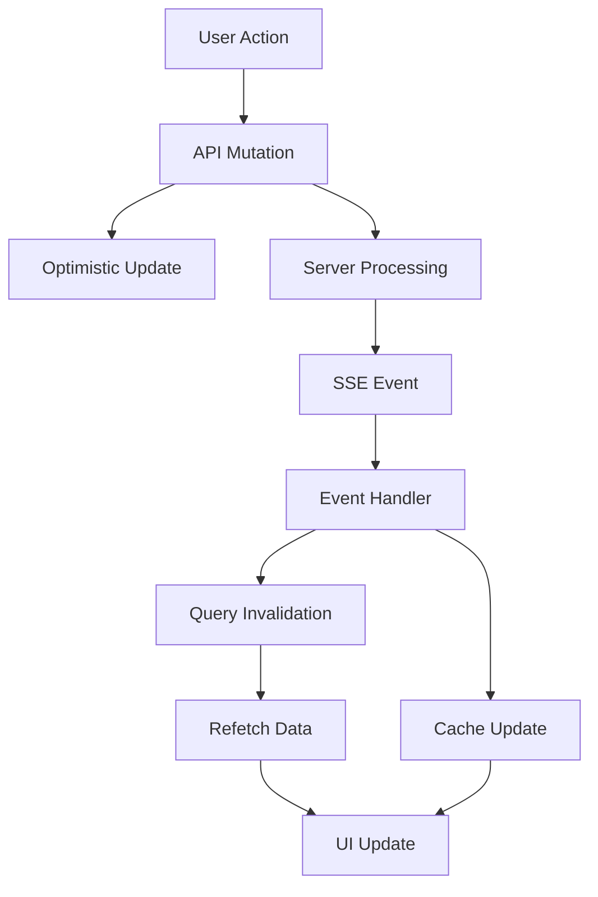

# Frontend Task Architecture

This document provides a comprehensive overview of the task lifecycle, event handling, and architectural patterns used in the Moatless frontend application.

## Table of Contents

1. [Overview](#overview)
2. [Architecture Patterns](#architecture-patterns)
3. [Task Lifecycle](#task-lifecycle)
4. [Event System Architecture](#event-system-architecture)
5. [Data Management](#data-management)
6. [Real-time Updates](#real-time-updates)
7. [Component Architecture](#component-architecture)
8. [Performance Optimizations](#performance-optimizations)
9. [Error Handling and Resilience](#error-handling-and-resilience)

## Overview

The Moatless frontend implements a sophisticated task management system that handles AI agent interactions, real-time event streaming, and workspace management. The architecture is designed for:

- **Real-time responsiveness** through Server-Sent Events (SSE)
- **Performance optimization** via strategic React Context separation
- **Scalability** with React Query for server state management
- **Developer experience** with TypeScript and clear architectural patterns

## Architecture Patterns

### Tri-Context Pattern

The application uses a unique **Tri-Context Pattern** to optimize performance by separating concerns across three React contexts:

```typescript
<TaskProviders taskId={taskId}>
  <TaskDataProvider>    // Stable server data
    <TaskEventsProvider>  // Real-time event streams
      <TaskUIProvider>    // Pure UI state
        {children}
      </TaskUIProvider>
    </TaskEventsProvider>
  </TaskDataProvider>
</TaskProviders>
```

**Important**: The TaskProviders work in conjunction with the GlobalEventStreamProvider:
- **GlobalEventStreamProvider** (app-level) manages the SSE connection
- **TaskEventsProvider** (task-level) subscribes to relevant events from the global stream

#### 1. TaskDataProvider
- **Purpose**: Manages stable task metadata and workspace status
- **Data**: Task details, iterations, git diffs, workspace status
- **Update frequency**: Low - only on significant state changes
- **Used by**: Components needing task metadata (TaskHeader, TaskViewer)

#### 2. TaskEventsProvider
- **Purpose**: Manages real-time event streaming and updates
- **Data**: Event stream from global SSE, connection status, event caching
- **Update frequency**: High - continuous event stream
- **Used by**: EventViewer, components tracking real-time progress
- **Note**: Uses GlobalEventStreamProvider for SSE connection

#### 3. TaskUIProvider
- **Purpose**: Manages pure UI state with no server dependencies
- **Data**: Selected iteration, panel sizes, view modes
- **Update frequency**: Medium - user interactions only
- **Used by**: UI control components, layout managers

### Benefits of Tri-Context Pattern

1. **Selective Re-renders**: Components only re-render when their specific data changes
2. **Performance Isolation**: High-frequency event updates don't affect stable UI
3. **Clear Separation of Concerns**: Easy to reason about data flow
4. **Optimized Subscriptions**: Components subscribe only to needed data

## Task Lifecycle

### Task States

Tasks progress through a defined lifecycle with the following states:

```typescript
type TaskStatus = 'open' | 'running' | 'error' | 'closed' | 'merged'
```

1. **`open`** 
   - Initial state after task creation
   - Waiting for user input or agent activation
   - Can transition to: `running`, `closed`

2. **`running`**
   - Agent actively processing the task
   - Executing tool calls and generating responses
   - Can transition to: `open`, `error`, `closed`

3. **`error`**
   - Task encountered a fatal error
   - Agent cannot continue processing
   - Can transition to: `running` (retry), `closed`

4. **`closed`**
   - Task manually closed by user
   - No further processing allowed
   - Terminal state

5. **`merged`**
   - Task changes successfully merged to repository
   - Terminal state indicating successful completion

### Task Structure

```typescript
interface Task {
  taskId: string
  status: TaskStatus
  repositoryId: string
  agentType: string
  iterations: TaskIteration[]
  createdAt: Date
  lastMessageAt: Date
  numTurns: number
  totalCostUsd: number
}

interface TaskIteration {
  iterationId: number
  message: string          // User input
  result?: string         // Agent response
  error?: string          // Error message
  startedAt: Date
  completedAt?: Date
  contextTokens: number
  costUsd: number
}
```

### Task Creation Flow

1. User initiates task creation with message and repository
2. Frontend optimistically creates task with temporary ID
3. API creates real task and returns permanent ID
4. Frontend updates routes and cache with real task data
5. Global SSE connection starts receiving events for the new task

## Event System Architecture

### Event Types

The system handles various event types that drive UI updates:

```typescript
enum EventType {
  INPUT = 'input',        // User message input
  MESSAGE = 'message',    // Agent message
  START = 'start',        // Task/iteration start
  STOP = 'stop',         // Task/iteration stop
  RESULT = 'result',     // Iteration completion
  ERROR = 'error',       // Error occurrence
  WORKSPACE = 'workspace', // Workspace changes
  SERVER = 'server',     // Dev server status
  TOOL = 'tool',         // Tool execution
  COMPLETION = 'completion' // Task completion
}
```

### Server-Sent Events (SSE) Implementation

#### Event Stream Architecture

The application uses a **two-layer event streaming architecture**:

```
App Level (main.tsx)
└── GlobalEventStreamProvider         // Single SSE connection
    └── RouterProvider
        └── Task Page
            └── TaskProviders
                └── TaskEventsProvider // Subscribes to task-specific events
```

#### Layer 1: GlobalEventStreamProvider (App Level)

Located at the root of the application, this provider:
- Maintains a **single SSE connection** to `/api/v1/events/stream?activeTasksOnly=true`
- Receives **all events** for all active tasks
- Provides subscription methods for components to filter events
- Handles connection management, reconnection, and error recovery

```typescript
// In main.tsx
<GlobalEventStreamProvider>
  <RouterProvider />  // All routes have access to global stream
</GlobalEventStreamProvider>
```

#### Layer 2: TaskEventsProvider (Task Level)

Located within each task's context, this provider:
- **Subscribes** to the global stream for its specific taskId
- Filters events to only those relevant to its task
- Manages task-specific event state and caching
- Triggers query invalidations based on event types

```typescript
// In TaskEventsProvider
const globalStream = useGlobalEventStream()

// Subscribe to events for this specific task
useTaskEventSubscription(taskId, (event) => {
  // Handle events for this task only
  handleTaskEvent(event)
})
```

#### Event Flow

1. **Server** emits event for Task A
2. **GlobalEventStreamProvider** receives event via SSE
3. **GlobalEventStreamProvider** notifies all subscribers
4. **TaskEventsProvider for Task A** receives event (filtered by taskId)
5. **TaskEventsProvider** updates cache and invalidates queries
6. **Components** re-render with new data

#### Multiple Task Pages Example

```
GlobalEventStreamProvider (Single SSE Connection)
├── Task Page A (/tasks/123)
│   └── TaskProviders (taskId="123")
│       └── TaskEventsProvider → subscribes to events where taskId="123"
│
├── Task Page B (/tasks/456)
│   └── TaskProviders (taskId="456")
│       └── TaskEventsProvider → subscribes to events where taskId="456"
│
└── Task List Page (/tasks)
    └── Uses global stream for status updates
```

**Key Points:**
- One SSE connection serves all task pages
- Each TaskEventsProvider filters for its specific taskId
- Task list pages can also subscribe to see status changes
- If user has 10 task tabs open, still only 1 SSE connection

**Benefits of This Architecture:**
- Single SSE connection for entire app
- Task pages don't manage their own connections
- Automatic event routing to correct task contexts
- Centralized connection error handling
- Easy to add app-wide event handling (notifications, etc.)

### Event-Driven Query Invalidation

Smart mapping of events to affected queries:

```typescript
const EVENT_INVALIDATION_MAP = {
  [EventType.START]: [
    queryKeys.task,           // Update task status
    queryKeys.taskWorkspaceStatus // Workspace may activate
  ],
  [EventType.STOP]: [
    queryKeys.task,           // Update task status
    queryKeys.taskWorkspaceStatus, // Workspace may deactivate
    queryKeys.taskServerStatus    // Server may stop
  ],
  [EventType.RESULT]: [
    queryKeys.task,          // Update iteration data
    queryKeys.taskGitDiff    // Code changes may occur
  ],
  [EventType.WORKSPACE]: [
    queryKeys.taskWorkspaceStatus, // Workspace state changed
    queryKeys.taskGitDiff         // Files may have changed
  ],
  // ... more mappings
}
```

## Data Management

### React Query Integration

The application uses React Query for server state management with a hierarchical query key structure:

```typescript
queryKeys = {
  tasks: {
    all: ['tasks'],
    list: (filters) => ['tasks', 'list', filters],
    detail: (id) => ['tasks', 'detail', id],
    
    // Sub-resources (invalidated with parent)
    events: (id) => [...detail(id), 'events'],
    gitDiff: (id) => [...detail(id), 'git-diff'],
    workspaceStatus: (id) => [...detail(id), 'workspace'],
    serverStatus: (id) => [...detail(id), 'server']
  }
}
```

### Query Invalidation Strategy

1. **Hierarchical Invalidation**: Invalidating a parent key invalidates all children
2. **Event-Driven Updates**: Events trigger specific query invalidations
3. **Optimistic Updates**: Mutations update cache before server confirmation
4. **Smart Refetching**: Only refetch queries that are actively being rendered

### Data Flow



## Real-time Updates

### Update Mechanism

1. **Event Reception**
   - SSE connection receives event
   - Event parsed and validated

2. **Cache Update**
   - Direct cache update for event data
   - Maintains event history in memory

3. **Smart Invalidation**
   - Event type determines affected queries
   - Queued as microtask for batch processing

4. **UI Synchronization**
   - React Query triggers re-renders
   - Components receive fresh data

### Event Merging

Tool events are merged for cleaner display:

```typescript
// Multiple edit events on same file -> Single grouped event
// Sequential message events -> Merged into conversation
// Tool call start/end -> Complete tool execution display
```

## Component Architecture

### Task Detail Page Structure

```
TaskDetailPage
├── TaskDataProvider
│   ├── TaskHeader (metadata, actions)
│   ├── TaskEventsProvider
│   │   ├── TaskUIProvider
│   │   │   ├── TaskViewer (iterations, chat)
│   │   │   ├── EventViewer (real-time events)
│   │   │   └── GitDiffViewer (code changes)
│   │   └── ServerLogsViewer (dev server logs)
│   └── TaskChatInput (message input)
└── ErrorBoundary (fault isolation)
```

### Key Components

1. **TaskViewer**
   - Displays task iterations and messages
   - Handles iteration selection
   - Renders markdown and code blocks

2. **EventViewer**
   - Real-time event stream display
   - Event filtering and grouping
   - Tool execution visualization

3. **GitDiffViewer**
   - Syntax-highlighted diff display
   - File tree navigation
   - Inline code comments

## Performance Optimizations

### Memoization Strategy

1. **Context Values**: Memoized with primitive dependencies
2. **Derived State**: Computed values cached with useMemo
3. **Callbacks**: Event handlers wrapped in useCallback
4. **Component Props**: Shallow comparison for re-render prevention

### Lazy Loading

- Route-based code splitting
- Dynamic imports for heavy components
- Suspense boundaries for loading states

### Query Optimization

- Stale-while-revalidate caching strategy
- Selective query enabling based on component visibility
- Batch query execution with useQueries
- Smart polling only for transitional states

## Error Handling and Resilience

### Error Boundaries

Strategic placement for fault isolation:

```typescript
<ErrorBoundary componentName="TaskViewer">
  <TaskViewer />
</ErrorBoundary>
```

### SSE Reconnection

- Exponential backoff: 1s → 2s → 4s → ... → 30s max
- Resume from last event ID
- Fallback to polling on persistent failures
- Visibility-based connection management

### Graceful Degradation

1. **SSE Failure**: Falls back to periodic polling
2. **Query Failure**: Shows cached data with error indicator
3. **Network Issues**: Offline mode with queued actions
4. **Invalid State**: Recovery through full data refresh

## Best Practices

### When Using This Architecture

1. **Always use the appropriate context hook** for your data needs
2. **Prefer event-driven updates** over polling
3. **Leverage React Query cache** as single source of truth
4. **Handle errors at appropriate boundaries**
5. **Test with SSE disconnections** to ensure resilience

### Common Patterns

```typescript
// Using multiple contexts efficiently
function MyComponent() {
  const { task } = useTaskData()        // Stable data
  const { events } = useTaskEvents()    // Streaming data
  const { selectedIteration } = useTaskUI() // UI state
  
  // Component only re-renders when used data changes
}
```

### Performance Tips

1. Split components by update frequency
2. Use specialized hooks for data slices
3. Implement virtual scrolling for long event lists
4. Debounce rapid UI state changes
5. Profile with React DevTools

## Future Considerations

1. **Enhanced SSE**: Add support for message priorities and acknowledgments
2. **Event Sourcing**: Complete task reconstruction from events
3. **Offline Support**: Local event queue and sync
4. **Collaborative Features**: Multi-user task interaction
5. **Advanced Caching**: Normalized cache with graphql-style resolvers

This architecture provides a robust foundation for real-time task management while maintaining excellent performance and developer experience.