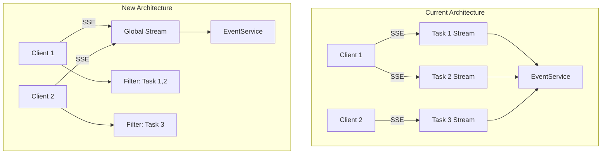

# Global Event Stream Implementation Plan

## Overview

This document outlines the implementation plan for transitioning from per-task event streams to a single global event stream with client-side filtering. This architecture will provide real-time updates across the entire application while simplifying connection management.

## Architecture Overview



## Implementation Plan

### Phase 1: Backend - Add Global Event Stream Endpoint

#### 1.1 Create Global Events Route
**File:** `server/routes/events.ts` (new)

```typescript
import { FastifyPluginAsync } from 'fastify'
import { z } from 'zod'
import { sseManager } from '../utils/sse-manager.js'
import { eventService } from '../services/event.js'

const eventsRoute: FastifyPluginAsync = async (app) => {
  // Global event stream endpoint
  app.get('/stream', {
    schema: {
      querystring: z.object({
        // Optional filters for future use
        types: z.array(z.string()).optional(),
        activeTasksOnly: z.boolean().optional().default(true),
      })
    }
  }, async (request, reply) => {
    const { types, activeTasksOnly } = request.query
    
    // Set up SSE headers
    reply.raw.writeHead(200, {
      'Content-Type': 'text/event-stream',
      'Cache-Control': 'no-cache',
      'Connection': 'keep-alive',
      'X-Accel-Buffering': 'no'
    })
    
    // Create global connection
    const connectionId = crypto.randomUUID()
    const connection = {
      id: connectionId,
      reply: reply.raw,
      lastEventId: request.headers['last-event-id'],
      filters: { types, activeTasksOnly }
    }
    
    // Add to global connections
    sseManager.addGlobalConnection(connection)
    
    // Handle disconnection
    request.socket.on('close', () => {
      sseManager.removeGlobalConnection(connectionId)
    })
    
    // Send existing events if reconnecting
    if (connection.lastEventId) {
      await sseManager.sendMissedGlobalEvents(connection)
    }
  })
}

export default eventsRoute
```

#### 1.2 Update SSE Manager
**File:** `server/utils/sse-manager.js`

Add support for global connections:

```javascript
class SSEConnectionManager {
  constructor() {
    this.taskConnections = new Map() // Existing
    this.globalConnections = new Map() // New
  }
  
  addGlobalConnection(connection) {
    this.globalConnections.set(connection.id, connection)
  }
  
  removeGlobalConnection(connectionId) {
    this.globalConnections.delete(connectionId)
  }
  
  broadcastGlobalEvent(event) {
    for (const connection of this.globalConnections.values()) {
      // Apply filters if any
      if (this.shouldSendEvent(event, connection.filters)) {
        this.sendEvent(connection.reply, event)
      }
    }
  }
  
  shouldSendEvent(event, filters) {
    if (filters.types && !filters.types.includes(event.type)) {
      return false
    }
    if (filters.activeTasksOnly && event.taskStatus === 'closed') {
      return false
    }
    return true
  }
}
```

#### 1.3 Update Event Service
**File:** `server/services/event.ts`

Emit events to both task-specific and global channels:

```typescript
export class EventService extends EventEmitter {
  async addEvent(taskId: string, event: Omit<Event, 'id' | 'taskId' | 'timestamp'>) {
    const fullEvent: Event = {
      ...event,
      id: crypto.randomUUID(),
      taskId,
      timestamp: new Date().toISOString(),
    }
    
    // Store event
    await this.storeEvent(taskId, fullEvent)
    
    // Emit to task-specific channel (existing)
    this.emit(`task:${taskId}`, fullEvent)
    
    // Emit to global channel (new)
    this.emit('global', fullEvent)
    
    // Broadcast to global SSE connections
    sseManager.broadcastGlobalEvent(fullEvent)
    
    return fullEvent
  }
}
```

#### 1.4 Register Global Events Route
**File:** `server/app.ts`

```typescript
import eventsRoute from './routes/events.js'

// Add to routes registration
app.register(eventsRoute, { prefix: '/api/v1/events' })
```

### Phase 2: Frontend - Global Event Stream Provider

#### 2.1 Create Global Event Stream Provider
**File:** `client/src/features/events/providers/global-event-stream-provider.tsx` (new)

```typescript
import { createContext, useContext, useEffect, useRef, useState } from 'react'
import { useQueryClient } from '@tanstack/react-query'
import { useLocation } from '@tanstack/react-router'
import { toast } from 'sonner'
import { NDJSONSSEClient } from '@/lib/api/ndjson-sse-client'
import { queryKeys } from '@/lib/api/query-keys'
import { Event, EventType } from '@shared/types/event'

interface GlobalEventStreamContextValue {
  isConnected: boolean
  connectionError: Error | null
}

const GlobalEventStreamContext = createContext<GlobalEventStreamContextValue>({
  isConnected: false,
  connectionError: null,
})

export function useGlobalEventStream() {
  return useContext(GlobalEventStreamContext)
}

export function GlobalEventStreamProvider({ children }: { children: React.ReactNode }) {
  const queryClient = useQueryClient()
  const location = useLocation()
  const clientRef = useRef<NDJSONSSEClient<Event>>()
  const [isConnected, setIsConnected] = useState(false)
  const [connectionError, setConnectionError] = useState<Error | null>(null)
  
  // Extract current task ID from route
  const currentTaskId = location.pathname.match(/\/tasks\/([^/]+)/)?.[1]
  
  useEffect(() => {
    const client = new NDJSONSSEClient<Event>({
      url: '/api/v1/events/stream',
      onConnect: () => {
        setIsConnected(true)
        setConnectionError(null)
      },
      onDisconnect: () => {
        setIsConnected(false)
      },
      onError: (error) => {
        console.error('Global event stream error:', error)
        setConnectionError(error)
      },
      onEvent: (event) => {
        handleGlobalEvent(event, currentTaskId)
      },
    })
    
    clientRef.current = client
    client.connect()
    
    return () => {
      client.disconnect()
    }
  }, []) // Only connect once at app startup
  
  const handleGlobalEvent = (event: Event, activeTaskId?: string) => {
    // Always update task lists for status changes
    if ([EventType.START, EventType.STOP, EventType.RESULT, EventType.ERROR].includes(event.type)) {
      queryClient.invalidateQueries({ queryKey: queryKeys.tasks.lists() })
      
      // Update specific task cache if loaded
      if (queryClient.getQueryData(queryKeys.task(event.taskId))) {
        queryClient.invalidateQueries({ queryKey: queryKeys.task(event.taskId) })
      }
    }
    
    // Handle events for currently viewed task
    if (activeTaskId && event.taskId === activeTaskId) {
      // Update task events cache
      queryClient.setQueryData(
        queryKeys.taskEvents(activeTaskId),
        (old: Event[] = []) => [...old, event]
      )
      
      // Update other task-specific caches
      switch (event.type) {
        case EventType.WORKSPACE:
          queryClient.invalidateQueries({ 
            queryKey: queryKeys.taskWorkspaceStatus(activeTaskId) 
          })
          break
        case EventType.SERVER:
          queryClient.invalidateQueries({ 
            queryKey: queryKeys.taskServerStatus(activeTaskId) 
          })
          break
      }
    }
    
    // Show notifications for background task completions
    if (event.type === EventType.RESULT && event.taskId !== activeTaskId) {
      toast.success(`Task completed: ${event.data?.title || event.taskId}`)
    }
    
    // Show error notifications
    if (event.type === EventType.ERROR && event.taskId !== activeTaskId) {
      toast.error(`Task error: ${event.data?.message || 'Unknown error'}`)
    }
  }
  
  return (
    <GlobalEventStreamContext.Provider value={{ isConnected, connectionError }}>
      {children}
    </GlobalEventStreamContext.Provider>
  )
}
```

#### 2.2 Add Provider to App
**File:** `client/src/main.tsx`

```typescript
import { GlobalEventStreamProvider } from '@/features/events/providers/global-event-stream-provider'

// Update the app structure
<QueryClientProvider client={queryClient}>
  <GlobalEventStreamProvider>
    <RouterProvider router={router} />
  </GlobalEventStreamProvider>
  <ReactQueryDevtools initialIsOpen={false} />
  <Toaster position="top-right" />
</QueryClientProvider>
```

#### 2.3 Create Event Types Export
**File:** `client/src/features/events/index.ts` (new)

```typescript
export { GlobalEventStreamProvider, useGlobalEventStream } from './providers/global-event-stream-provider'
```

### Phase 3: Remove Polling and Update Components

#### 3.1 Update Sidebar Tasks
**File:** `client/src/features/navigation/components/sidebar-tasks.tsx`

Remove the `refetchInterval`:

```typescript
export function SidebarTasks() {
  const { data: tasks = [], isLoading } = useTasksList({
    activeOnly: true,
    // Remove: refetchInterval: 10000
  })
  
  // Rest of component remains the same
}
```

#### 3.2 Update Task List Component
**File:** `client/src/features/tasks/components/task-list.tsx`

Add real-time status indicators:

```typescript
export function TaskList({ tasks, showEnvironment = true }: TaskListProps) {
  const { isConnected } = useGlobalEventStream()
  
  return (
    <div className="space-y-2">
      {isConnected && (
        <div className="flex items-center gap-2 text-xs text-muted-foreground">
          <div className="h-2 w-2 rounded-full bg-green-500" />
          Real-time updates active
        </div>
      )}
      {/* Rest of component */}
    </div>
  )
}
```

### Phase 4: Optimize Task Detail View

#### 4.1 Update Task Streaming Hook
**File:** `client/src/features/tasks/hooks/use-task-streaming.ts`

Make it optional since global stream handles updates:

```typescript
export function useTaskStreaming(taskId: string, options?: UseTaskStreamingOptions) {
  const { enabled = false } = options || {} // Default to disabled
  
  // Only enable for detailed event viewing
  const shouldStream = enabled && useIsTaskDetailView()
  
  // Rest remains the same but only connects if shouldStream is true
}
```

#### 4.2 Create Route Detection Hook
**File:** `client/src/features/tasks/hooks/use-is-task-detail-view.ts` (new)

```typescript
import { useLocation } from '@tanstack/react-router'

export function useIsTaskDetailView() {
  const location = useLocation()
  return location.pathname.includes('/tasks/') && location.pathname.includes('/details')
}
```

### Phase 5: Migration Strategy

#### 5.1 Feature Flags
**File:** `client/src/lib/config/features.ts` (new)

```typescript
export const features = {
  globalEventStream: import.meta.env.VITE_ENABLE_GLOBAL_STREAM === 'true',
  legacyTaskStreaming: import.meta.env.VITE_ENABLE_LEGACY_STREAMING !== 'false',
}
```

#### 5.2 Conditional Provider
**File:** `client/src/main.tsx`

```typescript
import { features } from '@/lib/config/features'

// Conditionally wrap with global event provider
const app = <RouterProvider router={router} />

const wrappedApp = features.globalEventStream 
  ? <GlobalEventStreamProvider>{app}</GlobalEventStreamProvider>
  : app
```

## Testing Plan

### Backend Tests
1. Test global event endpoint with multiple connections
2. Test event filtering
3. Test reconnection with last-event-id
4. Load test with multiple tasks generating events

### Frontend Tests
1. Test event filtering based on current route
2. Test cache updates from global events
3. Test notification display
4. Test connection recovery

## Rollout Plan

### Week 1: Backend Implementation
- Day 1-2: Implement global event endpoint
- Day 3-4: Update SSE manager and event service
- Day 5: Testing and bug fixes

### Week 2: Frontend Implementation
- Day 1-2: Create global event stream provider
- Day 3-4: Integrate with existing components
- Day 5: Testing and optimization

### Week 3: Migration and Optimization
- Day 1-2: Enable feature flag for internal testing
- Day 3-4: Monitor performance and fix issues
- Day 5: Gradual rollout to users

### Week 4: Cleanup
- Remove legacy per-task streaming code
- Remove polling from sidebar
- Documentation updates

## Performance Considerations

### Bandwidth Estimation
- Average event size: ~500 bytes
- Events per active task: ~50-100 per session
- 10 active tasks = 5-10 KB/session
- Negligible compared to benefits

### Client-Side Filtering Performance
- Simple string comparison (taskId)
- O(1) operation per event
- No noticeable impact on performance

### Memory Usage
- Only current task events kept in React Query cache
- Other events processed and discarded
- No memory leak risk

## Monitoring and Metrics

### Key Metrics to Track
1. SSE connection stability
2. Event delivery latency
3. Client-side filtering performance
4. Memory usage patterns
5. User engagement with real-time features

### Success Criteria
- 50% reduction in API calls (no polling)
- <100ms event delivery latency
- 99% SSE connection uptime
- Improved user satisfaction scores

## Rollback Plan

If issues arise:
1. Disable global event stream via feature flag
2. Re-enable polling in sidebar
3. Revert to per-task streaming
4. All changes are additive, so rollback is safe