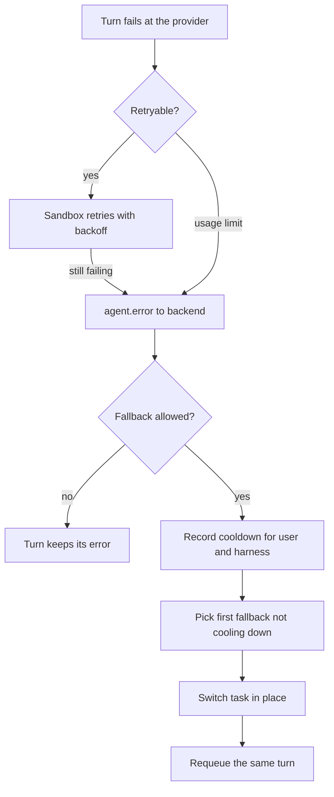

# Harnesses

Moatless runs several coding-agent CLIs. This guide shows which ones exist, how to pick one for a task or a Loop, how to set up your own credentials, and what happens when a provider refuses a turn.

## Terms

| Term | Meaning |
|---|---|
| Harness | The agent CLI family that runs inside the sandbox: `claude-code`, `codex`, `pi`, `mini-swe` or `acp`. |
| Agent profile | A catalog entry you select: a harness plus its transport, default model and credentials. `antigravity` is the profile that runs the `acp` harness. |
| Model | The model a profile runs, chosen from that profile's list. |

Several profiles can share one harness. Switching between profiles of one harness keeps the same CLI. Switching harness changes the CLI. See the [workspaces and sandboxes guide](workspaces-and-sandboxes.md) for where the CLI runs.

## Supported harnesses

| Profile | Credentials | Default model | Effort scale | Maturity |
|---|---|---|---|---|
| `claude-code` | Claude account, `CLAUDE_CODE_OAUTH_TOKEN` or `ANTHROPIC_API_KEY` | the CLI's own default | `low`, `medium`, `high`, `xhigh`, `max` | mature |
| `codex` | ChatGPT login (`CODEX_AUTH_JSON`) or `OPENAI_API_KEY` | resolved by the backend | `low` to `xhigh`, `max` or `ultra`, depending on the model | mature |
| `pi` | `ANTHROPIC_API_KEY` or `OPENAI_API_KEY` | `anthropic/claude-sonnet-5-5` | `off`, `minimal`, `low`, `medium`, `high` | experimental |
| `mini-swe` | `ANTHROPIC_API_KEY` or `OPENAI_API_KEY` | `openai/gpt-6.1-sol` | none documented | experimental |
| `antigravity` | `OPENAI_API_KEY` | `gemini-3-flash` | `low`, `medium`, `high` | experimental |

Claude Code and Codex are the mature pair. They are the default fallback pair, and the upgrade Loop gates their CLI releases on a transport test (see [Keeping CLIs current](#keeping-clis-current)). Treat the other three as experimental.

Pi and mini-swe run on API keys only. A Codex or Claude subscription login does not work for them, and Pi refuses ids such as `openai-codex/...`.

## Choosing one

Choose per task when you create it. Effort is not a task setting. You give it with each message.

```bash
moat tasks create --workspace <workspace> --agent-profile codex --model gpt-6.1-sol --message "..."
moat agents models
```

`moat agents models` lists every profile with its models, which one is the default, and an INSTALLED column. `--effort` on `create` sets the first turn's effort and needs `--message`. Later turns take theirs from `moat send --effort`.

A model that belongs to a different profile is refused, and the error lists the valid options. A model nobody lists is accepted, because the CLIs take any model string. Pi and mini-swe need a `vendor/model` id: `anthropic/` or `openai/` for both, plus `openrouter/` for Pi. Antigravity takes a bare id such as `gemini-3-flash`.

For a Loop, set `agentProfile` in its `LOOP.md` front matter, with an optional `model`. `agentType` is a deprecated alias that still works. The [loops guide](loops.md) covers the rest of the front matter.

A workspace can store a default model and effort. Today only the T3 client reads them, when it seeds a new thread (see the [T3 Code guide](t3-code.md)). Tasks created with the CLI, by a Loop or by an adapter do not use them, so pass `--model` yourself.

## Bringing your own credentials

Each user connects their own access. For Claude Code, connect a Claude account or add `ANTHROPIC_API_KEY`. For Codex, connect a ChatGPT login (stored as `CODEX_AUTH_JSON`) or add `OPENAI_API_KEY`. For Pi, mini-swe and Antigravity, add an API key.

Keys and logins live in your user-scoped secrets. A key stored as a global secret by an admin is the fallback when you have none of your own.

### Adding a key from T3 Code

T3 Code has no settings page for agent credentials. You add a key from inside a thread instead:

1. Ask the agent for it, for example "ask me for my `ANTHROPIC_API_KEY`".
2. The agent runs `moat secret request ANTHROPIC_API_KEY --reason "..."`, and a card with the reason appears in the thread.
3. Type the key into the card and choose **Save securely**, or decline it.

The value goes straight to your user-scoped secrets. The agent never sees it and only hears whether you saved or declined. Don't paste a key into the chat itself, where it stays in the transcript.

From a terminal, `moat secret set ANTHROPIC_API_KEY --value -` reads the key from stdin and saves it the same way.

When a task needs a Claude or OpenAI credential, the first match wins:

1. A credential pinned to the task's workspace.
2. The workspace's environment variables.
3. Your connected account (Claude or ChatGPT login).
4. Your user-scoped secrets, then global secrets.

A shared sandbox acts for its driver, the person who started the last turn. Credentials resolve for that person, so a new driver's turn runs on their credentials and not the previous driver's. The same applies to cooldowns and fallbacks, which follow the user the task runs as.

To check your setup, run `moat agents models` and read the INSTALLED column for each profile. A switch to a profile with no credential for you is refused. The error names the key to add, for example `CODEX_AUTH_JSON` or `OPENAI_API_KEY`. A Codex login that has expired fails the same way with a request to reconnect it. To rotate a key, replace the secret. The next turn picks it up.

## Switching mid-task

```bash
moat tasks update <task-id> --agent-profile claude-code --model opus
```

Without `--model`, the new profile's default model runs. The change takes effect between turns, and a running turn finishes on the profile it started with.

A switch keeps the task's branch, bindings and conversation. The recorded trajectory is transcoded into the new CLI's native session format, so the new agent sees the earlier work. Every switch adds a note to the conversation showing from which profile to which.

A switch is refused when:

- you hold no credential for the target profile;
- the task is an old one created before trajectory recording, and the switch changes harness (the error says it cannot switch);
- the target is Claude Code, but the task's sandbox runs the other Claude transport.

## When a provider fails



**In the sandbox.** Rate limits, provider throttling, provider unavailability, process exits and connectivity errors are retried up to 5 times. The wait doubles from 5 seconds up to a cap of 60 seconds, with about 20 percent jitter. A usage limit is not retried, because it lifts hours or days later.

**On the backend.** After the retries are spent, an error whose reason is `usage_limit`, `rate_limit`, `provider_unavailable` or `connectivity` triggers a fallback. The task switches harness in place and the turn that failed is queued again, so the workspace, branch, bindings and conversation carry over. A safety refusal never falls back. A fallback onto Claude Code runs Opus. Other targets run their default model.

The default order is:

| Failed harness | Falls back to, in order |
|---|---|
| Claude Code | Codex |
| Codex | Claude Code |
| Antigravity (ACP) | Claude Code, then Codex |

Pi and mini-swe have no default fallback. An admin can change the order with `AGENT_FALLBACK_ORDER`, for example `acp=claude-code,codex;pi=claude-code`. A named harness replaces its default list, and an empty list (`claude-code=`) turns its fallback off. A harness cannot fall back to itself.

There is no ping-pong. A turn that was already a fallback is not switched again, so when both providers are limited the turn keeps its error. A Loop can opt out with `fallbackToOtherAgent: false` in its front matter. Tasks that no Loop created always fall back.

**Cooldowns.** A refusal with `usage_limit`, `rate_limit` or `provider_unavailable` records a cooldown for that user and harness. It lasts until the provider's `resetsAt`, or 15 minutes when no reset is named, and never more than 3 hours. A newer refusal replaces the older one. A connectivity error records no cooldown, since it points at the sandbox's own network and not at the provider. Fallbacks skip a target that is cooling down.

Loops use cooldowns too. Each Loop delivery checks the Loop's harness first. While it cools down, the task moves onto its fallback before the turn starts, and it moves back once the cooldown ends. A firing therefore does not spend a turn on a provider known to refuse it. A task you switched yourself to a harness outside the Loop's fallback list stays where it is while that harness serves.

Fallback is between harnesses only. There is no fallback between models inside one harness.

## Keeping CLIs current

`docker/cli-versions.env` is the single source of truth for the CLI versions baked into sandbox images. It pins Claude Code, Codex, Pi, mini-swe-agent's bridge dependencies and the Antigravity CLI. Every image build path reads it. Renovate covers each pin as a backstop.

The Agent CLI Upgrade Loop (`.moatless/loops/agent-cli-upgrade/LOOP.md`) runs daily. It does the following:

1. Reads the pinned and the published CLI versions.
2. Probes the new Codex CLI's model list and the Claude model manifest, and updates both model catalogs to match.
3. Installs the candidate CLIs and runs the transport end-to-end test against each one.
4. Gates each CLI on its own result. A CLI that fails is held at its old pin, and the others ship.
5. Opens one PR that states what moved, what was held and why. A human merges it.

When it finds nothing to change it reports that in one line and opens no PR. The Loop handles Claude Code, Codex and Pi. A mini-swe or Antigravity upgrade follows the rules in the same file, and each needs its own end-to-end spec to pass first.

To add a new harness, follow the `harness-development` skill. It covers the runtime seam, session history, the catalog and credential wiring, and the lifecycle checks a new CLI must pass.
