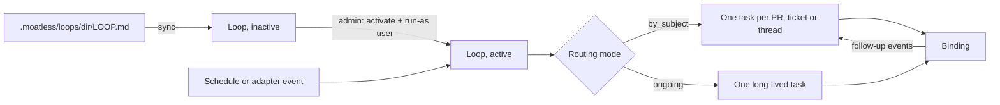

# Loops and routing

This guide takes you from "when Y happens, an agent should do X" to an active loop. It also explains how events reach tasks, so you can work out why a loop did or didn't fire.

## What a Loop is

A Loop is a standing definition of recurring agent work. It has three parts:

- a prompt, which tells the agent what to do;
- a firing condition: a Schedule or a Subscription to an adapter's events;
- a run-as identity, the Moatless user who creates and owns every task the loop opens.

Each firing starts or feeds a task. One-off tasks you create by hand are not part of a loop. The `on` key picks the kind of loop. These kinds are in use today:

| `on` | Fires when | Real example |
| --- | --- | --- |
| `schedule` | A cron time arrives | `e2e-nightly` in the moatless repo runs the API E2E suite at 03:00 UTC |
| `slack` | A message arrives in one channel | `alerts-moatless-monitor` in the moatless repo watches the deployment's alert channel |
| `linear` | An issue enters a state, gets a label, or the Moatless agent is mentioned, assigned or delegated to | A loop that starts one task per ticket in a team |
| `github_pr` | A pull request opens or changes | `code-review` in the moatless repo reviews each PR |



## Declaring a loop in git

A repository declares its loops at `.moatless/loops/<dir>/LOOP.md`. The frontmatter is the configuration. The body is the prompt, which the agent receives as its appended system prompt. This is the same layout as a `SKILL.md`.

This is the nightly E2E loop from the moatless repo:

```markdown
---
on: schedule
name: Nightly E2E
workspace: moatless-global
tags:
  - e2e-nightly
closeAfterSettledDays: 1
schedule:
  cron: "0 0 3 * * * *"
  timezone: UTC
  message: "Run the API E2E suite against this cluster and report the result."
---
```

The keys you will use most:

| Key | Meaning |
| --- | --- |
| `on` | Required. `schedule`, `slack`, `linear` or `github_pr` |
| `name` | Required. What the loop is called in the UI and CLI. It can be reworded freely |
| `schedule` | For `on: schedule`: `cron`, `timezone` (default `UTC`) and the kickoff `message` |
| `workspace` | The [Workspace](workspaces-and-sandboxes.md) tasks run in, by display name. It must be one this repository is placed in. Omit it to use the repository's own Workspace |
| `agentProfile` | The agent profile, default `claude-code` |
| `skills` | Skill names, from `.claude/skills/` or `.agents/skills/`, that every fresh agent session activates |
| `adapterConfig` | Adapter-specific settings. See Triggers below |
| `model` | The model tasks run on. Omit it for the profile's default |
| `memory.preload` | Memory keys, or `prefix*` patterns, summarised in each task's prompt |
| `room` | Gives each task its own Task Room, such as a private [Slack code channel](https://slack.com/features/code-channels) |
| `routingMode` | `by_subject` (the default) or `ongoing`. See Routing |

Lifecycle and cost keys are in the last section. See [harnesses](harnesses.md) for what an agent profile selects.

### Sync

The backend checks each repository's default-branch head about every 2 minutes. When the head has moved, it syncs the repository's workspaces and then its loops. A merged `LOOP.md` shows up in `moat loops list` within a few minutes. To sync at once, an admin runs:

```bash
moat repos sync-config <repo-id>
moat loops list
```

The directory name is the key, so renaming a directory gives you a new loop. A `LOOP.md` without a `name` is skipped, and a loop already synced from that directory keeps running unchanged. A loop that can't resolve its workspace or connection is skipped too. `sync-config` returns the reason, and a failed fetch changes nothing. A loop skipped for a reason fixed outside git, such as a new connection, lands at the next push, or when you run `sync-config`.

## Activation and run-as

A `LOOP.md` cannot make a loop run. Synced loops arrive inactive, with no run-as user. An admin approves each one and names the identity its tasks run as:

```bash
moat loops activate --id <id> --run-as-user-id <user>
```

Git cannot grant itself an identity, because commit access is not approval to run agents as a given user. The `active` and `runAsUserId` keys in frontmatter are ignored, and `sync-config` warns when it sees them. That is why `feedback-triage` and `alerts-moatless-monitor` in the moatless repo carry a comment with the activation command instead of the values.

The approval survives later syncs. Sync keeps updating the configuration of an active loop, and the loop keeps its approved user. Re-approval is needed only for a loop nobody has activated yet, or one whose tombstone an admin restored from git.

### Overriding git

`moat loops override --id <id>` detaches a synced loop so an admin's local edits survive the next sync. After that, the loop no longer reads its `LOOP.md`, and editing the file changes nothing that runs. The CONFIG column in `moat loops list` shows `git`, `manual` or `manual (overridden)`. Check it before you edit a `LOOP.md`. To return to git, run `moat loops reset-git --id <id>`. That discards the local edits and takes the file again. It also restores a loop an admin deleted.

## Triggers

### Schedules

`cron` has seven fields: second, minute, hour, day of month, month, day of week and year. The runner evaluates it in UTC, so `timezone` records intent and does not shift the fire time. Stagger loops that depend on each other. The `feedback-triage` loop runs at 07:00 UTC on weekdays, an hour after the Agent CLI Upgrade loop it follows.

### Slack

A Slack loop listens to one channel. `sourceMatcher` is the channel id and is required. `teamId` is the Slack workspace id. Omit it when only one Slack connection exists. The alert monitor loop sets `allow_bot_messages: true` and `trigger: all_messages` in `adapterConfig`, so it sees every bot post and decides whether to act. See [Moatless fixing itself](../use-cases/moatless-fixing-itself.md) for the full use case.

### Linear

Moatless installs in Linear as an [agent](https://linear.app/agents). People can mention it, assign an issue to it or delegate an issue to it, as they would a teammate. Each of these opens a Linear agent session on the issue, and the session links to the Moatless task. The agent posts its progress there, and a reply in the session reaches the same task.

A Linear loop watches one team. `sourceMatcher` is the team id, and `teamId` is the Linear organization id, which you can omit when only one connection exists. A loop with nothing else set fires when an issue enters one of its `trigger_states`, matched by state name. These keys narrow it:

| Key | Effect |
| --- | --- |
| `project_ids` | Only issues in these projects fire |
| `require_labels` | The issue must carry these labels |
| `exclude_labels` | An issue with one of these labels fires nothing, mentions included |
| `trigger_states` | State names whose entry spawns a task |
| `trigger_labels` | Also fires when an issue is created with, or gains, one of these labels |

Keep one trap in mind. A loop that should react to an `@mention` or an assignment must set `create_on_status_entry: false`. A bare mention moves no state, so with status entry on, nothing fires and Linear leaves the agent session hanging. When another loop already owns some tickets, give the mention loop `exclude_labels` for them, so a mention on such a ticket never starts a second task.

A task bound to an issue closes when the issue reaches a terminal state. `terminal_states` defaults to `completed` and `canceled`.

### GitHub PR

A `github_pr` loop needs a GitHub connection for the org. `sourceMatcher` defaults to the repository's own `owner/repo`. These keys filter what the loop's tasks hear:

| Key | Effect |
| --- | --- |
| `eventFilter` (top-level key, not in `adapterConfig`) | Only these events reach the loop's tasks. Empty means all |
| `ignored_events` | These events never reach them. It wins over `eventFilter` |
| `ignored_senders` | A login drops everything from that sender. `{login, events}` drops only those events |
| `ignored_title_patterns` | A PR whose title matches one of these regexes never opens a task |

No sender is ignored by default. `ignored_events` also accepts `review_verdict`, an approval or change request with no body. The `code-review` loop ignores `check_run`, `check_suite` and `review_verdict`, silences `github-actions[bot]` comments and reviews while its pushes still count, and skips dependency-bump titles.

The filters apply only to the tasks that loop opened. A task bound some other way, such as one that ran `moat gh pr create`, still gets its CI failures and conflicts.

## Routing

`routingMode` decides how events map to tasks:

| Mode | Behaviour | Example |
| --- | --- | --- |
| `by_subject` | A fresh task per external subject: a PR, a ticket or a thread | `code-review` |
| `ongoing` | One long-lived task that the loop keeps feeding | `alerts-moatless-monitor` |

A task opened by an event is created and owned by the loop's run-as user. The person whose event opened it is the requester, recorded as the task's reporter. The requester can read and message the task, but doesn't own it.

For Linear mentions, assignments and delegations, the narrowest loop on the team wins. Each constraint a loop satisfies is one point: `project_ids`, and each entry of `require_labels`. The most points wins and the oldest loop takes a tie. An unscoped loop catches the rest. A loop whose `exclude_labels` match is passed over. So a mention loop that requires a label takes the tickets carrying it, and the team's unscoped loop takes the others, with no second task.

A Binding ties a task to a subject, such as a PR or a ticket. Later events on that subject go to the same task, not to a new one. Moatless records each event a task makes through an adapter, such as a comment, a push or a state change. When the resulting inbound event arrives, it is not delivered back to the task that made it. A task never hears its own echo.

## Lifecycle and cost

A task settles when it has been idle, and closes some days after that. These keys set the pace:

| Key | Meaning |
| --- | --- |
| `settleAfterHours` | Idle hours before a task settles. The loop default is 1 |
| `closeAfterSettledDays` | Days from settling to auto-close. Omit it for the platform default. `inactiveTtlDays` is the old name |
| `stopWhenDone` | Stop the sandbox as soon as the agent run finishes, instead of holding the pod for the idle time |
| `agentProperties.promptCacheTtl` | `5m` or `1h`. The hour pays off when a task idles between 5 and 60 minutes between turns |
| `messageBufferSeconds` | How long a burst of events is held so it arrives as one turn. The default is 60 for `github_pr` and off elsewhere. `0` turns it off |

The `feedback-triage` loop sets `closeAfterSettledDays: 7` because its approval page lives on the task. The `code-review` loop sets 1.

Each event delivered to a `by_subject` task resumes its whole agent session, and the whole session is billed again. On a long PR this adds up fast. Cut the cost by dropping events the agent never acts on. The `code-review` loop ignores CI results and body-less verdicts for this reason. Buffering helps too, because a burst of review comments becomes one turn.

For how a task starts child tasks, see [orchestration](orchestration.md).
