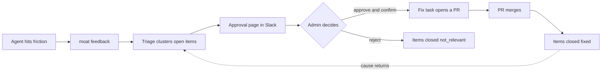

# Self-improvement

Agents record what cost them time, a weekday Loop groups those reports and proposes fixes, and an admin decides which fixes happen. This guide covers that path, what agents remember between runs, and how people steer a recurring Loop.

## The improvement loop



Only a Moatless admin's decisions change anything. A fix task is an ordinary Task in the repository that owns the cause, and the items close when its pull request merges.

## Recording feedback

Feedback is a note about a task that says what went wrong or what could be better. Any agent or person can record one.

```bash
moat feedback --category instruction \
  --comment "The deploy skill says to run build.sh, but the script was renamed to ship.sh."
```

| Category | Use it for |
|---|---|
| `environment` | The sandbox: missing tools, restarts, limits |
| `codebase` | The repository's own code or tooling |
| `instruction` | `AGENTS.md`, `CLAUDE.md` or a skill |
| `other` | Anything that fits none of the above |

Feedback attaches to the task in `$TASK_ID` unless you pass `--task`. Pass `--message` (and `--tool-use-id`) to point at one message or tool call. Otherwise it attaches to the task's most recent activity.

Triage reads only the comment, so a useful comment names the thing to change and what it cost. A comment like "the skill was confusing" gives a fix task nothing to work from. One that names the skill, the wrong step and the time lost does. A one-off mistake you recovered from is `noise` to triage.

`moat feedback list` reads what has been recorded, filtered by `--status`, `--category`, `--source`, `--workspace`, `--repo` or `--since`. `moat feedback status <id> --status fixed|not_relevant|open --note "..."` changes one item's state.

## Feedback triage

The Feedback Triage Loop (`.moatless/loops/feedback-triage/LOOP.md`) runs every weekday morning and follows the `feedback-triage` skill. See [loops](loops.md) for Loops in general.

Each run:

1. Acts on the decisions saved since the last run, and closes clusters whose fix has merged.
2. Groups the last week's open feedback into clusters that share one root cause. A cluster seen before keeps its name, so earlier decisions still apply.
3. Names the repository that owns each fix and checks it for a PR that already fixes the cause.
4. Ranks the clusters and publishes the top ones on an approval page, with a short summary in Slack.

### The approval page

The page is an [Artifact](artifacts.md) with one entry per cluster: its cause, sample reports, the suggested change and the owning repository. An admin approves, rejects or defers each cluster, then sends the decisions to the agent.

Approved clusters that share an owner and fit in one PR are proposed as a fix-task group. Once the admin confirms the groups, the run creates one fix task per group in the owning repository. When a fix PR merges, the run closes every report in its clusters. Rejected clusters close, and deferred ones stay off the page for a while.

## Memory

Memory holds what a later task needs and could not look up: a decision and its reason, a convention, a fact that took effort to establish, and the state of long-running work. Code, pull requests and tickets already remember themselves, so link to them and do not copy them in.

Each entry has a key such as `area:topic`, a summary of at most 160 characters, a body, optional JSON `--data`, tags and citations. A body or `--data` is at most 16 KiB, so keep one entry per item. Triage stores one entry per cluster for this reason.

```bash
moat memory put ci:flaky-e2e --summary "checkout chain flakes on cold runners" \
  --text "Retry once; a second failure is real." --cite task:<id> --tag ci
moat memory search "flaky checkout"
moat memory get ci:flaky-e2e
```

### Scopes

A memory scope says who shares an entry: `task`, `loop`, `workspace`, `repository`, `user` or `global`. Without `--scope`, a command reaches the task's Loop, or the task itself when it has no Loop. A command that names a scope reaches that scope only. Writing `workspace` or `repository` memory needs write access to it, and `global` needs an admin.

A task's prompt lists entry summaries only for keys named under `memory.preload` in its Loop's `LOOP.md`, and `preload` reads only the Loop's own `loop` scope. Triage preloads `triage:runs`. Anything in another scope has to be fetched with `moat memory get --scope <scope>`.

### Working with shared entries

- **Claims.** `moat memory claim <key> --ttl 2h` stops another open task from working the same item, and `moat memory release <key>` drops it. A claim is advisory: other tasks can still append to the entry.
- **Concurrent updates.** Pass `--if-version <n>` when you update an entry you read. If someone else wrote first, you get a 409 and nothing is overwritten.
- **Expiry.** An entry expires 28 days after its last put or verify. `moat memory verify` renews it, and `moat memory put --no-expiry` keeps it from expiring.

### Two traps

A scope change forks an index silently. The same key in two scopes is two entries, and a read reaches only the scope it names, so a task that switches scope stops seeing the old entries with no error. Triage passes `--scope loop` on every read and write for this reason.

Citations go stale. An entry citing `path:line` or a task keeps a fact that the code may have since changed. Check a recalled entry against the source before acting on it. If the citation holds, run `moat memory verify`. If not, update or delete the entry.

## Steering loops

To change how a recurring Loop behaves, edit its `LOOP.md` prompt, which every run reads. For notes that should reach every run without a prompt change, write them to loop memory and list their keys in the Loop's `memory.preload`. To change one pull request, comment on that PR instead.
