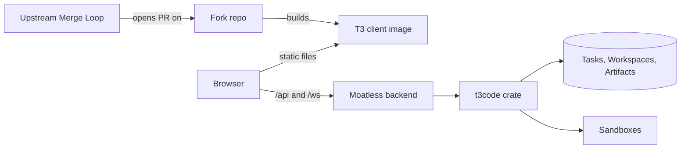

# The T3 Code UI and its integration

T3 Code is the browser UI for Moatless. This guide covers how its ideas map onto Moatless ones, how it connects and is deployed, how the fork is kept current, and how to develop against it.

## What T3 Code is

[T3 Code](https://github.com/pingdotgg/t3code) is an open-source coding-agent client, built by the T3 Code team. Moatless's UI is a fork of it, [aorwall/t3code](https://github.com/aorwall/t3code), and all credit for the client itself goes to the upstream project. A merge loop keeps the fork close to upstream (see [Keeping the fork current](#keeping-the-fork-current)).

Three things are true of every deployment:

- **We use only the T3 Code client.** Nothing from the T3 Code server runs.
- **The T3 server is replaced by Moatless.** The client opens a WebSocket to the Moatless backend and speaks T3's contract. The `t3code` crate (`crates/t3code`) answers it.
- **No analytics data is sent to PostHog.** [Analytics](#analytics) shows what that rests on.

The crate is an anti-corruption layer: T3 names appear on the wire and Moatless names sit behind it.



## How Moatless concepts appear

| In T3 Code | In Moatless | Notes |
| --- | --- | --- |
| Project | Workspace | One project per Workspace the signed-in user can read. A project composes no repositories of its own. |
| Thread | Task | The task id is the thread id. |
| Environment | The whole backend | One connected server. It is neither a deployment environment nor a Sandbox. |
| Project script and preview panel | A Workspace Script and its preview URL | A Script with a port opens its own preview tab. |
| Artifacts panel (fork only) | Artifacts | See [Artifacts](artifacts.md). The panel can change an Artifact's visibility. |
| Model picker | The harnesses the deployment offers | See [Harnesses](harnesses.md). |
| Sandbox row and controls (fork only) | The Task's Sandbox | A subscription pushes changes. See [Workspaces and Sandboxes](workspaces-and-sandboxes.md). |

Rows marked fork only exist only in the Moatless fork. See [What the fork adds and hides](#what-the-fork-adds-and-hides).

Two actions look alike and differ:

- **Archive** sends `thread.archive`, which closes the Task. The UI disables it while the agent is running.
- **Settle** stops the Sandbox and leaves the Task open.

Only a Script with a port is previewable. A server the agent starts with `moat cmd run` is reachable inside its own pod only.

## What the fork adds and hides

Upstream T3 Code runs agents on your own machine. It has no Artifacts and no remote Sandboxes: its "artifacts" are plans and Codex artifact templates, and its "sandbox" is a Codex permission mode (`read-only`, `workspace-write`). Everything Moatless-specific lives in the fork, mostly in `apps/web/src/fork/`, with each file marked `Fork-only`.

The fork adds:

| Surface | What it shows |
| --- | --- |
| Artifacts | The thread's Artifacts panel, and chips for Artifact links in messages |
| Sandbox | The sandbox row and its controls, and sandbox start-up shown as the setup steps |
| Subtasks and forks | A thread's child tasks, its parent, "Fork of" and "Subtask of" lines, and forking at a message |
| Thread Scripts | Scripts declared for one thread, beside the project's |
| Task links | A Moatless `/tasks/<id>` link opens as a thread |
| Thread filter | Filtering the sidebar's threads, with owner and tag for admins |
| Go to definition | Cmd or Ctrl-click in the file viewer, served by the sandbox's language server |

The fork also hides surfaces Moatless cannot back. The backend lists them in `capabilities.unsupportedSurfaces` (`crates/t3code/src/rpc/config.rs`), and the client hides each one (`apps/web/src/fork/features.ts`). Examples are per-turn diffs, adding projects, opening a path in a local editor, provider configuration, diagnostics and the Connections page. Removing a name from the backend's list shows the surface again once its methods are served.

## Signing in and connecting

A browser signs in with the deployment's login, which is OIDC or a local email and password. The session is two cookies: `moatless_session`, and `moatless_csrf`, which the client echoes back as `X-CSRF-Token` on writes. Cookies are tied to a host, so use one host name throughout.

A headless browser cannot complete OIDC. It trades an API key (`mvk_`) for the same two cookies instead, through `/api/v1/auth/api-key/session`. The `t3-ui-testing` skill (`.agents/skills/t3-ui-testing`) wraps this.

The `/ws` socket takes either of two credentials:

| Credential | How it is obtained | Origin check |
| --- | --- | --- |
| Session cookie | Sign in | The page's `Origin` must be on the allowlist. |
| WebSocket ticket | `POST /api/auth/websocket-ticket` with an authenticated request | Skipped. The ticket is valid for 60 seconds. |

The allowlist is `T3_UI_RPC_ALLOWED_ORIGINS`. Each entry is matched exactly, or as `*.<domain>` for a deployment that serves each sandbox on its own host. On Kubernetes the origin the T3 UI is served on is always included, and `t3.extraAllowedOrigins` adds more.
## Deploying and versions

The client is a static app built from the fork and served by nginx. The Helm chart deploys it when `t3.enabled` is true, which is its default in `k8s/helm/moatless/values.yaml`. Enabling it also switches on the backend's T3 router and allowlists the T3 origin. `t3.host` adds a second host name.

The edge routes `/api`, `/ws`, `/.well-known/t3` and `/oauth/token` to the backend. Nothing in the image proxies.

The client and backend must agree on a contract:

- **Contract version.** The backend reports one `serverVersion`, held in `crates/t3code/src/config.rs`. It moves in the change that brings the surface up to a newer client.
- **Capability map.** `server.getConfig` returns `environment.capabilities`, which tells the client what this backend can do.
- **Hidden surfaces.** The same descriptor lists `unsupportedSurfaces`, and the fork's client hides each one: per-turn diffs, project management, open-in-editor, diagnostics, connections and others. A surface leaves the list in `crates/t3code/src/rpc/config.rs` when the backend serves it.

The UI shows a "Client and server versions differ" banner when the client is ahead of the backend. Check it before blaming the client for a missing feature. Read `environment.serverVersion` and `capabilities` from `server.getConfig` to confirm.

## Analytics

Upstream T3 Code collects product usage analytics with PostHog. The T3 server's `AnalyticsService` (`apps/server/src/telemetry/`) posts usage events with a built-in PostHog project key to `https://ingest.t3.codes`. It is on by default and turned off with `T3CODE_TELEMETRY_ENABLED=false` or `DO_NOT_TRACK`.

No analytics data is sent to PostHog from a Moatless deployment:

- **The T3 server does not run.** The client image holds only nginx and the built web client (`docker/Dockerfile`), so `AnalyticsService` is never started. Moatless replaces the server and has no equivalent.
- **The web client loads no PostHog SDK.** The fork's client source does not reference PostHog or the ingest host.
- **The browser could not reach PostHog anyway.** The nginx content security policy sets `connect-src 'self'`, so the page may only connect to its own origin.

The client's own traces go to the Moatless backend on the same origin, at `/api/observability/v1/traces`. The backend forwards them only when `T3_CLIENT_OTLP_TRACES_ENDPOINT` (Helm `otel.clientTracesEndpoint`) is set, which it is not by default.

A build from a checkout can differ from the image. The fork's `.env.example` enables T3 Connect against T3's production services if it is copied to `.env`, because the build reads `.env`. Do not do that for a build you deploy.

## The UI-RPC surface

The surface is Effect-RPC over `/ws`, in four namespaces:

| Namespace | Covers |
| --- | --- |
| `server.*` | Config, settings, providers, usage, probes. |
| `orchestration.*` | Shell and thread reads, commands, subscriptions. |
| `sandbox.*` | Sandbox status and its subscription. |
| `scripts.*` | Listing and running project Scripts. |

A subscription sends the current value first, then each change. A first `Chunk` therefore shows that the subscribe path answers, not that it pushes.

The `rpc-verification` skill (`.agents/skills/rpc-verification`) probes from any sandbox with `rpc.mjs`. It trades the sandbox token for a ticket, sends one request and prints every frame.

```bash
MOATLESS_BASE=$BACKEND_API_URL node .agents/skills/rpc-verification/scripts/rpc.mjs \
  sandbox.subscribeStatus '{"threadId":"<task-id>"}' --stream --wait=15000
```

Read the frames:

- **`Exit/Success`** holds the answer in `exit.value`.
- **`Exit/Failure` with `Fail`** is a typed refusal, such as `UnsupportedMethodError`. On an unknown method it usually means the backend has not deployed the change yet.
- **`Exit/Failure` with `Die`** is an untyped defect, usually a bug or a missing handler.
- **`Chunk`** is one push, with its payload in `values[0]`.

To prove that a feature pushes, make the tracked state move while you listen. Create a throwaway Task with `moat tasks create` and no `--message`, which starts a Sandbox without a turn. Start the subscription in the background, stop or start that Task, then check the output for both the seed and the changed value. Close the Task afterwards. A deployed backend does not show an unreleased edit, so use a shadow backend for that.

## Keeping the fork current

The fork ([aorwall/t3code](https://github.com/aorwall/t3code)) has a daily Loop, Upstream Merge, defined in `.moatless/loops/upstream-merge/LOOP.md`. It runs at 04:00 UTC and loads the `fork-upstream-merge` skill. See [Loops](loops.md) for how a Loop runs.

- **It stacks on an open merge PR.** If an earlier run left one open, the run branches from its head and opens its PR against that branch. It never merges the open PR to clear the way.
- **It decides and never asks.** `preflight.mjs` prints a verdict for each conflicting file: `ours`, `theirs`, `converged` (take upstream, then re-apply the listed fork changes) or `decide`. The run resolves each by its verdict. When a `decide` conflict has no defensible answer, or a check fails with no fix, it pushes and opens a draft PR that names what is unresolved.
- **It never merges its own PR.** A person reviews it. With no new upstream commits it says so and ends.

`verify.mjs` then runs the tripwires, contract drift, format, lint, types, and the web build and tests in one pass. `--fast` skips the tests, which are most of a roughly thirteen-minute run.

Three records under `docs/fork/` keep the decisions:

| File | Holds |
| --- | --- |
| `inventory.json` | What the fork decided, and which changes a merge must carry through. A script applies it and prints the answer beside each path. |
| `upstream-merge-log.md` | One dated entry per merge: range, conflicts, verification. |
| `gaps.md` | What is not done on either side. Each entry names the check that closes it and what to delete when it passes. |

## Developing locally

### On a laptop

The Compose stack serves no UI of its own. Start the backend from your checkout with the T3 overlay, then run the client's dev server against it. The full steps are in the [local development runbook](../runbooks/t3-code-local-development.md).

```bash
docker compose --env-file .env.t3-rpc.local \
  -f docker-compose/docker-compose.yml \
  -f docker-compose/docker-compose.t3-rpc.yml \
  up -d --build postgres backend

# in the sibling client checkout
T3CODE_PROXY_TARGET=http://localhost:8080 pnpm dev:web
```

The overlay sets `T3_UI_RPC_ENABLED=true` and the allowed origins. Open `http://localhost:5733`, sign in as the local admin, and check that the shell lists one project per readable Workspace.

### In a sandbox

Do not follow the Compose path inside a sandbox. The paired workspace checks out Moatless and the client, and runs two Scripts: `web` serves the client on port 5733 and proxies `/api` and `/ws` to `backend` on port 8080. The `t3-development` skill (`.agents/skills/t3-development`) covers the setup.

A browser needs the HTTPS front door. Secure cookies need an HTTPS origin and the allowlist rejects `localhost`, so the skill's `tls-front.mjs` and `browser-check.mjs` put a real host name in front of the dev server. To click through a deployed UI, use the `t3-ui-testing` skill and its `tests/ui` suite, which spends real agent turns.
