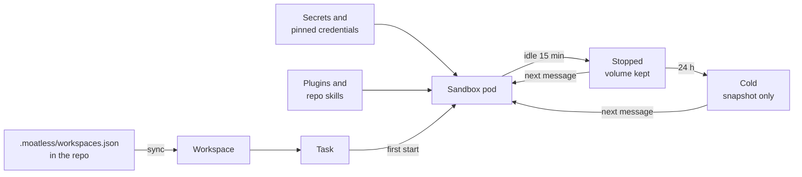

# Workspaces and sandboxes

A task runs in a sandbox, and the sandbox is set up from a workspace. This guide explains what a workspace declares, how credentials and skills reach the sandbox, how long a sandbox and its files live, and the limits the task runs inside.



## Workspaces

A Workspace is zero or more repositories plus run configuration. A Task points at a workspace, never at a repository. Every registered repository has a `default` workspace with that repository alone as primary. An entry with `"key": "default"` in the repo's file overrides its settings.

Workspaces are declared in `.moatless/workspaces.json` at the root of the repository. The backend syncs the file when the repository's default branch moves. To sync by hand:

```bash
moat repos sync-config <repo>
```

A key the schema does not know is ignored and reported as a sync warning, so a misspelling does not pass silently. A git-declared workspace is changed by editing its entry. `moat workspaces delete` only removes a legacy manual workspace.

The fields people use most:

| Field | What it sets |
|---|---|
| `key`, `name`, `description` | Identity. `key` stays stable when you rename `name` |
| `repos` | Each entry has `url`, and optionally `branch`, `mountName` and `primary` |
| `placeRepository` | `false` on an entry with no `repos` clones nothing |
| `dockerImage` | The sandbox image |
| `codeExecution.setupCommands` | Commands to run when the sandbox is set up |
| `scripts` | Named commands. Each becomes a Run button and can start with the sandbox (`runOnStart`). A script with a `port` gets a preview URL on Kubernetes |
| `envVars` | Plain environment variables. They are not secret, so keep tokens out |
| `resources` | CPU, memory and storage. See [Resources](#resources) |
| `dockerAccess` | Gives the sandbox Docker |
| `skills` | `enable` and `disable` lists of plugin skills for this workspace |
| `languageServers` | Language servers for the agent's code tools |
| `defaultModel`, `defaultEffort` | Defaults for new tasks |

A trimmed entry from the moatless repo's own file, the workspace its admin tasks run in:

```json
{
  "key": "admin",
  "name": "moatless-admin",
  "repos": [
    { "url": "https://github.com/<org>/moatless.git", "primary": true }
  ],
  "dockerAccess": true,
  "languageServers": ["typescript"],
  "resources": {
    "requests": { "cpu": "1", "memory": "6Gi" },
    "limits": { "cpu": "4", "memory": "14Gi" },
    "storage": "60Gi"
  },
  "sandboxServiceAccount": "moatless-admin",
  "networkProfile": "moatless-admin"
}
```

Three fields are admin-only: `sandboxServiceAccount`, `networkProfile` and `nodeSelector`. A value in git applies only when the deployment holds an identity grant for that repository and workspace key. Otherwise the sync drops the value and adds a warning. When a workspace names neither a service account nor a network profile, the sandbox gets a role identity. The `admin` identity goes only to a private sandbox that no loop opened and whose owner and run-as user are both platform admins. Every other sandbox gets `user`.

To start a task in a workspace:

```bash
moat tasks create --workspace <workspace> --agent-profile <harness> --message "..."
```

`--workspace` takes an id (`ws_...`) or a name. It is required unless a parent task or a joined sandbox already settles one. `--repo` is ignored, because the workspace's primary repository is what the task runs against.

## Secrets and credentials

A secret has a scope, and a user-scoped secret overrides a global one with the same key. Secrets reach the sandbox as environment variables, except the keys the platform owns.

A provider credential can also be pinned to a workspace. It overrides the run-as user's own credential for every task on that workspace, for sandbox clone and push and for backend pull request calls. That is how a workspace reaches repositories its users' own tokens cannot.

```bash
moat workspaces credentials list <workspace>
moat workspaces credentials set <workspace> ...
moat workspaces credentials remove <workspace> ...
```

Run `moat workspaces credentials set --help` for the provider names and how to pass the value.

The precedence, highest first: a pinned workspace credential, the workspace's `envVars`, then the connected account and scoped secrets. GitHub and Forgejo credentials and model keys never enter the pod. The pod reaches those through a backend proxy that holds the credential, so a token is never in the sandbox's environment.

## Skills and plugins

Plugins are git repositories of agent skills, registered once and available to everyone. The backend works out which plugins the run-as identity has turned on, narrowed by the workspace's `skills` lists, and the sandbox fetches them into `.plugins/` when it starts.

A repository's own skills, from `.claude/skills` and `.agents/skills`, always load. When a repository skill and a plugin skill share a name, the repository skill wins.

## The sandbox lifecycle

A sandbox is provisioned for a task on demand, with its own `sandbox_id` that is never the task's id. Its lifecycle record outlives the pod. A start builds a pod from the workspace, restores the saved files and runs setup, so a first start takes longer than a restart on a live volume. Cold start is normal, and the code keeps no pool of pre-created pods.

The reaper stops and reclaims sandboxes in stages. Each default below comes from the deployment's configuration, and the Helm chart can change it.

| Stage | Default | Setting |
|---|---|---|
| Idle stop | 15 minutes without activity | `SANDBOX_IDLE_TIMEOUT_MINUTES` |
| Settle | Off. A task settles only when `TASK_SETTLE_AFTER_HOURS` or the task's own value is above 0 | `TASK_SETTLE_AFTER_HOURS` |
| Close | 7 days after a task settled. `0` disables it | `TASK_CLOSE_AFTER_SETTLED_DAYS` |
| Cold reclaim | 24 hours after a stop. `0` disables it | `SANDBOX_COLD_AFTER_HOURS` |

The idle stop does not fire while the sandbox is busy. A running turn counts as activity, and so does a `moat cmd` command the sandbox is still holding. A task can opt out of the idle stop, or change it, per task:

```bash
moat tasks ttl <task-id> --ttl-minutes 0
```

`--ttl-minutes 0` means never stop. `--close-after-settled-days` sets the close delay the same way. When several tasks share a sandbox, the largest idle time wins, and one task set to 0 keeps the pod up for all of them.

A stopped sandbox keeps its volume, so the next message restarts warm. After the cold-reclaim time, the Deployment and volume are deleted and the S3 snapshot is the only copy. The task stays open, and a later message provisions a fresh volume and restores into it. Only tasks with both a volume and S3 snapshots are eligible.

A restart or a redeploy of a sandbox ends the agent's current turn. When the new pod is up, the agent is woken with a `<sandbox-restart-note>`, so work that was not captured before the restart is gone. For diagnosing a stuck sandbox, use the sandbox-troubleshooting skill.

## What survives

Workspace files live on a per-task volume at `/opt/moatless`, which is on by default. On stop or removal, the sandbox also snapshots the working tree to S3. The snapshot holds what git tracks, what is untracked but not ignored, and the `.git` directory.

Gitignored paths such as `node_modules` and `target/` are not in the snapshot. They survive a stop on the volume, but not a restore after a cold reclaim or a lost volume. Re-run installs and builds, which `setupCommands` can do for you. Treat `/tmp` and anything outside the workspace volume as temporary.


## Long-running work

A tool call cannot hold a process that outlives it. `moat cmd run` hands the command to the sandbox, which owns the process, stays awake until it finishes and wakes the agent when it exits.

```bash
moat cmd run --queue --label build "cargo build --release"
moat cmd status <id>
moat cmd wait <id>
```

The command is killed after 4 hours unless you pass `--timeout <seconds>`. `--queue` starts it only after every earlier queued command of the task has finished, whatever their exit codes. Use it for builds that share a target directory. Without it, the command starts at once.

## Sharing a sandbox

A task can join another task's sandbox instead of getting its own. The tasks become members of one sandbox, peers with none owning the pod. A member joins when the task is created and cannot move later.

```bash
moat tasks create --same-sandbox <task-id> --checkout-mode isolated --agent-profile <harness>
```

Bare `--same-sandbox` means the task you are running in. A sandbox holds exactly one workspace, so `--workspace` and `--repo` conflict with it. `--checkout-mode` is `shared` by default, where members use the same directory and git state. With `isolated`, each member gets its own checkout in the same pod and reuses the warm caches.

The driver is the person whose message started the sandbox's current turn. The sandbox acts for them, and its credentials resolve for the driver, unless the workspace or task pins a run-as identity. A new driver replaces the previous driver's task tokens. See [Orchestration](orchestration.md) for how parent and child tasks use this.

## Resources

A sandbox requests 1 CPU and 2 GiB of memory, with limits of 4 CPU and 16 GiB. These are the chart defaults for `sandboxResources`. A workspace's `resources` overrides them for heavier repositories.

Requests reserve capacity, and the scheduler packs nodes by them, so requests are what cost money. Limits only set where the kernel kills a process. Size a request from median memory use and a limit from peak use times about 1.5. The workspace-resource-tuning skill in the admin plugin walks through the measurements. A change to a workspace reaches only Deployments created after it, so redeploy existing ones to apply it.

A deployment can run sandbox pods on a spot node pool. A spot reclaim mid-turn kills the agent's turn, so loops that run unattended can ask for an on-demand pool with `nodeSelector`, which is an admin-only field. The runbook `docs/runbooks/sandbox-node-pools.md` covers how the pool, its taint and the Helm tolerations fit together. A loop that sets `stopWhenDone` stops its sandbox when the agent finishes, so the node can be released.

Docker is off unless a workspace sets `dockerAccess: true`. The sandbox then gets a privileged Docker-in-Docker sidecar. Its storage is `dockerStorage`, with `dockerStorageMode` choosing where it lives.

## Security boundaries

Sandbox network traffic is limited by a Kubernetes NetworkPolicy. A sandbox can reach cluster DNS, the backend and the public internet on port 443, minus the private address ranges. That blocks traffic to other pods and to internal services. An admin can restrict external egress to an allowlist, or give a workspace a `networkProfile` with its own egress rules. Ingress is restricted to the backend and the preview proxy.

The backend's git proxy holds the git credential and injects it into requests, so a GitHub token never reaches the pod.
