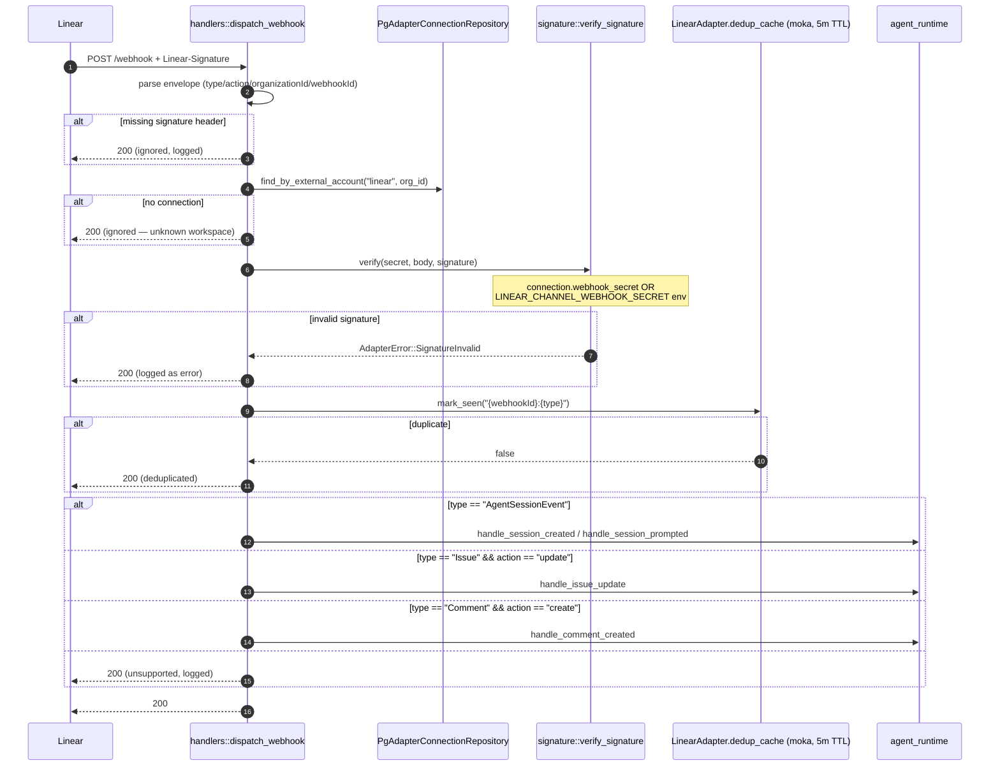
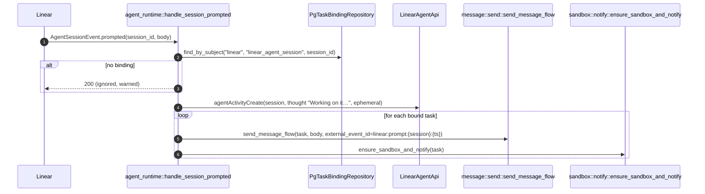
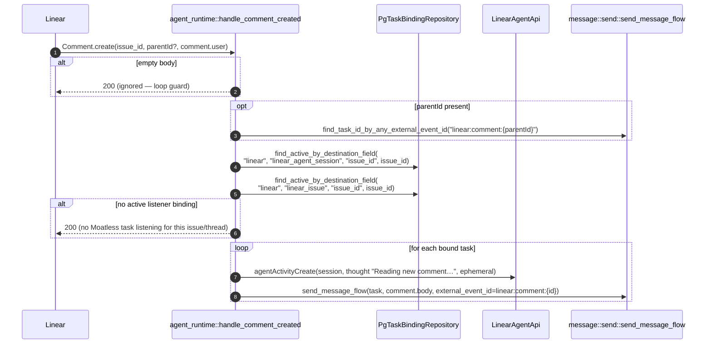
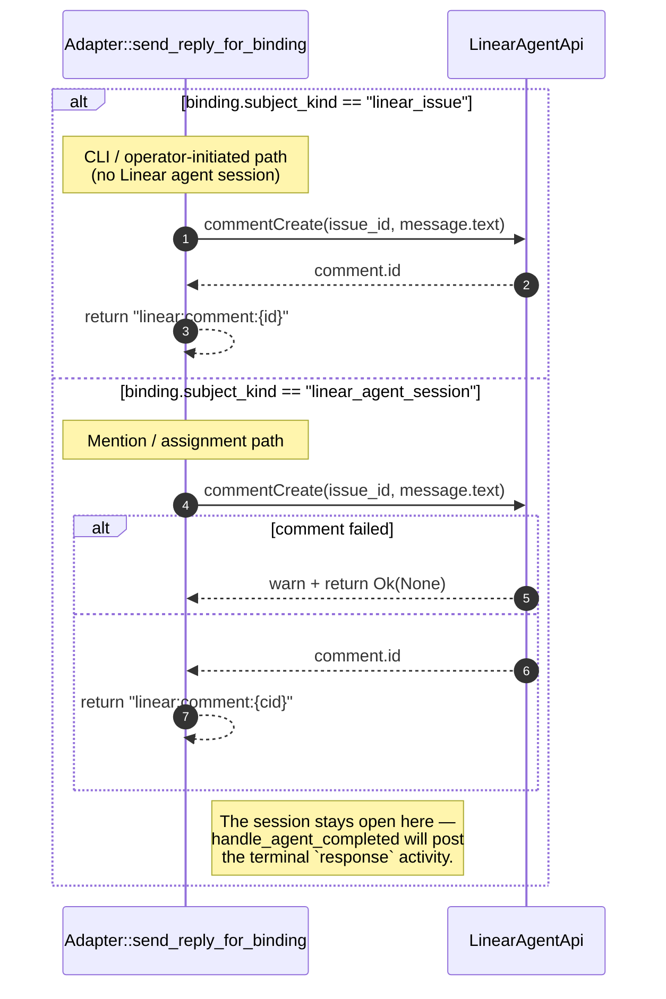
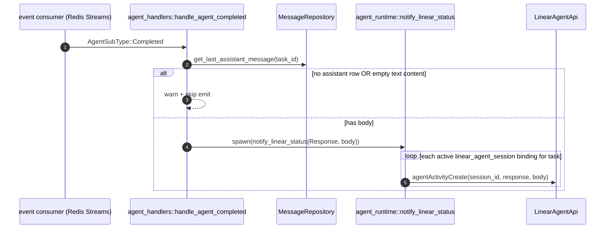
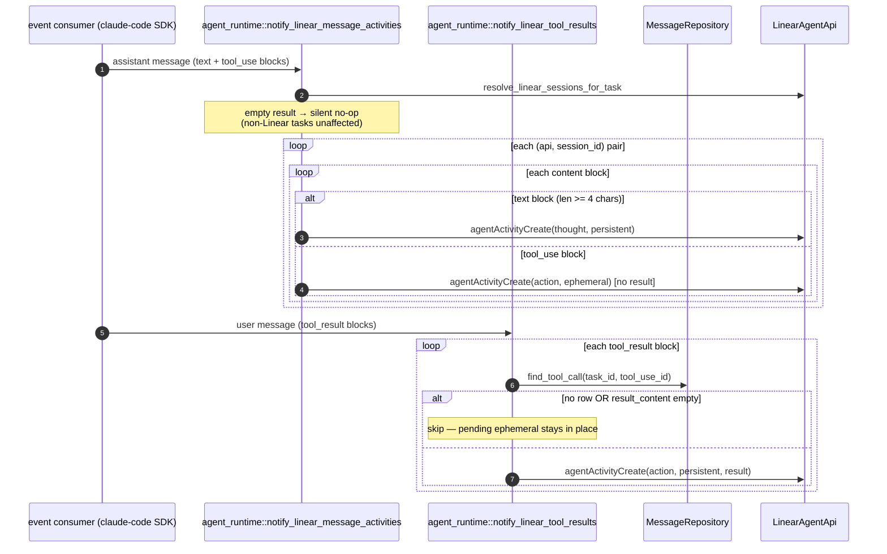
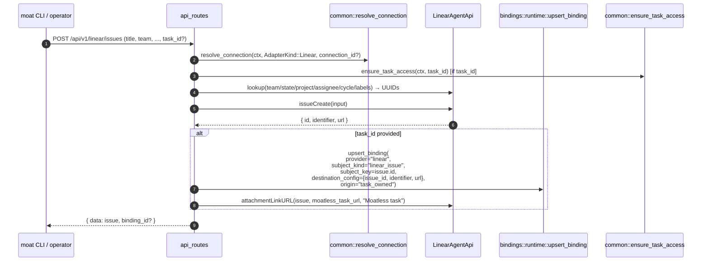

# Linear Adapter

Source: `backend/src/adapters/linear/`

The Linear adapter is an **Agents-first** integration: most inbound traffic
arrives as Linear `AgentSessionEvent` webhooks (the user `@mentioned` the
agent on an issue, or assigned the issue to the agent). A smaller surface
handles classic `Issue.update` / `Comment.create` events to keep already-
running tasks in sync, plus a typed `/api/v1/linear/*` REST surface for
CLI- and operator-driven flows.

Outbound traffic goes through Linear's GraphQL API at
`https://api.linear.app/graphql`, authenticated with a workspace-scoped
OAuth token stored in `provider_tokens` (keyed by Linear organization UUID).

## Module Map

| File | Role |
| --- | --- |
| `mod.rs` | Module declarations + the `SUBJECT_KIND_ISSUE` constant. |
| `adapter.rs` | `Adapter` trait impl, dedup cache, `send_reply_for_binding` (routes by `subject_kind`). |
| `handlers.rs` | Webhook endpoint dispatcher — HMAC verify, dedup, parse envelope, route by `event_type`. |
| `agent_runtime.rs` | All inbound business logic for `AgentSessionEvent`, `Comment.create`, `Issue.update`. Also emits ephemeral activities (`thought` / `action`) from the agent event consumer. |
| `agent_api.rs` | GraphQL client. Token refresh, `agentActivityCreate`, `agentSessionUpdate`, `commentCreate`, `attachmentLinkURL`, name → UUID lookups. |
| `api_routes.rs` | Typed `/api/v1/linear/*` HTTP surface used by the moat CLI (issue CRUD, comments, labels, GraphQL passthrough). Auto-creates `linear_issue` bindings when `task_id` is supplied. |
| `webhook_payloads.rs` | Serde structs for the inbound envelopes. |
| `config.rs` | `LinearRuleConfig` — typed view of `task_trigger_routes.provider_config`. |
| `signature.rs` | HMAC-SHA256 verification of the `Linear-Signature` header. |

## Two Binding Subject Kinds

The adapter persists task ↔ Linear-destination relationships in
`task_bindings`. The `subject_kind` column determines how a reply on the
task is routed back to Linear:

| `subject_kind` | Created by | `subject_key` | Outbound reply path |
| --- | --- | --- | --- |
| `linear_agent_session` | Inbound `AgentSessionEvent.created` (mention / assignment) | Linear session UUID | `commentCreate` on the issue. The terminal `response` activity that closes the Linear agent session is **not** emitted here — it is posted by `handle_agent_completed` once the task finishes (see [Session Finalization](#session-finalization-terminal-response--error-activities)). |
| `linear_issue` | `POST /api/v1/linear/issues` or `.../comments` with `task_id`, or `Adapter::post_to_destination("issue:SP-N", …)` | Linear issue UUID | `commentCreate` on the issue only. The session loop does not apply — there is no Linear agent session to close. |

The dispatch happens in `LinearAdapter::send_reply_for_binding`
(`adapter.rs:220-295`):

```rust
if binding.subject_kind == SUBJECT_KIND_ISSUE {
    // commentCreate-only
} else {
    // commentCreate only — session finalization is owned by agent.completed
}
```

This split is the single most important design point in the adapter and is
called out in every relevant sequence diagram below.

## Inbound: Webhook Dispatcher

All Linear webhooks land on `POST /api/v1/adapters/linear/webhook`
(`handlers.rs:25-62`). The dispatcher is intentionally generous: any benign
rejection (unknown org, dedup hit, unsupported event) still returns
`200 OK` so Linear doesn't retry, and a noisy `warn!` is reserved for real
verification failures.



Notes:
- The dedup cache key is `{webhookId}:{event_type}` — Linear reuses one
  `webhookId` across the related fan-out events (`Comment.create` and
  `AgentSessionEvent.created` arrive together), so keying on the pair
  prevents the second event being dropped as a duplicate.
- `signature.rs` does a constant-time HMAC-SHA256 compare with no `sha256=`
  prefix and no timestamp; replay protection is the dedup cache.

## Inbound: `AgentSessionEvent.created` (Mention / Assignment)

A user `@mentions` the agent on an issue, or assigns the issue to it.
Linear opens an agent session and delivers `AgentSessionEvent.created`.

```mermaid
sequenceDiagram
    autonumber
    participant Linear
    participant Dispatcher as handlers
    participant Runtime as agent_runtime::handle_session_created
    participant API as LinearAgentApi
    participant Tasks as state.tasks
    participant BindingRepo as PgTaskBindingRepository
    participant Sandbox as state.sandbox
    participant MsgFlow as message::send::send_message_flow

    Linear->>Dispatcher: AgentSessionEvent.created
    Dispatcher->>Runtime: handle_session_created(session)
    Note over Runtime: SYNCHRONOUS (within Linear's 10s window)
    Runtime->>API: agentActivityCreate(session, thought "Spinning up sandbox…", ephemeral)
    Runtime-->>Dispatcher: Ok (ack)
    Dispatcher-->>Linear: 200

    Note over Runtime: spawn background task
    Runtime->>Runtime: provision_session_task (tokio::spawn)
    Runtime->>Tasks: insert_task(rule defaults + issue identifier/title)
    Runtime->>Sandbox: auto_provision::build_provision_request → provision
    Runtime->>BindingRepo: upsert TaskBinding<br/>subject_kind="linear_agent_session"<br/>subject_key=session.id<br/>destination_config={session_id, issue_id, identifier, team_id, issue_url}
    Runtime->>API: agentSessionUpdate(externalUrls=[Moatless task])
    Runtime->>API: attachmentLinkURL(issue, task_url)
    alt mention path (comment with real user)
        Runtime->>API: fetch_issue_comments(issue, 50)
    end
    Runtime->>Runtime: build_inbound_text(session, prior_comments)
    Note right of Runtime: Prefers session.promptContext (Linear's<br/>pre-built XML); falls back to issue+comments
    Runtime->>MsgFlow: send_message_flow(task, inbound_text)
```

Key points:
- The synchronous heartbeat `thought` is ephemeral so the next real
  activity (e.g. the `action` from the first tool call) replaces it in
  Linear's UI rather than stacking.
- One `linear_agent_session` binding per session. The binding's
  `destination_config.issue_id` is what lets `Comment.create` find the
  task later.
- `provider_event_task_created` is the origin label (`ADAPTER_EVENT_BINDING_ORIGIN`),
  which gates Issue.update auto-close behavior.

## Inbound: `AgentSessionEvent.prompted` (Follow-up Prompt)

The user posts another comment in the same agent session. Linear delivers
the prompt body in `agentActivity.body`.



## Inbound: `Comment.create` on a Listening Issue or Comment Thread

A user comments on a Linear issue or replies inside a Linear comment thread.
We route the comment if the issue already has an active
`linear_agent_session` binding (a task spawned from a Linear agent session) or
an active `linear_issue` binding (a task connected directly to the issue).
When the comment is a threaded reply, Linear includes `parentId`; Moatless maps
that parent comment id back through `task_messages.external_event_id` and
delivers the reply only to the task that authored the parent comment.



The self-echo guard recovers the originating task from the `Moatless task:`
footer on outbound comments and from the persisted `linear:comment:<id>`
external event id. That skips the task that authored the comment while still
allowing other listeners on the same issue to receive ordinary issue-level
comments.

## Inbound: `Issue.update` (State Transition)

The dispatcher filters non-`update` actions in `handlers.rs`, and the
runtime requires a real state transition (different `stateId` in
`updatedFrom`). On a real transition we:
1. **Always** post a state-change notification to every bound task
   (best-effort).
2. **Optionally** close active bindings when the new state is in the
   rule's `terminal_states` and the rule has `close_task_on_close = true`.

```mermaid
sequenceDiagram
    autonumber
    participant Linear
    participant Runtime as agent_runtime::handle_issue_update
    participant Rules as PgTaskTriggerRouteRepository
    participant BindingRepo as PgTaskBindingRepository
    participant MsgFlow as message::send::send_message_flow
    participant API as LinearAgentApi
    participant Tasks as state.tasks
    participant Sandbox as state.sandbox

    Linear->>Runtime: Issue.update(issue, updatedFrom.stateId)
    alt prev == new OR either missing
        Runtime-->>Linear: 200 (no transition)
    end
    Runtime->>Rules: resolve_rules_for_team(team_id)
    Note over Runtime: rules[0] wins for config<br/>(LinearRuleConfig::from_rule)
    Runtime->>BindingRepo: find_active_by_destination_field("issue_id", issue_id)
    loop notify every bound task
        Runtime->>MsgFlow: send_message_flow("Linear issue {ident} moved to \"{state}\"")
    end
    alt new state in rule.terminal_states && rule.close_task_on_close
        Runtime->>BindingRepo: find bindings + sibling count per task
        loop per binding (origin == provider_event, single sibling, trigger == rule)
            Runtime->>API: agentActivityCreate(session, response "issue transitioned; closing")
            Runtime->>Sandbox: cleanup(task_id)
            Runtime->>Tasks: update_task(status = Closed)
            Runtime->>Runtime: publish_task_event(Closed)
        end
    end
```

Sibling guard: tasks bound to multiple Linear issues (or to a mix of
Linear + GitHub + Slack) are left open when one of their bindings closes —
only the sole-binding case triggers auto-close.

## Outbound from a Bound Task: `send_reply_for_binding`

Once a task has produced an answer, the message pipeline calls
`LinearAdapter::send_reply_for_binding`. This is where the
`subject_kind` branch lives.



`message_external_id` is used by the message pipeline to dedup retries —
`linear:comment:<id>` is stable per Linear-side object.

## Session Finalization (Terminal `response` / `error` Activities)

Per Linear's [Agent Interaction spec](https://linear.app/developers/agent-interaction#activity-content-payload),
an `AgentSession` stays open until the agent emits a terminal `response` or
`error` activity. Moatless owns those terminal activities in a single
emission point per outcome:

| Outcome | Hook | Activity | Body |
| --- | --- | --- | --- |
| Success | `event_handler::agent_handlers::handle_agent_completed` | `response` | Concatenated text blocks from the task's last `assistant` message (resolved via `MessageRepository::get_last_assistant_message`). |
| Agent error | `event_handler::consumer` (`AgentSubType::Error`) | `error` | `payload.error` (or `payload.message`) string. |
| Sandbox error | `event_handler::consumer` (`SandboxSubType::Error`) | `error` | `payload.message` string. |
| External close | `agent_runtime::close_active_bindings_for_issue` (Linear issue moved to terminal state) | `response` | `"Linear issue {identifier} transitioned to {state}; closing this task."` |

`send_reply_for_binding` deliberately does **not** post a `response`
activity — the agent's reply lands as a Linear issue comment, and the
session is finalized later by `handle_agent_completed` using the last
assistant message body. This keeps the lifecycle observable in one place
and avoids double-emit races when the agent calls `moat messages reply`
and then exits.



## Outbound: Streamed Activities from the Event Consumer

While the task runs, the agent event consumer streams Claude's `assistant`
and `user` messages back through two sibling helpers in `agent_runtime`:

- `notify_linear_message_activities` (assistant messages) — emits one
  **persistent** `thought` per `text` block (the agent's narration sticks in
  Linear's UI) and one **ephemeral** pending `action` per `tool_use` block
  with a one-line `summarize_tool_input` parameter (e.g. `"Bash"` → the
  command text, `"Edit"` → the file path).
- `notify_linear_tool_results` (user messages carrying `tool_result`
  blocks) — looks up the matching `tool_use_id` via
  `MessageRepository::find_tool_call` and emits a **non-ephemeral**
  completed `action` carrying the same `tool_name` + `summarize_tool_input`
  parameter, with the truncated result attached. The ephemeral pending
  action is visually replaced; the completed one persists.

Linear has no `agentActivityUpdate` mutation, so "promote pending →
completed" is implemented as two separate `agentActivityCreate` calls.



Result truncation: `truncate_result_for_linear` caps the result at 500
Unicode scalars (ellipsis suffix on overflow) and prefixes `"❌ "` when
the tool reported an error. Both helpers are **fire-and-forget**: any DB,
GraphQL, or network failure is logged and swallowed so the event-consumer
hot path is unaffected.

## Outbound: Sandbox / Agent Lifecycle Status Markers

Distinct from the streamed Claude messages, the event consumer emits one
**ephemeral** `action` activity per sandbox/agent lifecycle transition. The
`parameter` is the raw `SubType::as_str()` value — no UUIDs, no
free-form text — so each new status visually replaces the previous one in
Linear's UI without piling up.

| Event | `action` | `parameter` |
| --- | --- | --- |
| `Sandbox::Initializing` | `"Sandbox"` | `"initializing"` |
| `Sandbox::Ready` | `"Sandbox"` | `"ready"` |
| `Sandbox::Stopped` | `"Sandbox"` | `"stopped"` |
| `Agent::Started` | `"Agent"` | `"started"` |

Internal/terminal sandbox states (`NotCreated`, `Removing`, `Removed`)
have no useful Linear-UI signal and are intentionally not surfaced.
`Sandbox::Error` and `Agent::Error` continue to route through
`notify_linear_status` as persistent `error` activities (see
[Session Finalization](#session-finalization-terminal-response--error-activities)).

## CLI-Initiated Flow: `linear_issue` Binding

The typed `POST /api/v1/linear/issues` and
`POST /api/v1/linear/issues/{id}/comments` endpoints (`api_routes.rs`)
exist for the moat CLI and operators. When the caller supplies `task_id`,
the handler auto-binds the issue to the task with `subject_kind =
linear_issue`.



Comment-create (`POST /api/v1/linear/issues/{id}/comments`) follows the
same pattern: the comment is posted with `commentCreate`, and if
`task_id` is supplied the same `linear_issue` binding is upserted so
subsequent `POST /tasks/{id}/reply` calls flow through
`send_reply_for_binding` and into `commentCreate` on the same issue.

## Outbound Auth: Workspace Token Refresh

`LinearAgentApi` is constructed per-org. Before every GraphQL call it
resolves the access token from `provider_tokens` (keyed by
`provider = "linear"`, `team_id = <org uuid>`), and refreshes against
`https://api.linear.app/oauth/token` when the stored token is within
`REFRESH_LEEWAY_SECS` (5 minutes) of expiry. Refresh requires
`oauth_client_id` and `oauth_client_secret` to be configured on the
adapter — otherwise calls fail with `AdapterError::AdapterApi`.

## Summary Cheat Sheet

```
Inbound webhook                                 → routed by event_type:
  AgentSessionEvent.created       (mention)     → handle_session_created
  AgentSessionEvent.created       (assignment)  → handle_session_created
  AgentSessionEvent.prompted                    → handle_session_prompted
  Comment.create                                → handle_comment_created
  Issue.update (real state transition)          → handle_issue_update

Inbound side-effect: task_bindings row
  origin = "provider_event"
  subject_kind = "linear_agent_session"
  subject_key  = session.id
  destination_config.issue_id = issue.id

CLI-initiated POST /api/v1/linear/issues with task_id:
  origin = "task_owned"
  subject_kind = "linear_issue"
  subject_key  = issue.id

Outbound reply on a bound task                  → send_reply_for_binding:
  linear_agent_session                          → commentCreate (only)
  linear_issue                                  → commentCreate (only)

Outbound progress while task runs               → notify_linear_message_activities + notify_linear_tool_results:
  assistant text block                          → agentActivityCreate(thought, persistent)
  assistant tool_use block                      → agentActivityCreate(action, ephemeral) [no result]
  user tool_result block                        → agentActivityCreate(action, persistent, result)

Sandbox/agent lifecycle (ephemeral status)      → notify_linear_action:
  SandboxSubType::Initializing/Ready/Stopped    → agentActivityCreate(action="Sandbox", parameter=status, ephemeral)
  AgentSubType::Started                         → agentActivityCreate(action="Agent",   parameter="started", ephemeral)

Session finalization (terminal activity)        → emitted by event handlers, not reply:
  agent.completed (success)                     → agentActivityCreate(response, last assistant text)
  agent.error / sandbox.error                   → agentActivityCreate(error, error text)
  Issue.update → terminal state                 → agentActivityCreate(response, close message)
```
