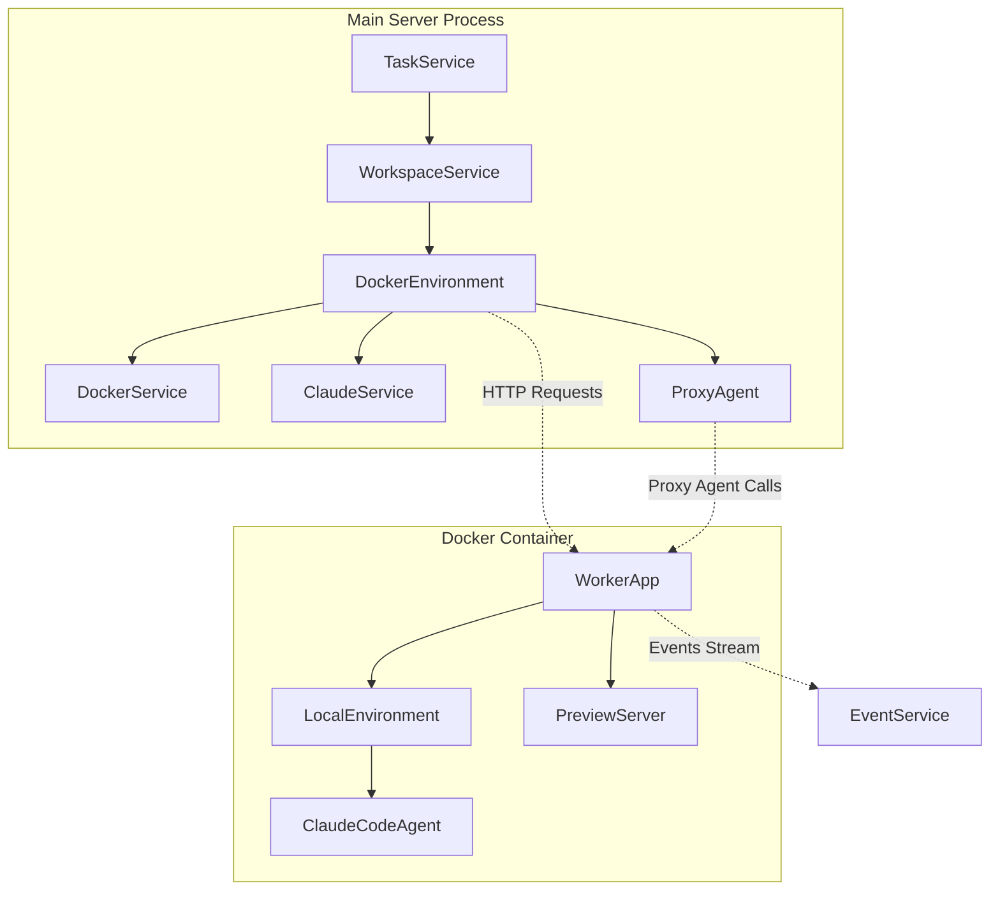
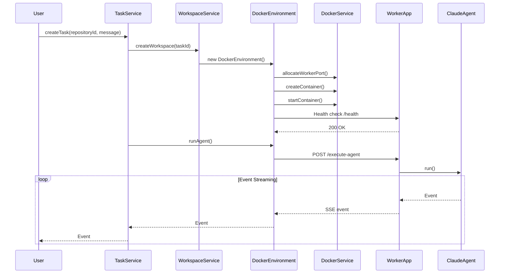
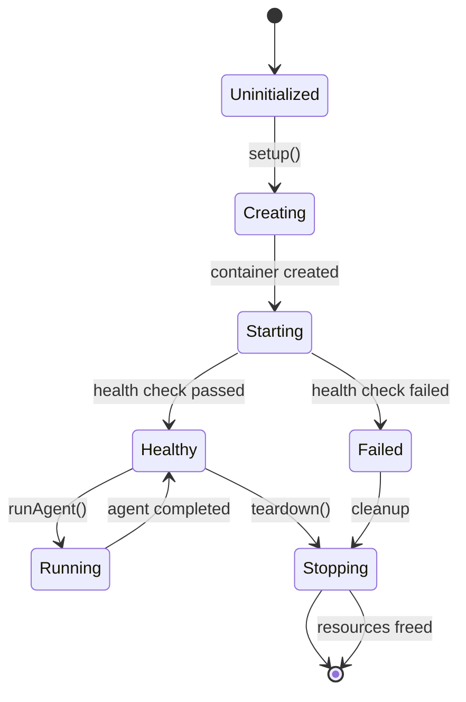

# Docker Environment Architecture Pattern

This document explains the complete Docker-based code execution architecture in Moatless, designed for LLMs to understand and troubleshoot the flow from repository configuration to agent execution within Docker containers.

## Overview

The Docker architecture enables secure, isolated code execution by running user code and AI agents inside Docker containers while maintaining communication with the main application server. This pattern uses dependency injection, service composition, and a worker-proxy architecture.

## Architecture Flow

### Component Structure


### Task Execution Sequence


### Container Lifecycle States


## 1. Task Creation and Repository Configuration

### File: `apps/backend/services/task.service.ts`
### File: `apps/backend/services/repository.service.ts`
### Schema: `packages/types/src/schemas/repository.schemas.ts`

**Task Creation Entry Point:**
- **Line 503-595**: `createTask()` - Creates task and workspace
- **Line 570-586**: Workspace creation with repository configuration
- **Line 592**: Background workspace setup and task start

**Repository Configuration:**
- **Line 41-63**: `createRepository()` - Creates repository configuration
- **Line 227-230**: `validateRepository()` - Validates Docker setup requirements

**Docker-Specific Configuration:**
```typescript
// packages/types/src/schemas/repository.schemas.ts:30-50
const CodeExecutionSchema = z.object({
  type: z.enum(['local', 'docker']),
  dockerImage: z.string().optional(),        // Container image to use
  envVars: z.record(z.string(), z.string()).optional(),  // Environment variables
  setupCommands: z.array(z.string()).optional(),         // Commands to run on startup
  volumes: z.array(z.string()).optional(),               // Volume mounts
  ports: z.record(z.string(), z.number()).optional(),    // Port mappings
})
```

**Key Methods:**
- `validateRepository()` - Ensures Docker prerequisites are met
- `detectFramework()` - Auto-detects preview server configuration
- `runSetupScript()` - Executes repository setup commands

**Task Execution Flow:**
- **Line 92-224**: `executeAgentViaEnvironment()` - Main agent execution method
- **Line 104**: Gets workspace from WorkspaceService
- **Line 125**: Gets environment from workspace
- **Line 162**: Executes agent via `environment.runAgent()`

## 2. Workspace Creation

### File: `apps/backend/services/workspace.service.ts`

**Docker Environment Creation:**
- **Line 67-76**: Decision point for Docker vs Local environment
- **Line 69**: Creates `DockerEnvironment` with dependency injection

```typescript
// apps/backend/services/workspace.service.ts:67-76
if (repository.codeExecution.type === 'docker') {
  environment = new DockerEnvironment(
    taskId,
    repository,           // Repository configuration
    workspacePath,        // Host workspace path
    this.dockerService,   // Docker operations service
    this.claudeService,   // Claude authentication service
    this.eventService,    // Event streaming service
  )
}
```

**Critical Dependencies:**
- **DockerService**: Container lifecycle management
- **ClaudeService**: Authentication and configuration
- **EventService**: Real-time event streaming

## 3. Docker Environment Implementation

### File: `apps/backend/environments/docker-environment.ts`

**Container Lifecycle:**
- **Line 75-202**: `setup()` - Complete container initialization
- **Line 756-786**: `teardown()` - Clean container shutdown

**Setup Process (Line 75-202):**
1. **Port Allocation** (Line 116): Allocate worker port using `DockerService`
2. **Container Creation** (Line 127): Create or reuse existing container
3. **Container Start** (Line 133): Start the container process
4. **Config Transfer** (Line 139): Copy repository config to container
5. **Health Check** (Line 154): Wait for worker readiness
6. **Claude Setup** (Line 157-173): Copy Claude authentication files

**Agent Execution:**
- **Line 668-685**: `createAgent()` - Returns `ProxyAgent` instance
- **Line 687-723**: `runAgent()` - Streams agent execution events
- **Line 725-754**: `stopAgent()` - Terminates running agents

**Preview Server Integration:**
- **Line 458-502**: `startServer()` - Starts preview server in container
- **Line 504-545**: `stopServer()` - Stops preview server
- **Line 614-666**: `proxyPreviewRequest()` - Proxies web requests to container

## 4. Docker Container Image

### File: `docker/Dockerfile`

**Multi-Stage Build:**
- **Line 6-196**: Base system with development tools
- **Line 198-241**: Application layer with Moatless worker

**Key Components:**
- **Line 93-95**: Node.js 22 installation
- **Line 98-109**: Python via pyenv
- **Line 112-117**: Rust toolchain
- **Line 119-127**: Go toolchain
- **Line 129-134**: Java OpenJDK 21
- **Line 152-167**: Bun package manager
- **Line 175**: Claude Code CLI installation

**Runtime Configuration:**
- **Line 229-235**: Environment variables for worker mode
- **Line 238**: Port 8001 exposure for worker communication
- **Line 241**: Entrypoint script execution

## 5. Container Entrypoint

### File: `docker/docker-entrypoint.sh`

**Initialization Process:**
- **Line 11-20**: Workspace directory setup and permissions
- **Line 23-25**: Claude configuration directory creation
- **Line 28-39**: Git worktree environment configuration
- **Line 42-58**: GitHub token authentication setup
- **Line 72-93**: Repository setup commands execution
- **Line 104**: Worker mode startup

**Critical Environment Variables:**
- `WORKER_TASK_ID`: Task identifier for the container
- `WORKER_API_URL`: Main server URL for event streaming
- `WORKSPACE_DIR`: Container workspace path (default: `/repo`)
- `CLAUDE_CONFIG_DIR`: Claude authentication directory

## 6. Worker Application

### File: `apps/backend/worker-app.ts`

**Worker Server Setup:**
- **Line 64-433**: `startWorkerMode()` - HTTP server for container operations
- **Line 97**: Creates `LocalEnvironment` within container
- **Line 119-126**: Health check endpoint

**Key Endpoints:**
- **Line 129-175**: `/execute-agent` - Agent execution (returns immediately, runs in background)
- **Line 178-215**: `/stop-agent` - Agent termination
- **Line 218-270**: `/server/start` - Preview server startup
- **Line 272-296**: `/server/stop` - Preview server shutdown
- **Line 352-398**: `/server/proxy/*` - Preview request proxying
- **Line 401-424**: `/command` - Direct command execution

**Background Execution:**
- **Line 24-53**: `runAgentInBackground()` - Executes agent and streams events to main server
- **Line 37**: Agent execution with event streaming
- **Line 41**: Event emission to main API via `WorkerApiClient`

## 7. Claude Code Agent in Container

### File: `apps/backend/agents/claude-code/claude-code-agent.ts`

**Container Execution:**
- **Line 27-196**: `run()` - Main agent execution method
- **Line 66-118**: Claude Code SDK integration
- **Line 198-206**: `stop()` - Agent termination

**SDK Configuration:**
- **Line 241-298**: `buildSDKOptions()` - SDK configuration with container paths
- **Line 259-270**: Claude environment variable setup
- **Line 272-297**: Working directory and tool configuration

**Key Features:**
- **Line 46**: SDK options building with container context
- **Line 272-276**: Tool allowlist: `['WebFetch', 'WebSearch', 'Bash']`
- **Line 274**: Permission mode: `'acceptEdits'` for autonomous operation

## 8. Proxy Agent Communication

### File: `apps/backend/agents/proxy-agent.ts`

**Proxy Pattern:**
- **Line 29-106**: `run()` - Streams agent execution from worker
- **Line 108-125**: `stop()` - Terminates remote agent

**HTTP Communication:**
- **Line 30**: Worker URL construction: `http://localhost:{workerPort}/execute-agent`
- **Line 37-53**: HTTP request to worker with agent parameters
- **Line 61-101**: Server-Sent Events (SSE) parsing and event streaming

**Event Streaming:**
- **Line 68-101**: SSE stream parsing loop
- **Line 79-83**: Event data extraction and JSON parsing
- **Line 93-95**: Event forwarding to main application

## 9. Preview Server Integration

### File: `apps/backend/services/preview-server.ts`

**Server Management:**
- **Line 46-206**: `start()` - Starts development server
- **Line 208-257**: `stop()` - Graceful server shutdown
- **Line 465-551**: `proxyRequest()` - HTTP request proxying

**Port Management:**
- **Line 56-72**: Dynamic port allocation or detection
- **Line 115-147**: Server readiness detection
- **Line 388-433**: Port detection from logs using regex patterns

**Log Management:**
- **Line 75-87**: Log file setup and stream creation
- **Line 316-335**: Log retrieval with platform-specific commands

## Lifecycle Flow

### 1. Task Creation (TaskService)
```typescript
// apps/backend/services/task.service.ts:503-595
const task = await taskService.createTask({
  agentType: 'claude-code',
  repositoryId: 'repo-123',
  message: 'Help me fix this bug',
  start: true
})

// Line 570-586: Creates workspace with repository
const workspace = await workspaceService.createWorkspace(
  task.taskId,
  params.repositoryId,
  params.originalBranch,
  params.newBranch
)

// Line 592: Background setup and task start
setupWorkspaceInBackground(task.taskId, params.start, params.message)
```

### 2. Workspace Creation (WorkspaceService)
```typescript
// apps/backend/services/workspace.service.ts:67-76
if (repository.codeExecution.type === 'docker') {
  environment = new DockerEnvironment(
    taskId,
    repository,           // Repository configuration with Docker settings
    workspacePath,        // Host workspace path
    this.dockerService,   // Docker operations service
    this.claudeService,   // Claude authentication service
    this.eventService,    // Event streaming service
  )
}
```

### 3. Container Initialization (DockerEnvironment)
```typescript
// apps/backend/environments/docker-environment.ts:75-202
await dockerEnvironment.setup()
// 1. Allocate worker port (Line 116)
// 2. Create/start container (Line 127, 133)
// 3. Copy repository config (Line 139)
// 4. Wait for worker readiness (Line 154)
// 5. Setup Claude authentication (Line 157-173)
```

### 4. Agent Execution (TaskService → Environment)
```typescript
// apps/backend/services/task.service.ts:92-224
// TaskService.executeAgentViaEnvironment()
const workspace = await workspaceService.getOrCreateWorkspace(taskId)
const environment = workspace.getEnvironment()

// Line 162: Execute agent via environment
for await (const event of environment.runAgent(agentType, message, runOptions)) {
  // Events streamed from worker container via ProxyAgent
  await eventService.emitEvent(event)
}
```

### 5. Preview Server (via WorkerApp)
```typescript
// Worker container handles preview server
// apps/backend/worker-app.ts:218-270
const serverStatus = await dockerEnvironment.startServer()
// Requests proxied through worker at /server/proxy/*
const response = await dockerEnvironment.proxyPreviewRequest(request)
```

## Implementation Details

### Container Setup Process
The `DockerEnvironment.setup()` method orchestrates the complete container initialization:

1. **Port Allocation**: Allocates an available worker port for container communication
2. **Container Creation**: Creates a new Docker container with the configured image
3. **Container Start**: Starts the container and waits for it to be running
4. **Configuration Transfer**: Copies repository configuration to the container
5. **Health Check**: Polls the worker health endpoint until ready
6. **Claude Setup**: Transfers Claude authentication files to the container

### Health Check Mechanism
The health check process polls the worker's `/health` endpoint with a maximum of 12 attempts, waiting 5 seconds between each attempt. This ensures the worker application inside the container is fully initialized before proceeding.

### Worker Application Endpoints
The worker application running inside the container exposes these endpoints:

- **GET /health**: Returns worker status and configuration information
- **POST /execute-agent**: Starts agent execution in the background (non-blocking)
- **DELETE /stop-agent**: Terminates any running agent process
- **POST /server/start**: Starts the preview development server
- **POST /server/stop**: Stops the preview server
- **ALL /server/proxy/***: Proxies requests to the preview server

### Configuration Schema
Repository configurations support Docker execution through:
- Execution type (`local` or `docker`)
- Optional Docker image specification
- Environment variables mapping
- Setup commands to run on container start
- Volume mount specifications
- Port mapping configuration

### Port Allocation Strategy
The DockerService manages port allocation by finding available ports in the host system and mapping them to the fixed container port 8001. This allows multiple containers to run simultaneously without port conflicts.

### Communication Flow
The ProxyAgent initiates agent execution by sending a POST request to the worker. The worker runs the agent in the background and streams events directly back to the main API server via the WorkerApiClient, bypassing the ProxyAgent entirely. This fire-and-forget pattern allows the ProxyAgent to return immediately while execution continues asynchronously.

## Troubleshooting Guide

### Container Won't Start
- **Check**: `DockerService.checkDockerAvailable()` in `apps/backend/services/docker.service.ts`
- **Log Location**: Container logs via `docker logs <container-name>`
- **Port Conflicts**: `DockerService.allocateWorkerPort()` allocation

### Agent Not Responding
- **Check**: Worker health endpoint: `http://localhost:{workerPort}/health`
- **Log Location**: `DockerEnvironment.logger` events
- **Authentication**: Claude config files in container at `/home/ubuntu/.claude/`

### Preview Server Issues
- **Check**: Server status endpoint: `/server/status`
- **Log Location**: Preview server logs in container temp directory
- **Port Detection**: `PreviewServer.detectPortFromLogs()` patterns

### Event Streaming Problems
- **Check**: `WorkerApiClient` connection to main server
- **Log Location**: Worker application logs in container
- **Network**: Container-to-host communication on worker ports

## Key Integration Points

1. **Repository Configuration** → **Docker Environment Setup**
2. **Docker Environment** → **Worker Container Communication**
3. **Proxy Agent** → **Worker Agent Execution**
4. **Preview Server** → **Request Proxying**
5. **Event Streaming** → **Real-time Updates**

This architecture provides secure, isolated code execution while maintaining seamless integration with the main application through well-defined service boundaries and communication patterns.