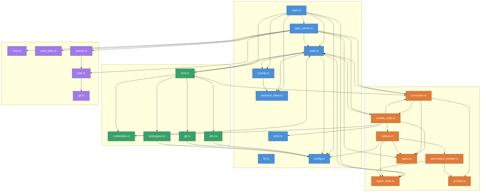
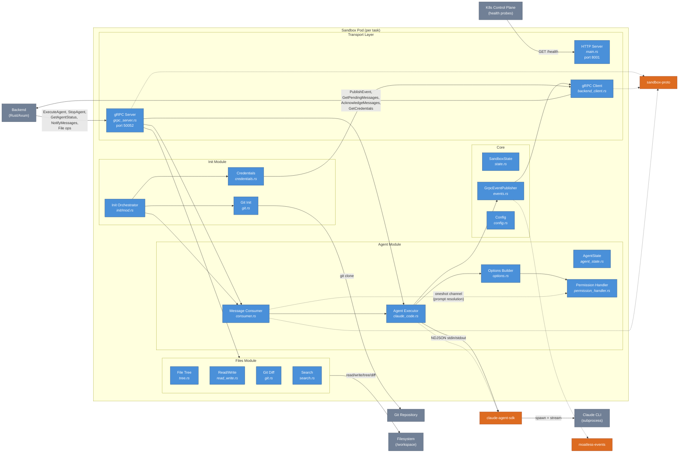
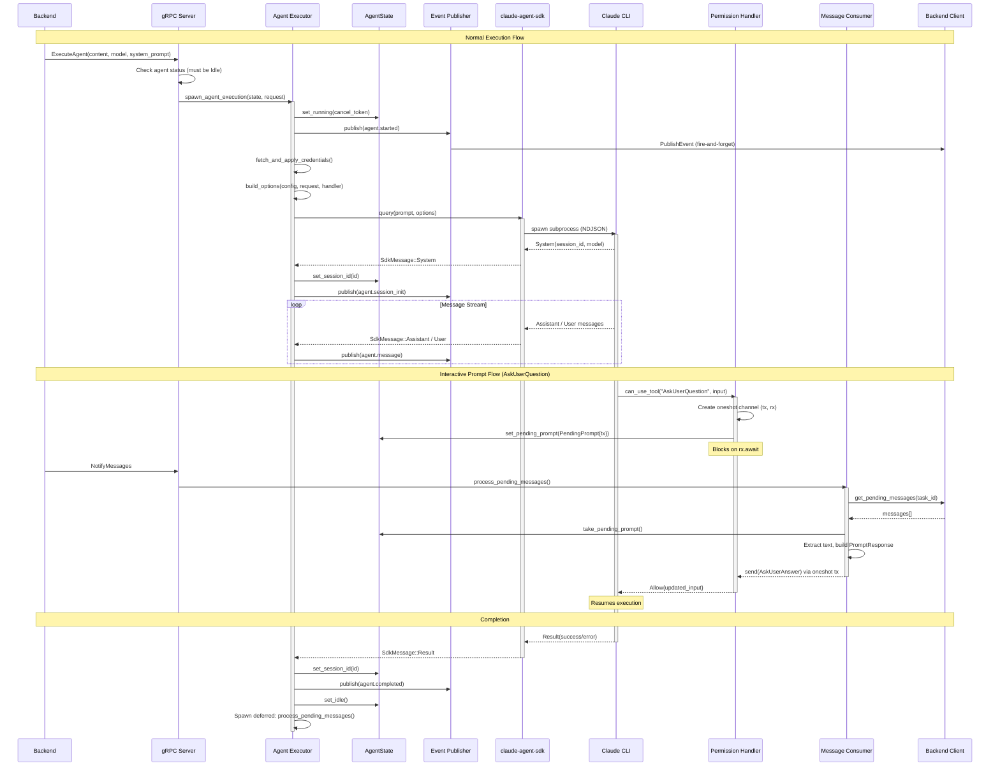

# Sandbox Architecture Diagrams

Visual documentation of the `moatless-sandbox` crate — the Rust runtime that executes inside each sandbox Kubernetes pod.

---

## 1. Module Dependency Graph

Internal `use crate::` relationships between all source files.

---

## 2. Component & Communication Architecture

The sandbox pod as a system, showing external dependencies, shared crates, and communication channels.

---

## 3. Agent Execution Sequence

Runtime lifecycle of an agent execution, including the interactive prompt (AskUserQuestion) flow.

---

## Key

| Symbol | Meaning |
|--------|---------|
| Solid arrow (`-->`) | Direct function call or data flow |
| Dashed arrow (`-.->`) | Crate dependency / import |
| `oneshot channel` | `tokio::sync::oneshot` — blocks sender until receiver responds |
| `fire-and-forget` | Errors logged but never propagated |
| `NDJSON` | Newline-delimited JSON over stdin/stdout to Claude CLI subprocess |
