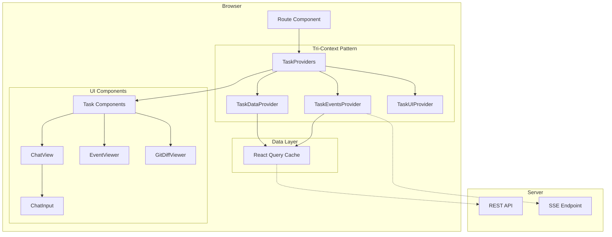
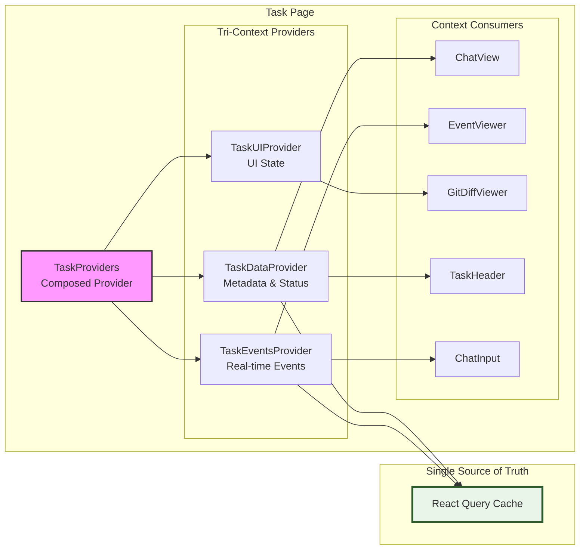
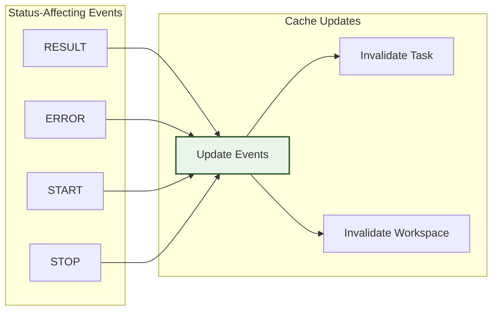
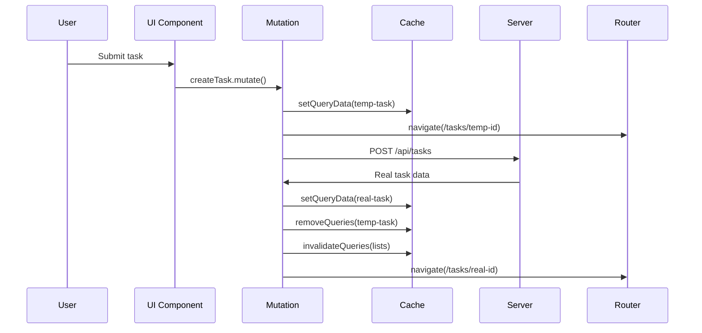

# Task Management Architecture

## Overview

This document outlines the architecture for the task management system in the Moatless Swarm UI. The architecture provides a robust, scalable, and maintainable solution for managing AI-powered tasks with real-time updates, proper state management, and seamless user experience.

## Core Principles

1. **Single Source of Truth**: React Query cache is the canonical data source for all task resources
2. **Optimistic UI Updates**: Immediate feedback using React Query's built-in features
3. **Real-time Synchronization**: SSE connections for live updates without complexity
4. **React Query First**: Leverage React Query's caching without custom abstractions
5. **Clean Separation**: Separation of concerns through focused context providers
6. **Tri-Context Pattern**: Specialized providers for data, events, and UI state
7. **Stable References**: Minimize re-renders through primitive extraction and stable dependencies

## High-Level Architecture



## Data Flow Architecture

### Tri-Context Pattern



## Architecture Components

### 1. TaskProviders - Composed Provider

The `TaskProviders` component composes all three context providers:

```typescript
export function TaskProviders({ taskId, children }: TaskProvidersProps) {
  return (
    <TaskUIProvider>
      <TaskDataProvider taskId={taskId}>
        <TaskEventsProvider taskId={taskId}>
          {children}
        </TaskEventsProvider>
      </TaskDataProvider>
    </TaskUIProvider>
  )
}
```

This is the recommended way to set up the task context for any task-related pages.

### 2. TaskDataProvider - Stable Server Data

Manages task metadata, git diffs, and workspace status with minimal re-renders:

```typescript
interface TaskDataContextValue {
  // Task metadata (rarely changes)
  taskId: string
  status: string | undefined
  agentType: string | undefined
  environmentId: string | undefined
  iterations: TaskIteration[]
  createdAt: Date | undefined
  
  // Git diff data
  gitDiff: GitDiffResponse | undefined
  
  // Workspace status with smart polling
  workspaceStatus: string | undefined
  workspaceReady: boolean
  workspaceHasChanges: boolean
  
  // Derived flags (stable primitives)
  canExecute: boolean
  isRunning: boolean
  isComplete: boolean
  
  // Loading & error states
  isLoading: boolean
  error: Error | null
}
```

**Key Features:**
- **Primitive extraction** in `useMemo` for stable references
- **Smart polling** that stops when workspace becomes stable
- **No complex select functions** that create new objects
- **Conditional queries** based on task state

### 3. TaskEventsProvider - Real-time Events

Manages event streaming and event-driven updates:

```typescript
interface TaskEventsContextValue {
  events: Event[]  // Single source: React Query cache
  isStreaming: boolean
  streamingError: string | null
  latestEventId: string | null
  hasNewEvents: boolean
  
  // Loading states
  isLoading: boolean
  error: Error | null
}
```

**Key Features:**
- **SSE connection management** with automatic reconnection
- **Event-driven task updates** for status-affecting events
- **Automatic deduplication** through React Query cache
- **Proper event sequencing** using `queueMicrotask`

### 4. TaskUIProvider - Pure UI State

Manages local UI state with no server dependencies:

```typescript
interface TaskUIContextValue {
  rightPanelView: PanelView
  selectedIteration: TaskIteration | undefined
  panelSizes: { left: number; right: number }
  selectedFile: string
  
  // Actions
  setRightPanelView: (view: PanelView) => void
  setSelectedIteration: (iteration?: TaskIteration) => void
  setPanelSizes: (sizes: { left: number; right: number }) => void
  setSelectedFile: (file: string) => void
}
```

**Key Features:**
- **No server dependencies** - never re-renders due to data changes
- **Pure local state** for UI preferences
- **Stable references** for all state and actions

## Query Key Structure

Hierarchical query keys enable automatic invalidation of sub-resources:

```typescript
const queryKeys = {
  tasks: {
    all: ['tasks'] as const,
    lists: () => [...queryKeys.tasks.all, 'list'] as const,
    list: (filters?) => [...queryKeys.tasks.lists(), filters] as const,
    
    details: () => [...queryKeys.tasks.all, 'detail'] as const,
    detail: (id: string) => [...queryKeys.tasks.details(), id] as const,
    
    // Sub-resources automatically invalidated with parent
    events: (id: string) => [...queryKeys.tasks.detail(id), 'events'] as const,
    iterations: (id: string) => [...queryKeys.tasks.detail(id), 'iterations'] as const,
    gitDiff: (id: string) => [...queryKeys.tasks.detail(id), 'git-diff'] as const,
    workspaceStatus: (id: string) => [...queryKeys.tasks.detail(id), 'workspace'] as const,
    serverStatus: (id: string) => [...queryKeys.tasks.detail(id), 'server'] as const,
  }
}
```

## Smart Cache Invalidation

Event-driven invalidation ensures data consistency without page reloads:



### Event-Driven Updates

```typescript
const STATUS_AFFECTING_EVENTS = [
  EventType.RESULT,    // Task completed successfully
  EventType.ERROR,     // Task failed  
  EventType.STOP,      // Agent stopped
  EventType.START,     // Agent started
] as const

const handleTaskEvent = useCallback((event: Event) => {
  // 1. Update events cache immediately
  queryClient.setQueryData(queryKeys.taskEvents(taskId), (old: Event[] = []) => {
    const eventMap = new Map(old.map((e) => [e.eventId, e]))
    eventMap.set(event.eventId, event)
    return Array.from(eventMap.values()).sort(...)
  })
  
  // 2. Trigger task data refetch for status changes
  if (STATUS_AFFECTING_EVENTS.includes(event.type)) {
    queueMicrotask(() => {
      queryClient.invalidateQueries({ queryKey: queryKeys.task(taskId) })
      queryClient.invalidateQueries({ queryKey: queryKeys.taskWorkspaceStatus(taskId) })
    })
  }
}, [taskId, queryClient])
```

## Optimistic Updates

Task creation uses optimistic updates for immediate user feedback:



## Specialized Hooks

The tri-context pattern provides specialized hooks for efficient re-renders:

```typescript
// Task metadata and status
const { status, isRunning, canExecute } = useTaskStatus()

// Real-time events
const { events, isStreaming } = useEventStream()

// UI state management
const { rightPanelView, setRightPanelView } = usePanelView()
const { selectedIteration, setSelectedIteration } = useSelectedIteration()

// Workspace status
const { workspaceStatus, workspaceReady } = useWorkspaceStatus()

// Git diff data
const { gitDiff } = useGitDiff()
```

## Route Structure

Routes use TaskProviders directly for optimal performance:

```typescript
export const Route = createFileRoute('/tasks/$taskId')({
  component: TaskDetail,
})

function TaskDetail() {
  const { taskId } = Route.useParams()
  
  return (
    <TaskProviders taskId={taskId}>
      <TaskPage />
    </TaskProviders>
  )
}
```

## Component Patterns

Components use specialized hooks for surgical re-renders:

```typescript
export function ChatView() {
  const { events, isLoading, error } = useEventStream()
  const { isStreaming } = useStreamingStatus()
  const { canExecute, status } = useTaskStatus()
  
  if (error) return <ErrorAlert error={error} />
  if (isLoading) return <ChatViewSkeleton />
  
  return (
    <div className="flex flex-col h-full">
      <ChatMessages messages={events} />
      <StreamingIndicator visible={isStreaming} />
      <ChatInput 
        taskId={taskId}
        taskStatus={status}
        canExecute={canExecute}
      />
    </div>
  )
}
```

## Testing Strategy

### Unit Tests
```typescript
describe('TaskDataProvider', () => {
  it('provides stable primitive values', () => {
    const { result } = renderHook(() => useTaskStatus(), {
      wrapper: ({ children }) => (
        <TaskDataProvider taskId="test-123">
          {children}
        </TaskDataProvider>
      ),
    })
    
    expect(result.current.isRunning).toBe(false)
  })
})
```

### Integration Tests
```typescript
describe('Task Page Flow', () => {
  it('handles real-time events without page reload', async () => {
    render(
      <TaskProviders taskId="123">
        <TaskPage />
      </TaskProviders>
    )
    
    // Verify SSE events update UI without unmounting components
    await waitFor(() => {
      expect(screen.getByText('New event')).toBeInTheDocument()
    })
  })
})
```

## Benefits

1. **Surgical Re-renders**: Only components using changed data re-render
2. **No Page Reloads**: Cache invalidation preserves component state
3. **Real-time Updates**: Instant event processing with proper sequencing
4. **Stable Performance**: Primitive extraction prevents unnecessary re-renders
5. **Clean Separation**: Focused providers with clear responsibilities
6. **Type Safety**: Strong TypeScript interfaces throughout
7. **Testability**: Provider pattern enables comprehensive testing

## Best Practices

### DO: Use Specialized Hooks
```typescript
// Efficient - only re-renders when status changes
const { isRunning, canExecute } = useTaskStatus()
```

### DO: Use TaskProviders for Setup
```typescript
// Recommended - clean tri-context setup
<TaskProviders taskId={taskId}>
  <TaskPage />
</TaskProviders>
```

### DO: Extract Primitives in useMemo
```typescript
const primitives = useMemo(() => ({
  status: task?.status,
  isRunning: task?.status === 'running',
}), [task])
```

### DON'T: Use Complex Select Functions
```typescript
// Avoid - creates new objects every render
const taskQuery = useQuery({
  select: (task) => ({ status: task.status, isRunning: task.status === 'running' })
})
```

### DO: Use queueMicrotask for Cache Sequencing
```typescript
queryClient.setQueryData(key, data)
queueMicrotask(() => {
  queryClient.invalidateQueries({ queryKey: parentKey })
})
```

### DON'T: Invalidate Immediately After Cache Update
```typescript
// Avoid - can cause race conditions
queryClient.setQueryData(key, data)
queryClient.invalidateQueries({ queryKey: parentKey }) // Too fast!
```