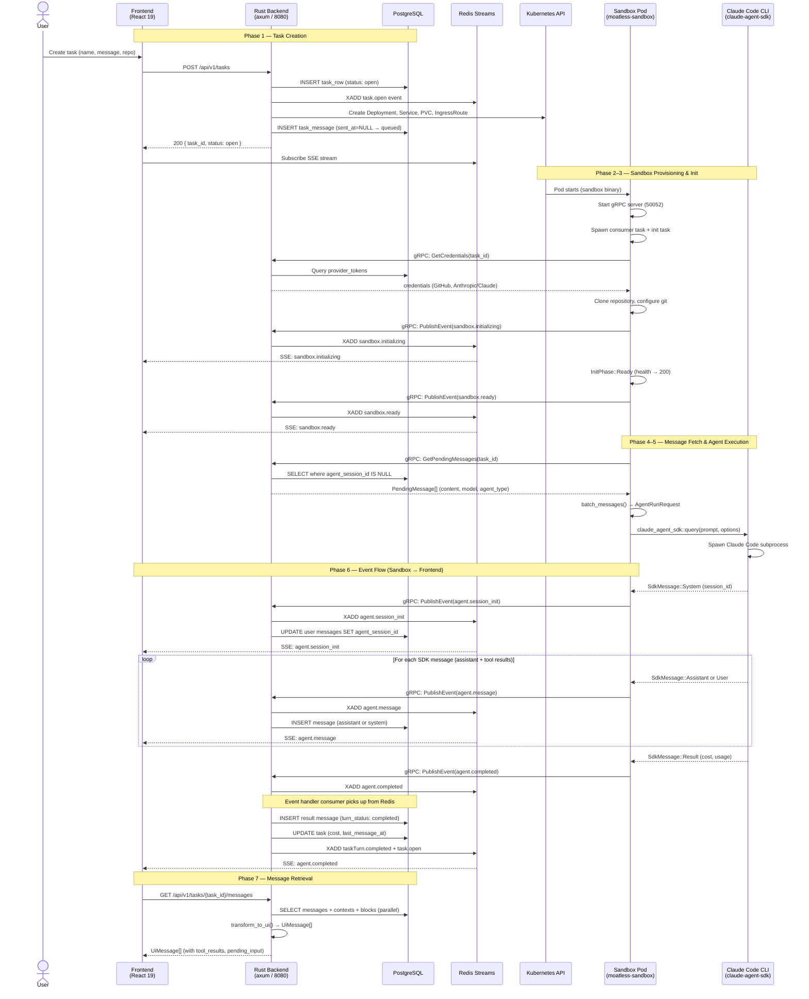
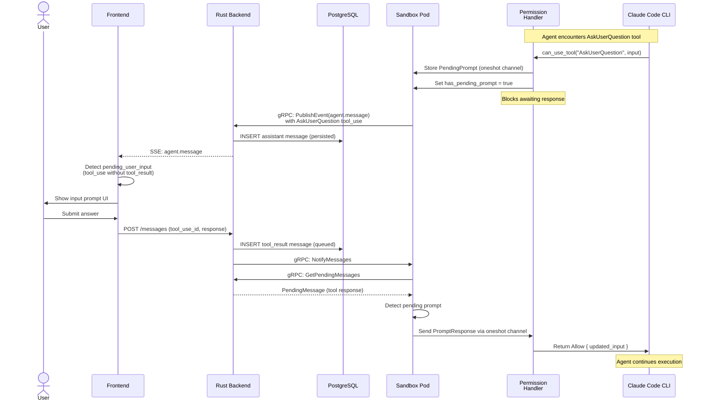
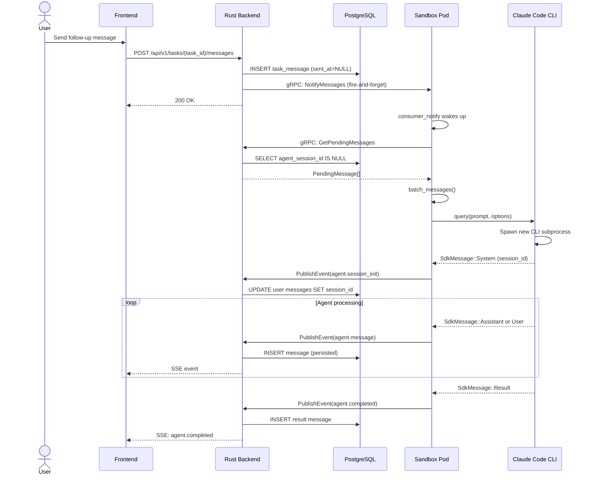
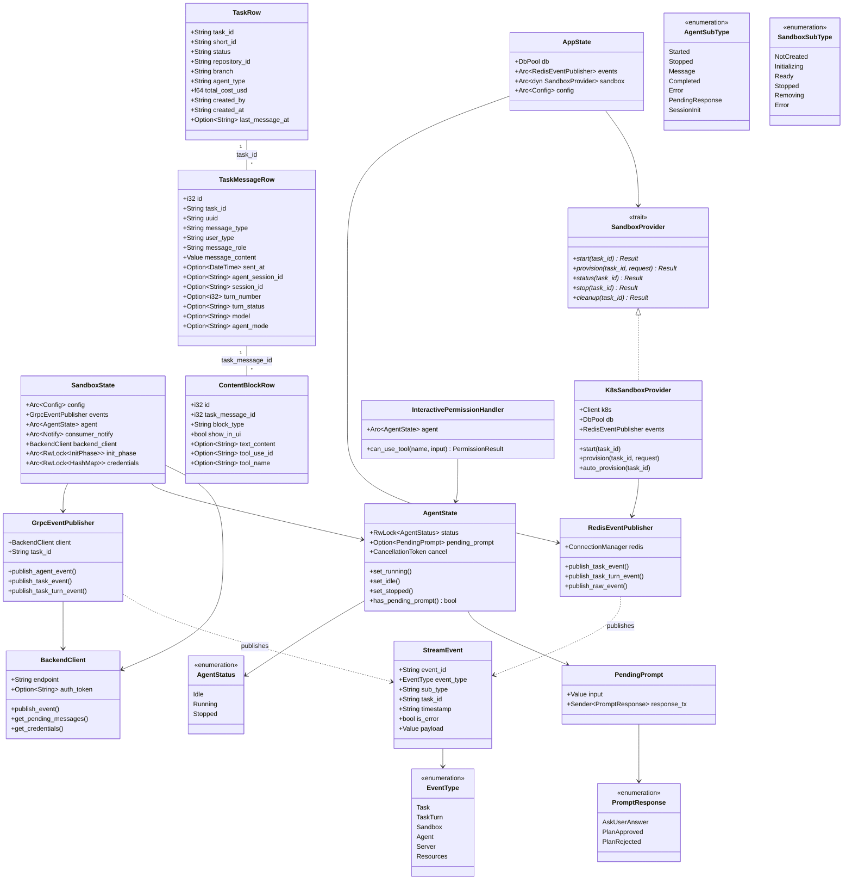

# Task & Message Flow: End-to-End Architecture

This document traces the complete lifecycle of a task — from creation through sandbox provisioning, agent execution, message handling, and persistence — across all system components.

## System Components Overview

```
+------------------+     +-------------------+     +-------------------+
|    Frontend      |     |   Rust Backend    |     |     Sandbox       |
|   (React 19)     |     |  (axum / 8080)    |     | (moatless-sandbox)|
+--------+---------+     +--------+----------+     +--------+----------+
         |                       |                          |
         | HTTP REST API         | PostgreSQL               | Claude Code CLI
         | SSE events            | Redis Streams            | gRPC (bidirectional)
         |                       |                          |
         v                       v                          v
   TanStack Query         +------+-------+          +------+-------+
   Event Streaming        | Redis Streams|          | K8s Pod      |
                          | (SSE bridge) |          | (per-task)   |
                          +--------------+          +--------------+
```

**Key crates:**
- `moatless-vibe-backend` (`backend/`) — API server, event publisher, gRPC server, DB access
- `moatless-sandbox` (`sandbox/`) — per-task container running inside K8s, hosts Claude Code agent
- `claude-agent-sdk` (`crates/claude-agent-sdk/`) — Rust SDK wrapping Claude Code CLI's NDJSON protocol
- `moatless-events` (`crates/events/`) — shared event type definitions
- `sandbox-proto` (`crates/sandbox-proto/`) — gRPC protobuf definitions for backend <-> sandbox

---

## Phase 1: Task Creation

### 1.1 API Entry Point

**Endpoint:** `POST /api/v1/tasks`
**File:** `backend/src/task/routes.rs:31` — `task_router()` registers the route
**Handler:** `backend/src/task/handlers.rs:28-119` — `create_task()`

```
POST /api/v1/tasks
  Body: CreateTaskRequest {
    repository_id, name?, description?, branch?,
    message?, model?, agent_mode?, contexts[], file_ids[]
  }
```

**Request type:** `backend/src/task/types.rs:6-21` — `CreateTaskRequest`

### 1.2 Handler Flow

The `create_task` handler executes these steps sequentially:

#### Step 1: Validate repository
```
handlers.rs:34-36
  repository_dao::find_repository_by_id(&state.db, &req.repository_id)
  → TaskError::RepoNotFound if missing
```

#### Step 2: Validate task name
```
handlers.rs:39-41
  validate_task_name(name)?
  → Rules: non-empty, max 200 chars (handlers.rs:716-724)
```

#### Step 3: Generate unique identifiers
```
handlers.rs:43-46
  task_id  = UUID v4
  short_id = nanoid(8) — uniqueness verified via task_dao::exists_by_short_id
```

#### Step 4: Build and insert TaskRow
```
handlers.rs:48-70
  TaskRow {
    task_id, short_id, created_at (RFC3339), last_message_at,
    agent_type: "claude-code" (default), repository_id,
    status: "open", total_cost_usd: 0.0,
    branch: req.branch || repo.default_branch,
    created_by: auth.user_id, visibility: "private"
  }

handlers.rs:70
  task_dao::insert_task(&state.db, &row)
  → SQL INSERT with 18 columns (db/task_dao.rs:51-84)
```

**DB model:** `backend/src/db/models.rs:9-32` — `TaskRow` (19 fields, derives `sqlx::FromRow`)

#### Step 5: Publish task event
```
handlers.rs:73-83
  events.publish_task_event(&task_id, TaskSubType::Open, agent_type, {})
  → Writes to Redis Stream "task-events:{task_id}" via XADD
  → Event format: { eventId, type: "task", subType: "open", taskId, timestamp, payload }
```

**Event publisher:** `backend/src/events.rs:137-153` — `publish_task_event()`
**Redis write:** `backend/src/events.rs:242-313` — XADD with MAXLEN ~1000

#### Step 6: Start sandbox provisioning
```
handlers.rs:85-93
  state.sandbox.start(&task_id).await
  → Non-blocking: returns immediately, provisioning continues in background
  → Failures logged as warnings, never fail the API response
```

#### Step 7: Send initial message (optional)
```
handlers.rs:95-110
  if let Some(message) = req.message {
    message::send::send_message_flow(&state, &task_id, &message, ...)
  }
  → Failures logged as warnings, never fail the API response
```

#### Step 8: Return response
```
handlers.rs:112-119
  CreateTaskResponse { task_id, status: "open", task: TaskResponse }
```

**Response type:** `backend/src/task/types.rs:112-116` — `CreateTaskResponse`

---

## Phase 2: Sandbox Provisioning

### 2.1 SandboxProvider Trait

**File:** `backend/src/sandbox/provider.rs:17-70`

```rust
#[async_trait]
pub trait SandboxProvider: Send + Sync {
    async fn start(&self, task_id: &str) -> Result<(), SandboxError>;
    async fn provision(&self, task_id: &str, request: &ProvisionRequest) -> Result<ProvisionResponse, SandboxError>;
    // ... status, stop, cleanup methods
}
```

The active implementation is `K8sSandboxProvider`.

### 2.2 K8s Provider: start()

**File:** `backend/src/sandbox/k8s/provider.rs:204-231`

```
start(task_id)
  ├── deployment::find_deployment(&self.k8s, task_id)
  ├── If Deployment exists → scale_deployment(task_id, 1)  // wake from sleep
  ├── If no Deployment → auto_provision(task_id)
  │     ├── auto_provision::build_provision_request(pool, &k8s, task_id)
  │     │     → Reads task + repo from DB, builds ProvisionRequest
  │     └── self.provision(task_id, &request)
  └── publish_initializing(task_id)
      → SandboxSubType::Initializing event to Redis
```

### 2.3 K8s Provider: provision()

**File:** `backend/src/sandbox/k8s/provider.rs:45-160`

Creates the full K8s resource set for a new sandbox:

```
provision(task_id, request)
  ├── Check for existing healthy pod → return Ready if found
  ├── Ensure/refresh user JWT secret (K8s Secret)
  │     jwt.rs:30-56 → generate_user_auth_token() (HS256, 90-day expiry)
  │     Stored in K8s Secret: moatless-user-{userId}-credentials
  ├── Create PVC (persistent workspace storage)
  │     naming.rs:45-53 → moatless-workspace-{taskId}-{base36_timestamp}
  ├── Build pod spec
  │     pod_builder::build_pod() → sandbox container + server containers
  │     Container env: TASK_ID, BACKEND_GRPC_URL, USER_AUTH_TOKEN, REPO_CONFIG, etc.
  ├── Create Deployment (replicas: 1)
  │     deployment::create_workspace_deployment()
  │     Name: moatless-ws-{taskId} (naming.rs:37-40)
  ├── Create Service (ClusterIP)
  │     service::create_sandbox_service()
  │     Exposes gRPC port (50052), HTTP port (8001), server ports
  ├── Create Traefik IngressRoutes (if PROXY_DOMAIN configured)
  │     URL pattern: {taskId}--{port}.{proxyDomain}
  └── Publish SandboxSubType::Initializing event
```

**Naming module:** `backend/src/sandbox/k8s/naming.rs` — deterministic K8s resource names
**Error types:** `backend/src/sandbox/error.rs:9-27` — `SandboxError` enum (6 variants)

### 2.4 Frontend Polling

After `create_task` returns, the frontend:
1. Receives `{ task_id, status: "open" }`
2. Subscribes to SSE stream for `task-events:{task_id}`
3. Polls `/api/sandbox/v1/tasks/{task_id}/env-status` for readiness
4. Waits for `SandboxSubType::Ready` event

---

## Phase 3: Sandbox Startup & Initialization

### 3.1 Sandbox Binary Entry Point

**File:** `sandbox/src/main.rs`

When the K8s pod starts, the sandbox binary runs:

```
main()
  ├── Line 28-40: Load Config::from_env(), init tracing
  ├── Line 50-52: Create BackendClient (gRPC, lazy connection)
  ├── Line 55: Create GrpcEventPublisher (wraps BackendClient)
  ├── Line 58-66: Build SandboxState (all Arc-wrapped components)
  ├── Line 72-85: Spawn gRPC server (port 50052)
  │     Implements SandboxService: ExecuteAgent, StopAgent, NotifyMessages, SearchFiles
  ├── Line 89: Spawn init task (Phase 1 + Phase 2)
  ├── Line 94: Spawn consumer task (message polling loop)
  └── Line 98-108: Start HTTP server (port 8001)
        /health → 503 during init, 200 when Ready
```

**State:** `sandbox/src/state.rs:18-33` — `SandboxState`
```rust
SandboxState {
    config: Arc<Config>,
    events: GrpcEventPublisher,
    agent: Arc<AgentState>,
    consumer_notify: Arc<tokio::sync::Notify>,
    backend_client: BackendClient,
    init_phase: Arc<RwLock<InitPhase>>,
    credentials: Arc<RwLock<HashMap<String, String>>>,
}
```

### 3.2 Initialization Phases

**File:** `sandbox/src/init/mod.rs`

**Phase 1: Core Init** (lines 130-216) — blocks health endpoint
```
1. Ensure directories exist
2. Fetch credentials from backend (FATAL on failure)
     → gRPC: GetCredentials(task_id, auth: Bearer <token>)
     → Backend resolves: env vars > provider_tokens DB table
     → Credentials: GITHUB_TOKEN, ANTHROPIC_API_KEY, CLAUDE_CODE_OAUTH_TOKEN
3. Configure git authentication (non-fatal)
4. Clone repository (FATAL on failure)
5. Sync plugins (non-fatal)
→ Set InitPhase::Ready (health returns 200)
```

**Phase 2: Workspace Setup** (lines 227-254) — non-blocking
```
1. Copy pre-installed node_modules from image
2. Set up Next.js build cache on tmpfs
3. Run setup commands from REPO_CONFIG
4. Write .workspace-ready sentinel file
```

**Credential fetching:** `sandbox/src/init/credentials.rs:18-88`
- Retry with exponential backoff (3s → 60s, max 10 attempts)
- Writes `$CLAUDE_CONFIG_DIR/.credentials` for Claude CLI auth
- Sets env vars + stores in `state.credentials`

### 3.3 Backend gRPC Server (serves sandbox requests)

**File:** `backend/src/sandbox_grpc_server.rs`

Implements `BackendSandboxService` (proto defined in `crates/sandbox-proto/proto/sandbox/v1/sandbox.proto`):

| RPC | Lines | Purpose |
|-----|-------|---------|
| `PublishEvent` | 82-140 | Sandbox → Redis Streams (event bridge) |
| `GetPendingMessages` | 146-206 | Return queued user messages, mark as fetched |
| `GetCredentials` | 213-291 | Return credentials (env > DB provider_tokens) |

**Proto definitions:** `crates/sandbox-proto/proto/sandbox/v1/sandbox.proto`
```protobuf
service BackendSandboxService {
  rpc PublishEvent(PublishEventRequest) returns (PublishEventResponse);
  rpc GetPendingMessages(GetPendingMessagesRequest) returns (GetPendingMessagesResponse);
  rpc GetCredentials(GetCredentialsRequest) returns (GetCredentialsResponse);
}

service SandboxService {
  rpc ExecuteAgent(ExecuteAgentRequest) returns (ExecuteAgentResponse);
  rpc StopAgent(StopAgentRequest) returns (StopAgentResponse);
  rpc NotifyMessages(NotifyMessagesRequest) returns (NotifyMessagesResponse);
  rpc SearchFiles(SearchFilesRequest) returns (SearchFilesResponse);
}
```

---

## Phase 4: Message Sending

### 4.1 User Sends a Message

**Endpoint:** `POST /api/v1/tasks/{task_id}/messages`
**Handler:** `backend/src/message/handlers.rs:31-94` — `send_message()`

```
send_message() handler
  ├── Verify task exists + user access
  ├── If tool response (tool_use_id present):
  │     send_tool_response_flow() → message/send.rs:113-182
  ├── If command name provided:
  │     Load command from DB → use command.prompt as message
  ├── send_message_flow() → message/send.rs:13-110
  └── notify_sandbox_for_task() → sandbox/notify.rs:10-13 (fire-and-forget)
```

### 4.2 send_message_flow()

**File:** `backend/src/message/send.rs:13-110`

```
send_message_flow(state, task_id, message, model, agent_mode, file_ids, contexts)
  ├── Generate UUID + RFC3339 timestamp
  ├── enricher::build_content_blocks()  → message/enricher.rs:25-87
  │     ├── Primary text block (show_in_ui: true)
  │     ├── Context blocks: previewUrl, element
  │     └── File attachment blocks
  ├── Create TaskMessageRow:
  │     { uuid, task_id, message_type: "user", user_type: "human",
  │       message_role: "user", message_content: JSON array,
  │       sent_at: None, agent_session_id: None }  ← "queued" state
  ├── Create UI content block (show_in_ui: true, block_type: "text")
  ├── message_dao::append(&state.db, &msg_row, &contexts, &[ui_block])
  │     → Transaction: UPSERT task_messages + INSERT contexts + INSERT blocks
  └── task_dao::update_task(last_message_at: now)
```

### 4.3 Message Persistence (DAO)

**File:** `backend/src/db/message_dao.rs`

| Function | Lines | Purpose |
|----------|-------|---------|
| `append()` | 71-186 | Upsert message with contexts and content blocks (idempotent on uuid) |
| `get_pending_user()` | 189-213 | Fetch messages where `agent_session_id IS NULL` (not yet confirmed by agent session) |
| `set_session_id_for_task()` | 290-311 | Set `session_id`, `agent_session_id`, and `sent_at` on pending user messages when agent session starts |
| `get_last_user_message()` | 244-282 | Last user message for a task (used to inherit agent_mode) |
| `get_all()` | 12-68 | Fetch all messages + contexts + blocks (parallel queries) |
| `get_last_result()` | 220-245 | Last result message (idempotency check) |
| `delete_queued()` | 340-355 | Delete messages where `agent_session_id IS NULL` |

**Upsert logic (append):**
```sql
ON CONFLICT (uuid) DO UPDATE SET
    message_content = EXCLUDED.message_content,
    agent_session_id = COALESCE(EXCLUDED.agent_session_id, task_messages.agent_session_id),
    turn_status = COALESCE(EXCLUDED.turn_status, task_messages.turn_status),
    ...
```

### 4.4 Database Schema (Messages)

**File:** `backend/migrations/0001_schema.sql`

```
task_messages (lines 142-180)
  ├── id (serial PK), task_id, uuid (UNIQUE)
  ├── message_type: "user" | "assistant" | "system" | "result"
  ├── user_type: "human" | "system"
  ├── message_role: "user" | "assistant" | "system"
  ├── message_content (JSONB): array of content blocks
  ├── sent_at (timestamptz): NULL = queued, set to NOW() when agent session starts (set_session_id_for_task)
  ├── agent_session_id: Real Claude Code session ID (set later via set_session_id_for_task on session_init)
  ├── session_id: Same as agent_session_id (API-visible, set together)
  ├── turn_number, turn_status, turn_result, will_not_resume
  ├── agent_mode, model, resume_session_id
  └── assistant_* fields: message_id, model, usage tokens, stop_reason

task_message_contexts (lines 189-210)
  ├── FK → task_messages(id) CASCADE
  └── type, reference_id, data (JSONB)

task_message_content_blocks (lines 215-241)
  ├── FK → task_messages(id) CASCADE
  └── block_type, show_in_ui, text_content, tool_use_id, tool_result_*
```

### 4.5 Notify Sandbox

**File:** `backend/src/sandbox/notify.rs:10-32`

```
notify_sandbox_for_task(state, task_id)
  → generate_service_name(task_id)  // "moatless-ws-{taskId}"
  → SandboxGrpcClient::for_service(service_name, namespace, port)
  → client.notify_messages()  // gRPC: NotifyMessages RPC
  → Fire-and-forget: logs warnings, never propagates errors
```

This triggers `SandboxService::notify_messages()` on the sandbox pod, which wakes the consumer.

---

## Phase 5: Sandbox Message Consumption & Agent Execution

### 5.1 Message Consumer Loop

**File:** `sandbox/src/agent/consumer.rs:20-144`

The consumer runs as a background task from sandbox startup:

```
run_consumer()
  ├── Wait until InitPhase::Ready (lines 22-38)
  ├── Self-notify to fetch any pending messages (line 46)
  └── Loop:
      ├── Wait for notification OR 30-second polling timeout (line 50-54)
      │     Uses timeout(30s, notified()) — catches lost gRPC notifications
      ├── Check agent status BEFORE fetch (line 60-68):
      │     If Running + no pending prompt → skip (prevents premature acknowledgment)
      │     If Running + has pending prompt → continue (need to resolve prompt)
      ├── gRPC: backend_client.get_pending_messages(task_id) (line 71-86)
      │     On error: spawn delayed retry (notify_one after 5 seconds)
      ├── If pending interactive prompt (AskUserQuestion/ExitPlanMode):
      │     Convert message to PromptResponse → send via oneshot channel (line 102-132)
      │     → Continue (don't spawn new agent)
      ├── If agent already running → skip (line 135-138)
      └── batch_messages() → spawn_agent_execution() (line 142-143)
```

### 5.2 Backend GetPendingMessages (gRPC)

**File:** `backend/src/sandbox_grpc_server.rs:146-206`

When the sandbox calls `GetPendingMessages`:

```
get_pending_messages(task_id)
  ├── Verify JWT auth (if configured)
  ├── message_dao::get_pending_user(pool, task_id)  → rows where agent_session_id IS NULL
  ├── parse_content_blocks(row.message_content)
  │     → Convert JSON array to proto ContentBlock (text/image)
  └── Return PendingMessage { content, model?, system_prompt?, resume?, agent_type? }
```

### 5.3 Message Batching

**File:** `sandbox/src/agent/consumer.rs:202-233`

```
batch_messages(messages) → AgentRunRequest
  ├── Combine all content blocks from all messages
  ├── Last message wins for: model, system_prompt, resume, agent_type
  └── Return single AgentRunRequest with all content
```

### 5.4 Agent Execution

**File:** `sandbox/src/agent/claude_code.rs:20-225`

```
spawn_agent_execution(state, request)
  └── tokio::spawn(execute_agent(state, request))

execute_agent(state, request)
  ├── Create CancellationToken, set status to Running (line 45-46)
  ├── Publish AgentSubType::Started event (line 60)
  ├── Re-fetch credentials (pick up rotated tokens) (line 62-65)
  ├── build_options() → ClaudeOptions (options.rs:17-55)
  │     ├── Resolve model (request > config > none)
  │     ├── Build system prompt (preset + config + request)
  │     ├── Create InteractivePermissionHandler
  │     ├── Set cwd: workspace_dir, cli_path, plugins
  │     └── ClaudeOptions { model, system_prompt, permission_mode: AcceptEdits, ... }
  ├── claude_agent_sdk::query(prompt, options) (line 82-94)
  │     → Spawns Claude Code CLI subprocess
  │     → Returns QueryHandle with mpsc::Receiver<SdkMessage>
  └── Message streaming loop (line 98-214):
      while let Some(msg) = handle.messages.recv().await {
        match msg {
          SdkMessage::System(init) → set session_id, publish AgentSubType::SessionInit
          SdkMessage::Assistant(msg) → publish AgentSubType::Message
          SdkMessage::User(msg)     → publish AgentSubType::Message (tool results)
          SdkMessage::Result(result) → publish AgentSubType::Completed or Error
        }
      }
  ├── Set agent status to Idle (line 216)
  └── consumer_notify.notify_one() (wake consumer for queued messages)
```

### 5.5 Claude Agent SDK

**File:** `crates/claude-agent-sdk/src/`

The SDK wraps the Claude Code CLI's NDJSON stdin/stdout protocol:

```
query(prompt, options) → QueryHandle
  ├── SubprocessTransport::spawn()  → transport/subprocess.rs:27-89
  │     ├── Resolve claude CLI path
  │     ├── Build CLI args from ClaudeOptions (--model, --permission-mode, etc.)
  │     ├── If can_use_tool handler: add --permission-prompt-tool stdio
  │     └── Spawn subprocess, capture stdin/stdout/stderr
  ├── Send Initialize control request (hooks, mcp_servers, system_prompt)
  ├── Send user message as JSON line on stdin
  └── Orchestrator::spawn()  → protocol/orchestrator.rs:30-76
        Background task that routes messages:
        ├── SdkMessage → consumer channel (mpsc)
        ├── CanUseTool → PermissionHandler::can_use_tool()
        ├── HookCallback → HookHandler::on_hook()
        └── McpMessage → SdkMcpServer::handle_message()
```

**SdkMessage variants** (`types/messages.rs:18-51`):
- `System(SystemInitMessage)` — session_id, tools, model, MCP servers
- `Assistant(AssistantMessage)` — content blocks (text, tool_use)
- `User(UserMessage)` — tool_result blocks (SDK-generated responses to tool_use)
- `Result(ResultMessage)` — final outcome with metrics (cost, tokens, duration)
- `StreamEvent`, `ToolProgress`, `AuthStatus`, etc.

### 5.6 Permission Handling

**File:** `sandbox/src/agent/permission_handler.rs`

The `InteractivePermissionHandler` intercepts tool calls:

```
can_use_tool(tool_name, input, context) → PermissionResult
  ├── If AskUserQuestion or ExitPlanMode:
  │     Create oneshot channel
  │     Store as PendingPrompt in AgentState
  │     Block until response received (from consumer)
  │     Return Allow { updated_input }
  ├── If plan_mode_active + write tool (Write, Edit, Bash, etc.):
  │     Return Deny("Plan mode: use ExitPlanMode first")
  └── Otherwise: Return Allow (auto-approve)
```

**Prompt types:** `sandbox/src/agent/prompt.rs`
```rust
enum PromptResponse {
    AskUserAnswer { answers: serde_json::Value },
    PlanApproved,
    PlanRejected { feedback: String },
}
```

When the agent uses AskUserQuestion, the permission handler blocks the agent, the consumer picks up the next user message from the backend and resolves the pending prompt.

---

## Phase 6: Event Flow (Sandbox → Backend → Frontend)

### 6.1 Sandbox Event Publishing

**File:** `sandbox/src/events.rs:21-107`

The sandbox publishes events via gRPC to the backend:

```
GrpcEventPublisher
  ├── publish_agent_event(task_id, AgentSubType, payload)
  ├── publish_task_event(task_id, TaskSubType, payload)
  └── publish_task_turn_event(task_id, TaskTurnSubType, payload)
      All → BackendClient::publish_event() → gRPC PublishEvent RPC
```

### 6.2 Backend: gRPC → Redis Bridge

**File:** `backend/src/sandbox_grpc_server.rs:82-140`

```
PublishEvent(request)
  ├── Parse payload JSON
  ├── Map proto EventType → string ("agent", "task", "taskTurn", etc.)
  └── publisher.publish_raw_event(task_id, event_type, sub_type, payload)
      → Redis XADD to stream "task-events:{task_id}"
```

### 6.3 Event Types

**File:** `crates/events/src/lib.rs`

```
EventType: Task, TaskTurn, Sandbox, Agent, Server, Resources
AgentSubType: Started, Stopped, Message, Completed, Error, PendingResponse, SessionInit
SandboxSubType: NotCreated, Initializing, Ready, Stopped, Removing, Error
TaskSubType: Created, Open, Closed, Updated, MetadataUpdated
TaskTurnSubType: Active, Completed, Error, Stopped
ServerSubType: Installing, Starting, Started, Stopped, Failed
```

### 6.4 Backend Event Handler (Consumer)

**File:** `backend/src/event_handler/consumer.rs`

A background task reads from Redis Streams and dispatches to handlers:

```
EventHandlerConsumer::run()
  └── Loop:
      ├── SCAN for keys matching "task-events:*"
      ├── Ensure consumer group "event-handler" exists
      ├── XREADGROUP (GROUP, CONSUMER_ID, BLOCK 5s, COUNT 50)
      ├── Parse → AgentEvent
      ├── Dispatch by "{event_type}.{sub_type}":
      │     "agent.completed" | "taskTurn.completed" → handle_agent_completed()
      │     "agent.message" → handle_agent_message()
      │     "agent.session_init" → handle_agent_session_init()
      │     "agent.stopped" | "taskTurn.stopped" → handle_agent_stopped()
      │     "agent.error" | "taskTurn.error" → handle_agent_error()
      │     "task.metadata.updated" → handle_task_metadata_updated()
      │     sandbox.*, server.*, resources.*, agent.started, task.open → SSE-only, skip
      └── XACK to acknowledge processed entries
```

### 6.5 Agent Event Handlers

**File:** `backend/src/event_handler/agent_handlers.rs`

#### handle_agent_session_init() (lines 178-204)
```
Extract session_id from event.payload
message_dao::set_session_id_for_task(pool, task_id, session_id)
  → Updates fetched user messages (sent_at IS NOT NULL, agent_session_id IS NULL):
    SET session_id = {sid}, agent_session_id = {sid}
```

#### handle_agent_completed() (lines 41-172)
```
1. Idempotency: has_result_for_current_turn()? → skip if exists
2. Parse SdkResultMessage from payload (session_id, cost, usage, is_error, num_turns, duration_ms)
3. Determine turn_status: "completed" or "error"
4. Fallback: set_session_id_for_task if not yet set (from sdk_result.session_id)
5. Extract model from payload.model_usage keys (first key in map)
6. Inherit agent_mode from last user message (via get_last_user_message)
7. Create result message (message_type: "result", role: "assistant")
   Passes session_id, agent_mode, model to build_result_message_row()
8. message_dao::append() with content block
9. Update task: status, last_message_at, total_cost_usd_increment
10. Publish TaskTurnEvent (Completed) + TaskEvent (Open or Closed)
```

#### handle_agent_message() (lines 360-540)
Now persists full SDK messages to DB (both assistant and tool_result messages):
```
1. Determine message type from payload role:
   - SDK "user" (tool results) → stored as message_type="system", role="user"
   - SDK "assistant" → stored as message_type="assistant", role="assistant"
2. Extract fields: uuid, session_id, parent_uuid (parent_tool_use_id), content, usage
3. Normalize content to JSON array (safety net for bare strings)
4. Inherit agent_mode from last user message (via get_last_user_message)
5. Build TaskMessageRow with all fields
6. Build content blocks from payload (text, tool_use, tool_result block types)
   → build_content_blocks_from_payload() helper
7. Persist: message_dao::append()
8. Skill tagging (assistant messages only):
   Extract skill names from tool_use blocks (name="Skill")
   Create tags like "skill-{name}" via tag_dao::find_or_create_tags()
```

#### handle_agent_stopped()
```
1. Read the typed stop `source` from the payload (defaults to User)
2. Idempotency: agent run already terminal in the event log? → skip
   (one user stop publishes `agent.stopped` twice — /stop handler + sandbox)
3. Only when source == Error (message::models::stop_is_reported):
     - Inherit agent_mode from last user message (via get_last_user_message)
     - Create result message ("Stopped after an error", will_not_resume=true)
   Routine stops — user, idle reaper, cleanup, system — write no message.
4. Update task + emit TaskTurnEvent(Stopped)
```
The turn is closed as `stopped` either way, and that turn status — not the
message row — is what suppresses `--resume` on the next run (see
`TaskTurnRepository::latest_closed_turn_status`).

#### handle_agent_error() (lines 277-361)
```
1. Guard: task has messages, last isn't already a result
2. Inherit agent_mode from last user message (via get_last_user_message)
3. Create result message: turn_status="error", will_not_resume=true
4. Persist + emit TaskTurnEvent(Error)
```

---

## Phase 7: Message Retrieval (Frontend ← Backend)

### 7.1 Fetch Messages API

**Endpoint:** `GET /api/v1/tasks/{task_id}/messages`
**Handler:** `backend/src/message/handlers.rs:109-130`

```
get_messages(task_id)
  ├── message_dao::get_all(pool, task_id)
  │     → Parallel queries: task_messages + contexts + content_blocks
  ├── transform::transform_to_ui(messages, contexts, blocks)
  │     → Group blocks by message_id
  │     → Build tool_results_map (tool_use_id → result)
  │     → Transform each message by type
  └── Filter empty messages (no content, no results, no pending input)
```

### 7.2 Message Transformation (DB → UI)

**File:** `backend/src/message/transform.rs`

```
transform_to_ui(messages, contexts, blocks) → Vec<UiMessage>
  ├── transform_assistant(): Collect tool results, detect pending prompts
  ├── transform_user(): Derive is_queued from sent_at.is_none() (NULL = queued)
  ├── transform_system(): Extract text blocks only
  └── transform_result(): Include turn_status, turn_result, run_metrics, agent_mode, model
```

**Pending user input detection** (lines 306-335):
- Checks for `tool_use` blocks with name = `AskUserQuestion` or `ExitPlanMode`
- Verifies no matching `tool_result` exists
- Sets `has_pending_user_input: true` → frontend shows input prompt

**UiMessage structure** (`message/types.rs:8-36`):
```rust
pub struct UiMessage {
    uuid, message_type, role, timestamp, session_id, turn_number, agent_mode, model,
    is_queued: Option<bool>,          // sent_at IS NULL
    content: Vec<UiContentBlock>,
    tool_results: Vec<UiToolResult>,
    has_pending_user_input: Option<bool>,
    assistant: Option<UiAssistantMeta>,
    result: Option<UiResultMeta>,
}
```

---

## Phase 8: Subsequent Messages

When the user sends a follow-up message while the agent is idle:

```
 1. Frontend: POST /api/v1/tasks/{task_id}/messages
 2. Backend: send_message_flow() → persist message (sent_at=NULL)
 3. Backend: notify_sandbox_for_task() → gRPC NotifyMessages
 4. Sandbox: consumer wakes up (or 30s poll) → GetPendingMessages (gRPC)
 5. Backend: get_pending_messages() → return queued rows (agent_session_id IS NULL)
 6. Sandbox: batch_messages() → spawn_agent_execution()
 7. Sandbox: agent publishes agent.session_init → backend sets session_id on user messages
 8. Sandbox: agent publishes agent.message events → backend persists assistant + tool_result messages
 9. Backend: gRPC → Redis → SSE → Frontend
10. Sandbox: agent publishes agent.completed → backend persists result message, updates task
```

When the user responds to an interactive prompt (AskUserQuestion):

```
1. Frontend: POST /api/v1/tasks/{task_id}/messages (with tool_use_id)
2. Backend: send_tool_response_flow() → persist tool_result message
3. Backend: notify_sandbox_for_task() → gRPC NotifyMessages
4. Sandbox: consumer wakes up → GetPendingMessages
5. Sandbox: detect pending prompt → convert to PromptResponse
6. Sandbox: Send response via oneshot channel → unblocks permission_handler
7. Agent: permission_handler returns Allow → agent continues
```

---

## Message Lifecycle State Machine

```
Message States (tracked by sent_at and agent_session_id):

[Queued]         sent_at=NULL, agent_session_id=NULL
    │               User message persisted but not yet confirmed by agent
    │
    ▼ (handle_agent_session_init → set_session_id_for_task)
[Acknowledged]   sent_at=set, agent_session_id={claude_session_id}
                    Message confirmed delivered to agent session
```

---

## Complete Sequence Diagram (ASCII)

```
Frontend          Backend (Rust)          Redis           Sandbox Pod
   |                   |                    |                  |
   |--- POST /tasks -->|                    |                  |
   |                   |-- INSERT task ---->|                  |
   |                   |-- XADD task.open ->|                  |
   |                   |-- sandbox.start -->|                  |
   |                   |   (K8s create)     |                  |
   |                   |-- send_message --->|                  |
   |                   |   (DB insert)      |                  |
   |<-- 200 response --|                    |                  |
   |                   |                    |                  |
   |                   |                    |       [Pod starts]
   |                   |                    |                  |
   |                   |<------------ GetCredentials (gRPC) ---|
   |                   |-- credentials --->|                  |
   |                   |                    |       [Clone repo]
   |                   |                    |       [InitPhase::Ready]
   |                   |                    |                  |
   |                   |<------ GetPendingMessages (gRPC) ----|
   |                   |-- messages ------->|                  |
   |                   |                    |                  |
   |                   |                    |                  |
   |                   |                    |   [spawn agent execution]
   |                   |                    |   [claude_agent_sdk::query]
   |                   |                    |                  |
   |                   |<--- PublishEvent(agent.started) ------|
   |                   |-- XADD ----------->|                  |
   |<-- SSE event -----|                    |                  |
   |                   |                    |                  |
   |                   |<--- PublishEvent(agent.session_init) -|
   |                   |-- XADD ----------->|                  |
   |                   |-- set_session_id -->|                  |
   |                   |                    |                  |
   |                   |<--- PublishEvent(agent.message) ------|
   |                   |-- XADD ----------->|   (multiple)     |
   |                   |-- INSERT msg ----->|   (persisted)    |
   |<-- SSE events ----|                    |                  |
   |                   |                    |                  |
   |                   |<--- PublishEvent(agent.completed) ----|
   |                   |-- XADD ----------->|                  |
   |                   |-- INSERT result msg|                  |
   |                   |-- UPDATE task ----->|                  |
   |<-- SSE event -----|                    |                  |
   |                   |                    |                  |
   |--- GET messages ->|                    |                  |
   |<-- UiMessage[] ---|                    |                  |
```

---

## Mermaid Diagrams

### Full Task Lifecycle — Sequence Diagram



### Interactive Prompt Flow — Sequence Diagram



### Subsequent Message Flow — Sequence Diagram



### UML Class Diagram — Core Domain Model



### Message Lifecycle — State Diagram

```mermaid
stateDiagram-v2
    [*] --> Queued: send_message_flow()<br/>INSERT sent_at=NULL

    Queued --> Acknowledged: handle_agent_session_init<br/>set_session_id_for_task()<br/>SET sent_at + agent_session_id

    Acknowledged --> [*]

    state Queued {
        direction LR
        note right of Queued
            sent_at = NULL
            agent_session_id = NULL
            Message persisted but not
            yet confirmed by agent
        end note
    }

    state Acknowledged {
        direction LR
        note right of Acknowledged
            sent_at = timestamp
            agent_session_id = session_id
            Message confirmed delivered
            to agent session
        end note
    }
```

### Sandbox Init — State Diagram

```mermaid
stateDiagram-v2
    [*] --> PodStarting: K8s creates Deployment

    PodStarting --> CoreInit: sandbox binary starts

    state CoreInit {
        [*] --> FetchCredentials
        FetchCredentials --> ConfigureGit
        ConfigureGit --> CloneRepo
        CloneRepo --> SyncPlugins
        SyncPlugins --> [*]
    }

    CoreInit --> Ready: InitPhase::Ready<br/>Health → 200

    Ready --> WorkspaceSetup: Phase 2 (non-blocking)

    state WorkspaceSetup {
        [*] --> CopyNodeModules
        CopyNodeModules --> SetupBuildCache
        SetupBuildCache --> RunSetupCommands
        RunSetupCommands --> WriteReadySentinel
        WriteReadySentinel --> [*]
    }

    WorkspaceSetup --> FullyReady: .workspace-ready written

    Ready --> ConsumerLoop: Spawn consumer task
    ConsumerLoop --> WaitForMessages: Poll / notify loop

    state WaitForMessages {
        [*] --> WaitNotify: 30s timeout or notify
        WaitNotify --> FetchPending: GetPendingMessages gRPC
        FetchPending --> ExecuteAgent: batch + spawn
        ExecuteAgent --> WaitNotify: Agent completes → idle
    }
```

---

## Key File Reference

| Area | File | Key Functions/Structs |
|------|------|-----------------------|
| **Task creation** | `backend/src/task/handlers.rs:28-119` | `create_task()` |
| **Task types** | `backend/src/task/types.rs` | `CreateTaskRequest`, `TaskResponse` |
| **Task DAO** | `backend/src/db/task_dao.rs:51-84` | `insert_task()` |
| **Task model** | `backend/src/db/models.rs:9-32` | `TaskRow` |
| **Sandbox provider** | `backend/src/sandbox/provider.rs:17-70` | `SandboxProvider` trait |
| **K8s provisioning** | `backend/src/sandbox/k8s/provider.rs` | `start()`, `provision()` |
| **K8s naming** | `backend/src/sandbox/k8s/naming.rs` | `generate_service_name()` |
| **Message send** | `backend/src/message/send.rs:13-110` | `send_message_flow()` |
| **Message enricher** | `backend/src/message/enricher.rs:25-87` | `build_content_blocks()` |
| **Message handlers** | `backend/src/message/handlers.rs` | `send_message()`, `get_messages()` |
| **Message DAO** | `backend/src/message/dao.rs` | `append()`, `get_pending_user()`, `set_session_id_for_task()`, `get_last_user_message()` |
| **Message models** | `backend/src/db/models.rs:87-164` | `TaskMessageRow`, `ContentBlockRow` |
| **Message transform** | `backend/src/message/transform.rs` | `transform_to_ui()` |
| **Event publisher** | `backend/src/events.rs` | `publish_task_event()`, `publish_raw_event()` |
| **Event types** | `crates/events/src/lib.rs` | `EventType`, `AgentSubType`, etc. |
| **Event consumer** | `backend/src/event_handler/consumer.rs` | `EventHandlerConsumer::run()` |
| **Agent handlers** | `backend/src/event_handler/agent_handlers.rs` | `handle_agent_completed()`, `handle_agent_message()`, `handle_agent_session_init()`, etc. |
| **gRPC server** | `backend/src/sandbox_grpc_server.rs` | `BackendSandboxServiceImpl` |
| **Sandbox notify** | `backend/src/sandbox/notify.rs` | `notify_sandbox_for_task()` |
| **Proto definitions** | `crates/sandbox-proto/proto/sandbox/v1/sandbox.proto` | Both gRPC services |
| **Sandbox main** | `sandbox/src/main.rs` | Entry point, startup sequence |
| **Sandbox state** | `sandbox/src/state.rs` | `SandboxState` |
| **Sandbox init** | `sandbox/src/init/mod.rs` | Phase 1 + Phase 2 init |
| **Sandbox credentials** | `sandbox/src/init/credentials.rs` | `fetch_and_apply_credentials()` |
| **Consumer loop** | `sandbox/src/agent/consumer.rs` | `run_consumer()` |
| **Agent execution** | `sandbox/src/agent/claude_code.rs` | `execute_agent()` |
| **Agent state** | `sandbox/src/agent/agent_state.rs` | `AgentState`, `AgentStatus` |
| **Permission handler** | `sandbox/src/agent/permission_handler.rs` | `InteractivePermissionHandler` |
| **Prompt types** | `sandbox/src/agent/prompt.rs` | `PendingPrompt`, `PromptResponse` |
| **Agent options** | `sandbox/src/agent/options.rs` | `build_options()` |
| **Backend gRPC client** | `sandbox/src/backend_client.rs` | `BackendClient` |
| **Sandbox events** | `sandbox/src/events.rs` | `GrpcEventPublisher` |
| **SDK query** | `crates/claude-agent-sdk/src/query.rs` | `query()`, `QueryHandle` |
| **SDK transport** | `crates/claude-agent-sdk/src/transport/subprocess.rs` | `SubprocessTransport` |
| **SDK orchestrator** | `crates/claude-agent-sdk/src/protocol/orchestrator.rs` | Message routing |
| **SDK messages** | `crates/claude-agent-sdk/src/types/messages.rs` | `SdkMessage` enum |
| **SDK permissions** | `crates/claude-agent-sdk/src/types/permissions.rs` | `PermissionHandler` trait |
| **AppState** | `backend/src/state.rs` | `AppState` struct |
| **Config** | `backend/src/config.rs` | Backend configuration |
| **Sandbox config** | `sandbox/src/config.rs` | `Config`, `AgentConfig` |
| **DB migration** | `backend/migrations/0001_schema.sql` | Full DB schema |
