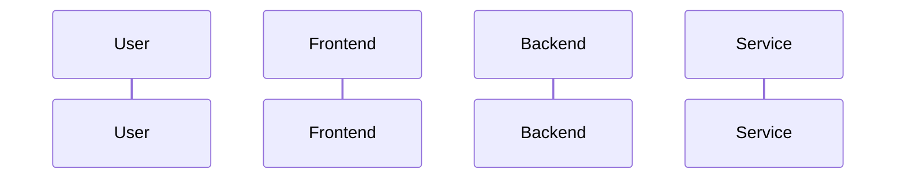

# [Integration Flow Name]

## Overview
<!-- Brief description of what this integration flow accomplishes -->

## Components Involved
<!-- List all components that participate in this flow -->
- **Component A**: Role in the flow
- **Component B**: Role in the flow
- **Component C**: Role in the flow

## Prerequisites
<!-- What needs to be in place before this flow can execute -->
- 
- 
- 

## Flow Diagram

### High-Level Flow
```mermaid
graph LR
    %% High-level flow diagram
```

### Detailed Sequence


## Step-by-Step Process

### Step 1: [Step Name]
**Component:** [Component Name]  
**Action:** [What happens]  
**Triggers:** [What initiates this step]  
**Output:** [What this step produces]  

**Code Reference:**
```typescript
// File: path/to/file.ts:lineNumber
// Brief code snippet or reference
```

### Step 2: [Step Name]
**Component:** [Component Name]  
**Action:** [What happens]  
**Triggers:** [What initiates this step]  
**Output:** [What this step produces]  

**Code Reference:**
```typescript
// File: path/to/file.ts:lineNumber
// Brief code snippet or reference
```

## Data Flow

### Request Flow
```json
{
  // Example request structure
}
```

### Response Flow
```json
{
  // Example response structure
}
```

### State Changes
<!-- How state changes throughout the flow -->
1. **Initial State**: 
2. **After Step 1**: 
3. **After Step 2**: 
4. **Final State**: 

## Error Handling

### Error Scenarios
| Step | Potential Error | Handling Strategy | User Experience |
|------|----------------|-------------------|-----------------|
| | | | |

### Rollback Strategy
<!-- How to handle partial failures -->

## Performance Considerations

### Bottlenecks
<!-- Potential performance issues -->
- 
- 

### Optimization Strategies
<!-- How to improve performance -->
- 
- 

## Security Considerations

### Authentication
<!-- How authentication is handled in this flow -->

### Authorization
<!-- Permission checks throughout the flow -->

### Data Validation
<!-- Where and how data is validated -->

## Testing Strategy

### Unit Tests
<!-- Key unit tests for individual components -->
- Test: [Test Name] - File: `path/to/test.ts`
- Test: [Test Name] - File: `path/to/test.ts`

### Integration Tests
<!-- Tests that verify the complete flow -->
- Test: [Test Name] - File: `path/to/test.ts`

### E2E Tests
<!-- End-to-end tests if applicable -->
- Test: [Test Name] - File: `path/to/test.ts`

## Monitoring and Debugging

### Log Points
<!-- Where to find relevant logs -->
| Component | Log Location | Key Events |
|-----------|--------------|------------|
| | | |

### Metrics
<!-- What metrics to track -->
- 
- 

### Debug Tips
1. 
2. 
3. 

## Common Issues

### Issue 1: [Issue Name]
**Symptoms:** 
**Root Cause:** 
**Solution:** 

### Issue 2: [Issue Name]
**Symptoms:** 
**Root Cause:** 
**Solution:** 

## Related Documentation
- [Component A Architecture](../components/component-a.md)
- [Component B Architecture](../components/component-b.md)
- [Related Flow](./related-flow.md)

## Version History
| Version | Date | Changes | Author |
|---------|------|---------|--------|
| 1.0 | | Initial documentation | |