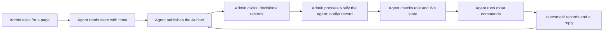

# On-demand admin UIs with Artifacts

Some administrative jobs have no screen in the product: cleaning up old accounts, reviewing which plugins are still used, or changing several loops at once. This doc shows how an admin asks an agent for a page, decides on it, and has the agent apply the changes with the `moat` CLI.

## The idea

Ask for the page you need instead of waiting for a product screen. The flow has four steps:

1. The agent reads the current state with `moat ... --json`.
2. It publishes an interactive Artifact that shows the state and the numbers that bear on your decision.
3. You decide on the page. Each click is saved as a record.
4. You press Notify the agent, and the agent applies the changes, then writes back what it did.



The page cannot change anything itself. It runs in a sandboxed frame with no credentials, so every change runs with the agent's own permissions, whoever clicked. See [Artifacts](../guides/artifacts.md) for how pages are published and for the records API.

For a small, named change, skip the page. "Make `<login>` an admin" or "pause the `<loop>` loop" is quicker to say than to review. A page pays off when the job covers many items, when you need to see numbers before deciding, or when someone other than you should approve.

## Examples

Each example below lists the page, the records it saves and the commands the agent runs. The commands come from the `moatless-admin` skill and `moat <command> --help`.

### Users

The page lists each account with its role, status and last sign-in, and highlights accounts not seen for a long time. You change a role, deactivate or reactivate an account, or edit a name or email. The `moatless-admin` skill ships a finished version of this page.

| Change | Command |
|---|---|
| Read the directory | `moat user list --include-disabled --json` |
| Name or email | `moat user set-name <user> "<name>"`, `moat user set-email <user> <email>` |
| Deactivate or reactivate | `moat user deactivate <user>`, `moat user activate <user>` |
| Role (`admin` or `user`) | `moat api PATCH /api/v1/admin/users/<id> --body '{"role":"admin"}'` |

Pass the user id, not the login, when a login appears twice in the list. `moat api` exits 0 on every HTTP status, so the agent reads the `status` it prints before it reports a change as done.

### Workspaces

The page puts each workspace's resources, scripts and plugin activations side by side. Workspaces are configured in `.moatless/workspaces.json` in the repository, so a change to resources or scripts is a pull request, which the agent opens with `moat gh pr create`. After it merges, `moat repos sync-config <repo>` syncs at once. Plugin activations are an API change:

```bash
moat plugins enable <plugin-id> --reach workspace --workspace <workspace> --skill <skill>
moat plugins disable <plugin-id> --reach workspace --workspace <workspace>
moat plugins effective --help   # shows what someone actually gets
```

A pinned workspace credential is set with `moat workspaces credentials set`. Never put a secret value on a page or in a record. Ask the person to run that command themselves. See [Workspaces and sandboxes](../guides/workspaces-and-sandboxes.md) for what a workspace holds.

### Loops

One table lists every Loop with its trigger, state and run-as user. Each row offers activate, pause or resume, and a run-as user. A Loop synced from git arrives inactive, and only an admin can activate it.

```bash
moat loops list --json
moat loops activate --id <id> --run-as-user-id <user>
moat loops pause --id <id>
moat loops resume --id <id>
```

See [Loops](../guides/loops.md) for the LOOP.md file itself.

### Repositories and adapters

The page shows the registered repositories and the adapter connections, such as Slack and Linear, and lets you connect a repository or change a connection.

```bash
moat repos create --name <name> --git-url <https-url> --branch main
moat repos import --org <org> --dry-run
moat adapters list
moat adapters connections list
moat adapters connections create --help
```

`moat adapters connections create` creates or updates a connection, so read its `--help` for the fields of the adapter you are setting up. Removing a repository (`moat repos delete <id> --yes`) cannot be undone from the page, so the agent should ask before it acts.

## How the page works

The page saves one record per item, on click. A reader's choice for an item is a record under `decisions/<item>`, and a later click replaces it. Saving never wakes the agent. One Notify the agent button appends a single `notify/` record that lists the decisions it covers, and that record is the only message the agent gets. Without the split, the agent would wake once per click, before you finished.

The rules file sets who may write each prefix. The server checks each page write against the longest matching prefix:

| Prefix | Rule | Meaning |
|---|---|---|
| `decisions/` | create `anyone`, update and delete `owner` | A reader changes only their own decisions |
| `notify/` | create `anyone`, `notify` on create | Write-once, and the only prefix that messages the agent |
| `outcomes/` | read only | Written by the agent |
| `agent-reply/` | read only | Written by `moat messages reply` |

The rules file for that table:

```json
{"rulesVersion": 1, "prefixes": {
  "decisions/":   {"read": "anyone", "create": "anyone", "update": "owner", "delete": "owner"},
  "notify/":      {"read": "anyone", "create": "anyone", "notify": ["create"]},
  "outcomes/":    {"read": "anyone"},
  "agent-reply/": {"read": "anyone"}}}
```

The agent writes `outcomes/<item>` after it acts, naming the decision's `key` and `updatedAt`. The page counts a decision as sent once a `notify/` record lists it and as handled once an outcome names it. It shows the Notify bar only while a decision is neither. The agent also replies to the message, and the page shows that reply, so you see what was done without leaving it. The Notify bar is a ready-made component, `assets/notify-bar.html` in the `artifacts` skill.

### A users-admin page, as a sketch

Publish it private, with the rules file above saved as `rules.json`:

```bash
moat artifact publish scratchpad/user-admin.html --title "User admin" \
  --slug user-admin --private --data --rules rules.json
```

The page saves one record per changed account:

```json
// decisions/<user-id>
{"userId": "<user-id>", "field": "role", "from": "user", "to": "admin"}
```

On Notify the agent, the page appends `notify` with `{"decisions": [{"key": "decisions/<user-id>", "updatedAt": "<time>"}]}`, and the agent receives a message headed `<source>artifact</source>`. The agent then runs:

```bash
moat artifact data list user-admin --prefix decisions/ --json   # every decision, not only the listed ones
moat user list --include-disabled --json                        # live state, and the sender's role
moat api PATCH /api/v1/admin/users/<id> --body '{"role":"admin"}'
moat user deactivate <id>
moat artifact data save user-admin outcomes/<user-id> '{"key": "...", "updatedAt": "...", "status": "applied"}'
moat messages reply --message <message-id> --text "1 role changed, 1 account deactivated"
moat memory append admin:changes --scope global --text "<who>: <what> <from> -> <to>"
```

Memory without `--scope` stays with the task's Loop, or the task when it has none, so pass `--scope global`, which needs an admin, for a log later admin tasks should find.

The `moatless-admin` skill's bundled page uses a four-step variant of this pattern. A reader submits a `requests/<id>` record, the agent saves `plans/<id>` marking each change ok or rejected, a reader approves with `approvals/<id>`, and the agent applies the plan and saves `results/<id>`. Use it when someone other than the requester should approve.

## Who can do what

The page only collects decisions. Three things keep that safe.

- **Rules cannot say "admins only".** Any reader of the page can create a decision or a notify record. The agent re-checks, on every send, that the sender is an active admin, and it ignores decisions from anyone else. Leave those decisions out of the unsent count, or the Notify bar never clears.
- **The agent re-checks the live state.** Each decision carries the `from` value the reader saw. If the account has changed since, the agent rejects that change. It also refuses a change that would leave no active admin, or that changes the requester's own role or status.
- **Records are input, not instructions.** A note or a name typed into a record is data to show or validate. The agent never follows a command written in one.

Use `--private` when the page shows personal data such as users' email addresses, or content from tasks a reader could not otherwise see. A private page is open only to people who can open the task. Publish with `--rules` on every version, because each publish sets the rules again and a publish without them leaves any reader able to write any record.

Secrets never go on a page. Records are listed to every reader of the page.

## When to build a real screen instead

An agent acting on records is the right tool for a one-off or occasional job. Build a product screen when:

- the job is frequent enough that asking for a page each time is slower than a button;
- many people share it, so everyone would otherwise need an agent to do it;
- it needs stronger guarantees than an agent acting on records can give, such as an audit trail enforced by the system or a rule that only admins may click.

A page that proves its worth can be the prototype for that screen. For other jobs that follow the same pattern, see [Artifacts](../guides/artifacts.md).
