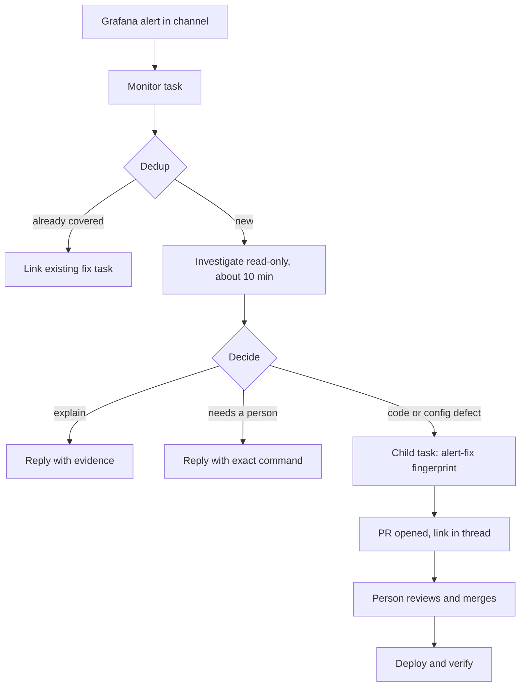

# Moatless fixing itself

This doc shows how a Grafana alert about a Moatless deployment becomes a fix PR with no one filing a ticket. It also shows the points where a person still decides. It is written for whoever runs a deployment.

## The idea

Grafana alert rules watch the Moatless deployment: backend memory, database pool, adapter deliveries, sandbox provisioning, agent runs and more. They post to a Slack channel, `#alerts-moatless`. A monitor Loop listens on that channel. It investigates each alert read-only, then does one of three things:

- starts a child task in the moatless repo that fixes the cause and opens a PR;
- explains in the alert's Slack thread why no fix is needed;
- hands the problem to a person, with the evidence and the exact command to run.

There are no tickets. The child task is the record, and the thread for each alert ends with a link to its PR. For the general idea of Moatless improving its own code and setup, see [self-improvement](../guides/self-improvement.md).

## Moatless fixing itself: #alerts-moatless

### How the monitor is set up

The monitor is a Loop whose `LOOP.md` lives in the moatless repo, under `.moatless/loops/alerts-moatless-monitor`. Its frontmatter names the deployment's alert channel and Slack workspace, so change those two ids for another deployment. It is an adapter-event Loop on the Slack channel. Its main settings:

| Setting | Value | Why |
|---|---|---|
| `routingMode` | `ongoing` | One long-lived monitor task instead of one task per alert. See [loops](../guides/loops.md). |
| `trigger` | `all_messages` | The monitor sees every message, then decides whether to act. People can ask questions in the channel too. |
| `allow_bot_messages` | `true` | Grafana's alerts arrive as bot posts. |
| `closeAfterSettledDays` | `7` | The monitor's conversation is its memory of open fixes, so it stays until it has been settled for a week. |
| `skills` | `alert-fix` | The skill holds every rule. |

You can confirm the configuration and the running monitor with `moat loops list` and `moat loops tasks --id <loop-id>`. The Loop is activated outside Git: an admin runs `moat loops activate` with the identity it should run as. See [loops](../guides/loops.md) for activation and [orchestration](../guides/orchestration.md) for how child tasks relate to a parent.

### Policy lives in the skill, values in the deployment

The `LOOP.md` prompt does not paraphrase policy. It says to run the `alert-fix` skill (in `.agents/skills/alert-fix` in the moatless repo) and follow it. One edit to the skill then changes the behavior.

Neither the skill nor the Loop prompt names a deployment. The prompt's `## Deployment` section points the agent at a skill you provide for your deployment, which holds the values it needs:

| Value | What it is |
|---|---|
| channel | The Slack channel the monitor serves. |
| base URL | The start of every task link posted in a thread. |
| namespace and backend | The Kubernetes namespace and backend Deployment to inspect. |
| datasource uids | The Prometheus and Loki sources, and which environment they belong to. |
| alert rules | The repository and path of the rule definitions. |
| heartbeat | The name of the weekly canary alert. |
| fix owners | Per repository, the workspace to create its fix task with and when a merged fix goes live. |

If a value is missing, the monitor says so in its first reply and skips whatever needs it. A repository that is not in the fix-owner table gets no fix task. The monitor says in the thread that its owner has to act.

### What happens to each message

The monitor first sorts the message. A person's question gets an answer. The weekly canary gets a checkmark and nothing else. A `RESOLVED` notice is passed to the open fix task for that alert, if any. Only a `FIRING` alert continues. The monitor puts an `eyes` reaction on a message when it starts and a `white_check_mark` when it finishes, so an `eyes` alone means work is unfinished.

For a firing alert, the monitor reads the fingerprint from the envelope's last line, in the form `grafana/<alertname>/<asset>`. The fingerprint identifies the problem and goes verbatim into task names and replies.

### Dedup

Before investigating, the monitor looks for an existing fix. It lists all open tasks whose name starts with `alert-fix: `, not only its own children, because an earlier monitor may have started them. Then:

- A task named `alert-fix: <fingerprint>` that is still working or has an open PR means no new task. The monitor replies once with the task and PR links, and forwards the new occurrence only if it adds evidence.
- Another open task that covers the same cause counts as a match. For example, a memory alert and an out-of-memory kill on the same pod share one fix.
- A fix that merged less than 7 days ago for the same fingerprint means the fix did not hold or is not deployed yet. The monitor compares the image the pods run against the merge commit. If the fix is live, the new task's brief says so and links the earlier PR.
- Two bursty rules, error-log bursts and UI-RPC defects, start a fix only on their second firing within 24 hours. On the first, the monitor explains what fired and that a second firing starts a fix.

When a replacement monitor starts with an empty conversation, it adopts the open `alert-fix:` tasks it did not create. It reads each task's state, relays it to Slack using the `slack_message:` line at the top of the task's brief, and tells the task to report to the new monitor from now on.

### Investigate, then decide

The investigation is read-only and lasts about 10 minutes. It is enough to name the cause and the owning repository. The monitor queries Prometheus and Loki through the sandbox's Grafana service proxy and uses read-only `kubectl` commands in the deployment's namespace. It filters every query on that namespace, because the same datasources can carry other products and environments.

The skill's alert catalog lists each expected rule, what it means, where to look first and which repository usually owns the fix. The monitor writes down what it observed, with numbers and times, apart from what it infers. That text becomes both the Slack reply and the child's brief.

| Outcome | What the monitor does |
|---|---|
| A defect a PR can fix | Starts a fix task. |
| Expected behavior, or a wrong rule | No task. Replies with the evidence and says what to change in the alert rules, or delegates the rule change. |
| Needs a person: restart, rollback, database change, credential, node capacity | No task. Replies with the evidence and the exact command, and never runs it. |
| Unclear after 10 minutes | Replies with what it found and could not rule out, then delegates an investigation task with the open question as its goal. |

### The fix task

At most 3 fix tasks may be working at once. A task whose PR is waiting for review does not count, so a slow review queue does not block new fixes. At the limit, the monitor replies "Queued" with its findings and starts the task when another one reports its PR.

The task is created with the name `alert-fix: <fingerprint>`, the `claude-code` agent profile and a brief file. The brief contains, in order:

1. the Slack message id and the fingerprint, which the child echoes at the start of every report;
2. the alert as posted, with its time;
3. what the monitor observed and what it infers, kept apart;
4. the goal: find the cause, write a failing test or reproducible check first, fix it and open one PR, with a 7-day backtest in the PR for an alert rule change;
5. the limits: open PRs only, and never merge, deploy, restart or change the cluster or Grafana by hand;
6. the earlier task and PR, if this fingerprint was fixed before.

The monitor then replies in the thread with the one-line cause and the task link, and leaves the `eyes` reaction on. When the child reports a PR, the monitor posts the PR link. When it reports the merge, the monitor posts the commit, when the fix goes live per the fix-owner table, and adds the checkmark. A `RESOLVED` notice does not stop a fix, because a resolved alert is not a fixed cause.

## From PR to deployed

A person reviews and merges the PR. The monitor and its children never merge, approve or deploy. See [PR reviews](pr-reviews.md) for how a review gate can sit in front of the merge.

After the merge, your deployment process publishes and rolls out the new image. Then check that the running pods carry the merged image, exercise the change against the live deployment, and roll back only with the user's agreement.

Not every fix goes live this way. The fix-owner values say what "live" means for each repository: the next backend rollout for the moatless repo, or whatever your deployment uses for any other repository it lists. The monitor relays that timing in the thread.

## What a person still does

| Who | Decision |
|---|---|
| A maintainer | Reviews and merges each fix PR. |
| A maintainer | Agrees to a rollback before one happens. |
| An operator | Picks up every alert the monitor marked as needing a person, and runs the command it gave, such as a restart, a credential change or adding node capacity. |
| An admin | Activates the Loop and chooses the identity it runs as. |
| The repository owner | Acts on alerts whose cause sits in a repository the fix-owner table does not list. |
