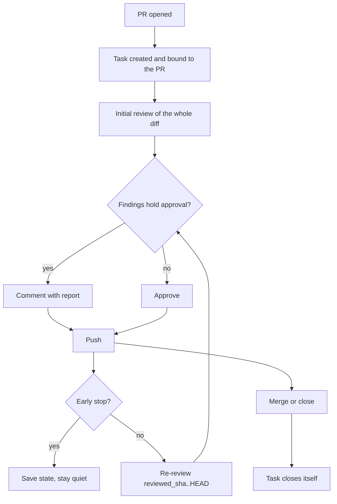

# PR reviews

This doc shows how to run an agent that reviews every pull request on a repository, and how that reviewer behaves once it is running. You set it up with one Loop file and Moatless's own `pr-review` skill.

## What you get

When the Loop is active, each PR on the repository gets:

- a review when it is opened, with inline comments on the lines the diff touched;
- a re-review of only the new commits when someone pushes;
- an answer when someone asks the reviewer a question in its own thread;
- an approval once everything is addressed.

The reviewer never requests changes. A review with open issues stays a comment, and the author decides what to do.

## Setting up the loop

A review Loop is a `LOOP.md` under `.moatless/loops/<name>/` in the repository. Moatless's own repo uses `.moatless/loops/code-review/LOOP.md`. See [Loops](../guides/loops.md) for how a Loop file is synced and activated. This is the front matter of that file, trimmed:

```yaml
---
on: github_pr                 # subscribe to the GitHub PR adapter
name: Full-Repo Code Review
workspace: moatless-global    # the workspace the review task runs in
agentProfile: claude-code
model: opus
closeAfterSettledDays: 1      # close a settled task after a day
skills: [pr-review]           # the review workflow
adapterConfig:
  ignored_events: [check_run, check_suite, review_verdict]
  ignored_senders:
    - login: github-actions[bot]
      events: [issue_comment, pull_request_review, pull_request_review_comment]
  ignored_title_patterns:
    - '^chore\(deps'
    - '^deps[:(]'
    - '^build\(deps'
    - '^chore: release'
---
```

The body of the file is the prompt. It points at the `pr-review` skill and adds only what is specific to your repository: where the rules live, and any sections you want in the report.

### Skipping noise

Three `adapterConfig` keys keep events out of the review task. The adapter reads them in `crates/adapter-github-pr/src/config.rs`.

| Key | What it does |
|---|---|
| `ignored_events` | Drops the named events. A name here wins over the same name in an include list. |
| `ignored_senders` | Drops events from a login. A bare login drops everything from it. An entry with `login` and `events` mutes only those events, so a CI bot can still open or close tasks. Matching ignores case. |
| `ignored_title_patterns` | Regexes matched case-insensitively against the PR title. A match stops a review task from being created when the PR is opened or reopened. |

If you leave `ignored_senders` out, no sender is ignored. A name the adapter doesn't know is silently inert, so check spellings. Besides GitHub's event types, you can name derived events such as `review_verdict` (a review with no body, such as a bare approval), `pr_merged` and `merge_conflict`.

### Giving it rules

The `pr-review` skill holds the workflow and no opinion about what good code is. You supply the rules in one of two ways, or both:

- **A path-to-guideline table in the prompt.** The reviewer classifies each changed file by its row, reads the guideline the row names and applies its checks. It loads only the rows the diff touches. The Moatless Loop uses this: Rust, TypeScript, Helm, Docker, tests and migrations each point at a skill under `.agents/skills/` and list the checks that matter.
- **A skill with a `references/review.md`.** List the skill in the Loop's `skills:`. The reviewer reads its `review.md` as a rule set, including the exceptions it states.

Every finding names the rule it comes from, so the author can open it. Rules that CI already enforces, such as a linter or a type check, are CI's job and the reviewer skips them.

## Life of a review task



**Opened.** The adapter creates a task and a Binding to the PR, so later events on that PR reach the same task. The reviewer checks out the head, reads the repository's `AGENTS.md`, loads the rules for the changed files and reviews the whole PR against the merge base. Every changed file ends the turn either reviewed or skipped with a reason.

**Push.** The reviewer picks a mode before it reads any code:

| Situation | Mode |
|---|---|
| Never reviewed this PR | Initial review |
| Reviewed, did not approve, new commits | Update re-review: only `git diff <reviewed_sha>..HEAD`, held to the same standard |
| Only nits from an earlier turn are open, or a review ended with nothing that holds approval | Approval pass: the full rules over the entire diff, then approve |
| Approved, new commits | Post-approval check |

Before it reads code on a re-review, it applies an early stop. It reviews nothing new when the new commits contain no reviewable files (generated, vendored, binary or a lockfile refresh), only formatting or comment changes, or a rebase that leaves the PR's own diff unchanged. It still posts a short update while one of its findings holds approval, and when only earlier nits are open it runs the approval pass instead. One exception applies: if the push touches a file where the reviewer has an open finding, it reads that hunk, because the author may have answered the finding.

After an approval, a new commit gets a post-approval check. A new public entry point, such as an endpoint, a migration or a new module, is reviewed again. A broken rule the reviewer can name is posted as a finding. Anything else leaves the earlier approval standing. If the repository dismissed the approval on push, the reviewer re-approves.

The reviewer keeps a small state record per PR: the last reviewed head, whether it approved, its open findings and the conclusions it already reached. It lives in Moatless records, not in a file, because the next push often starts a task in a fresh sandbox. If the state can't be read, the reviewer reviews nothing rather than overwrite the record.

**Merge or close.** The task closes itself when the PR is merged or closed, and a task that has settled closes after `closeAfterSettledDays`. Tasks bound to the PR that don't auto-close are told about the merge through a derived `pr_merged` event.

## How it posts

Each inline finding is one issue on a line the diff touched. It opens with a hidden marker that records its severity, so the reviewer can rebuild its state later:

| Severity | Meaning | Looks like |
|---|---|---|
| `important` | Must be fixed before merge: a correctness, security or data-loss defect, a broken contract, or a rule the rule set marks as blocking | A normal comment |
| `nit` | Everything else: a name, a placement, a convention | Starts with `**Nit**` |

A comment has the rule in bold, one line saying what is violated, why it matters here, and a fenced `Current` and `Expected` snippet. All the inline findings of a turn go up in one review.

Each turn then delivers one report, exactly once. On an initial review and an approval pass it is the full report: progress since the last review, any sections your Loop adds (the Moatless Loop adds a compliance checklist), and additional feedback. On a re-review it is a short update listing what was fixed, what is still open and what is new. The report goes in the approval body when the reviewer approves now, and in a PR comment otherwise.

The reviewer resolves its own threads when the head no longer has the issue, and leaves a thread open when it is unsure. It never resolves someone else's.

**Approval.** The reviewer approves only when:

- the approval pass ran over the whole diff;
- none of its `important` findings is open, and no nit it raised on this very turn is open;
- every condition your Loop adds is met.

A nit holds approval for one review only. The review that raises a nit does not approve, and every later turn approves over it and lists it in the approval body.

The reviewer does not read or wait for CI: approval judges the code, and whether CI must pass before a merge is the repository's merge rule.

Every call goes through `moat gh`, never bare `gh`. It records the comments and reviews the reviewer creates, so the webhook echo that GitHub sends back is recognised as an own event and not delivered to the reviewer as if somebody else had written it.

## Talking to the reviewer

The reviewer never opens the PRs it reviews, so it treats every comment as addressed to someone else unless it passes one of two tests: the comment @mentions the reviewer, or it replies inside a thread the reviewer started. A comment on the exact line it flagged is not enough, because that can be a question between two other people. To stay silent, the reviewer does nothing at all: no comment, no reaction.

| What you write | What the reviewer does |
|---|---|
| A question in its thread, or an @mention | Answers |
| "Fixed" or "done" in its thread | Nothing. The next push gets reviewed |
| A reply declining a nit, with a reason | Marks it `declined`, never raises it again, and runs the approval pass if nothing else holds approval |
| A new inline thread, a status update, "thanks" | Nothing |
| A conversation with someone else | Nothing |

A declined nit stays in the state record so no later turn raises it again, and its thread stays open for you.

## Usage

Moatless uses this Loop on its own repository, which mixes a Rust backend and sandbox, shared TypeScript packages, Helm charts and Docker. Its prompt carries the path table, a general-quality checklist and a compliance checklist, and after each review it saves a run record with `moat records save review-runs`, so reviews can be compared over time.

## Going further

A deployment can add a merge gate on top of the review: risk tiers that decide how much human review a PR needs, required approvers per tier, and a check run that blocks the merge until they are met. The reviewer's approval then becomes one input to the gate, not the merge decision.
