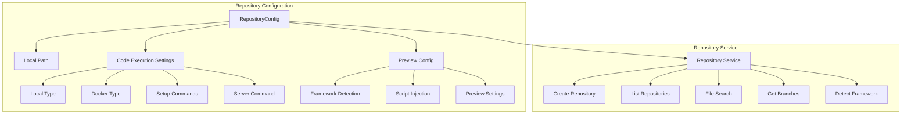
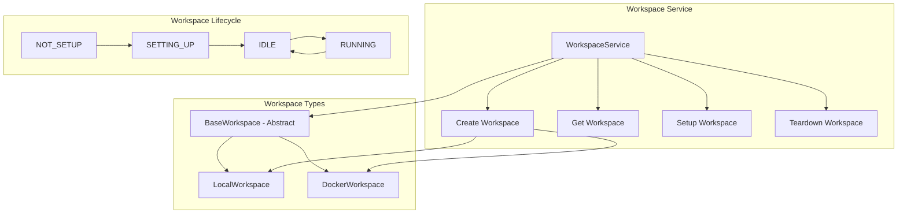
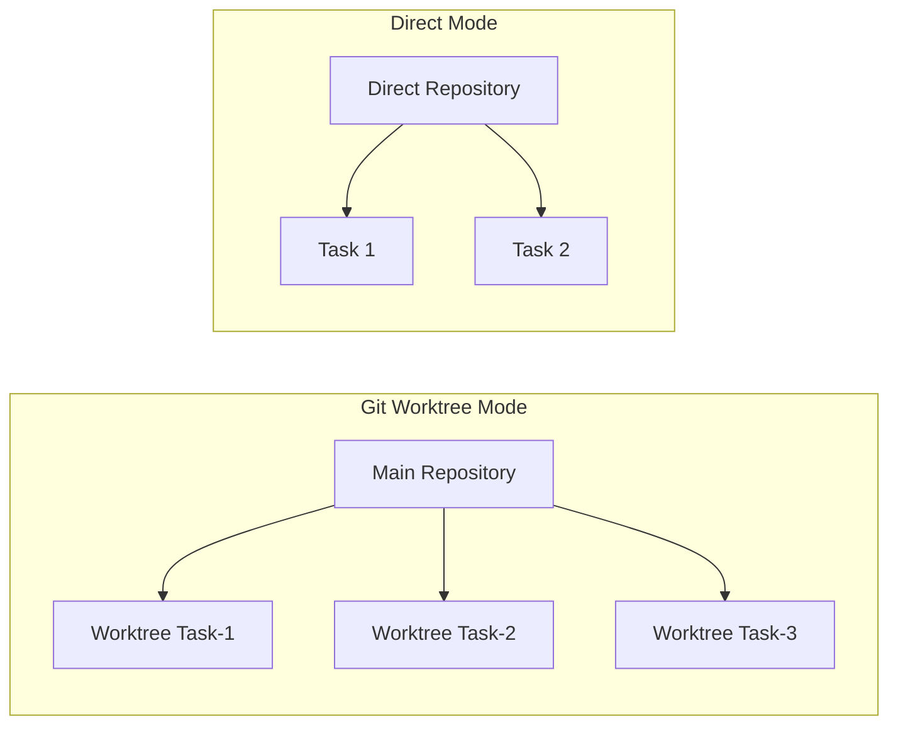
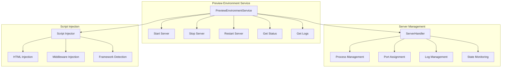
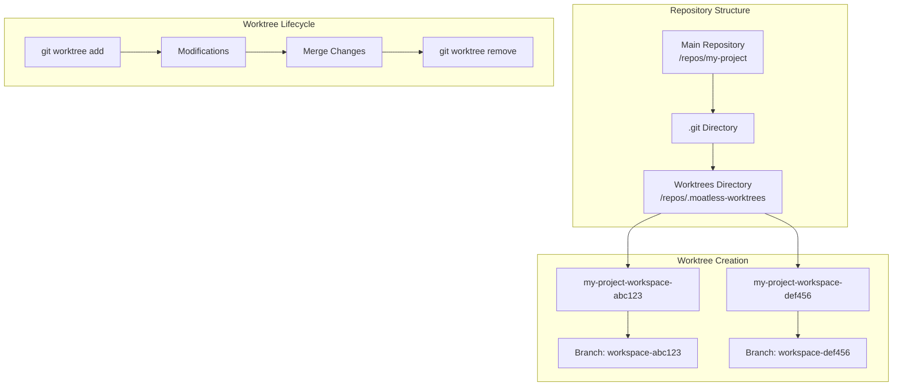

# Workspace Architecture

## Overview

The Moatless Swarm UI workspace architecture provides isolated execution environments for AI agents to safely modify code repositories. The system supports both local git worktree-based isolation and full Docker containerization, with integrated preview environments for testing changes.

## Architecture Components

### 1. Repository Management

Repositories are the foundation of the workspace system. Each repository represents a codebase that tasks can operate on.



#### Repository Configuration Structure

```typescript
interface RepositoryConfig {
  id: string
  name: string
  path: string                     // Local filesystem path
  useGitWorktrees?: boolean        // Enable git worktree isolation
  originalBranch?: string          // Base branch for worktrees (default: main)
  
  codeExecution: {
    type: 'local' | 'docker'       // Execution environment type
    setupCommands?: string         // Commands run during workspace setup
    serverCommand?: string         // Command to start dev server (use {PORT} for dynamic port)
    
    // Docker-specific settings
    image?: string                 // Docker image to use
    envVars?: Record<string, string>
    volumes?: string[]             // Additional volume mounts
    ports?: Record<number, number> // Port mappings
  }
  
  previewConfig?: {
    framework?: string             // Detected or configured framework
    serverStartCommand?: string    // Override server command
    serverPort?: number            // Fixed server port
    injectionStrategy?: {          // Script injection for debugging
      method: 'html-injection' | 'middleware'
      config: Record<string, any>
    }
  }
}
```

### 2. Workspace System

The workspace system provides isolated environments for code execution. It supports two implementations:



#### Workspace Lifecycle

1. **NOT_SETUP**: Initial state, workspace not yet created
2. **SETTING_UP**: Creating worktree/container, running setup commands
3. **IDLE**: Ready for command execution
4. **RUNNING**: Actively executing commands or running preview server

#### LocalWorkspace Implementation

LocalWorkspace provides git-based isolation using worktrees or direct repository access:



**Git Worktree Features:**
- **Isolation**: Each task gets its own worktree with separate working directory
- **Concurrency**: Multiple tasks can work on the same repository simultaneously
- **Branch Management**: Automatic branch creation/deletion
- **Location**: `{WORKTREE_DIR}/{repo-name}-workspace-{taskId}`
- **Branch Naming**: `workspace-{taskId}`

**Direct Mode Features:**
- **Simplicity**: Works directly in the repository path
- **No Isolation**: All tasks share the same working directory
- **Use Cases**: Single-task workflows, testing, development

#### DockerWorkspace Implementation

DockerWorkspace provides complete isolation using Docker containers:

```mermaid
graph TB
    subgraph "Docker Workspace"
        DC[Docker Container]
        DC --> WD[/workspace Directory]
        DC --> ENV[Environment Variables]
        DC --> VOL[Volume Mounts]
        
        subgraph "Operations"
            FO[File Operations]
            CO[Command Execution]
            SO[Server Operations]
        end
        
        DC --> FO
        DC --> CO
        DC --> SO
    end
    
    subgraph "Host System"
        HR[Host Repository]
        HD[Host Docker]
        
        HR -.->|Copy Files| WD
        HD --> DC
    end
```

**Docker Features:**
- **Complete Isolation**: Full container isolation from host
- **Reproducibility**: Consistent environment across systems
- **Security**: Sandboxed execution environment
- **Resource Control**: CPU/memory limits via Docker
- **Container Naming**: `moatless-task-{taskId}`

### 3. Preview Environment System

The preview environment system manages development servers for testing changes:



#### Preview Environment Features

1. **Framework Detection**: Automatically detects Vite, Next.js, CRA, Webpack
2. **Script Injection**: Injects debugging/monitoring scripts into preview apps
3. **Process Recovery**: Persists server metadata for crash recovery
4. **Port Management**: Dynamic port assignment with conflict resolution
5. **Log Streaming**: Real-time server log access

#### Script Injection Strategy

The preview environment can inject monitoring scripts to enable:
- Console log capture
- Network request monitoring
- Error tracking
- Navigation tracking
- Element inspection

```typescript
interface ScriptInjectionStrategy {
  method: 'html-injection' | 'middleware'
  config: {
    indexPath?: string        // Path to HTML file
    insertLocation?: string   // Where to inject (head/body)
    middleware?: string       // Middleware type
  }
}
```

### 4. Git Worktree Architecture

Git worktrees provide lightweight, isolated working directories:



#### Worktree Configuration

Environment variables:
- `WORKTREE_DIR`: Base directory for all worktrees (default: `../`)
- Repository setting: `useGitWorktrees: true/false`
