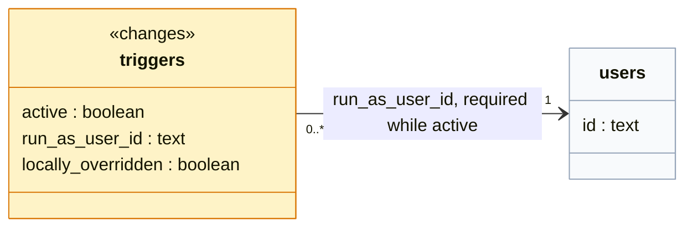
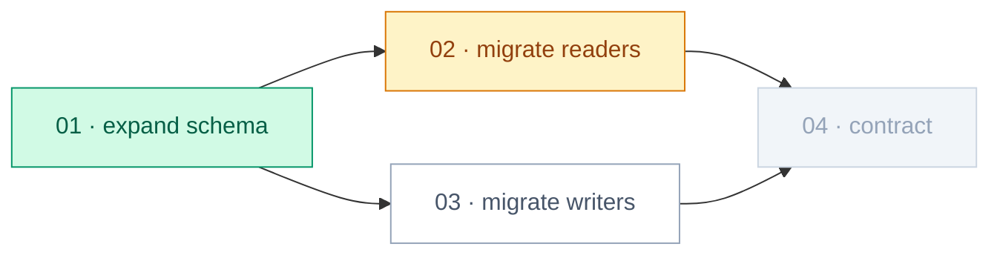

# Design elements for specs

The elements below serve both surfaces — the **page**, where the user agrees to the change, and the **markdown**, which the implementing agent reads.

**Anything that lives only on the page evaporates.** The page is not in the repo and does not outlive the sandbox, so every element it carries has to have a counterpart in the spec once the spec is written.

## Every element earns its place by doing one of five jobs

| Job | The problem it solves | Element |
|---|---|---|
| **Locate** | "Where am I, and what kind of thing is this?" | Fixed heading order · deep links |
| **Chunk** | A wall of text has no handholds — you can't enter or leave it | Tables · one instruction per line · short sections |
| **Signal state** | The reader can't hold what's settled, shipped, or blocked | Status line · progress bar · graph node colours · task lists |
| **Show shape** | Relationships paragraphs can't carry | Mermaid graphs · before/after trees |
| **Ground** | "Is this a fact about the repo, or a proposal?" | Observed/proposed split · `file:line` evidence |

If an element does none of the five, it is decoration. Cut it.

## No section is paragraphs only

The failure mode isn't length, it's flatness — a stretch with nothing for the eye to land on.

Every `##` carries at least one table, list, diagram, or code block. A section that resists this is either not yet decided, or it's two sections.

**Don't cut elements while tidying.** Removing one takes out a handhold: the result looks neater and reads worse.

## The elements

### Status line with a progress bar

Put progress in the status line, in text, so it renders everywhere:

```md
> **Status:** in progress · ▓▓▓▓▓░░░░░ 3/7 tickets · **Updated:** 2026-07-25
```

Update it in the same edit that lands a ticket.

### The decision table — four columns, never five

```md
| # | Decision | Chosen | Rejected because |
|---|---|---|---|
| 1 | Where the seam sits | Coordinator owns retry | Per-harness retry diverges silently |
| 2 | Message assembly | Backend only | Sandbox-side coalescing duplicates work per harness |
```

**This table is the page's, and it has no counterpart in the markdown.** It exists to get a person to approve a choice, which is a thing that happens once. The agent that implements the choice does not re-open it, so what reaches the spec is the choice stated as fact in the section it belongs to, with the one line of *why* that stops an implementer undoing it by accident.

The rejected alternative sits *beside* the chosen one, in the same row — never as a separate list, which lets the two be read apart.

Four columns is the cap — past that, cells wrap and the table stops being scannable in a narrow diff view.

For a decision that is still open, add a fifth *row* rather than a fifth column: ranked options, one line each, recommendation first.

### Choosing a diagram form

| For | Use |
|---|---|
| Who did what to whom, in what order | `sequenceDiagram` — one participant per component, `alt` for the failure branch, and a `Note over` for the thing that deliberately does *not* happen |
| X depends on Y depends on Z | `flowchart` |
| Stored entities, their fields and their cardinality | `classDiagram` — see "The data model" below |
| Legal states and the moves between them | `stateDiagram-v2` |

**Structure and time do not share an axis.** Two diagrams beat one doing both jobs: if a class diagram has grown a paragraph underneath explaining *when* things happen, that paragraph is a sequence diagram.

**A diagram that is mostly text is a table.** Check the shape is the point before drawing — an information model whose value is the *reason* beside each field reads better as annotated facts than as boxes. The data model is where this is already settled: the diagram carries the shape and the tables carry the reasons, so neither has to be both.

**Only a stored entity gets a box.** A state, a lifecycle stage or a flag is a *field on an entity*, not an entity of its own — "deleted override" is a column on the row that already exists, and giving it a box invents a table that never will. Something read and never persisted, such as a file in a repository, is not in the model either: it belongs in the surrounding text, or in the flow that reads it. The test is "would this be a row somewhere after the change". Model the tables; the concepts around them are what the other sections are for.

**Write a field as `name : type`, never as `+type name`.** Mermaid accepts both; only one reads. `+text run_as_user_id` puts the least interesting word first and prefixes a visibility marker that means nothing for a database column, while `run_as_user_id : text` reads as the schema does. A qualifier in the type position reads as a type — `+ignored active` looks like a type named `ignored` — so qualifiers go in the note beside the diagram, never in the type.

**A class label is the entity's real name and nothing else.** Not `triggers — a Loop is a row here`, not `task_messages — now derived`. A description in the label is the same content as the line under that entity's table, set in the smallest type on the page and stretching the box that carries it; the diagram is the map, and a map labels places rather than explaining them. Where the state must survive a reader who cannot distinguish the fills, use a `<<new>>` or `<<changes>>` stereotype above the name — a marker, not a sentence.

**A node with no edges costs a whole row of layout.** Something that relates to nothing belongs in a sentence under the diagram.

### The data model — the diagram, then a table per entity

**The diagram comes first.** One class per stored entity the change touches, the relations between them, and **only the fields the change touches**. It is the map: which entities exist after the change, which are new, and what points at what. Nothing else on the page answers that, and a reader who starts in a field table has to build it in their head.

````md

````

Colour the classes the way the field rows are coloured — new, changes, context — so the map and the tables agree at a glance.

**Then one section per entity the change changes**, headed with the entity's real name, one line of what it holds and what its identity is, and its own field table:

| Column | Type | Null | What it holds |
|---|---|---|---|
| `run_as_user_id` | text | not null | **New.** The identity work is created as |
| `locally_overridden` | boolean | not null, default false | **New.** Set when an administrator edits a Git-supplied row, so sync skips it |
| `active` | boolean | not null | **Meaning changes.** A commit can no longer set it |
| `managed_by` | text | nullable | Read, unchanged — `0066:13` |

Mark the three states in the row itself — new, meaning changes, read-and-unchanged — and colour the row to match on the page. Grey the unchanged ones: they are context, and they should read as context.

**A wholly new entity says so once, above the table, and drops the marking.** Every row of a new table is new; a `New.` bold-lead on all fourteen of them is a word repeated fourteen times to say nothing that varies, and it crowds out the description that does vary. The three states are for an entity where they differ — which, once the model is split by entity, is only the ones being modified.

**The columns after name and type are chosen per entity.** Nullability earns a column here because a backfill turns on it; elsewhere it is key membership because identity moves, or the index the new query needs. Carrying a column every table leaves blank is as bad as omitting one a table needs — the point of splitting by entity is that each gets the columns its own change turns on.

**The field name is bare, because the heading carries the table.** `task_activities.task_id` repeated fourteen times puts the least interesting eleven characters first in every row; under a `task_activities` heading it is `task_id`.

**An entity the change only reads gets a box and no section.** It is context. Where the change depends on a field it holds, say so in the line under the diagram rather than opening a table for one row.

Rules for the diagram itself:

- **Only the fields the change touches go in a class.** Mermaid cannot colour one member — `style` fills a whole class — so a class listing every column says nothing about which ones move, and the tables below are where per-field marking lives anyway. Five fields that are all part of the change carry the map; twelve bury it.
- **Colour marks the entity, and a stereotype says the same thing.** `style` on the reshaped class, plus `<<new>>` or `<<changes>>`, so a reader who cannot distinguish the fills still gets it. One word inside the angle brackets — a stereotype is not a second place to describe the entity.
- **A referenced entity contributes its identifier and nothing else.** Its own columns are not part of this change.
- **Four or five classes.** Past that the layout is wider than the column, and an entity that only holds a reference belongs in a sentence instead.
- **A constraint the schema does not have is worth drawing.** A relationship enforced only in code is a dotted edge with the reason on the label — exactly the fact a field list hides.
- **An edge label is two or three words**, usually just the column. Mermaid wraps a longer one into a boxed block dropped in the middle of the layout, where it is physically larger than the classes and reads as a node rather than a label. `message_uuid` on the edge, "null for a Sandbox activity" in the line underneath.

**The diagram and the tables do not repeat each other**, which is what makes both worth having: the diagram carries the relations and no marking, the tables carry the marking and no relations. A class body that lists every column, or a table row that restates an edge, is the failure this split exists to prevent.

### The interfaces table — the consumer and the interface are both code

| Consumer | The interface it depends on | What it can rely on | Status |
|---|---|---|---|
| `moat` CLI message listing | `ConversationPayload.activities` — `api-schemas/src/message.rs:32` | Every tool call and Sandbox status as its own item, with `kind` and `summary` renderable without parsing content blocks | **New** |
| `moat` CLI message listing | `ConversationPayload.content` | Role and message text. No `tool_use` blocks | **Breaking** on deploy |
| The paired T3 client | `ui_rpc/projection.rs` — `messages`, `activities` | The same shapes it reads today | Unchanged |
| Any live client | `SSE /api/tasks/{id}/events` | Lifecycle types only. `agent.message` is never emitted again; the variant stays so old rows replay | Changed, compatibly |
| An operator | `moat tasks rebuild <id>` | One conversation rebuilt from the block log, and a refusal naming the gap when the log does not cover all of it | **New** |

Then the promises as a short list, then one callout at most.

**The third column is what the consumer can rely on, not what changed about it.** Most plans build more than they modify, and a "what changes" column has nothing to say about an interface that did not exist an hour ago — every such row opens `New.` and then describes the thing anyway. That makes the column a status marker with a paragraph stapled to it. Split them: the promise in its own column, phrased the same whether it is a week old or a year old, and the status in a column narrow enough to scan down.

**A consumer that depends on two interfaces gets two rows.** The frontend above gains a collection and loses blocks from another; one row saying both buries the breaking half.

Every row is checkable: the reader can open the file, find the type, and see whether it promises what the row says. Compare the version this replaced —

> | Anyone reading a conversation | Read messages and activities as one ordered stream | The conversation view and its feed | Same transaction as the write |

— where the consumer is a role, the interface is a screen, and nothing in the row can be looked up or falsified.

- **Both of the first two columns name something in the code.** A component, a crate, a path; then a type, a route, an event name, an RPC method, with `file:line` where the file is the contract.
- **A role belongs there only where there is no code on the other side** — an operator running a command, someone reading a page. Then the interface is the command or procedure by name, and it still has to exist.
- **Mark the breaking rows.** They are the reason the section is on the page, and a reader scanning five rows should find them without reading the `When` column of each.
- **Monospace only what is an identifier.** `ConversationPayload.content` is code and looks it; "the Events tab" set in monospace claims to be a name you could grep for and is not. Mixing them in one column costs the column its meaning.
- **The admission test is whether something on the other side breaks when it changes** — true of an in-repo payload the frontend renders, false of a helper one worker calls. Internal module structure is in the markdown, and is not a promise.

### Diagram hazards, and how to know

Four ways a diagram breaks with nothing reported. All four have been hit in this repo:

1. **The HTML parser eats the source.** Inside `<pre class="mermaid">` the diagram is markup first: `<<durable · new>>` reaches Mermaid as `<>` and errors, which is a near-certainty now that a data model marks its classes `<<new>>` and `<<changes>>`; and `Registration<br/>proves it` reaches it as `Registrationproves it` — **silently**. On the page, escape every `<` as `&lt;`, or keep the source in a JS template literal and call `mermaid.render()`. Fenced blocks in the markdown are unaffected.
2. **`;` separates statements.** A semicolon inside a label splits the line — `BEGIN; INSERT; COMMIT` in a message is a parse error. Use commas or an em dash. This one applies to **both** surfaces.
3. **Page CSS leaks in.** `label`, `node`, `edge`, `cluster` and `title` are Mermaid's own class names. A page utility called `.label` matched 90 elements and rendered every diagram uppercase, letter-spaced and tiny, with CamelCase destroyed. Namespace page classes — `.kicker`, not `.label`.
4. **`Note over A,B` is sized to the span it covers, and its text is not wrapped.** A note longer than the distance between those two participants is cut mid-word — "Malformed files are reported and their prior state pr…" — while the diagram renders clean. Keep notes short, or widen the span to the outermost participants. It survives a render check and fails a reading.

**Validate at render level, not parse level.** `mermaid.parse()` accepts the broken `<>` in hazard 1, so a parse-only check reports success on a page displaying "Syntax error in text". Load the file in a browser, count `pre.mermaid svg`, count `[aria-roledescription='error']`, read `getComputedStyle` on rendered text — and look at the screenshot.

### The work graph, coloured by state

One Mermaid graph does two jobs — the dependency shape and the progress display. Colour the nodes by state:

````md

````

Ticket names only — no acceptance criteria, no file paths. If the graph needs a legend to be read, it has too many states; four is the ceiling.

Use it even where Mermaid isn't rendered — it degrades to a fenced block that still reads top-to-bottom.

### Callouts, rationed

GitHub alert syntax, and only for things that would genuinely surprise:

```md
> [!WARNING]
> This contradicts the existing access-scope decision. Changing it is part of the ask.
```

One or two per spec.

### Links

Every mention of another spec links to the file. On the page, an open decision's evidence sits directly under its options rather than behind a link — see [HTML-REPORT.md](HTML-REPORT.md).

### Before/after as trees

For structural change, use two fenced trees under `**Today**` and `**After**` headings:

```
Today                          After
crates/sandbox/src/                   crates/sandbox/src/
├── services/          →       ├── features/
│   ├── file.service.ts        │   ├── files/
│   └── git.service.ts         │   └── git/
└── app.ts                     └── app.ts
```

Fine to draw them stacked rather than side by side when the paths are long.

## Ban list

Never use:

- **Emoji as decoration.** A status glyph in a fixed column is a signal; a rocket in a heading is noise.
- **Bold as emphasis-spray.** Bold is reserved for field labels and the leading term of a rule.
- **`<details>`, and every other cap.** Truncated lists, "…and 12 more", collapsed sections — each costs an agent a section it has to know to open.
- **Bullets nested past two levels.** Three levels means the structure belongs in a table.
- **Tables past four columns.** They wrap in every narrow view.
- **Screenshots.** They go stale silently and can't be diffed.
- **New headings.** The unconditional heading set is fixed, and the conditional sections have the names `/spec` gives them. A section you want that has no heading is a sign the change belongs in the skill, not in one spec.
- **A conditional section stubbed with "n/a".** Omit it. An omitted section is a statement; an empty one is a gap.
- **A line justifying a section's presence.** "Included because…", "Always included." The inclusion triggers decide whether you write the section; they are not something the reader is told.
- **ASCII art** that isn't a directory tree or a box diagram.
