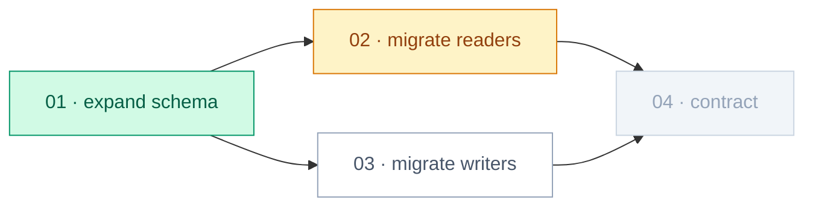

# Design elements for specs

The elements below serve both surfaces — the **page**, where the user agrees to the change, and the **markdown**, which the implementing agent reads.

**Anything that lives only on the page evaporates.** The page is not in the repo and does not outlive the sandbox, so every element it carries has to have a counterpart in the spec once the spec is written.

## Every element earns its place by doing one of four jobs

| Job | The problem it solves | Element |
|---|---|---|
| **Locate** | "Where am I, and what kind of thing is this?" | Fixed heading order · deep links |
| **Chunk** | A wall of text has no handholds — you can't enter or leave it | Tables · one instruction per line · short sections |
| **Signal state** | The reader can't hold what's settled, shipped, or blocked | Status line · progress bar · graph node colours · task lists |
| **Show shape** | Relationships prose can't carry | Mermaid graphs · before/after trees |

If an element does none of the four, it is decoration. Cut it.

## No section is prose-only

The failure mode isn't length, it's flatness — a stretch with nothing for the eye to land on.

Every `##` carries at least one table, list, diagram, or code block. A section that resists this is either not yet decided, or it's two sections.

**Don't cut elements while tidying.** Removing one takes out a handhold: the result looks neater and reads worse.

## The elements

### Status line with a progress bar

Put progress in the status line, in text, so it renders everywhere:

```md
> **Status:** in progress · ▓▓▓▓▓░░░░░ 3/7 tickets · **Updated:** 2026-07-25
```

Update it in the same edit that lands a ticket.

### The decision table — four columns, never five

```md
| # | Decision | Chosen | Rejected because |
|---|---|---|---|
| [1](#1-where-the-seam-sits) | Where the seam sits | Coordinator owns retry | Per-harness retry diverges silently |
| [2](#2-message-assembly) | Message assembly | Backend only | Sandbox-side coalescing duplicates work per harness |
```

The rejected alternative sits *beside* the chosen one, in the same row — never as a separate list, which lets the two be read apart.

Four columns is the cap — past that, cells wrap and the table stops being scannable in a narrow diff view. The `#` links down to the `###` section carrying the full reasoning.

For a decision that is still open, add a fifth *row* rather than a fifth column: ranked options, one line each, recommendation first.

### The work graph, coloured by state

One Mermaid graph does two jobs — the dependency shape and the progress display. Colour the nodes by state:

````md

````

Ticket names only — no acceptance criteria, no file paths. If the graph needs a legend to be read, it has too many states; four is the ceiling.

Use it even where Mermaid isn't rendered — it degrades to a fenced block that still reads top-to-bottom.

### Callouts, rationed

GitHub alert syntax, and only for things that would genuinely surprise:

```md
> [!WARNING]
> This contradicts ADR-0007 (teams grant no resource access). Reopening it is part of the ask — see Decision 3.
```

One or two per spec.

### Deep links from the decision table to its reasoning

Every decision row links to its `###` section. Every mention of another spec links to the file.

### Before/after as trees

For structural change, use two fenced trees under `**Today**` and `**After**` headings:

```
Today                          After
sandbox/src/                   sandbox/src/
├── services/          →       ├── features/
│   ├── file.service.ts        │   ├── files/
│   └── git.service.ts         │   └── git/
└── app.ts                     └── app.ts
```

Fine to draw them stacked rather than side by side when the paths are long.

## Ban list

Never use:

- **Emoji as decoration.** A status glyph in a fixed column is a signal; a rocket in a heading is noise.
- **Bold as emphasis-spray.** Bold is reserved for field labels and the leading term of a rule.
- **`<details>`, and every other cap.** Truncated lists, "…and 12 more", collapsed sections — each costs an agent a section it has to know to open.
- **Bullets nested past two levels.** Three levels means the structure belongs in a table.
- **Tables past four columns.** They wrap in every narrow view.
- **Screenshots.** They go stale silently and can't be diffed.
- **New headings.** The heading set is fixed.
- **ASCII art** that isn't a directory tree or a box diagram.
