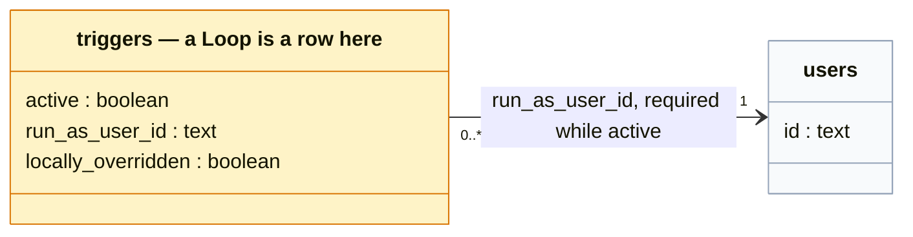
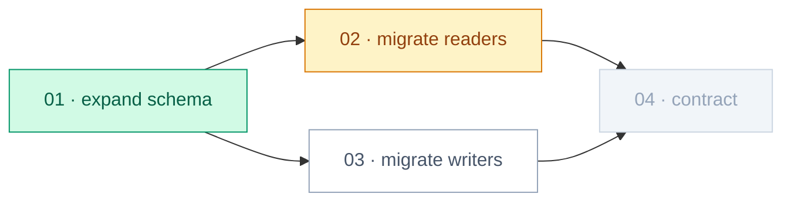

# Design elements for specs

The elements below serve both surfaces — the **page**, where the user agrees to the change, and the **markdown**, which the implementing agent reads.

**Anything that lives only on the page evaporates.** The page is not in the repo and does not outlive the sandbox, so every element it carries has to have a counterpart in the spec once the spec is written.

## Every element earns its place by doing one of five jobs

| Job | The problem it solves | Element |
|---|---|---|
| **Locate** | "Where am I, and what kind of thing is this?" | Fixed heading order · deep links |
| **Chunk** | A wall of text has no handholds — you can't enter or leave it | Tables · one instruction per line · short sections |
| **Signal state** | The reader can't hold what's settled, shipped, or blocked | Status line · progress bar · graph node colours · task lists |
| **Show shape** | Relationships prose can't carry | Mermaid graphs · before/after trees |
| **Ground** | "Is this a fact about the repo, or a proposal?" | Observed/proposed split · `file:line` evidence |

If an element does none of the five, it is decoration. Cut it.

## No section is prose-only

The failure mode isn't length, it's flatness — a stretch with nothing for the eye to land on.

Every `##` carries at least one table, list, diagram, or code block. A section that resists this is either not yet decided, or it's two sections.

**Don't cut elements while tidying.** Removing one takes out a handhold: the result looks neater and reads worse.

## The elements

### Status line with a progress bar

Put progress in the status line, in text, so it renders everywhere:

```md
> **Status:** in progress · ▓▓▓▓▓░░░░░ 3/7 tickets · **Updated:** 2026-07-25
```

Update it in the same edit that lands a ticket.

### The decision table — four columns, never five

```md
| # | Decision | Chosen | Rejected because |
|---|---|---|---|
| [1](#1-where-the-seam-sits) | Where the seam sits | Coordinator owns retry | Per-harness retry diverges silently |
| [2](#2-message-assembly) | Message assembly | Backend only | Sandbox-side coalescing duplicates work per harness |
```

The rejected alternative sits *beside* the chosen one, in the same row — never as a separate list, which lets the two be read apart.

Four columns is the cap — past that, cells wrap and the table stops being scannable in a narrow diff view. The `#` links down to the `###` section carrying the full reasoning.

For a decision that is still open, add a fifth *row* rather than a fifth column: ranked options, one line each, recommendation first.

### Choosing a diagram form

| For | Use |
|---|---|
| Who did what to whom, in what order | `sequenceDiagram` — one participant per component, `alt` for the failure branch, and a `Note over` for the thing that deliberately does *not* happen |
| X depends on Y depends on Z | `flowchart` |
| Stored entities, their fields and their cardinality | `classDiagram` — see "The data model" below |
| Legal states and the moves between them | `stateDiagram-v2` |

**Structure and time do not share an axis.** Two diagrams beat one doing both jobs: if a class diagram has grown a paragraph underneath explaining *when* things happen, that paragraph is a sequence diagram.

**A diagram that is mostly text is a table.** Check the shape is the point before drawing — an information model whose value is the *reason* beside each field reads better as annotated facts than as boxes.

**Only a stored entity gets a box.** A state, a lifecycle stage or a flag is a *field on an entity*, not an entity of its own — "deleted override" is a column on the row that already exists, and giving it a box invents a table that never will. Something read and never persisted, such as a file in a repository, is not in the model either: it belongs in the prose, or in the flow that reads it. The test is "would this be a row somewhere after the change". Model the tables; the concepts around them are what the other sections are for.

**Write a field as `name : type`, never as `+type name`.** Mermaid accepts both; only one reads. `+text run_as_user_id` puts the least interesting word first and prefixes a visibility marker that means nothing for a database column, while `run_as_user_id : text` reads as the schema does. A qualifier in the type position reads as a type — `+ignored active` looks like a type named `ignored` — so qualifiers go in the class label, `class GitFile["LOOP.md — its authority fields are ignored"]`, or in the prose beside the diagram.

**A node with no edges costs a whole row of layout.** Something that relates to nothing belongs in a sentence under the diagram.

### The data model — a table unless the relations matter

**Default to a table, one row per field.** It is the form that can mark every field individually, which is the question a data model on a spec answers: which fields move.

| Column | Type | What this change does to it |
|---|---|---|
| `run_as_user_id` | text | **New.** The identity work is created as |
| `locally_overridden` | boolean | **New.** Set when an administrator edits a Git-supplied row, so sync skips it |
| `active` | boolean | **Meaning changes.** A commit can no longer set it |
| `managed_by` | text | Read, unchanged — `0066:13` |

Mark the three states in the row itself — new, meaning changes, read-and-unchanged — and colour the row to match on the page. Grey the unchanged ones: they are context, and they should read as context.

**Reach for a `classDiagram` when the relations are the point** — when the change adds or moves a reference, when cardinality or ownership crosses entities, or when an invariant spans two of them. Then one class per stored entity, and **only the fields the change touches**:

````md

````

- **Relevance is shown by what you include, not by colour.** Mermaid cannot colour one member — `style` fills a whole class — so a diagram listing every column says nothing about which ones move. Five fields that are all part of the change say it; twelve fields do not. Whatever is merely read goes in the table or in a sentence.
- **Colour marks the entity, and the words say the same thing.** `style` on the reshaped class, plus a `<<stereotype>>` or a suffix in the label, so a reader who cannot distinguish the fills still gets it.
- **A referenced entity contributes its identifier and nothing else.** Its own columns are not part of this change.
- **Two or three classes.** Past that the layout is wider than the column.
- **A constraint the schema does not have is worth drawing.** A relationship enforced only in code is a dotted edge with the reason on the label — exactly the fact a field list hides.

Never both. A table and a diagram of the same entity is the same content twice, and the second one is the one nobody reads.

### Diagram hazards, and how to know

Four ways a diagram breaks with nothing reported. All four have been hit in this repo:

1. **The HTML parser eats the source.** Inside `<pre class="mermaid">` the diagram is markup first: `<<durable · new>>` reaches Mermaid as `<>` and errors, and `Registration<br/>proves it` reaches it as `Registrationproves it` — **silently**. On the page, escape every `<` as `&lt;`, or keep the source in a JS template literal and call `mermaid.render()`. Fenced blocks in the markdown are unaffected.
2. **`;` separates statements.** A semicolon inside a label splits the line — `BEGIN; INSERT; COMMIT` in a message is a parse error. Use commas or an em dash. This one applies to **both** surfaces.
3. **Page CSS leaks in.** `label`, `node`, `edge`, `cluster` and `title` are Mermaid's own class names. A page utility called `.label` matched 90 elements and rendered every diagram uppercase, letter-spaced and tiny, with CamelCase destroyed. Namespace page classes — `.kicker`, not `.label`.
4. **`Note over A,B` is sized to the span it covers, and its text is not wrapped.** A note longer than the distance between those two participants is cut mid-word — "Malformed files are reported and their prior state pr…" — while the diagram renders clean. Keep notes short, or widen the span to the outermost participants. It survives a render check and fails a reading.

**Validate at render level, not parse level.** `mermaid.parse()` accepts the broken `<>` in hazard 1, so a parse-only check reports success on a page displaying "Syntax error in text". Load the file in a browser, count `pre.mermaid svg`, count `[aria-roledescription='error']`, read `getComputedStyle` on rendered text — and look at the screenshot.

### The work graph, coloured by state

One Mermaid graph does two jobs — the dependency shape and the progress display. Colour the nodes by state:

````md

````

Ticket names only — no acceptance criteria, no file paths. If the graph needs a legend to be read, it has too many states; four is the ceiling.

Use it even where Mermaid isn't rendered — it degrades to a fenced block that still reads top-to-bottom.

### Callouts, rationed

GitHub alert syntax, and only for things that would genuinely surprise:

```md
> [!WARNING]
> This contradicts ADR-0007 (teams grant no resource access). Reopening it is part of the ask — see Decision 3.
```

One or two per spec.

### Deep links from the decision table to its reasoning

Every decision row links to its `###` section. Every mention of another spec links to the file.

### Before/after as trees

For structural change, use two fenced trees under `**Today**` and `**After**` headings:

```
Today                          After
sandbox/src/                   sandbox/src/
├── services/          →       ├── features/
│   ├── file.service.ts        │   ├── files/
│   └── git.service.ts         │   └── git/
└── app.ts                     └── app.ts
```

Fine to draw them stacked rather than side by side when the paths are long.

## Ban list

Never use:

- **Emoji as decoration.** A status glyph in a fixed column is a signal; a rocket in a heading is noise.
- **Bold as emphasis-spray.** Bold is reserved for field labels and the leading term of a rule.
- **`<details>`, and every other cap.** Truncated lists, "…and 12 more", collapsed sections — each costs an agent a section it has to know to open.
- **Bullets nested past two levels.** Three levels means the structure belongs in a table.
- **Tables past four columns.** They wrap in every narrow view.
- **Screenshots.** They go stale silently and can't be diffed.
- **New headings.** The unconditional heading set is fixed, and the conditional sections have the names `/writing-specs` gives them. A section you want that has no heading is a sign the change belongs in the skill, not in one spec.
- **A conditional section stubbed with "n/a".** Omit it. An omitted section is a statement; an empty one is a gap.
- **A line justifying a section's presence.** "Included because…", "Always included." The inclusion triggers decide whether you write the section; they are not something the reader is told.
- **ASCII art** that isn't a directory tree or a box diagram.
