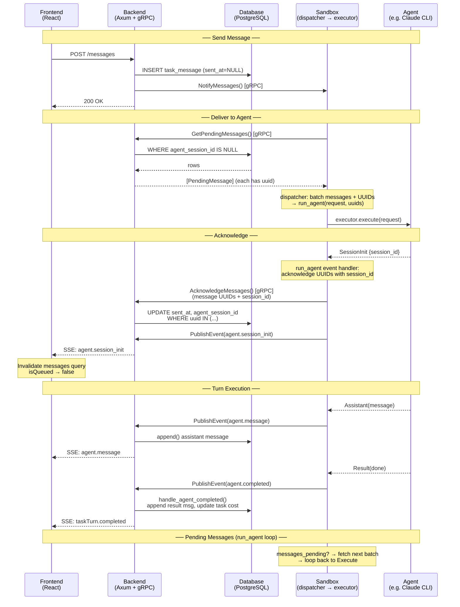
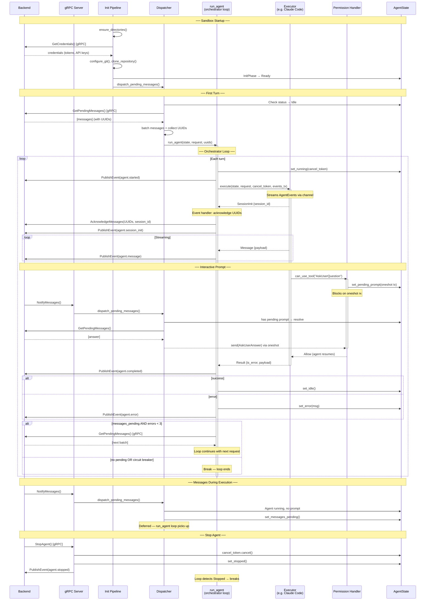

# Agent Execution, Messages & Commands

The agent is the AI assistant that processes user messages, makes code changes, and converses within a task's sandbox. Commands provide reusable prompts that can be attached to tasks.

## What Users Can Do

### Agent Execution
- **Start the agent** — happens automatically when a message is sent to a task with a ready sandbox.
- **Watch execution** — see the agent's progress in real-time as it works through a turn.
- **Stop the agent** — interrupt execution mid-turn; the agent halts and can be resumed later.
- **Resume after restart** — restart the sandbox and send a new message; the agent picks up with full conversation history.
- **Multi-turn conversation** — send follow-up messages after the agent completes a turn; each message triggers a new turn.

### Messages
- **Send a message** — submit text (and optional attachments) to the task; the message is stored and delivered to the agent.
- **View conversation history** — see all user and assistant messages in chronological order.
- **See message status** — each user message shows whether it is queued, sent to the agent, or processed.
- **Delete a queued message** — remove a message that has not yet been picked up by the agent.
- **Inspect content blocks** — messages can contain text, code, tool calls, and other structured content.
- **Track cost** — each turn's token usage is recorded; the task's total cost accumulates over turns.
- **Answer agent questions** — when the agent asks the user a question mid-turn, the user can respond inline.
- **Approve or reject a plan** — when the agent proposes a plan, the user can approve it to proceed or reject it with feedback.

### Commands
- **Create reusable prompts** — define commands with a name, prompt template, and optional conditions.
- **Attach commands to tasks** — commands can be triggered by name during a conversation.

## How It Works

### Agent Turns

1. When a user sends a message, the agent activates for a **turn** — one round of work that may involve multiple tool calls and file changes.
2. The agent runs inside the task's sandbox and has access to the workspace files.
3. Stopping the agent mid-turn is graceful: the conversation history is preserved up to the interruption point.
4. After a sandbox restart, the agent resumes with the full message history — no context is lost.
5. Commands are stored per-repository and expand into the conversation when invoked.

### Message Lifecycle

Every user message progresses through three states:

| State | Meaning | User can delete? |
|-------|---------|------------------|
| **Queued** | The message has been saved but the agent has not yet picked it up | Yes |
| **Sent** | The agent has started a session and acknowledged this specific message | No |
| **Processed** | The agent has completed the turn that included this message | No |

#### Sending a message

1. The user submits a message to a task.
2. The message is stored with a unique ID.
3. If the agent is idle, the sandbox is notified that new messages are available.
4. If the agent is already running, the message stays queued until the current turn completes.

#### Delivering messages to the agent

1. The dispatcher fetches all queued messages for the task. Each message carries its unique ID.
2. If multiple messages are queued, they are batched into a single prompt for the agent.
3. The message UUIDs are passed to the orchestrator alongside the request.
4. The orchestrator starts the agent executor and begins processing.

#### Acknowledging messages

1. When the agent session starts, the executor emits a session-init event with the session ID.
2. The orchestrator observes this event and sends an acknowledgment to the backend with the message UUIDs and session ID.
3. The backend marks each acknowledged message as **sent** — recording the session ID and the time it was picked up.
4. A notification is sent to the frontend so the UI updates the message status from "Queued".
5. Messages are acknowledged individually — each message is tracked by its own unique ID, not in bulk.

#### Completing a turn

1. The agent works through the prompt — reading files, making changes, calling tools.
2. Progress is streamed to the frontend in real time (assistant messages, tool calls, results).
3. When the agent finishes, a result message is created and the turn is marked complete.
4. The task's cost is updated with the turn's token usage.
5. If more messages arrived while the agent was busy, the orchestrator loops and automatically starts a new turn with those messages — no re-dispatch needed.

#### Deleting a queued message

- A user can delete a message only while it is still **queued** (not yet acknowledged by the agent).
- Once the agent has picked up and acknowledged the message, it cannot be deleted.

### Interactive Prompts

During a turn, the agent may pause to ask the user for input:

- **Questions** — the agent presents one or more questions. The user's answers are delivered as a response to the waiting prompt, and the agent continues.
- **Plan approval** — the agent proposes a plan and waits for the user to approve or reject it. On approval, the agent switches from plan mode to edit mode and proceeds. On rejection, the user can provide feedback and the agent revises the plan.

While the agent is waiting for input, new messages from the user are delivered as responses to the pending prompt rather than starting a new turn.

### Error Recovery

- If the agent encounters an error during a turn, the error is recorded and the turn ends. The user can send a new message to retry.
- If the agent fails multiple consecutive turns, execution pauses to prevent runaway errors. The user is notified and can retry or investigate.
- If the sandbox restarts (e.g., after a crash), the agent resumes with the full conversation history from the previous session.
- If the agent crashes before acknowledging messages, those messages remain queued and are automatically re-fetched on the next attempt.

## Message Flow — Sequence Diagram

Shows the core code components and the flow from sending a message through agent acknowledgment and turn completion.

## Agent Lifecycle — Sequence Diagram

Shows the sandbox-internal lifecycle: the orchestrator loop, agent executor trait, interactive prompts, error recovery, and multi-turn handling.

The sandbox has three layers:
- **Dispatcher** — fetches messages, resolves prompts, starts agent runs
- **Orchestrator (`run_agent`)** — manages state, event handling, acknowledgment, loops on pending messages
- **Executor** — pluggable agent implementation (e.g. Claude Code), streams events via channel

## Key Concepts

| Concept | Meaning |
|---------|---------|
| Turn | One round of agent work in response to one or more user messages |
| Idle / Running | The two agent states — idle waits for input, running processes a turn |
| Queued / Sent / Processed | The three message states tracking delivery to the agent |
| Session ID | A unique identifier for each agent session, used to link messages to turns |
| Content block | A unit within a message: text, code, tool use, or result |
| Command | A reusable prompt template that can be triggered by name |
| Plan mode | A special mode where the agent proposes changes before making them |
| Interactive prompt | A pause during a turn where the agent waits for user input |
