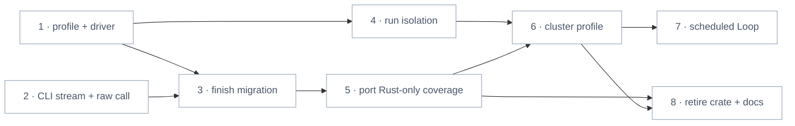

# One E2E suite, run against the Kubernetes environment

> **Status:** approved · ░░░░░░░░░░ 0/8 tickets
> **Updated:** 2026-07-27
> **Vocabulary:** CONTEXT.md · **Decisions:** —

## Lede

**After this ships:** the same E2E suite runs unchanged against Docker Compose or the live Kubernetes environment, chosen by one profile setting.

**In scope:**
- One TypeScript suite, two environment profiles
- Tests drive the compiled `moat` binary
- Runs inside a sandbox, ambient login
- Shared cluster database, never reset
- Rust integration-tests crate retired

**Out of scope:**
- The browser suite — unchanged
- Multi-identity and callback tests under the cluster profile
- New behaviour coverage beyond what exists

**Decisions** — the ones a reader could reasonably disagree with:

| # | Decision | Chosen | Rejected because |
|---|---|---|---|
| [1](#1-language-and-driver) | Language and driver | TypeScript on Playwright, driving the compiled `moat` binary | Rust costs minutes of compile per run; a hand-written client drifts from the CLI people actually run |
| [2](#2-how-a-profile-is-selected) | Profile selection | `E2E_PROFILE=docker\|k8s` → one profile value: properties plus capability flags | Compile-time selection needs a rebuild; a config format nobody needs yet; auto-detect hides which environment ran |
| [3](#3-isolation-on-a-live-database) | Isolation without truncate | Run-scoped name prefix, filtered assertions, delete-by-prefix teardown, sweeper | Tags alone are forgettable; no sweeper leaks sandboxes after a crash; an owning test user cannot be created |
| [4](#4-how-a-k8s-run-is-launched) | Launching a cluster run | A scheduled Loop on this repo; the agent reports the summary | Manual-only finds nothing until someone looks; external CI needs a personal key; a cron workload has no identity |
| [5](#5-which-tiers-run-on-k8s) | Tiers on the cluster | All three — db, sandbox and agent — every scheduled run | An opt-in agent tier leaves agent regressions unwatched |

**Open questions:** who watches nightly agent-tier spend; whether a failure notifies beyond the task summary. Neither blocking.

**Work:**

**Next action:** open [E2E-1](../docs/plans/one-e2e-suite-against-k8s/tickets/E2E-1-profile-and-moat-driver.md) — it starts at `tests/api/fixtures/api-fixtures.ts:36`.

---

## Today

### The state slice

Two E2E suites exist. Both talk HTTP to one backend base URL, both default to
`http://localhost:8080`, and both assume that URL is a Docker Compose stack on
the same machine as the test process.

| | Rust integration tests | Playwright api chains | Playwright ui specs |
|---|---|---|---|
| Location | `crates/integration-tests/` | `tests/api/` | `tests/ui/` |
| Size | 33 files · 6.1k lines · 80 tests | 18 files · 3.8k lines · 169 tests | 6 specs |
| HTTP client | `MoatClient` — the moat CLI's own client (`src/lib.rs:4`) | hand-written `ApiClient`, 1270 lines (`tests/shared/api-client.ts`) | same `ApiClient` + Chromium |
| Auth | admin password login (`src/lib.rs:41-46`) | admin password login (`fixtures/api-fixtures.ts:40-45`) | admin fills the login form (`auth.setup.ts:15-16`) |
| Isolation | truncate every table (`src/lib.rs:445`) | truncate every table (`helpers/db-reset.ts:56`) | none — inherits the api reset |
| Tiering | env gates `SANDBOX_E2E` / `CLAUDE_SDK_E2E` + `#[ignore]` | none — every chain runs | none |
| Runner | `docker-compose/test-runner.sh` | `docker-compose/playwright-runner.sh` | same |
| In CI | manual only (`.github/workflows/e2e.yml`) | manual only | manual only |

The two suites are **near-duplicates by subject**: `task_crud` / `task-crud`,
`sandbox_lifecycle` / `sandbox-lifecycle`, `agent_execution_flow` /
`agent-execution-flow`, `auth_access` / `auth-access-control`,
`file_operations` / `file-operations`, `webhook_callback` / `webhook-callback`,
`plugins_e2e` / `plugins-e2e`, and six more. 15 of the 18 Playwright chains have
a same-subject Rust file. Only the Rust side has `workspace_*`,
`trigger_recent_tasks`, `github_proxy`, `messages`, `feedback`,
`sandbox_replacement_ordering`; only the browser side covers login, navigation
and interactive prompts.

### How a test reaches the backend today

1. `docker-compose/test-runner.sh` builds images, starts `postgres` + `redis` +
   `backend` with the CI overlay, polls `/health`, then truncates the database.
2. The test process resolves its base URL from `MOATLESS_API_URL`
   (`src/lib.rs:220`) or `DOCKER_COMPOSE_URL` (`tests/api/playwright.config.ts:54`).
3. It logs in as the bootstrap admin — `POST /api/v1/auth/password/login`,
   username `admin`, password `ci-admin-password-1234`.
4. Tests that need a second identity call `client_as_user("alice", …)`, which
   `POST /api/v1/users` as admin with a plaintext password, then logs that user
   in for a session cookie (`src/lib.rs:100-150`).
5. Tests that need state the API does not expose shell out:
   `docker exec moatless-postgres psql` (`src/lib.rs:252`, used by
   `provider_settings`, `shadow_workspace_primary`, `trigger_recent_tasks`,
   `workspace_git_override`, `setup_requirements`).
6. Tests that need the backend to call *them* bind a local port and hand the
   backend `host.docker.internal:<port>` — the webhook callback server
   (`src/callback_server.rs:72`) and the mock GitHub API on port 18092
   (`tests/github_proxy.rs:41`).
7. Teardown drops the containers and the volumes.

### What breaks against the deployed cluster

The deployed environment answers
`GET /api/v1/auth/mode` with `{"mode":"oauth","provider":"github_app"}`. That
single fact invalidates most of the harness above:

| Harness mechanism | Against Kubernetes |
|---|---|
| Admin password login | **404** — `require_local_auth` rejects it (`backend/src/auth/routes.rs:341`) |
| Creating alice/bob/carol | **400** — human users need local auth (`routes.rs:576`) |
| Truncating every table | Destroys a shared environment; no equivalent exists |
| `docker exec … psql` | No Docker daemon, no container by that name |
| `host.docker.internal` callbacks | Backend pods cannot route to the test machine |
| Fresh stack per run | Cluster is long-lived and shared with real work |

Two mechanisms do carry over unchanged:

- **API keys.** `mvk_` keys authenticate as `Authorization: Bearer` from
  anywhere (`crates/cli/src/config.rs:57-67`), and `MoatClient` already speaks
  them (`crates/cli/src/client.rs:74`). They can only be minted from a session
  cookie, for the caller's own account (`routes.rs:1646-1651`) — the OAuth CLI
  login flow is what mints one non-interactively (`routes.rs:1265`).
- **In-sandbox auth.** A process inside a sandbox pod gets `USER_AUTH_TOKEN` and
  the in-cluster backend URL for free (`config.rs:53`), so `moat` there is
  already authenticated as the task's owner, and the pod is addressable from the
  backend.

### Dead or unused paths

- **No E2E runs on a pull request.** `.github/workflows/e2e.yml` is
  `workflow_dispatch` only; `ci.yml` mentions neither suite. Both suites are
  therefore gated by someone remembering to run them.
- **`tests/ui/_archive/`** holds specs no config references.
- The TypeScript `ApiClient` re-implements ~100 endpoints by hand even though
  `crates/api-client` is generated from the same OpenAPI document, and
  `packages/` ships a generated `@moatless/api-client` for the frontend.

## Problem

The platform's own deployed environment is the one place nobody tests. Both
suites describe a Docker Compose stack, and everything that makes the cluster
different — pod scheduling, persistent volumes, ingress, the sandbox service, the
real Kubernetes sandbox runtime — is exercised for the first time by whoever
opens the app after a deploy.

Three costs follow, in the order they hurt:

| Cost | Who feels it |
|---|---|
| A Kubernetes-only regression is found by a user, not a test | whoever is using the platform that day |
| The same behaviour is written twice, in two languages, and only one gets updated | whoever changes an endpoint |
| Neither suite runs on a pull request, so both drift until someone remembers | whoever inherits the drift |

The second cost is what makes the first one permanent: a suite duplicated across
Rust and TypeScript is expensive enough to extend that nobody adds the
cluster as a third target.

## Solution

One TypeScript suite on the Playwright runner. Every API call goes through the
compiled `moat` binary, so the tests exercise the client people actually run, and
authentication is whatever the environment already gives the process — inside a
sandbox that is the ambient login, with no credential to provision or store.

A **profile** carries everything that differs between environments:

| Profile field | `docker` | `k8s` |
|---|---|---|
| Base URL | `http://localhost:8080` | the in-cluster backend, from the sandbox env |
| Authentication | admin password login | ambient sandbox login |
| Fixture repository | hello-world-ui template | **Moatable** — global template `433e035b…`, workspace `ws_433e035b…`, React + Vite starter with a `preview` server |
| Database reset | truncate before the run | never |
| Second identity | yes | no |
| Direct database access | yes | no |
| Inbound callbacks to the runner | yes | no, for now |
| Sandbox provisioning timeouts | container-speed | pod-speed, longer |

A test that needs a capability the active profile lacks is skipped there, with
the skip visible in the report — not deleted, and not silently passing. The
cluster run is started by a scheduled Loop on this repository: the sandbox checks
the repo out, runs the suite against the environment it is itself running in, and
the agent reports the result.

The moat CLI grows two commands the suite needs and nobody has needed yet —
streaming the event feed, and a raw call that surfaces the response status — so
test code never reaches around the CLI to raw HTTP.

## Decisions

### 1. Language and driver

TypeScript on the Playwright runner, every call through the compiled `moat`
binary.

The Rust crate was the strongest candidate on paper: it already builds on
`MoatClient`, the CLI's own client, so it exercises shipped code and gets typed
responses for free. It loses on the two things that decide whether a suite gets
run — a cluster run has to compile the workspace first (minutes, in a sandbox),
and its test ergonomics are the weakest of the options considered.

Driving the binary rather than importing a client library is a deliberate trade:
assertions parse `--json` output instead of typed structs, and in exchange every
test is a statement about the interface a user has. Where the CLI can't express
something, the CLI is extended — that was explicitly authorised, and it is the
rule that keeps the driver honest.

Alternatives, and why each lost (3)

| Option | Lost because |
|---|---|
| Rust `crates/integration-tests` | Minutes of compile before a cluster run; weakest ergonomics for chain-style tests |
| TypeScript + Vitest | No serial chains, retries, HTML report or artifact capture — all of which the chain style leans on |
| Python + pytest | Best fixtures of the four and there is precedent (`docker-compose/e2e-test.py`), but it adds a third language and toolchain to the sandbox image |

### 2. How a profile is selected

`E2E_PROFILE=docker|k8s` resolves one profile value holding the properties in the
Solution table plus a set of capability flags. Selection defaults sensibly —
a process that has a sandbox login present is a cluster run unless told
otherwise — but the name is always resolved, recorded, and printed in the report
header, so a run's target is never inferred by the reader.

Capability flags, and what turns off without each:

| Capability | Off under | Tests that need it |
|---|---|---|
| `seedUsers` | `k8s` | access control, team writes, session claims, per-user tokens |
| `resetDatabase` | `k8s` | anything asserting on totals rather than its own resources |
| `directDatabase` | `k8s` | provider settings, workspace primacy, recent-task routing, setup requirements |
| `inboundCallbacks` | `k8s` | webhook callbacks, the mock GitHub proxy |
| `agentCredentials` | either, by config | the agent tier |

Compile-time selection was rejected because switching targets would mean a
rebuild; a config file format was rejected as unearned for two profiles; pure
auto-detection was rejected because a misconfigured run would silently test the
wrong environment.

### 3. Isolation on a live database

`TRUNCATE` has no cluster equivalent, and there is no tenancy boundary to hide
behind: `Scope` is only `global | user`, and teams grant no resource access
(ADR 0006). Isolation is therefore a convention the suite enforces on itself:

1. Every resource a test creates is named with a run-scoped prefix.
2. No assertion reads an unfiltered list — every list is filtered to the run's
   own prefix before anything is counted.
3. Teardown deletes by prefix, whatever the test outcome.
4. A sweep mode removes resources older than a few hours that a crashed run
   left behind, including their sandboxes.

Point 2 is the real work: today's tests do assert on totals, and each of those
assertions has to be rewritten. Point 4 is what stops a crash from leaving
sandboxes running on a shared cluster — the failure mode that would otherwise
end the experiment.

### 4. How a k8s run is launched

A scheduled Loop on this repository. The Loop starts a task, the sandbox checks
the repo out and runs the suite against the environment it is itself running in,
and the agent reports pass/fail as the task's summary. The credential problem
disappears: a sandbox is already logged in.

The cost is honest — an agent turn wraps every run, so the result is a message
rather than a status check on a pull request. External CI was rejected because
the only key it could carry belongs to a person; a scheduled cluster workload was
rejected because nothing can issue it an identity today.

### 5. Which tiers run on k8s

All three, every scheduled run.

The cheap tier alone would skip the pod lifecycle, which is most of what a
cluster run is worth. Making the agent tier opt-in would leave agent regressions
unwatched between manual runs — and the agent path is where a cluster differs
most from Compose, since it involves real pods, real volumes and real timeouts.
The accepted cost is a nightly agent bill, tracked as an open question rather
than pretended away.

## Behaviour

### The person running the suite locally

1. Runs one command with the Docker profile; behaviour is exactly as today.
2. Runs the same command with the cluster profile from inside a sandbox; the
   suite targets the deployed environment with no extra configuration.
3. Reads a report header that names the profile, the run prefix, and every
   skipped test with the capability that caused the skip.
4. Runs the sweep command when a previous run died, and sees what it removed.

### The person reading a nightly result

1. Receives the run's summary on the task the Loop created.
2. Sees counts of passed, failed and skipped, and for failures, which chain.
3. Opens the task to read the full output; the artifacts are in its workspace.

### The person changing an endpoint

1. Changes the endpoint and, where needed, the CLI command that exposes it.
2. Updates one test, in one language, in one place.
3. Runs the Docker profile locally before pushing; the nightly covers the rest.

Given / When / Then, per capability skip (4)

* **Given** the cluster profile is active
* **When** a test requires a second identity
* **Then** the test is skipped, and the report names the missing capability
  * **And** the run does not fail because of the skip
  * **And** the same test runs normally under the Docker profile

Repeat for direct database access, inbound callbacks, and database reset. The
shape is identical in each case; only the capability name changes.

## Seams and testing

The **driver** is the new seam, and it is the only one this change introduces:
one module that turns domain verbs into `moat` invocations and back into typed
results. Everything above it — chains, steps, fixtures, the context accumulator —
stays as it is; everything below it is the CLI.

| Concern | Where it lives | Why there |
|---|---|---|
| Domain verbs (`createTask`, `waitForSandboxReady`) | steps | already exist, already shared across chains |
| Invocation, JSON parsing, error mapping | the driver module | one place that knows the CLI's output shape |
| Environment differences | the profile | so a test never branches on which environment it is in |
| Cleanup bookkeeping | run context | so teardown is derivable, not remembered |

This is the highest seam available: any lower and the tests bypass the CLI, which
is the interface being defended; any higher and they drive a browser, which the
`tests/ui/` suite already does for the parts that need it.

Prior art in the repo to follow rather than reinvent: the chain and step layout
under `tests/api/`, the polling helpers in `tests/shared/wait-helpers.ts`, the
NDJSON collection in `tests/shared/sse-collector.ts`, and the scenario IDs in
`specs/*/01-*.md`, which the ported tests keep referencing so the spec-to-test
mapping survives the rewrite.

## Out of scope

| Not doing | Why |
|---|---|
| The browser suite | It tests a different surface; nothing here improves it |
| Multi-identity coverage on the cluster | No second identity can exist under the deployed auth provider |
| Inbound callbacks on the cluster | Possible via a declared server port, but not worth the first release |
| New behaviour coverage | This is a rewrite of what exists; new tests come after |
| Running E2E on every pull request | A separate decision about cost and duration |

## Open questions

| Question | Blocking | Default if unanswered |
|---|---|---|
| Who watches nightly agent-tier spend | no | Review after the first week of nightlies |
| Whether a failure notifies beyond the task summary | no | Task summary only |

## Ticket breakdown

Each ticket is one vertical slice, sized to a single context window. Full text in
[`docs/plans/one-e2e-suite-against-k8s/tickets/`](../docs/plans/one-e2e-suite-against-k8s/tickets/).

| # | Ticket | Delivers | Blocked by |
|---|---|---|---|
| [1](../docs/plans/one-e2e-suite-against-k8s/tickets/E2E-1-profile-and-moat-driver.md) | Profile and moat driver | Profile resolution, capability flags, the driver module, and the first two chains on it | — |
| [2](../docs/plans/one-e2e-suite-against-k8s/tickets/E2E-2-cli-event-stream-and-raw-call.md) | CLI: event stream and raw call | Streaming the event feed, and a raw call that reports status, so tests never bypass the CLI | — |
| [3](../docs/plans/one-e2e-suite-against-k8s/tickets/E2E-3-finish-driver-migration.md) | Finish the driver migration | The remaining 16 chains and the step layer moved over; the hand-written client deleted | 1, 2 |
| [4](../docs/plans/one-e2e-suite-against-k8s/tickets/E2E-4-run-isolation.md) | Run isolation | Run prefix, filtered list assertions, delete-by-prefix teardown, sweep mode | 1 |
| [5](../docs/plans/one-e2e-suite-against-k8s/tickets/E2E-5-port-rust-only-coverage.md) | Port Rust-only coverage | The 17 subjects that exist only in the Rust crate, scenario IDs intact | 3 |
| [6](../docs/plans/one-e2e-suite-against-k8s/tickets/E2E-6-cluster-profile.md) | Cluster profile | Moatable fixture, pod-speed timeouts, capability skips visible in the report | 4, 5 |
| [7](../docs/plans/one-e2e-suite-against-k8s/tickets/E2E-7-scheduled-loop.md) | Scheduled Loop | The Loop definition, the run it invokes, and the summary it reports | 6 |
| [8](../docs/plans/one-e2e-suite-against-k8s/tickets/E2E-8-retire-crate-and-docs.md) | Retire and document | Delete the Rust crate, correct the workflow, the skill, and two stale documents | 5, 6 |

Rust-only subjects to port in ticket 04, with test counts (17 files, 44 tests)

| Subject | Tests | Note |
|---|---|---|
| `setup_requirements` | 6 | needs direct database access — Docker profile only |
| `github_proxy` | 5 | needs inbound callbacks — Docker profile only |
| `integrations_github_pr_reply` | 5 | |
| `repo_crud` | 5 | partially covered by the repository chain |
| `trigger_routing` | 4 | overlaps the webhook-routing chain |
| `feedback` | 3 | |
| `integrations_config` | 2 | |
| `provider_settings` | 2 | needs direct database access |
| `sandbox_replacement_ordering` | 2 | agent tier |
| `task_connections` | 2 | needs a second identity |
| `trigger_recent_tasks` | 2 | needs direct database access |
| `agent_ask_user_question` | 1 | agent tier |
| `loops_alias_equivalence` | 1 | |
| `messages` | 1 | |
| `shadow_workspace_primary` | 1 | needs direct database access |
| `subagent_tool_tracking` | 1 | agent tier |
| `workspace_git_override`, `workspace_multi_repo` | 2 | one needs direct database access |

The remaining 16 Rust files have a same-subject chain already; they are compared
assertion-by-assertion during the port, and anything the chain misses is folded
in rather than ported as a separate test.

