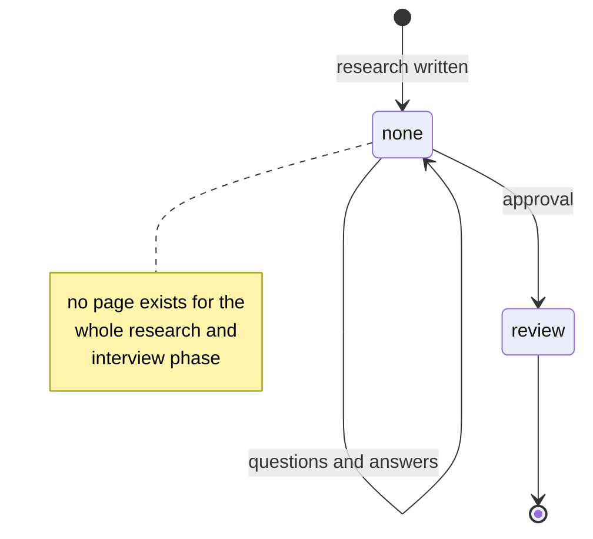
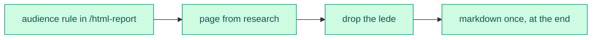

# The page is the working document; the spec is written once, at the end

> **Status:** shipped · all five decisions implemented in the skills
> **Updated:** 2026-07-27
> **Vocabulary:** CONTEXT.md · **Decisions:** —

## Today

*How the workflow behaved when this spec was opened.*

It rendered exactly one page, at approval, and it rendered the **answers**. The
**research** — the part with diagrams in it — never got a page, and the place the
user was told to read it instead cannot draw diagrams.

> Sibling spec: `specs/plans-declare-their-state.md` (proposed, not approved). It
> decides where these files live. This one decides what the page shows and when
> the markdown gets written.

### The slice

Three skills own a page layer over one shared mechanic in `/html-report`.

| Layer | Renders | When | Lines |
|---|---|---|---|
| `html-report/SKILL.md` | The mechanics — path, preview URL, Write-tool rule, scaffold, style | — | 117 |
| `writing-specs/HTML-REPORT.md` | The lede: what we're building, scope, decisions, work graph | Approval only | 48 |
| `explaining-code/HTML-REPORT.md` | State slice, lifecycle, trace spine, delta chips, seam band | After the trace | 78 |
| `improve-codebase-architecture/HTML-REPORT.md` | Before/after architecture diagrams | End of review | 90 |

The two real artifacts from this task show the split cleanly:

| Page | Sections |
|---|---|
| `agent-harness-runtime-seam-board.html` | title · open questions · what we're building · scope · decisions · work |
| `message-delivery-explained.html` | title · vocabulary · **the state** · trace A · trace B · **who waits on whom** · where it bites |

**Everything in the first page is short text. Everything the second page adds is
shape.** The first fits in a chat message; the second does not.

### What the page could be, and was



`none` was not an accident — it was made the default in `7ac64c3`, because a board
that re-rendered after **every answer** put several tool calls between the user
answering and the next question arriving. That reasoning holds for answers. It was
never tested against research, which is written once, before any question is asked.

### The trace — what a user saw during an interview

Trigger: an agent runs `/writing-specs` and writes `## Today` before asking anything.

1. **`writing-specs/SKILL.md:27`** — `## Today` is written into the markdown:
   GFM tables, a `stateDiagram-v2`, a numbered trace with `file:line` anchors.
2. **`writing-specs/GRILLING.md`** — the agent links the section rather than
   pasting it, because it is far too big for a chat message. This is correct and
   it is the only option.
3. **`apps/frontend/src/features/files/components/file-viewer.tsx`** — the link
   carries `fileView=preview`; a markdown file is previewable, so it routes to
   the markdown renderer.
4. **`markdown-preview.tsx:3-4`** — `react-markdown` with `remark-gfm` and a
   syntax highlighter. **That is the entire pipeline.**
   → tables render · code renders · **`mermaid` renders as a syntax-highlighted
   code block, not a diagram**
5. **the interview runs** — answers land in the markdown. No page is rendered.
   → still `none`
6. **`writing-specs/HTML-REPORT.md:30`** — at approval the review page is built,
   and `/html-report` loads Mermaid from a CDN inside the iframe.
   → the first working diagram in the whole workflow appears **after** every
   decision has already been made
7. **outcome** — the reader made their decisions from a page that could not draw,
   and got a drawing once there was nothing left to decide.

### Where it bit

- **The one diagram that survived was the one nobody needed.** The work graph
  rendered at approval. The `stateDiagram-v2` in `## Today` — which exists to show
  the reader the shape they are about to make decisions about — never rendered at all.
- **`## Today` was the largest thing in the file and the least readable.** In this
  task's own spec it ran to roughly 100 lines against a 40-line lede, and it was the
  part a reader was asked to check *first*.
- **The removal reason and the new need pointed in opposite directions.** Cheap to
  re-render is what research is; expensive to re-render is what answers were. A rule
  written against the second was applied to both.
- **Two records disagreed.** Answers went into the markdown while the page showed
  an older state, so the user could be approving a page that no longer matched the
  file the implementing agent would read.

## Problem

A human was being asked to make decisions from the one artifact that cannot show
them shape, and the artifact that could was rendered only after the decisions were
made. Behind that sat a second problem: two documents were maintained in parallel
during the interview, and there was no rule for which one was true.

## Solution

**After this ships:** a user planning a change reads one HTML page from the first
question to approval, with the research drawn on it, and never opens a markdown
file. The markdown spec is written once, after they say yes, for the agent that
implements it.

**In scope**

- The audience rule, in `/html-report`, as the base every page skill inherits.
- `/writing-specs`: page from research, markdown after approval, no lede.
- `/orchestrate`: the same sequence at feature size.
- `/to-spec` and `/to-tickets`: references to the lede that no longer exists.

## Decisions

| # | Decision | Chosen | Rejected because |
|---|---|---|---|
| [1](#1-how-the-format-is-chosen) | How the format is chosen | By audience: HTML for humans, markdown for agents | By artifact type — it catches the wrong files |
| [2](#2-what-a-spec-is) | What a spec is | A page during, a markdown file after | One document for two readers serves neither |
| [3](#3-the-markdown-lede) | The markdown lede | Dropped — flat, complete, uncapped | Its cap was justified by human attention, which has moved to the page |
| [4](#4-when-the-page-redraws) | When the page redraws | When it would otherwise mislead | A fixed cadence is either wasteful or stale; neither tracks the reader |
| [5](#5-when-the-markdown-is-written) | When the markdown is written | Once, after agreement | Drafting during the interview gives an answer two homes, and they diverge |

### 1. How the format is chosen

By **audience**, not by artifact type.

| Reader | Format | Written for |
|---|---|---|
| **A human** | HTML | Being looked at — shape, colour, spatial layout, diagrams that draw |
| **An agent** | Markdown | Being located in — completeness, explicit structure, stable anchors |

The task UI's markdown preview is `react-markdown` plus GFM and a syntax
highlighter, so a ` ```mermaid ` block renders as a code block. Handing a human
markdown sends them the one version that cannot show them what you drew.

Discriminating by audience is what makes this correct where "HTML for output"
would not: `/to-tickets` writes markdown that **child agents** consume, so it is
already right and stays untouched.

### 2. What a spec is

Both formats, at different times — not one document in two skins. The HTML page is
the communication layer between the human and the agent. The markdown is what an
implementing agent reads, written in whatever way serves an agent, which is not the
same as serving a human.

### 3. The markdown lede

Dropped. Its cap was justified by human attention, and human attention has moved to
the page. The markdown becomes flat, complete and heavily anchored: fixed headings,
deep links, every decision with its full reasoning. Nothing is summarised, because
nothing is skimming it.

That relocates the workflow's load-bearing split rather than removing it:

| Was | Becomes |
|---|---|
| Lede ≤ 40 lines, capped | *(gone)* |
| "Approve at the lede" | Approve at the page |
| Detail below the `---`, uncapped | The whole markdown file, uncapped |
| Link the spec file to the user | Never — the user is sent the page |

Three rules die with it: the 40-line count, `<details>` for the long tail, and "cap
every list at 5". All three exist to keep a human reading; none of them help an
agent, and the last two hide content from one.

The status vocabulary loses its first three values too. `ideation`, `discussion`
and `proposed` existed to tell a human reader what was being asked of them, and by
the time the file exists that has already been settled on the page. `approved` is
the first status a spec file can carry.

### 4. When the page redraws

When it would otherwise mislead — the checkable form of "when it makes sense".

| An answer… | Redraw? |
|---|---|
| Contradicts something already drawn on the page | **Yes** — the page is now wrong |
| Changes scope, so parts of the research no longer apply | **Yes** — wrong by omission |
| Fills a section the page already shows as open | No — incomplete, not misleading |
| Adds detail under a heading already rendered | No |

The distinction is *wrong* versus *incomplete*. A page visibly missing answers
costs nothing; a page asserting something since overturned costs a decision. Fixed
cadences fail both ways — every answer is wasteful, and batch boundaries leave a
contradiction on screen until the batch ends.

**Redrawing is not the same as recording.** Recording an answer is mandatory and
happens before the next question: one `Edit` adding a row. Redrawing rewrites a
section that has become false. Only the second is a judgement call.

**The page never carries the question being asked.** Questions are asked in chat
and answered in chat.

| | Where |
|---|---|
| **The current question** — what you are being asked this turn, with its ranked options | Chat only. Never rendered |
| **Open questions** — parked, nobody is being asked, they are part of the state | The page. They are what is *not* settled, which the reader needs to see |

Rendering the live question is what made the old board expensive: it forced a
redraw every single turn, because a question one turn stale is a page that is
actively wrong. Keeping questions off the page is what makes the mislead-only rule
affordable.

### 5. When the markdown is written

Once, in one pass, after the user approves — never during the interview.

Two records maintained in parallel is the failure this prevents. Each answer would
have to land in both, they drift within a few questions, and there is no rule
saying which one the user just approved. One record removes the question.

The consequence is that the markdown must be **self-contained**, because the page
is not in the repo and does not outlive the sandbox. Everything agreed there —
research, rejected alternatives, reasoning — is transcribed or lost.

**Write order inverts.** The old rule was markdown first, render second, and it
existed to stop an answer living only in an uncommitted file. That job now belongs
to the page: it is the single record, so recording on it is mandatory and immediate.

## Behaviour

**Planning a change, as the user sees it**

* **Given** the agent has been asked to spec a change
* **When** it finishes reading the affected code
* **Then** a page appears with the research on it, and its URL is given once
  * **And** no file has been created in `specs/`

* **Given** the interview is running
* **When** the user answers a question
* **Then** the answer appears on the page before the next question arrives
  * **And** the page is redrawn only if the answer contradicted something on it
  * **And** the question itself never appears on the page

* **Given** every section is filled or parked
* **When** the user approves the decision table
* **Then** `specs/<slug>.md` is written in one pass, complete and uncapped
  * **And** it carries everything that was on the page, including the research

## Seams and testing

There is no automated seam — these are skill documents, and their only consumer is
an agent reading them. The check that matters is a live run: the observable failure
was an agent linking `specs/one-e2e-suite-against-k8s.md` to a user in task
`f11ab889`, and the passing condition is that a run of `/writing-specs` links only
`scratchpad/<slug>.html` until approval.

Internal consistency is checkable and was checked: no surviving reference to the
lede, and every relative markdown link between skill files resolves.

## Out of scope

- `/explaining-code`, which already renders its page directly and keeps no markdown.
- `/to-tickets`' markdown output — its readers are child agents, so it is correct.
- Where spec and plan files live. That is `specs/plans-declare-their-state.md`.
- Persisting the page. It stays in `scratchpad/`, outside the repo.

## Open questions

- **The page is not durable, and it is now the only record during the interview.**
  `scratchpad/` sits outside the repo, so a recycled sandbox loses an interview that
  has not reached approval. Accepted as the cost of a single record; revisit if it
  actually bites.

## Ticket breakdown

Shipped directly, no tickets.


