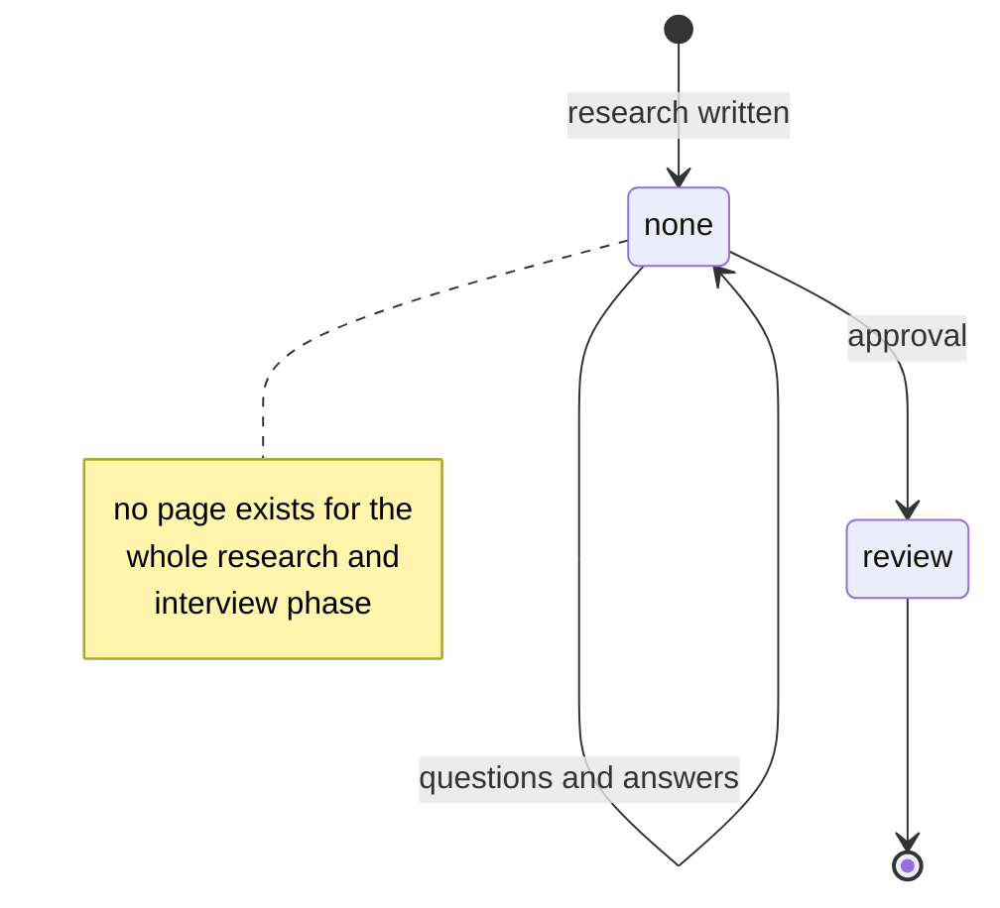

# The page shows the research, not the answers

> **Status:** in progress · decisions 1, 2 and 4 shipped; 3 outstanding
> **Updated:** 2026-07-27
> **Vocabulary:** CONTEXT.md · **Decisions:** —

> **Why part-shipped:** a live run kept linking the markdown to the user
> (`f11ab889`), because the skill still told it to. Decisions 1, 2 and 4 were
> implemented to stop that. **Decision 3 — dropping the markdown lede — is not
> done**: it rewrites every rule in `writing-specs`, and it is not what the
> defect was about.

## Lede

**After this ships:** _(not yet settled)_

**In scope:** _(not yet settled)_
**Out of scope:** _(not yet settled)_

**Decisions** — the ones a reader could reasonably disagree with:

| # | Decision | Chosen | Rejected because |
|---|---|---|---|
| 1 | How the format is chosen | By audience: HTML for humans, markdown for agents | By artifact type — it catches the wrong files |
| 2 | The spec | Has both, written differently | One document for two readers serves neither |
| 3 | The markdown lede | Dropped — flat, complete, anchored | Its cap was justified by human attention that has moved to the page |
| 4 | When the page re-renders | When it would otherwise be misleading | A fixed cadence is either wasteful or stale; neither tracks the reader |

**Open questions:** _(none parked yet)_

**Work:** _(after the decisions)_

**Next action:** answer question 1.

---

## Today

The workflow renders exactly one page, at approval, and it renders the **answers**.
The **research** — the part with diagrams in it — never gets a page, and the place
the user is told to read it instead cannot draw diagrams.

> Sibling spec: `specs/plans-declare-their-state.md` (proposed, not approved). It
> decides where these files live. This one decides what the page shows.

**Settled — the governing rule: the format follows the audience.**

| Audience | Format | Written for |
|---|---|---|
| **Human** | HTML | Being looked at — shape, colour, spatial layout, diagrams |
| **AI agent** | Markdown | Being located in — completeness, explicit structure, stable anchors |

A spec has **both**, and they are not the same document in two skins. The HTML is
the communication layer; the markdown is what an implementing agent reads, written
in whatever way serves an agent — which is not the same as serving a human.

This discriminates correctly where "HTML for output" would not: `/to-tickets`
writes markdown that **child agents** consume, so it is already right and stays
untouched. `/research` writes markdown for a **human** to read, so it is wrong.

**Write order does not change: markdown first, render second.** That rule was never
about which one the human reads — it is what stops an answer existing only in an
uncommitted file. It survives intact.

**Settled — the markdown lede goes away.** Its cap was justified by human attention,
and human attention has moved to the page. The markdown becomes flat, complete and
heavily anchored: fixed headings, deep links, every decision with its full
reasoning. Nothing is summarised, because nothing is skimming it.

That relocates the workflow's load-bearing split rather than removing it:

| Was | Becomes |
|---|---|
| Lede ≤ 40 lines, capped | *(gone)* |
| "Approve at the lede" | Approve at the page |
| Detail below the `---`, uncapped | The whole markdown file, uncapped |
| Link the spec file to the user | Never — the user is sent the page |

The three rules that die with it: the 40-line count, `
` for the long tail,
and "cap every list at 5". All three exist to keep a human reading; none of them
help an agent, and the last two actively hide content from one.

**Settled — one page, for the whole interview.** It appears once the initial research
is done and stays at one URL until approval. It carries everything needed while
planning: the research, the settled answers, what is still open.

**Re-render when the page would otherwise mislead — not on a cadence.** That is the
checkable form of "when it makes sense":

| An answer… | Re-render? |
|---|---|
| Contradicts something already drawn on the page | **Yes** — the page is now wrong |
| Changes scope, so parts of the research no longer apply | **Yes** — it is now wrong by omission |
| Fills a slot the page already shows as open | No — incomplete, not misleading |
| Adds detail under a heading already rendered | No |

The distinction is *wrong* versus *incomplete*. A page that is visibly missing
answers costs nothing; a page asserting something that has since been overturned
costs a decision. Fixed cadences fail both ways — every answer is wasteful, batch
boundaries leave a contradiction on screen until the batch ends.

**The page never carries the question being asked.** Questions are asked in chat and
answered in chat. Two things sound alike here and are not:

| | Where |
|---|---|
| **The current question** — what you are being asked this turn, with its ranked options | Chat only. Never rendered |
| **Open questions** — parked, nobody is being asked, they are part of the state | The page. They are what is *not* settled, which the reader needs to see |

Rendering the live question is what made the old board expensive: it forced a
re-render every single turn, because a question one turn stale is a page that is
actively wrong. Keeping questions off the page is what makes the mislead-only rule
above affordable — without it, every turn triggers a re-render by definition.

### The slice

Three skills own a page layer over one shared mechanic in `/html-report`.

| Layer | Renders | When | Lines |
|---|---|---|---|
| `html-report/SKILL.md` | The mechanics — path, preview URL, Write-tool rule, scaffold, style | — | 117 |
| `writing-specs/HTML-REPORT.md` | The lede: what we're building, scope, decisions, work graph | Approval only | 48 |
| `explaining-code/HTML-REPORT.md` | State slice, lifecycle, trace spine, delta chips, seam band | After the trace | 78 |
| `improve-codebase-architecture/HTML-REPORT.md` | Before/after architecture diagrams | End of review | 90 |

The two real artifacts from this task show the split cleanly:

| Page | Sections |
|---|---|
| `agent-harness-runtime-seam-board.html` | title · open questions · what we're building · scope · decisions · work |
| `message-delivery-explained.html` | title · vocabulary · **the state** · trace A · trace B · **who waits on whom** · where it bites |

**Everything in the first page is short text. Everything the second page adds is
shape.** The first fits in a chat message; the second does not.

### What the page can be, and is

`none` is not an accident — it was made the default one commit ago (`7ac64c3`),
because a board that re-rendered after **every answer** put several tool calls
between the user answering and the next question arriving. That reasoning holds
for answers. It was never tested against research, which is written once, before
any question is asked.

### The trace — what a user sees during an interview

Trigger: an agent runs `/writing-specs` and writes `## Today` before asking anything.

1. **`writing-specs/SKILL.md:27`** — `## Today` is written into the markdown:
   GFM tables, a `stateDiagram-v2`, a numbered trace with `file:line` anchors.
2. **`writing-specs/GRILLING.md`** — the agent links the section rather than
   pasting it, because it is far too big for a chat message. This is correct and
   it is the only option.
3. **`apps/frontend/src/features/files/components/file-viewer.tsx`** — the link
   carries `fileView=preview`; a markdown file is previewable, so it routes to
   the markdown renderer.
4. **`markdown-preview.tsx:3-4`** — `react-markdown` with `remark-gfm` and a
   syntax highlighter. **That is the entire pipeline.**
   → tables render · code renders · **`mermaid` renders as a syntax-highlighted
   code block, not a diagram**
5. **the interview runs** — answers land in the markdown. No page is rendered.
   → still `none`
6. **`writing-specs/HTML-REPORT.md:30`** — at approval the review page is built,
   and `/html-report` loads Mermaid from a CDN inside the iframe.
   → the first working diagram in the whole workflow appears **after** every
   decision has already been made
7. **outcome** — the reader made their decisions from a page that could not draw,
   and got a drawing once there was nothing left to decide.

### Where it bites

- **The one diagram that survives is the one nobody needed.** The Work graph
  renders at approval. The `stateDiagram-v2` in `## Today` — which exists to show
  the reader the shape they are about to make decisions about — never renders at all.
- **`## Today` is the largest thing in the file and the least readable.** In this
  task's own spec it is roughly 100 lines against a 40-line lede, and it is the part
  a reader is asked to check *first*.
- **The removal reason and the new need point in opposite directions.** Cheap to
  re-render is what research is; expensive to re-render is what answers were. A rule
  written against the second was applied to both.
