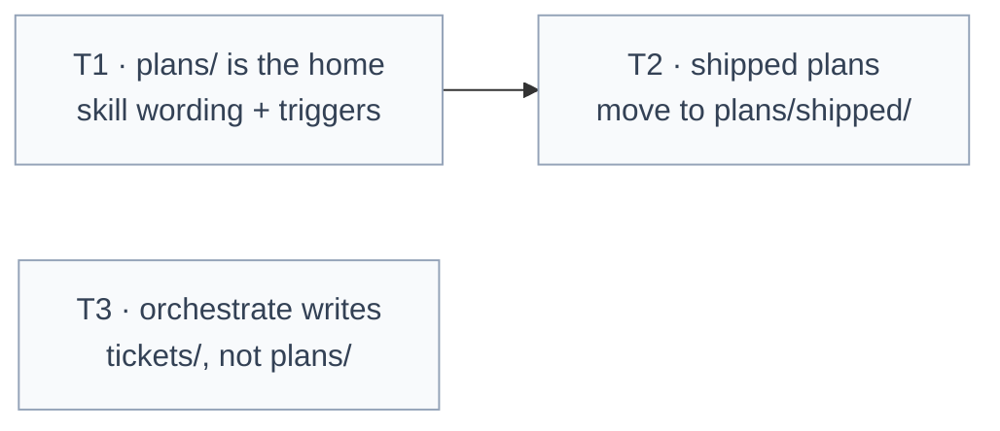
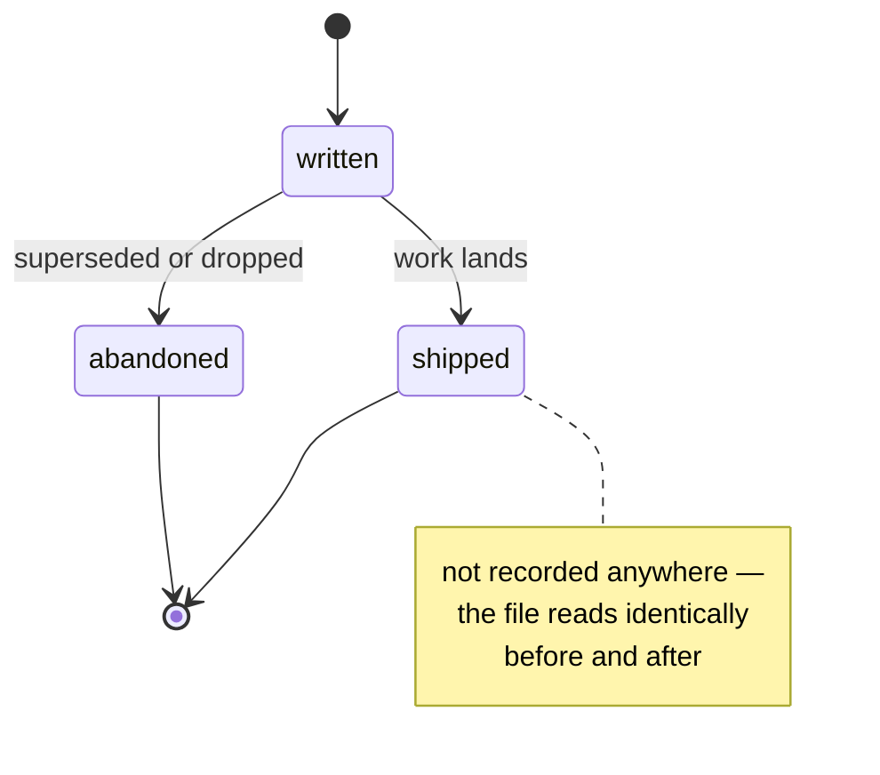

# New plans live in one directory and say when they ship

> **Status:** proposed
> **Updated:** 2026-07-26
> **Vocabulary:** CONTEXT.md · **Decisions:** —

## Lede

**After this ships:** anyone writing a plan puts it in one known place, and the
directory listing answers "what is still open" without opening a file.

**In scope:**
- New change proposals live in `plans/<slug>.md`
- A plan that ships moves to `plans/shipped/`
- `/orchestrate` writes its tickets to `tickets/`

**Out of scope:**
- `specs/` — untouched, keeps its scenario-chain meaning
- The 16 existing `docs/plans/` files — not read, moved or stamped
- Converting any existing document to the format

**Decisions** — the ones a reader could reasonably disagree with:

| # | Decision | Chosen | Rejected because |
|---|---|---|---|
| 1 | Where the skill writes | `plans/<slug>.md`, hardcoded | Detection is machinery for a variation that does not exist yet |
| 2 | Existing `docs/plans/` | Left alone entirely | Reading 16 files to stamp them costs more than the confusion does |
| 3 | A plan that ships | Moves to `plans/shipped/` | An index file is one more thing nobody updates |
| 4 | Orchestrate's output dir | Renamed to `tickets/` | Two artifacts called "plans" is the ambiguity this removes |

**Open questions:**
1. Mark `docs/plans/` historical in one line? Not blocking — the false status
   lines below stay false either way, and this is the cheap mitigation.

**Work:**

**Next action:** move this file to `plans/plans-declare-their-state.md`.

---

## Today

Three planning-document systems exist. The `/writing-specs` workflow knows about one
of them, and **no document in the repo currently conforms to it.**

> **Read this as evidence, not as a work list.** Migrating the existing documents is
> explicitly out of scope. What follows is why the going-forward rules are shaped the
> way they are — every rule below traces to a failure observed here.

### The slice

| System | Where | Count | Shape | Says its state? |
|---|---|---|---|---|
| **Scenario chains** | `specs/<domain>/NN-*.md` | 20 files, 8 domains | Fixed, documented in `specs/AGENTS.md` | Per-scenario IDs, tied to E2E tests |
| **Specs** | `specs/<slug>.md` | 2 files | `/writing-specs` format — **0 of 2 conform** | One says `ready-for-agent`, one says nothing |
| **Plans** | `docs/plans/*.md` | 16 files, 7,908 lines | None shared | 4 of 16 carry any status marker |

The three are neighbours in name only. `specs/AGENTS.md` documents the first,
`/writing-specs` defines the second, and the third has no owning document at all.

**Settled:** change proposals live in top-level `plans/`, and `specs/` is left
alone. The two artifacts stay in separate directories, so nothing has to be
renamed and the two lifecycles never share a status vocabulary.

**Consequence for the skill:** `/writing-specs` currently states that specs live
at `specs/<slug>.md`. For this repo that becomes `plans/<slug>.md`. The skill
ships in `plugins/moatless-skills/`, so the wording has to work for repos that
have no `specs/` at all.

### The states a plan is actually in

**`shipped` and `written` are indistinguishable from inside the file.** That is the
whole problem. The transition happens in the code, and nothing writes it back.

### What a reader does today

Trigger: someone asks "is the workspace concept still planned, or did we build it?"

1. **`docs/plans/workspace-concept.md:3`** — reads `**Status:** Research + proposed
   design (no code yet)`. Stops here if they trust it.
   → the file asserts **written**
2. **`backend/src/workspace/`** — `dao.rs`, `git_sync.rs`, `handlers.rs`. The feature exists.
3. **`CONTEXT.md:32`** — `Workspace` is a defined domain term with an `_Avoid_` list.
   A concept only reaches the glossary after it is real.
   → actual state: **shipped**
4. **outcome** — the status line is not merely stale, it is **false**, and the reader
   who trusted it at hop 1 now believes the opposite of the truth.

This is not one bad file. Spot-checking five of the sixteen against the code:

| Plan | Says | Actually |
|---|---|---|
| `workspace-concept.md` | "no code yet" | **shipped** — `backend/src/workspace/`, in `CONTEXT.md` |
| `rust-claude-agent-sdk.md` | nothing | **shipped** — `crates/claude-agent-sdk` |
| `rename-repository-to-dao.md` | nothing | **shipped** — `backend/src/*/dao.rs` |
| `backend-crate-split.md` | nothing | **shipped** — `crates/backend-core` and 8 siblings |
| `secret-handling.md` | nothing | **shipped** — `backend/src/secret/`, 3 migrations |

Five of five checked were done. One actively denies it; four are silent. The base
rate matters: a reader who opens any plan file has no reason to expect it describes
future work, and no cheap way to find out.

### The vocabulary, as it stands

`CONTEXT.md` defines **none** of: spec, plan, proposal, ticket, scenario.

What the repo does instead:

| Signal | Says |
|---|---|
| `specs/AGENTS.md:1` | "Spec Authoring Guide" |
| `specs/AGENTS.md:3` | "This **directory** contains testable specifications … map directly to automated E2E tests" |
| Title prefixes across the 18 files | 8 × `# Plan:`, 1 × `# Proposal:`, 1 × `# Spec:`, 8 × no prefix |

So the word **spec** is already claimed, and claimed for the whole directory, by a
format that means "behaviour tied to an E2E test".

**Resolved by separation, not by naming.** Change proposals go to `plans/`, so
`specs/AGENTS.md` keeps its current meaning and no term needs redefining. The two
artifacts have opposite lifecycles — a scenario chain that reads "shipped" is
meaningless, a change proposal that stays true forever never happened — and
keeping them in separate directories is what stops them sharing a status
vocabulary.

### Where it bites

- **The format has no users.** `/writing-specs` shipped to main, and the two files in
  `specs/` predate it. Nothing in the repo demonstrates the shape, so the first
  person to follow the skill has no worked example to check themselves against.
- **`docs/plans/` averages 494 lines per file.** These are exactly the documents the
  capped lede exists for, and they are the ones the workflow does not reach.
- **Nothing lists what is open.** There is no index over either directory, so
  "what are we planning" is answered by reading sixteen file names and guessing.

  **Settled:** shipped plans move to `plans/shipped/`, so the top-level listing
  *is* the answer to "what is open". The directory does the index's job, which
  removes the one artifact nobody would have kept up to date.
