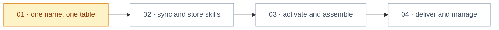

# Turn a plugin on for everyone, or just for yourself

> **Status:** in progress (0/4 tickets)
> **Updated:** 2026-07-26
> **Vocabulary:** CONTEXT.md · **Decisions:** ADR-NNNN

## Lede

**After this ships:** An admin turns a plugin, or one skill inside it, on for everyone — and any user turns one on, or off, for their own tasks.

**In scope:**
- One word, "plugin", everywhere
- Plugins synced centrally, their skills stored
- Always-on set globally, adjusted per user
- Per-repository plugin links removed
- Admin plugin pages on real data

**Out of scope:**
- Pinning a plugin version per repository
- Plugin sources that are not git
- Authoring or editing plugins in the UI

**Decisions** — the ones a reader could reasonably disagree with:

| # | Decision | Chosen | Rejected because |
|---|---|---|---|
| [1](#1-how-plugin-content-is-fetched) | How plugin content is fetched | Centrally, on demand, behind a version check | Fetching from a sandbox cannot reach a private global plugin |
| [2](#2-what-picking-a-skill-delivers) | What picking a skill delivers | The plugin minus its unpicked skills | Whole-plugin loading puts skills nobody picked in every prompt |
| [3](#3-where-always-on-lives) | Where always-on lives | One activation record: everyone, or one person | A visibility axis nobody asked for, a repository level nobody used |
| [4](#4-what-a-user-may-override) | What a user may override | Their own record wins, global is a default | Mandatory globals leave no escape from a noisy plugin |
| [5](#5-who-may-register-a-plugin) | Who may register a plugin | Admins only, unchanged | Self-service points the platform credential at any repository |
| [6](#6-the-rename-cutover) | The rename cutover | One release, no compatibility aliases | A deprecation window for consumers that all live in this repo |

**Open questions:** 1. A skill that reads a file belonging to an unpicked skill breaks, and nothing declares that dependency. _Not blocking._

**Work:**

**Next action:** run ticket 01 — rename the module and drop the repository link.

---

## Problem

Two problems with one cause.

**The same thing has three names.** The backend calls it a plugin repo. The frontend calls it a
marketplace. The command line calls it a plugin. Someone who registers a plugin from the command
line and then opens the admin section to check on it finds a page titled Marketplaces showing
nothing at all — because that page was never connected to anything. Every conversation about
plugins starts by establishing which word is meant.

**A plugin can only reach one repository at a time.** Someone who has built a set of skills that
every task should use has to attach them to each repository by hand, and to remember to do it again
for every repository created afterwards. Someone who wants a plugin in their own work has no way to
ask for it without editing a repository that other people share.

The cause of the second problem is that a skill does not exist as far as the platform is concerned.
It is read out of git whenever somebody asks for the list, held for a few minutes, and forgotten.
There is nothing durable to attach a setting to, so a setting cannot be offered.

## Solution

Four moves, in order. Each is a ticket.

1. **One word.** Plugin — in the stored data, the API, the command line and the UI. The
   repository-level link goes away in the same move, along with a second, never-completed delivery
   mechanism that is where the word "marketplace" came from.
2. **Skills become records.** One sync routine fetches a plugin's content centrally, reads the
   skills out of it, and stores them. It asks the source for its current version before spending a
   fetch, so the common case costs one cheap call.
3. **Activation replaces linking.** A plugin or a skill is turned on for everyone, or for one
   person. A person's own setting wins over the global one, which makes both "give this to
   everybody" and "not for me, thanks" the same mechanism read two ways.
4. **Delivery becomes assembly.** What a sandbox receives is built to order: the plugin with the
   skills nobody picked left out.

## Decisions

### 1. How plugin content is fetched

**Chosen:** centrally, on demand, behind a version check. One routine, shared by the sandbox
provisioning path and the admin listing path, asks the source what version it is at now; if that
matches the stored snapshot, nothing is fetched. If it differs, the content is fetched with the
platform's own credential, stored, and the skills re-read from it. Concurrent callers collapse into
one fetch. A fetch that fails leaves the previous snapshot in place rather than emptying the plugin.

**Rejected — fetching from inside the sandbox**, which is what happens today. The sandbox clones
using the task's git credential and the skill listing reads using the requesting person's
credential. Both are the wrong authority for a plugin an administrator turned on for everyone: a
plugin held in a private repository is invisible to anybody whose credential does not reach it, and
that is precisely the plugin an organisation is most likely to want everywhere. Fetching centrally
is what makes global reach mean anything.

**Rejected — a background refresh loop on a timer.** It bounds staleness without anybody asking,
and it costs a scheduled job, a leader guard, and a decision about how often. On demand behind a
version check gets the same freshness where it is observed, at the cost of one cheap call.

**Rejected — refreshing when the source announces a change.** Freshest and cheapest at rest, but
plugin sources are frequently owned by other people, and there is no way to register for those
announcements. It would work for some plugins and silently not for others, which is worse than a
rule that works the same everywhere.

### 2. What picking a skill delivers

**Chosen:** the plugin with its unpicked skills left out. Everything that is not a skill — the
manifest, commands, hooks, agents — is kept, so the only thing that can break is a skill reading a
file that belongs to another skill.

The reason a decision is needed at all: one agent harness loads a plugin as a directory and gets
every skill in it, while the other is handed skills one directory at a time. So "always use this
one skill" has no single obvious meaning, and the two harnesses disagree about what is even
loadable.

**Rejected — shipping the whole plugin whenever any of its skills is picked.** Simplest to build,
and it makes a skill setting almost indistinguishable from a plugin setting: pick one skill from a
plugin holding ten and you get ten. Skills are not free once loaded — each one contributes its name
and description to every prompt — so this quietly spends context on skills nobody asked for, and
gives the person who picked carefully no benefit over the person who picked everything.

**Rejected — offering no skill-level setting.** Half the ask.

The residual risk is recorded as the one open question below.

### 3. Where always-on lives

**Chosen:** every plugin stays visible to everyone, and one activation record says where a plugin or
a skill is turned on — for everyone, or for one person.

**Rejected — a visibility axis alongside activation.** Modelling "who may see this" separately from
"who gets this automatically" is the more general design, and generality is the problem: nothing in
the ask needs a plugin that some people cannot see, and the existing access policy would have to
grow a meaning it does not have today. Every plugin registered so far is visible to everyone, which
is the status quo, and keeping it costs nothing.

**Rejected — keeping the repository level.** It is the only reach a plugin has today, so removing it
is the largest deletion in this change. It goes because the two new levels cover what it was used
for and cover it better: what people actually wanted from attaching a plugin to a repository was
either "everyone working here should have this" — now global — or "I want this in my work" — now
personal. What it costs in exchange is per-repository specificity, which nobody asked to keep.

### 4. What a user may override

**Chosen:** a person's own record wins; the global one is the default. Turning something on globally
makes it the starting position for everyone, and anyone may set it aside for themselves.

**Rejected — global as mandatory**, with the personal setting only able to add things global did not
give. This is what the original request described. It guarantees that a plugin an administrator
turned on is genuinely present everywhere, which matters if a plugin ever encodes policy rather than
convenience. It was set aside because nothing turns a plugin into policy today, and the cost of
being wrong the other way is a person stuck with a plugin they cannot escape.

**Rejected — two kinds of global, enforced and default-on.** This is the correct answer if plugins
ever carry policy, and it stays available: it is one more state on the global record, added when
there is something to enforce. Adding it now would be building for a case that does not exist.

### 5. Who may register a plugin

**Chosen:** administrators only, exactly as today. Everyone else picks from what has been
registered.

The existing code already gives the reason — a plugin is loadable code whose hooks and commands run
inside sandboxes, so admitting one is a platform-wide trust decision. Decision 1 sharpened it:
content is now fetched using the platform's own credential rather than the requesting person's, so
whoever may name a source may aim that credential at a repository and read the result back.

**Rejected — anyone may register, fetched with their own credential.** Removes the escalation, since
such a fetch can only reach what that person could already reach, and it answers a real need: a
personal collection of skills currently requires asking an administrator. It costs two fetch paths
that behave differently and go stale differently, and the personal plugin breaks quietly when that
person's credential expires or they leave. Worth revisiting once anyone asks for it.

**Rejected — anyone may register, fetched with the platform credential.** This turns registration
into a way to read any repository the platform can see.

### 6. The rename cutover

**Chosen:** one release, no compatibility aliases. The stored name, the API surface, the command
line and the UI all move together.

Most of the old surface is being removed rather than renamed — the repository link, the
never-completed second delivery mechanism, and the identifier format that carried the word
marketplace — so the compatible-for-one-release option would be preserving routes that are being
deleted regardless.

**Rejected — a deprecation window.** Every consumer of this API lives in this repository and is
released from it in one tag. A window buys compatibility for a command-line binary older than the
release, at the cost of a release carrying two route sets and a follow-up change to take one away.

**Rejected — renaming the code but not the stored data.** No migration risk, and the stored names
would then contradict the code, which is the exact split this change exists to close.

One piece of the word marketplace stays: a plugin repository may declare where its plugins live in a
file of that name, which both the backend and the sandbox read. That file format belongs to the
agent harness, not to this platform, and renaming our handling of it would only obscure what it is.

## Behaviour

### As an administrator

| I want to | So that |
|---|---|
| Register a plugin by naming its source | Its skills become available to be turned on |
| See every skill a plugin contains | I know what turning it on gives people |
| Turn a plugin on for everyone | Nobody has to discover and enable it themselves |
| Turn a single skill on for everyone | People get the one skill without the rest of its plugin |
| Turn a global setting off again | A plugin that turned out to be noisy stops reaching people |
| Remove a plugin | It stops being offered, and stops being delivered |

* **Given** a plugin has been registered and not turned on anywhere
* **When** an administrator turns it on for everyone
* **Then** every task started afterwards receives it
  * **And** people who had already turned it on for themselves see no change

* **Given** a plugin is registered whose source is private to the organisation
* **When** an administrator turns it on for everyone
* **Then** it reaches people whose own credentials cannot read that source

### As a person using the platform

| I want to | So that |
|---|---|
| Browse every registered plugin and its skills | I can find what exists without asking |
| Turn a plugin on for my own tasks | I get it everywhere I work, without changing shared settings |
| Turn a single skill on for my own tasks | I get the one skill I want and not its siblings |
| Turn off something turned on for everyone | A plugin that gets in my way stops arriving |
| See why something is turned on | I can tell my own choice from the default |

* **Given** a skill is turned on for everyone
* **When** a person turns that same skill off for themselves
* **Then** their own tasks stop receiving it
  * **And** everybody else is unaffected

* **Given** a person has turned a plugin on for themselves
* **When** an administrator later turns the same plugin on for everyone
* **Then** the person's tasks continue to receive it, and nothing appears to change

### As the system starting a task

* **Given** a task is starting and its owner has settings resolving to two plugins and one skill
* **When** the sandbox is prepared
* **Then** it receives both plugins, and a third containing only the picked skill
  * **And** the other skills of that third plugin are absent
  * **And** the plugin's commands, hooks and manifest are present

* **Given** a plugin's stored snapshot is older than its source
* **When** a task needs that plugin
* **Then** the newer content is fetched and stored before the sandbox is prepared

* **Given** two tasks needing the same out-of-date plugin start at the same moment
* **When** both reach the point of needing it
* **Then** the content is fetched once and both receive the same version

* **Given** a plugin's source cannot be reached
* **When** a task needs that plugin
* **Then** the task starts with the last content that was successfully stored

## Seams and testing

The **sync routine is the seam that carries this change.** It is one module with two callers — task
provisioning and the admin listing path — and everything expensive sits behind it: the version
probe, the fetch, the snapshot write, the skill upsert. Testing it needs a fake source, and the
existing `SkillFetcher` trait in `backend/src/skill/fetcher.rs` is already exactly that shape, with
a fake used by the current skill tests. Extend it rather than introducing a second abstraction.

**Bundle assembly is a pure function** — snapshot plus a list of picked skill names, out comes a
directory listing. No database, no network, no filesystem if the snapshot is addressed by content.
Test it directly; this is the highest-leverage test in the change and the cheapest.

**Activation resolution is also pure** — global records plus personal records for one person, out
comes the effective set. The two rules worth pinning are that a personal record beats a global one
in both directions, and that a removed plugin disappears from the result regardless of records
pointing at it.

Depth is what to watch: the sync routine should present a narrow interface — *give me this plugin at
its current version* — over a wide amount of machinery. Resist letting callers reach past it for the
snapshot, the probe or the parser separately, because that is what would make the two callers drift.

Prior art for the integration tier is `crates/integration-tests/tests/plugin_repos_e2e.rs`; it is
being rewritten rather than extended, since the endpoints it exercises are going away. The Playwright
chain in `tests/api/chains/plugin-repos-e2e.spec.ts` is in the same position. Both should come back
covering registration, global activation, personal override, and delivery.

The existing scope policy in `crates/backend-core/src/scope.rs` is **not** being reused here —
decision 3 keeps plugins visible to everyone, so there is no access filtering to apply. Administrator
checks stay where they are, in the handlers.

## Out of scope

- **Pinning a plugin version per repository.** Everyone gets the current version of a plugin. Adding
  a pin means a version resolution step in provisioning and a place to record the pin, and nobody has
  asked to hold a plugin back.
- **Plugin sources that are not git.** A registry, an archive URL, a local path. Git covers every
  registered plugin.
- **Authoring or editing plugins in the UI.** Plugins are edited where they live.
- **Enable and disable of individual skills inside a plugin that is already turned on.** Picking a
  skill turns it on; there is no separate mute.
- **Enforced globals that a person cannot override.** Available later as one extra state on the
  global record — see decision 4.

## Open questions

1. **A skill that reads a file belonging to a skill left out of the bundle breaks, and nothing
   declares that dependency.** Bundle assembly cannot know that one skill reaches sideways into
   another. Options: accept it and let the failure surface when the skill runs; scan skill bodies at
   sync time for paths pointing outside their own directory and warn whoever registered the plugin;
   or treat any such reference as making the plugin unsplittable, so picking one of its skills
   delivers all of them. _Not blocking — the first is the current behaviour of the design, and either
   of the others can be added without changing anything stored._

## Ticket breakdown

Four vertical slices. Each is sized to one context window and declares what blocks it.

### 01 · One name, one table

**Blocked by:** nothing.

Rename the stored plugin data, the module, the API surface, the shared schema types, the generated
clients, the command-line verbs and the admin pages so that everything says plugin. In the same
change, remove the never-completed second delivery mechanism — the identifier format carrying the
word marketplace, the shell script that fetched against endpoints that were never built, and the two
configuration fields feeding it. Nothing reads that mechanism today, so removing it changes no
behaviour.

The repository-level link **stays** through this ticket. It is the only way a plugin currently
reaches a sandbox, and removing it before activation-based delivery exists would leave two tickets
during which no plugin reaches anything. It is renamed along with everything else and removed in
ticket 04, at the moment its replacement lands.

The handling of the agent harness's own `marketplace.json` is untouched. Three files parse that
format and keep the word: `backend/src/skill/fetcher.rs`, `sandbox/src/init/plugin_skills.rs` and
`sandbox/src/agent/options.rs`.

*Done when:* nothing outside those three files says marketplace or plugin repo, plugin registration,
listing, linking and delivery all still work end to end, `CONTEXT.md` carries the settled vocabulary,
and the checks in `CLAUDE.md` pass for every crate and the frontend.

### 02 · Sync and store skills

**Blocked by:** 01.

One sync routine: probe the source for its current version, compare against what is stored, fetch
and store a snapshot when they differ, read the skills out of the snapshot and store them. Concurrent
callers collapse into one fetch; a failed fetch leaves the previous snapshot in place. Fetching uses
the platform credential. The admin listing path and the task provisioning path both call this and
nothing else.

Skill listing stops reading from git on request and starts reading stored records.

*Done when:* a registered plugin's skills survive a restart, a second call at an unchanged version
performs no fetch, and two simultaneous callers at a changed version perform exactly one.

### 03 · Activate and assemble

**Blocked by:** 02.

Activation records covering a plugin or a skill, at global or personal reach, with the endpoints to
set and clear them. Administrator rights required for global, one's own identity for personal.
Resolution: personal wins over global, in both directions. Bundle assembly as a pure function from a
snapshot plus picked skill names to a directory listing — the plugin minus its unpicked skills.

*Done when:* resolution and assembly are covered by direct tests, including a personal record
switching a global one off, and a global record arriving after a personal one changing nothing.

### 04 · Deliver and manage

**Blocked by:** 03.

Task provisioning resolves the owner's effective set, syncs each plugin, assembles each bundle and
hands them to the sandbox, which loads them instead of cloning. The repository-level link is removed
here — its replacement is now live — along with every endpoint and command-line verb reaching it. The
admin plugin pages list registered plugins and their skills, and turn them on and off at either
reach, against the real endpoints. Integration and browser coverage returns for registration, global
activation, personal override and delivery.

*Done when:* a plugin turned on globally arrives in a new task's sandbox, a personal override keeps
it out of that person's next task, and a picked skill arrives without its siblings.
