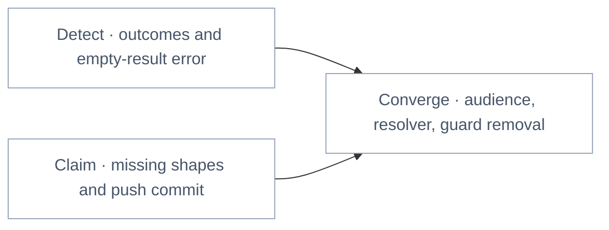
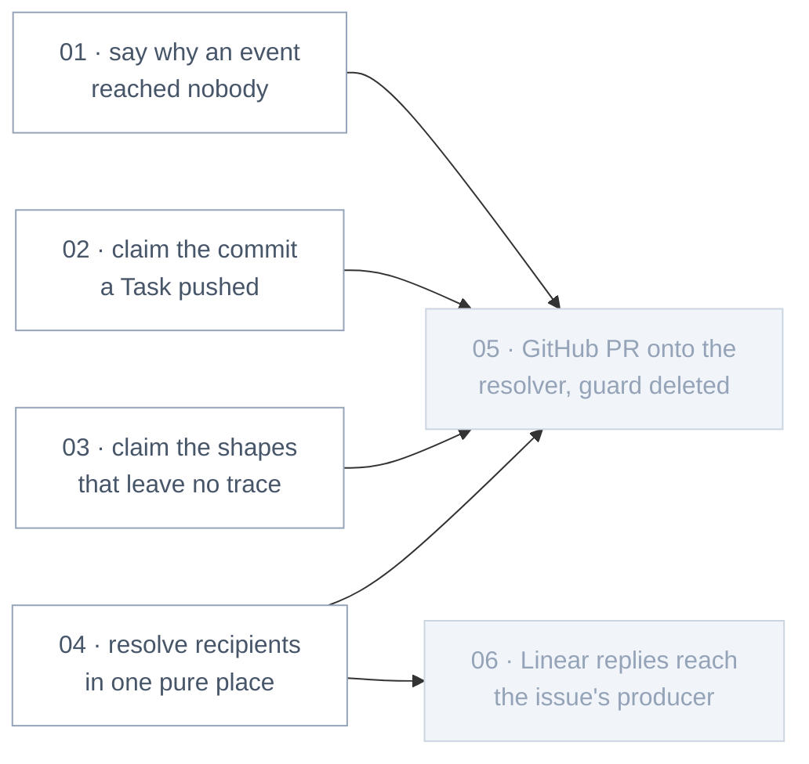

# Every PR event reaches a Task, or says why not

> **Status:** approved
> **Updated:** 2026-07-28
> **Vocabulary:** CONTEXT.md

## Current solution

The GitHub PR Adapter does not share the routing path every other Adapter uses.
It has its own delivery loop, its own self-echo policy, and no inbound metric.
An event it decides to deliver to nobody produces no metric, no warning, and no
error.

### The two routers

Slack, Telegram, Linear and Webhook route through `bindings/runtime.rs:134`.
GitHub PR routes through `adapters/github_pr/runtime.rs:125`. They differ in
three ways that matter here.

| Behaviour | Shared router | GitHub PR router |
|---|---|---|
| Metric on a passed-over Binding | `record_inbound` with a reason, `bindings/runtime.rs:297` | none — a `debug!` and a `continue` |
| Result when nobody was delivered to | an error, `bindings/runtime.rs:361` | a bare `Ok(())`, `github_pr/runtime.rs:475` |
| Self-echo policy | one rule — a configured filter identity on the Binding, `bindings/runtime.rs:558` | a four-rung ladder, any rung can veto, `github_pr/runtime.rs:267-334` |
| Test of the composition | none | none — only the rungs, in isolation |

The inbound metric is declared in `bindings/metrics.rs:6` and emitted only from
the shared router. The GitHub PR fan-out never touches it, for any outcome.

The one metric that does fire on the GitHub PR path is at
`github_pr/handlers.rs:42`, recorded when the webhook is admitted as Adapter
work. It means the delivery was accepted, not that a Task received anything. An
event delivered to nobody is recorded there as a success.

### How one review comment was lost

An inline review comment was posted on a pull request that a Task had opened.
The Task never received it. Seven hops, each verified against the running
system.

1. `github_pr/handlers.rs:42` — the webhook is admitted and metered as a
   success. This means accepted, not delivered.
2. `github_pr/adapter.rs:998` — the event is parsed into an inbound message.
   The authoring Task is recovered from the footer link in the comment body
   (`github_pr/adapter.rs:1032`). The comment carried no footer, so this is
   empty.
3. `github_pr/runtime.rs:159` — the router falls back to looking the event
   identifier up among recorded messages. The comment was posted through a raw
   shell call that recorded nothing, so this is empty too.
4. `github_pr/runtime.rs:270` — rung 1, the originating Task. Nothing resolved,
   so no Binding is skipped here.
5. `github_pr/runtime.rs:281` — rung 2, responder thread-scoping. It applies
   only to the reviewer's Binding and skips it, correctly: the comment starts a
   thread rather than replying within one.
6. `github_pr/runtime.rs:303` — rung 3, owner identity. The comment's GitHub
   sender resolves through `github_pr/adapter.rs:1415` to the same person who
   owns the Task that opened the pull request. The Binding is skipped.
7. The loop ends with an empty recipient set and returns `Ok(())`. Nothing is
   metered, logged above debug level, or surfaced.

The reviewer's own Binding was skipped by rung 2 and the pull request author's
by rung 3, so the review reached no Task at all.

The condition rung 3 tested was that the sender's identity equals the Task
owner's identity. It is a property of *who posted*, not of *what posted it*. It
holds whenever a Loop posts under an identity that resolves to the same person
who owns the Task being reviewed, which is the normal arrangement for any repo
whose Tasks and reviewer Loop belong to one person.

### Five echo guards, four exact and one a guess

| Guard | Keyed on | Precision | Where |
|---|---|---|---|
| 1 · Originating Task | Task identifier, from footer or recorded event identifier | exact, Task-scoped | `github_pr/runtime.rs:159, 270` |
| 2 · Responder thread-scoping | the event being replied to | exact, by design | `github_pr/runtime.rs:240-265, 281` |
| 3 · Owner identity | sender's user equals the Task owner | a guess, user-scoped | `github_pr/runtime.rs:303-319` |
| 4 · Event receipt | event identifier plus Binding | exact, redelivery only | `github_pr/runtime.rs:449-470` |
| 5 · Recently-sent cache | Task identifier plus event identifier | exact, Task-scoped | `bindings/recently_sent.rs:34`, read at `message/send.rs:79` |

Guard 3 was added on 2026-06-01 in `ecea6ad7`, before guards 1 and 5 existed. It
carries six unit tests at `github_pr/runtime.rs:1149-1198` that assert exactly
the behaviour which dropped the review. The predicate is correct and covered.
The policy it encodes is what is wrong, and no test looks at the policy.

Guard 3 has already been worked around once. Merge-conflict notifications
bypass the router entirely and call delivery directly. The comment at
`github_pr/runtime.rs:487` states why: *"precisely so the synthetic alert
bypasses the owner self-echo filter"*. The bypass is
`record_merge_state_and_notify` at `github_pr/runtime.rs:494`.

A narrower exemption exists for build results, `github_pr/runtime.rs:1061`,
added on 2026-07-17 for the same reason: a build failure whose sender is the
person who pushed was being dropped for the very Task that needed it.

### A Task's role is the direction the tie was formed

A Binding records which way round the Task and the external subject met. Both
directions exist, and one subject can carry Bindings of each. The two role
values are shared vocabulary, declared once at `adapters/models.rs:11-12` and
assigned by the shared router.

| Role | Direction | Formed when | Assigned at |
|---|---|---|---|
| Producer | Task to subject | The Task existed first and reached out — opened the pull request, sent to the issue, replied into a new thread | `adapters/handlers.rs:204, 322` · `bindings/outbound.rs:113` · `bindings/runtime.rs:188` · `loops/firing/listen.rs:168` |
| Responder | subject to Task | The subject existed first and a Loop spawned a Task from it — a pull request opened, an issue entered its start state | `bindings/runtime.rs:213, 262` |

Two roles, but not two origin values. Linear writes a third string of its own
when a Task files an issue or posts into one (`linear/api_routes.rs:872`), and
it is not one of the two declared constants. It is a producer by direction, so
any rule that recognises a producer by matching the producer constant misses
every Linear producer. The role must be read as *not* the responder direction —
the one origin the router writes from an inbound event — which is how
`bindings/handlers.rs` already reads it.

A parent's author is neither. It is not a role but a fact about one event:
whichever Task wrote the comment being replied to. It is usually a responder,
because responders are what start threads. A reviewer opens a review thread, so
a reply to it names the reviewer's Task and not the Task that opened the pull
request. Producer and parent's author coincide only when a Task replies inside a
thread it started itself.

### The same three policies are already written twice

The GitHub PR Adapter is not the only one deciding which Bindings receive an
event. Linear answers the same three questions independently, in its own module,
with its own tests — and on the middle one it answers differently.

| Policy | GitHub PR | Linear | Agree? |
|---|---|---|---|
| Skip the Task that authored the event, found by footer | `github_pr/runtime.rs:159, 270` | `linear/agent_runtime.rs:344, 370` | yes |
| A threaded reply belongs to the Task that authored its parent | `github_pr/runtime.rs:240-265, 281` — the producer always keeps it, only responders are scoped | `linear/agent_runtime.rs:447-460, 481` — the parent's Task takes it exclusively, everyone else loses it | no |
| Eligibility by the Task's role on the subject | `github_pr/runtime.rs:1085` | `linear/agent_runtime.rs:1076` | yes |

Both implementations call the same shared service to resolve a parent event to
its authoring Task. The resolver that maps role to eligibility already exists as
a pure function at `github_pr/runtime.rs:1085`; it simply lives inside one
Adapter and takes a role as a string.

Linear's exclusive rule at `linear/agent_runtime.rs:481` means a threaded reply
on an issue reaches the parent comment's author and nobody else. Where a Task
produced the issue, that Task hears nothing about a discussion on its own work.

### Provenance coverage — every way a Task can produce a PR event

A self-reply can be recognised precisely by three signals: a footer naming the
Task, a claim the Task recorded when it acted, or an event identifier already
recorded against a Task. Seven paths carry at least one. Five carry none.

| Path | Footer | Claim | Recorded identifier |
|---|---|---|---|
| Backend-proxied pull request open | yes | yes, `api_routes.rs:125` | yes |
| Backend-proxied pull request or issue comment | yes, `api_routes.rs:381` | yes, `api_routes.rs:185` | yes |
| Backend-proxied threaded reply | yes | yes, `api_routes.rs:259` | yes |
| Binding reply from the agent | yes | yes, `bindings/outbound.rs:342` | yes |
| Shell pull request open | appended afterwards, `shell_reconcile.rs:152` | yes, `shell_reconcile.rs:122` | yes |
| Shell pull request or issue comment | no | yes, `shell_reconcile.rs:247` | yes |
| Shell push | not applicable | yes, `shell_reconcile.rs:406` | yes |
| Raw API call — new inline review comment | no | no | no |
| Raw API call — review submission | no | no | no |
| Raw API call — issue comment | no | no | no |
| Direct HTTP from the sandbox | no | no | no |
| Provider tool call that never reaches a shell | no | no | no |

The reviewer Loop's own prompt instructs agents to post inline comments through
the first uncovered path, so the gap is the normal path rather than an edge
case.

### Why the coverage list cannot simply be finished

Claims are produced by matching the text of a shell command against a fixed set
of shapes. The matcher is `matches_gh_subcommand` at `shell_reconcile.rs:619`,
driven by the four detectors at `shell_reconcile.rs:547-575`. It recognises a
two-word subcommand form, tolerating a proxy prefix, environment assignments,
preceding chained commands and repository flags.

It cannot recognise a raw API call, a direct HTTP request, or a provider tool
call that never reaches a shell at all. Adding shapes closes the known holes; it
does not make the list closed.

### The push claim is the one claim that is predicted, not read back

Every other claim reads the identifier out of the mutation's own response. A
push returns none, so `handle_git_push` at `shell_reconcile.rs:289`
reconstructs one: parse the push output for repository and branch, find a
Binding carrying a pull request number, ask GitHub for that pull request's
current head, and claim the identifier that pair implies.

| Step | If it fails | State |
|---|---|---|
| Push output names a GitHub repository and branch | no claim | sound — force-push and rejected-push forms both covered, `shell_reconcile.rs:1088, 1107` |
| Head commit | not applicable | sound — read from the API, never parsed |
| A Binding for that repository exists | silent skip | fragile |
| That Binding carries a pull request number | silent skip | fragile — absent until the pull-request-opened event lands |
| A repository-scoped credential resolves | silent skip | fragile |
| The pull request fetch succeeds | silent skip | fragile |
| The fetched head is the commit just pushed | claims the wrong identifier | read-after-write race |
| The claim lands before the webhook | claim arrives too late | race, widened by the extra round-trip |

Four branches end in a silent `return` and two are races. Guard 3 has been
masking all six, because the person who pushes is usually the person who owns
the Task.

The push output already carries the pushed commit on its range line, in both the
fast-forward and forced forms — the fixtures at `shell_reconcile.rs:1057` and
`shell_reconcile.rs:1088` show both. `parse_git_push` at
`shell_reconcile.rs:481` reads the branch off that same line and discards the
commit.

### What is dead or bypassed

- `record_merge_state_and_notify`, `github_pr/runtime.rs:494`, exists in its
  current form only to route around guard 3.
- The build-result exemption at `github_pr/runtime.rs:1061` exists only to
  route around guard 3.
- The shared router's provider-agnosticism is guarded by a source-text test at
  `bindings/runtime.rs:566`. There is no guard in the other direction — nothing
  stops an Adapter forking the delivery loop, which is how the divergence above
  arose.

## Planned solution

### Problem

**As a person who opened a pull request from a Task**, the review of my work
never arrives. The reviewer posts its findings, and my Task sits idle as though
nothing happened. Nothing on the pull request, in the Task, or in any log says a
delivery was attempted and abandoned. I find out only by reading the pull
request myself and asking why the Task did not react.

**As an operator**, I cannot tell this is happening. The only metric on the path
records the webhook as successfully processed, which it was — it was accepted,
parsed, routed, and dropped. There is no counter, no error and no event
distinguishing "delivered to three Tasks" from "delivered to none". A silent
loss looks exactly like a quiet day.

**As a maintainer**, the rules that decide who receives an event exist twice,
once per Adapter, and disagree with each other on threaded replies. A fix
applied to one does not reach the other. The predicates on both sides are
individually correct and individually tested; nothing tests what they compose
into, which is where the fault was.

### Behaviour

#### For a Task that produced a subject

- **Given** a Task opened a pull request, **when** anyone reviews it, **then**
  the Task receives the review, whatever identity the reviewer posted under.
- **Given** a Task opened a pull request and a responder Task started a review
  thread on it, **when** anyone replies inside that thread, **then** both the
  producing Task and the responder receive the reply.
- **Given** a Task opened a pull request, **when** that Task posts a comment on
  it by any means the system can recognise, **then** the Task does not receive
  its own comment back.
- **Given** a Task pushed to its pull request's branch, **when** the push
  notification arrives, **then** the Task does not receive its own push back,
  and this holds for a forced push as well as a fast-forward one.
- **Given** a Task pushed to a branch that has no pull request, **when** the
  push completes, **then** nothing is claimed and nothing is delivered, because
  no notification is produced.
- **Given** a Task's pull request has a build result or a merge conflict,
  **when** the notification arrives, **then** the producing Task receives it
  through the ordinary delivery path rather than a bypass.

#### For a Task a Loop spawned to respond

- **Given** a responder Task started a review thread, **when** someone replies
  in that thread, **then** the responder receives the reply.
- **Given** a responder Task is bound to a subject, **when** a thread it did not
  start receives a reply, **then** the responder does not receive it.
- **Given** a responder Task posted a review, **when** the review echoes back
  through the provider, **then** the responder does not receive its own review.
- **Given** a subject has a responder Task but no producing Task, **when** a
  build result or merge conflict arrives, **then** the responder receives it as
  the fallback recipient.

#### For a Task bound to a Linear issue

- **Given** a Task produced a Linear issue and a responder Task is working it,
  **when** someone replies to a comment the responder wrote, **then** both Tasks
  receive the reply. Today only the responder does.
- **Given** a Task is bound to a Linear issue, **when** an ordinary issue-level
  comment arrives that replies to nothing, **then** every Task bound to the
  issue receives it, as today.
- **Given** a Linear issue has a responder Task but no producer, **when**
  someone replies to a comment no Task wrote, **then** every Task bound to the
  issue receives it, as today — the fallback applies because neither a parent's
  author nor a producer resolves.

#### For a Task bound through Slack, Telegram or Webhook

- **Given** any of these Adapters delivers an event, **when** it is routed,
  **then** the set of Tasks that receive it is exactly the set that receives it
  today. Their events state an audience of everyone on the subject, which is
  what these Adapters already do.

#### For an operator

- **Given** an event is routed, **when** a Binding is passed over, **then** the
  reason it was passed over is recorded against the Adapter, the Loop and the
  connection.
- **Given** an event is routed to a subject that has active Bindings, **when**
  the resolved recipient set is empty, **then** the routing fails loudly — an
  error, a metric and a log line naming the subject and the reasons every
  Binding was passed over.
- **Given** a claim cannot be recorded for an action a Task took, **when** the
  claim step gives up, **then** it says so rather than returning silently.

### The delivery path after the change

1. An event arrives from an Adapter and is taken into durable work before the
   provider is acknowledged. Unchanged.
2. The Adapter parses it into an inbound message and states its **audience**:
   everyone on the subject, the subject's producer, or a named parent's author.
3. The router loads the active Bindings on the subject and, when the audience
   names a parent, resolves that parent's authoring Task once.
4. Provenance is resolved: a footer naming a Task, a claim the Task recorded
   when it acted, or an event identifier already recorded against a Task.
5. The **resolver** turns audience, Bindings and provenance into recipients. It
   reads nothing and writes nothing.
6. Every Binding passed over is recorded with the reason it was passed over.
7. Recipients are checked against the receipt table for redelivery, then
   delivered.
8. An empty recipient set on a subject that has active Bindings is an error —
   recorded, metered and visible.

Identity plays no part at any step. A Task is passed over only where it can be
named as the author of what arrived.

### The audience model

Each Adapter classifies its own inbound event into one audience. Classification
stays with the Adapter because only the Adapter knows its own event shapes; it
is a match over values the Adapter already owns. The two GitHub PR predicates
that do this today, `is_author_only_signal` at `github_pr/runtime.rs:1073` and
`is_review_comment` at `github_pr/runtime.rs:1097`, become that classification.

| Audience | Who receives it | Used today by |
|---|---|---|
| Everyone on the subject | every active Binding | comments, pull request opened, and every Slack, Telegram and Webhook event |
| The subject's producer | the producing Task, falling back to all active Bindings when no producer is bound | build results, merge conflicts |
| A named parent's author | the Task that authored the parent, plus the producing Task, falling back to all active Bindings when neither resolves | review-comment replies, Linear threaded replies |

The fallback in the second row already exists as `author_only_target` at
`github_pr/runtime.rs:1085`. Convergence moves it into shared code and widens it
to serve the third row; it is not invented here.

The third row's fallback is the same rule and exists for the same reason. A
reply inside a thread no Task wrote, on a subject with no producer bound, would
otherwise resolve to nobody — a silent drop of a real event, on a case that is
common rather than rare, since most Linear issues are worked by a responder and
have no producer at all. Today every Task bound to such an issue receives that
reply; without the fallback none would.

**An empty recipient set has two causes and they are not the same.** The
fallback answers one of them and must not answer the other.

| Why the set is empty | Meaning | Answer |
|---|---|---|
| The audience **named** nobody — no parent's author resolved, no producer bound | Nothing knows who the event was for | Fall back to every active Binding |
| Someone was named and **excluded** as the author of the event | We know exactly who it was for; they wrote it | Nobody — and that is not a failure |

So the fallback condition is *the audience named no Binding*, not *no eligible
Binding was named*. Naming happens first, the author exclusion after.
Conflating the two would mean a Task replying inside its own thread wakes every
other Task bound to the subject, which nothing asks for.

The second row is also what keeps the detect slice honest. A Binding left out
by the audience has **not** received the event and must not be recorded as
though it had; only an author exclusion or a configured filter identity means
the Task already holds it. Recording an audience skip as accounted-for would
make a zero-recipient fan-out report as a delivery, which is the one signal this
change exists to add.

### The three slices

The order is a safety property, not a preference. Removing the identity guard
before the claims land leaves a window in which a Task's own activity returns to
it unguarded. Detection comes first because it depends on nothing and makes the
two slices after it observable while they land.

| Slice | Contains | Depends on |
|---|---|---|
| Detect | An outcome recorded for every Binding passed over; an error and a metric when a subject with active Bindings resolves to no recipients | nothing |
| Claim | The three uncovered posting shapes; the pushed commit claimed from push output; loud failure when a claim cannot be recorded | nothing |
| Converge | The audience model, the pure resolver and its table, the shared thread-scoping rule, and the identity guard's removal | both slices above |

Detect and Claim are independent of each other and of everything else, so they
can land in either order or at once. Converge must land last.

### What changes for each Adapter

| Adapter | Change in behaviour |
|---|---|
| GitHub PR | Reviews and comments reach the producing Task regardless of who posted them. Its own router is replaced by the shared one. Merge-conflict notifications and build results stop needing bypasses. |
| Linear | A threaded reply also reaches the issue's producer where one exists. Most Linear issues are worked by a responder and have no producer, so this is narrower in practice than the GitHub change. |
| Slack, Telegram, Webhook | No behaviour change. Every event states an audience of everyone on the subject, which is what they do today. |

## Decisions

| # | Decision | Chosen | Rejected because |
|---|---|---|---|
| [1](#1-shape-of-the-change) | Shape of the change | One spec, three ordered slices — detect, then claim, then converge | Splitting the spec duplicates the research; unsequenced shipping opens a window where echoes flow unguarded |
| [2](#2-fate-of-the-owner-identity-guard) | Fate of the owner-identity guard | Retire it, once every self-reply path carries a footer, a claim, or a recorded identifier | Keeping it means real reviews stay silently droppable; its stated job moved to the shell reconciler |
| [3](#3-how-provenance-coverage-is-made-complete) | How provenance coverage is made complete | Add the missing posting shapes; anything still unrecognised is delivered | Claiming at the credential seam covers everything but is a far larger change; a backstop identity guard reintroduces silent drops |
| [4](#4-whether-the-github-pr-router-stays-forked) | Whether the GitHub PR router stays forked | Converge — Adapters classify an event's audience, the shared router resolves recipients | Keeping the fork preserves two copies of three policies that already disagree |
| [5](#5-seam-the-fan-out-is-tested-at) | Seam the fan-out is tested at | A pure recipient resolver, tested as a table with no database | Database and end-to-end tests are too slow to enumerate the matrix that broke |
| [6](#6-how-the-push-claim-is-made-reliable) | How the push claim is made reliable | Claim the pushed commit from push output; stop reconstructing the event identifier | Making the reconstruction loud still echoes first and reports after; accepting push echoes wakes sandboxes |
| [7](#7-which-thread-scoping-answer-survives-convergence) | Which thread-scoping answer survives convergence | The producing Task always receives; only responders are scoped to their own threads | The exclusive rule would stop pull request authors hearing replies inside reviewer threads they must address |

### 1 · Shape of the change

One spec, three ordered slices: detect, then claim, then converge.

The ordering is a safety constraint. Retiring the identity guard is only safe
once claims exist for every posting shape the system can recognise and the push
claim no longer depends on a prediction. Shipping the guard's removal first
would open a window in which every Task's own activity returns to it. Detection
depends on nothing and makes the other two slices observable while they land, so
it goes first.

**Rejected — two specs**, one for provenance and claims, one for audience
routing. Cleaner pull requests, but the decisions reference each other across the
split, and the research behind them would be written twice or lost from one
half.

**Rejected — detection ships now as a standalone change, the rest specced
later.** Attractive for getting the blind spot closed within a week, but it
leaves the actual repair unscheduled, and the investigation that produced this
spec is already the cost of not having done it.

**Rejected — a single unsequenced change.** Smallest process overhead, largest
pull request, and the unsafe window exists inside it rather than being designed
out.

### 2 · Fate of the owner-identity guard

Retire it. Self-replies are recognised by provenance, never by identity. An
event is suppressed for a Task only when it carries that Task's footer, that
Task's claim, or that Task's recorded event identifier. An event carrying none
of the three is delivered.

The guard's stated job, per its own comment at `github_pr/runtime.rs:296`, was
catching shell comments that left no marker. The shell reconciler took that job
over at `shell_reconcile.rs:247`. What remains is a rule that drops a real
review whenever a reviewer's external identity happens to resolve to the Task
owner, which is the whole of the reported fault.

Retiring it also removes two workarounds that exist only to escape it: the
merge-conflict bypass at `github_pr/runtime.rs:494` can route through the
ordinary path, and the build-result exemption at `github_pr/runtime.rs:1061`
stops being load-bearing.

**Rejected — keep it and exempt review events**, mirroring the existing
build-result exemption. It fixes the reported case and leaves the mechanism
intact, so the next event class that collides with an owner identity is dropped
the same way, and the exemption list grows one incident at a time. The two
existing exemptions are the evidence for how that goes.

**Rejected — keep it and narrow it to comments only.** Same objection, smaller.
It would still have dropped the review that prompted this spec.

### 3 · How provenance coverage is made complete

Add claims for the three uncovered posting shapes — a new inline review comment,
a review submission, and an issue comment made through a raw API call. Anything
still unrecognised is treated as authored by someone other than the Task, and
delivered.

The claim matcher is a pattern match over shell command text
(`shell_reconcile.rs:619`), so the list of recognised shapes can be extended but
never closed. A policy for the residue is therefore required rather than
optional, and delivery is the correct default because the two failure modes are
not symmetric.

| If we get it wrong | What happens | Who notices |
|---|---|---|
| Deliver an echo | The agent reads a comment it wrote. Loop prompts already carry a rule for this and instruct the agent to stay silent. | Recoverable — one wasted turn at most |
| Drop a real event | A review reaches no Task. Nothing is logged, metered or shown. | Nobody, until a human asks |

This holds only while claims are reliable for the shapes that *are* covered. A
claim that silently fails now produces an echo rather than nothing, which is why
decision 6 exists and why the claim step must report its own failures.

**Rejected — claim at the credential seam.** Routing the sandbox's provider API
traffic through the backend would observe every mutation regardless of the
command that produced it, making the pattern matcher redundant rather than
longer. It is the only option that closes the list. It also touches sandbox
egress and credential handling, which is a materially larger change than the
whole of the rest of this spec, and the residue it would cover is currently
hypothetical. Worth revisiting if the residue ever produces a real incident.

**Rejected — add the shapes and keep a narrowed identity guard as a backstop for
zero-provenance events.** Cheapest, and it reintroduces exactly the silent-drop
class being removed, across fewer paths. It would still have dropped the review
that prompted this spec, since that path stays identity-matched.

**Rejected — change the reviewer Loop's prompt to use the proxied path and add
no shapes.** No code at all. It does not generalise to other Loops, and a prompt
instruction is not an invariant.

### 4 · Whether the GitHub PR router stays forked

Converge. Adapters classify an event's audience; the shared router resolves
recipients, records why each Binding was passed over, and fails when the result
is empty.

The first draft of this decision was to keep the fork and share only the metric
contract, on the grounds that reviewer thread-scoping and role-based eligibility
were GitHub-shaped and a shared abstraction would be a hook with one
implementation — which `CLAUDE.md` rules out. That reasoning was wrong. Linear
implements all three policies already, independently, and disagrees on one of
them. The abstraction has two callers before it is written, and the duplication
is present rather than speculative.

Three facts make this convergence a move rather than an invention:

- Both roles are already shared vocabulary, declared at
  `adapters/models.rs:11-12` and assigned by the shared router.
- The parent-Task lookup is already a shared service that both Adapters call.
- The role-to-eligibility resolver already exists as a pure function at
  `github_pr/runtime.rs:1085`.

Adapters that answer "everyone on the subject" get their present behaviour
stated rather than implied, which is a gain in legibility at no behavioural cost.

**Rejected — keep the fork, share the contract.** The GitHub PR router keeps its
loop but adopts the metric and the empty-result error, with a source-text guard
test asserting both routers emit the same outcome vocabulary, mirroring
`bindings/runtime.rs:566`. This buys the observability property without touching
policy, and it was the recommendation until the Linear duplication was found. It
leaves two copies of three policies in place, one pair of which already
disagrees, so the next divergence is discovered the same way this one was.

**Rejected — extract the loop skeleton only**, leaving each Adapter its own
predicates. A middle ground that shares the walking, dedup, metering and
empty-result behaviour but not the policy. It would leave the Linear and GitHub
thread-scoping answers divergent, which is the specific inconsistency worth
settling.

**Rejected — leave it forked and add the metric.** Cheapest. Drift continues.

### 5 · Seam the fan-out is tested at

Resolving recipients becomes a pure function over audience, Bindings and
provenance, tested as a table with no database.

The composition has no test today because the loop performs input and output
inside itself — a per-Binding Task fetch for guard 3, and the parent lookup.
Testing it meant standing up a database, so nobody did, and cheap predicate
tests were written instead. Those passed while the composition was broken.

Purity is a consequence of the earlier decisions rather than a goal. Removing
the identity guard removes the per-Binding read from inside the loop, and the
audience model lifts the parent lookup above it. The parent lookup happens
before the resolver is called; the receipt check happens after it returns.

The table enumerates audience against the roles present, against what provenance
the event carries. The row that failed here is one of them: an event with no
provenance, on a subject with an active producing Task, resolves to that Task and
not to nothing. The invariant across the whole table is that the result is never
empty while an active Binding exists and the audience is everyone.

**Rejected — a database test at the router.** Precedent exists at
`adapters/inbound_work.rs:340`. It covers the wiring as well as the policy, but
each case is slow enough that the matrix would not get enumerated, and an
un-enumerated matrix is how this fault survived.

**Rejected — an end-to-end chain.** Highest confidence per case, and it can
express perhaps three cases rather than the matrix.

**Rejected — the pure table plus one database test for wiring.** The pure table
does the real work; the single database test would guard against a correct
resolver that nothing calls. That failure mode is real and is the shape of the
present fault — `author_only_target` is fully tested and the loop around it
still dropped the review. The residual risk is accepted and recorded in Open
questions; the empty-result signal from slice one is what catches it in
production instead.

### 6 · How the push claim is made reliable

Claim the commit named in the push output. Match the inbound push notification
against that commit. Stop reconstructing the event identifier.

The Binding lookup, the pull-request-number lookup, the credential resolution
and the pull request fetch all leave the path. Four branches that ended in a
silent skip stop existing, and both races close: nothing is read back from the
provider, so there is nothing to read too early, and the claim is recorded
without an intervening round-trip.

The commit named in push output is abbreviated, so the match is on the leading
characters rather than the whole value. That is the one cost of this option and
the only new behaviour it needs. The claim store is keyed on exact strings today
(`bindings/recently_sent.rs:43`), so it gains a prefix-matching form or a
separate commit-scoped key.

**Rejected — keep the reconstruction and make its failures loud.** Turn the four
silent returns into warnings and a metric, leave the mechanism alone. Cheap, and
it means the failure is discovered — but only after the echo has already woken a
sandbox and started a turn. Worth keeping as a companion to the chosen option
wherever a claim can still fail.

**Rejected — accept push echoes.** Consistent with the asymmetry argument in
decision 3, except that a push echo is not merely a wasted turn: delivery
ensures the sandbox is running, so an echoed push can wake a stopped sandbox and
start paid work.

**Rejected — narrow the identity guard to push events only.** Identity is
genuinely meaningful for a push, since the actor is the pusher. It fails the same
way the original did: a responder pushing a fix to the producer's pull request
under a colliding identity leaves the producer's Task unaware.

### 7 · Which thread-scoping answer survives convergence

A reply to a named parent goes to the Task that authored that parent and to the
Task that produced the subject. Other responder Tasks bound to the same subject
do not receive it — a responder hears only the threads it started.

This is the GitHub PR answer, and it generalises. The producing Task must
address every review thread on its own work, so excluding it from replies inside
those threads removes exactly the information it needs.

It changes Linear, where a threaded reply currently goes to the parent's Task
alone (`linear/agent_runtime.rs:481`) and the Task that produced the issue hears
nothing. That is the same silent drop this change exists to remove, reached by a
different route. The practical scope is narrow: most Linear issues are worked by
a responder spawned from the issue and have no producer at all, so the recipient
set only grows on issues where some Task created the issue or posted into it
first.

**Rejected — Linear's exclusive rule becomes the shared one.** Strictest and
quietest. Pull request authors would stop receiving replies inside reviewer
threads, which introduces a silent drop rather than removing one, in the exact
area this spec exists to repair.

**Rejected — keep both as two audience variants**, "parent's author plus the
producer" and "parent's author only". Zero behaviour change anywhere, and the
divergence becomes a stated per-Adapter choice instead of an accident. The
honest conservative option, and it preserves an inconsistency that nobody has
argued for on its merits — the Linear behaviour looks like an oversight rather
than a decision.

**Rejected — defer.** Converge the other two policies and leave thread-scoping
per-Adapter. It leaves the resolver with an Adapter-shaped hole in the middle of
it, which is most of what convergence was for.

## Seams and testing

The **seam** this change creates is between an Adapter's knowledge of its own
event shapes and the router's knowledge of Bindings. Above the seam, an Adapter
answers one question: who is this event for. Below it, the router answers a
different one: which Bindings does that make recipients. Neither side needs the
other's vocabulary.

The **resolver** below the seam is the deep module. Its **interface** is three
values in and a set of Bindings out, with no input or output of its own, and it
holds the whole of the routing policy — the role eligibility, the fallback when
a preferred role is absent, the thread-scoping rule, and the provenance
exclusion. **Depth** comes from that ratio: a narrow interface over every rule
that decides delivery. Its **locality** is what makes the matrix affordable to
test, because a case is a literal in a table rather than a database fixture.

The classification above the seam is deliberately shallow, and should stay so.
It is a match over values the Adapter already owns, and every Adapter that has
no audience distinction to make returns the same answer for every event.

**Leverage** comes from the resolver being the single place a delivery decision
is made. Today a decision is made in four places in one Adapter and three in
another, and a fix applied to one reaches none of the others.

The GitHub PR Adapter's **adapter** work — parsing a webhook into an inbound
message — does not move and is not affected. `github_pr/adapter.rs` keeps its
event dispatch at `github_pr/adapter.rs:583-584` and gains only the audience
classification.

### What is tested where

| Test | Seam | Covers |
|---|---|---|
| Resolver table | the pure resolver | Audience against roles present against provenance carried, exhaustively, including the never-empty invariant |
| Claim shape detectors | the command matcher | Each newly recognised posting shape, plus the forms that must not match |
| Push output parsing | the push parser | The pushed commit is extracted from fast-forward and forced output, and absent from dry-run and rejected output |
| Existing predicate tests | the classifiers | Retained where the predicate survives as a classifier; the six identity-guard tests at `github_pr/runtime.rs:1149-1198` are deleted with the guard |

The six tests deleted with the identity guard are worth naming explicitly. They
pass today, they are correct about the predicate, and they encode the policy
that caused the fault. Deleting them is part of the change, not collateral.

## Out of scope

- **Which GitHub identity a reviewer Loop posts under.** A Loop posting under
  the repository owner's identity is the condition that made this visible, and
  it stays unfixed. After this change it is no longer harmful.
- **Slack, Telegram and Webhook routing behaviour.** They gain an audience
  classification that states what they already do, and their recipient sets do
  not change.
- **Loop configuration, Subscriptions and Routing mode semantics.** Untouched.
- **Outbound send.** The outbound metric and path are not part of this change.
- **The event receipt and redelivery mechanism.** It is exact and stays as it
  is.
- **Routing the sandbox's provider API traffic through the backend.** Considered
  and rejected under decision 3; recorded there rather than dropped.

## Open questions

1. **Who owns the empty-result alert.** A metric nobody watches detects nothing.
   Whether the signal pages someone, feeds the daily health check Loop, or is
   only greppable is undecided and does not block the change.
2. **Nothing proves the resolver is reached.** Decision 5 covers the resolver
   exhaustively and stops at its boundary. A correct resolver the router never
   calls would pass every test, which is the shape of the present fault. The
   empty-result signal is the production compensation; a wiring test remains
   available if that proves insufficient.
3. **Whether the claim store needs prefix matching or a second key shape.**
   Decision 6 requires matching an abbreviated commit against a full one. Which
   of the two forms is cleaner is an implementation call.
4. **Whether Linear's exclusive thread-scoping has a defender.** Decision 7
   treats it as an oversight. If it was deliberate, the reason has not been
   found in the code or its comments, and finding one would reopen the decision.

## Ticket breakdown

Six tickets. Four have no blockers. Ticket 05 waits for all four; ticket 06
waits only for the resolver.

| # | Ticket | Slice | Blocked by |
|---|---|---|---|
| 01 | Say why an event reached nobody | Detect | none |
| 02 | Claim the commit a Task pushed | Claim | none |
| 03 | Claim the shapes that leave no trace | Claim | none |
| 04 | Resolve recipients in one pure place | Converge | none |
| 05 | GitHub PR onto the resolver, guard deleted | Converge | 01, 02, 03, 04 |
| 06 | Linear replies reach the issue's producer | Converge | 04 |

Ticket 04 is additive and carries no behaviour change, which is why it starts
alongside the other three rather than after them. Ticket 05 is the one that
makes the lost review arrive, and it is held until provenance is complete and
drops are visible.
