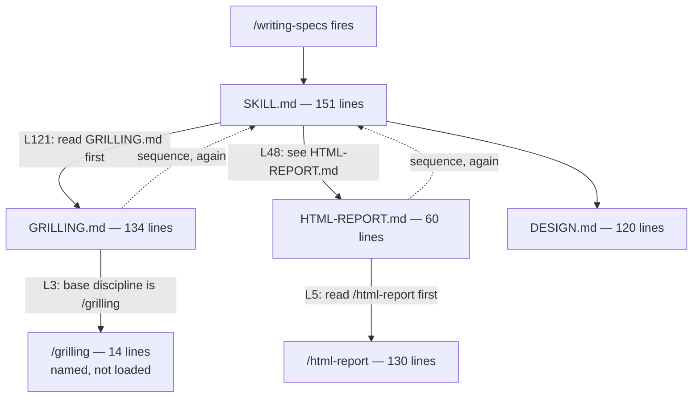
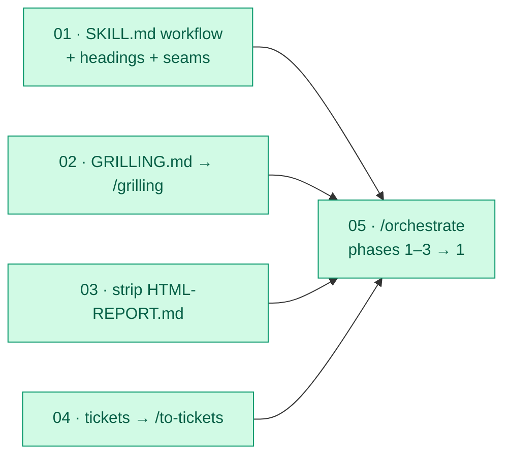

# The workflow is described once, at the top

> **Status:** shipped — step 5 superseded by [writing-messages.md](writing-messages.md)
> **Updated:** 2026-07-27
> **Vocabulary:** CONTEXT.md

> **Superseded in part.** The six-step workflow below shipped as written. Step 5 — "Run `/to-tickets`" — was
> later removed: a breakdown earns its own approval round only when something spawns work per ticket, which is
> `/orchestrate`. Steps are now numbered 1–5, with "Write `specs/<slug>.md`, once" as step 5. The rest of this
> record stands.

## Current solution

`/writing-specs` was four files, 465 lines, and it described its own sequence five times.

| File | Lines | Held |
|---|---|---|
| `writing-specs/SKILL.md` | 151 | Two-surfaces intro · where things live · research · the page · spec shape · design · style · **the sequence** · knobs |
| `writing-specs/GRILLING.md` | 134 | **Slot table · batch order · understanding batch · record/redraw loop · stop condition** · question-block format · park tangents |
| `writing-specs/HTML-REPORT.md` | 60 | **When it first renders · record vs redraw** · page section order · style notes · naming |
| `writing-specs/DESIGN.md` | 120 | Element catalogue · the four jobs · ban list — all "how", no sequence |
| `grilling/SKILL.md` | 14 | One at a time · recommend · look facts up · don't act until confirmed |
| `html-report/SKILL.md` | 130 | Audience rule · path · preview URL · Write-tool rule · scaffold · style baseline |

### The sequence was written five times

| Where | Called the steps |
|---|---|
| `SKILL.md:117-140` | Research → Grill → Approve at the page → Write the spec once → Tickets → Track |
| `SKILL.md:33-52` | The same first two steps again, in prose, under two other headings |
| `GRILLING.md:5-21, 54-70, 91-113` | Slot table → understanding batch → batch order → record/redraw → stop |
| `HTML-REPORT.md:15-52` | First render → record vs redraw → section order |
| `orchestrate/SKILL.md:21-55` | Phase 1 Alignment → Phase 2 Agreement → Phase 3 Spec and tickets |

None was marked authoritative. An agent reading three of them got three orderings that *mostly* agreed — the shape that produced the `orchestrate` self-contradiction in `7ac64c3`, where the artifact list denied what lines 43 and 78 said.

### Every grilling rule existed in four copies

| Rule | `/grilling` | `SKILL.md` | `GRILLING.md` | `orchestrate` |
|---|---|---|---|---|
| One question at a time | L8 | L123 | L70 | L27 |
| Look facts up, only ask decisions | L10 | L127 | L3, L116 | L27 |
| Recommended answer + ranked alternatives | L6 | L125 | L90 | L27 |

`GRILLING.md:3` named `/grilling` as its "base discipline" and then restated all four of its rules rather than letting the agent load it — 134 lines wrapping a 14-line skill.

### What an agent read before question one



Roughly 475 lines across four files, with the sequence restated at three of the stops.

### Two dead slots

`HTML-REPORT.md:52` ("Footer: the status line and the one next action") and `GRILLING.md:21` ("| **Next action** | Never asked. You write it. |") both outlived the rule that defined a next action. That rule — `writing-specs/SKILL.md:66`, whose worked example was `"Open backend/src/agent/mod.rs" counts` — was deleted with the lede in `5043cd3`. The slot stayed mandatory and undefined.

Its observable cost: a run producing `specs/one-e2e-suite-against-k8s.md` ended a spec awaiting approval with *"Next action: open `tests/api/fixtures/api-fixtures.ts`"* — pointing at where to type, in a plan the reader had not yet agreed to. It also contradicted `to-spec/SKILL.md`, which bans file paths in specs because they go stale.

## Planned solution

The workflow is described once, in six bullets at the top of `writing-specs/SKILL.md`. Every other file describes only *how* to do one part of it, and none of them states an ordering.

```md
1. Research the current state, and ask until you and the user see the same thing.
2. Render the page. Its first content is that shared understanding, as `## Current solution`.
3. Research and grill toward what to build, growing `## Planned solution` as you go.
4. Get the plan approved, on the page.
5. Run `/to-tickets`. The breakdown lands on the same page and gets its own approval.
6. Write `specs/<slug>.md`, once — complete, uncapped, work graph included.
```

Steps 1–3 are the user's own formulation. Steps 4–6 follow from decision 12.

`SKILL.md` then routes: `/grilling` for asking the questions, `HTML-REPORT.md` for the page layout, `DESIGN.md` for the elements, and its own body for the shape of the file written at step 6.

### Problem

Two problems, one structural and one its symptom.

**Structural:** a workflow stated in five places drifts. Nothing marks which copy is authoritative, so an edit to one leaves four contradicting it — which is exactly how `7ac64c3` shipped a self-contradiction, and how a slot survived the deletion of its own definition.

**Symptom:** the reference files had accumulated workflow, so an agent had to assemble the sequence from four documents before it could ask anything. The files meant to answer "how do I do this part well" were also answering "what do I do next", inconsistently.

### Behaviour

**Running `/writing-specs`**

* **Given** an agent invokes the skill
* **When** it reads `SKILL.md`
* **Then** the six-step workflow is the first thing in the file
  * **And** no other file it opens states an ordering

* **Given** the interview is running
* **When** an answer lands
* **Then** it is recorded on the page before the next question goes out
  * **And** a section is redrawn only if that answer made it wrong

* **Given** every section is filled or parked
* **When** the plan is approved on the page
* **Then** `/to-tickets` runs and draws the breakdown onto the same page
  * **And** only after its own approval is `specs/<slug>.md` written

**Asking a question that isn't a pick**

* **Given** the answer is "which of these N real things survive"
* **When** the agent would otherwise bundle them into 2–4 combinations
* **Then** it shows the N items, one line each, and asks which survive

### File-by-file

| File | Becomes |
|---|---|
| `writing-specs/SKILL.md` | 151 → 124. Workflow at the top, then the spec shape and writing rules |
| `writing-specs/GRILLING.md` | **Deleted.** Technique moved into `/grilling`, workflow into `SKILL.md` |
| `writing-specs/HTML-REPORT.md` | 60 → 33. Section order and style notes only |
| `writing-specs/DESIGN.md` | Unchanged — already only "how" |
| `grilling/SKILL.md` | 14 → 90. Question-block format, both question shapes, understanding, batching, tangents |
| `to-tickets/SKILL.md` | Draws the graph onto the `/writing-specs` page before its own approval |
| `orchestrate/SKILL.md` | 201 → 150. Phases 1–3 (~60 lines) → one phase (~12) |
| `to-spec/SKILL.md` | Points at step 6; `## Today` → `## Current solution` |

## Decisions

| # | Decision | Chosen | Rejected because |
|---|---|---|---|
| [1](#1-where-the-workflow-is-described) | Where the workflow is described | Once, short, at the top of `SKILL.md` | Four restatements drift; nobody knows which is authoritative |
| [2](#2-what-reference-files-hold) | Reference files | Describe *how* to do one part. No sequence, no ordering | Workflow scattered into references is workflow you have to assemble |
| [3](#3-section-names) | Research section name | `## Current solution` | `## Today` reads as a date, not as a subject |
| [4](#3-section-names) | Where the plan accumulates | `## Planned solution`, grown through step 3 | A decision table alone is a record of picks, not a specification |
| [5](#5-grillingmd-is-deleted) | `GRILLING.md` | Deleted — technique moves into `/grilling` | 134 lines restating a 14-line skill |
| [6](#6-the-lede-lives-on-the-page) | Where the lede lives | The page only, updated while working | A lede in both surfaces means two tops to keep in sync |
| [7](#3-section-names) | Heading set | Page and file mirror each other; `Planned solution` absorbs Problem / Solution / Behaviour | One name on screen and three in the file is the gap the understanding questions exist to catch |
| [8](#8-html-reportmd-survives-as-layout) | `HTML-REPORT.md` | Kept, stripped to layout | Moving layout into `SKILL.md` re-mixes "how" with workflow; moving it into `/html-report` makes the generic file the union of every page type |
| [9](#9-seams-become-a-question) | Seams | Become a question in step 3 | Written after approval from assumptions today — nobody is asked |
| [10](#10-tickets-belong-to-to-tickets) | Tickets | Leave `/writing-specs` entirely; `/to-tickets` owns them | Two skills describing the breakdown is the duplication this change removes |
| 11 | ADR instructions | Removed from both skills | `/domain-modeling` owns ADRs |
| [12](#12-two-gates-tickets-before-the-markdown) | Where approval sits | Two gates, tickets before the markdown | Tickets after the spec means editing a file "written once"; one combined gate puts an approval in `/orchestrate` that neither skill owns |
| [13](#13-a-second-question-shape) | Question shapes | A selection-from-a-set shape alongside the ranked pick | The ranked pick cannot express "which of these eighteen survive" |

### 1. Where the workflow is described

One numbered list, at the top of `writing-specs/SKILL.md`, before anything else. Every other file — including `/orchestrate` — points at it rather than restating it.

The alternative was to keep the restatements but mark one authoritative. That fails the way comments fail: the marker is advisory, the copies still drift, and a reader who lands on a copy has no reason to suspect it.

### 2. What reference files hold

A reference file answers "how do I do this part well". It may not answer "what comes next". The test is mechanical: if a sentence could be numbered as a step, it belongs in the workflow list.

This is what makes deleting `GRILLING.md` possible — once its ordering content moves out, what remains is technique, and technique belongs to `/grilling`.

### 3. Section names

`## Today` becomes `## Current solution`; `## Planned solution` is new and absorbs `## Problem`, `## Solution` and `## Behaviour` as `###` subheadings.

The page and the file use the same names. The alternative — new names on the page, old names in the file — means "update Planned solution" is ambiguous about where, which is precisely the class of mismatch the understanding questions exist to catch.

**`Behaviour` survives as a subheading; it does not vanish.** It is the section the e2e-suite spec never grew, so demoting it must not become dropping it.

`CONTEXT.md` defines none of *spec*, *plan*, *lede*, *current solution* or *planned solution*, so there was no prior anchor and this becomes one.

### 5. `GRILLING.md` is deleted

Its 134 lines split three ways: duplication of `/grilling` (four rules), workflow (slot table, batch order, understanding batch, record/redraw, stop condition), and genuine technique.

The technique — the one-question-one-screen block, the understanding and terminology checks, batching, park-tangents — moves into `/grilling`, where it benefits every caller rather than only spec writing. The workflow moves into the six-step list. The duplication is deleted.

### 6. The lede lives on the page

The lede was removed from the markdown spec in `5043cd3`, because its cap was justified by human attention and human attention moved to the page. This confirms the other half: the lede exists on the page, is updated while working, and has no counterpart in the file.

### 8. `HTML-REPORT.md` survives as layout

Its 60 lines were ~18 workflow, ~8 duplicating `/html-report`, and ~28 genuine spec-page layout. The workflow and the duplication go; the 28 stay in place.

Deleting the file entirely would have pushed that layout either into `SKILL.md` — re-mixing "how" with workflow, the thing this change separates — or into `/html-report`, which is the generic mechanic and would become the union of every page type as `explaining-code` and `improve-codebase-architecture` followed. Both siblings keep their own `HTML-REPORT.md`; this one stays consistent with them.

### 9. Seams become a question

`## Seams and testing` was a spec heading nothing ever asked about — it got written after approval from the agent's assumptions. It becomes a question in step 3.

It also does double duty: it is the first question in the workflow that is not a ranked pick, which is what decision 13 generalises.

### 10. Tickets belong to `/to-tickets`

`/writing-specs` loses its ticket step and its `## Ticket breakdown` authorship. `/to-tickets` gains the job of drawing the dependency graph onto the `/writing-specs` page before asking for approval, and `/orchestrate` points at it rather than carrying a template.

The work graph survives as an element in `DESIGN.md` — it is still the progress display — it is simply drawn by a different skill.

### 12. Two gates, tickets before the markdown

Order: plan approved on the page → `/to-tickets` → breakdown approved → `specs/<slug>.md` written once, work graph included.

The constraint is decision 12's own predecessor: the spec is written once, after agreement. Running `/to-tickets` *after* the spec would mean editing a file one step after declaring it complete, and the work graph would land only in the document nobody reads.

The cost is real and accepted: `/writing-specs`' last step runs after another skill, so it is not a skill you can run top-to-bottom in isolation.

A single combined gate owned by `/orchestrate` was rejected for the same reason as decision 1 — it puts an approval in a third place, and the two skills already own one each.

### 13. A second question shape

Alongside the ranked pick, `/grilling` gains **selection from a set**: when the answer is "which of these real things survive, and where does each go", show every item on one line with what you'd do with it, and ask which survive.

The rule of thumb: *if you are about to bundle a list of real things into 2–4 combinations, you want this shape.* The bundles are guesses at groupings, and the user regroups in ways you didn't offer — so the bundles hide the items. The tell is finding yourself writing an option that means "some of them".

Evidence from this spec's own interview: question 4 offered four bundles for `/orchestrate` (*point / point+summary / leave / restructure*). The user asked "what's the delta to keep?", got the actual eight-item inventory, and produced four decisions in one turn — including "tickets belong to `/to-tickets`", which none of the four bundles contained.

The e2e-suite spec shows the same failure twice: *"which tiers run on k8s"* was asked as four combinations of three tiers, and the spec never asked *"here are the eighteen existing chains — which survive, what's missing?"* at all.

## Seams and testing

No automated seam — these are skill documents whose only consumer is an agent reading them. Two checks, both run:

- **Internal consistency.** No surviving reference to `GRILLING.md`, `## Today`, the lede in a markdown context, or "next action". Every relative link between skill files resolves, except three pre-existing illustrative paths in `domain-modeling/CONTEXT-FORMAT.md`.
- **The sequence appears once.** `writing-specs/SKILL.md` is the only file with a numbered workflow; `/grilling`, `HTML-REPORT.md`, `DESIGN.md`, `/to-tickets` and `/orchestrate` all point at it.

The check that matters most is a live run, and this spec is one: the workflow was used to produce itself. That run is also where decision 13 came from.

## Out of scope

- `DESIGN.md` — already only "how".
- The audience rule (HTML for humans, markdown for agents) from PR #61.
- Where spec and plan files live — `specs/plans-declare-their-state.md`.
- `explaining-code` and `improve-codebase-architecture`, which keep their own `HTML-REPORT.md` layers.

## Open questions

None.

## Ticket breakdown

Shipped in one commit — the change is a set of edits to seven skill files with no runtime surface, so the breakdown step was skipped by agreement.


